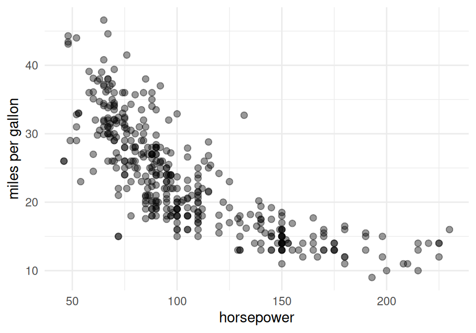

# Variance and covariance

Code

- [Show All Code](javascript:void(0))

- [Hide All Code](javascript:void(0))

- 

  ------------------------------------------------------------------------

- [View Source](javascript:void(0))

Published

Last modified: 2026-10-16 02:58:15 (PDT)

## 1 Deviation, error, and noise

> **NOTE:**
>
> **Definition 1 (Deviation)** A **deviation** is the difference between a value and a reference value. For any quantity \\z\\ and reference value \\r\\, the deviation of \\z\\ from \\r\\ is:
>
> \\z - r\\

> **NOTE:**
>
> *Remark*. In probability and statistics, “deviation” usually means deviation from a [population mean](expectation.llms.md#def-expectation).
>
> See: [Wikipedia: Deviation (statistics)](https://en.wikipedia.org/wiki/Deviation_(statistics))

> **NOTE:**
>
> **Example 1 (Deviation from a reference weight)** A newborn weighing 3,200 g deviates from a reference weight of 3,500 g by \\3200 - 3500 = -300\\ g.

> **NOTE:**
>
> **Definition 2 (Deviation from a population or subpopulation mean)** The **deviation from the mean** of a random variable \\Y\\ is its [deviation](#def-deviation) from its [expectation](expectation.llms.md#def-expectation):
>
> \\\delta(Y) \stackrel{\text{def}}{=}Y - \operatorname{E}\mathopen{}\left\[Y\right\]\mathclose{}\\
>
> For a realized observation \\y\\:
>
> \\\delta(y) \stackrel{\text{def}}{=}y - \operatorname{E}\mathopen{}\left\[Y\right\]\mathclose{}\\

> **NOTE:**
>
> *Remark*. Other sources often call this quantity an **error** or **noise term**. In regression settings, the reference mean is often conditional on covariates: \\\delta(y_i) \stackrel{\text{def}}{=}y_i - \operatorname{E}\mathopen{}\left\[Y_i \mid X_i = x_i\right\]\mathclose{}\\.
>
> These notes prefer “deviation” for this mean-deviation quantity; “error” and “noise” are common aliases. The Morrison Lab’s regression notes use “residual” (defined in their [Linear regression chapter](https://morrison-lab.github.io/rme/chapters/Linear-models-overview.html#def-resid-fitted)) for deviations from fitted values, write \\\delta(\cdot)\\ for these model/data deviations, and reserve \\\varepsilon\mathopen{}\left(\cdot\right)\mathclose{}\\ for estimator-to-estimand deviations (see [Estimation](https://morrison-lab.github.io/sds/estimation.html#def-estimation-error)).
>
> See:
>
> - [Wikipedia: Errors and residuals](https://en.wikipedia.org/wiki/Errors_and_residuals)
> - [Wikipedia: Deviation (statistics)](https://en.wikipedia.org/wiki/Deviation_(statistics))
> - [Wikipedia: Linear regression — Notation and terminology](https://en.wikipedia.org/wiki/Linear_regression#Notation_and_terminology)

> **NOTE:**
>
> **Example 2 (Deviation of a die roll from its mean)** A fair die roll \\Y\\ has \\\operatorname{E}\mathopen{}\left\[Y\right\]\mathclose{} = 3.5\\ (computed on the [expectation page](expectation.llms.md#exm-linearity-expectation)), so a roll of \\y = 5\\ has deviation
>
> \\ \begin{aligned} \delta(5) &= 5 - 3.5 \\ &= 1.5, \end{aligned} \\
>
> and a roll of \\y = 2\\ has deviation
>
> \\ \begin{aligned} \delta(2) &= 2 - 3.5 \\ &= -1.5. \end{aligned} \\

### 1.1 Mean-zero noise model

Measurement noise is almost always modeled as a random variable \\\varepsilon\\ with **mean zero** and variance \\\sigma^2\\.

> **NOTE:**
>
> *Remark 1* (Mean zero is a parametrization choice). Mean zero is a parametrization choice, not a substantive assumption. In \\Y = f(x) + \varepsilon\\, moving a constant from \\\varepsilon\\ into \\f(x)\\ changes the split but not the distribution of \\Y\\, so the data identify only the sum \\f(x) + \operatorname{E}\mathopen{}\left\[\varepsilon\right\]\mathclose{}\\, the mean of \\Y\\ at \\x\\. Requiring \\\operatorname{E}\mathopen{}\left\[\varepsilon\right\]\mathclose{} = 0\\ picks the one split in which \\f(x)\\ is that mean. This loses no generality when the model for \\f\\ can absorb a constant, as any model with an intercept can. It restricts the model only when \\f\\ cannot absorb one, as in a regression through the origin.

Mean zero gives one identity, used repeatedly across statistical modeling and machine learning.

> **NOTE:**
>
> **Exercise 1 (The average squared error of pure noise)** Let \\\varepsilon\\ be a random variable with \\\operatorname{E}\[\varepsilon\] = 0\\ and \\\operatorname{Var}\mathopen{}\left(\varepsilon\right)\mathclose{} = \sigma^2\\.
>
> Find \\\operatorname{E}\[\varepsilon^2\]\\ in terms of \\\sigma^2\\, and say which earlier result you used.

> **NOTE:**
>
> *Solution 1*. [Theorem 3](#thm-variance) says \\\operatorname{Var}\mathopen{}\left(X\right)\mathclose{} = \operatorname{E}\[X^2\] - (\operatorname{E}\[X\])^2\\ for any \\X\\. Taking \\X = \varepsilon\\ and substituting \\\operatorname{E}\[\varepsilon\] = 0\\,
>
> \\ \begin{aligned} \operatorname{E}\[\varepsilon^2\] &= \operatorname{Var}\mathopen{}\left(\varepsilon\right)\mathclose{} + 0^2 \\ &= \sigma^2 \end{aligned} \tag{1}\\
>
> so for mean-zero noise the average squared value *is* the variance.
>
> The identity looks slight and does a lot of work. [Equation 1](#eq-noise-second-moment) is the step that produces the irreducible error term in regression and statistical modeling: it converts a statement about the *spread* of the noise, which is what a model of the world gives you, into a statement about *squared error*, which is what the fitting objective measures.

> **NOTE:**
>
> **Theorem 1 (The second moment of mean-zero noise)** Let \\\varepsilon\\ be a random variable with \\\operatorname{E}\[\varepsilon\] = 0\\ and \\\operatorname{Var}\mathopen{}\left(\varepsilon\right)\mathclose{} = \sigma^2\\. Then
>
> \\\operatorname{E}\[\varepsilon^2\] = \sigma^2\\

> **NOTE:**
>
> *Proof*. This is the solution to [Exercise 1](#exr-noise-second-moment), worked in [Solution 1](#sol-noise-second-moment). It rearranges [Theorem 3](#thm-variance), using \\\operatorname{E}\[\varepsilon\] = 0\\.

## 2 Variance and related characteristics

> **NOTE:**
>
> **Definition 3 (Variance)** The **variance** of a random variable \\X\\ with \\\operatorname{E}\mathopen{}\left\[X^2\right\]\mathclose{} \< \infty\\ is the [expectation](expectation.llms.md#def-expectation) of the squared [deviation from the mean](#def-deviation-pop-mean); that is:
>
> \\\operatorname{Var}\mathopen{}\left(X\right)\mathclose{} \stackrel{\text{def}}{=}\operatorname{E}\mathopen{}\left\[\[\delta(X)\]^2\right\]\mathclose{}\\

> **NOTE:**
>
> **Theorem 2 (Variance as expected squared deviation from the mean)** \\\operatorname{Var}\mathopen{}\left(X\right)\mathclose{} = \operatorname{E}\mathopen{}\left\[(X - \operatorname{E}\mathopen{}\left\[X\right\]\mathclose{})^2\right\]\mathclose{}\\

> **NOTE:**
>
> *Proof*. Substituting the definition of \\\delta(X)\\ from [Definition 2](#def-deviation-pop-mean) into [Definition 3](#def-variance):
>
> \\ \operatorname{Var}\mathopen{}\left(X\right)\mathclose{} \stackrel{\text{def}}{=}\operatorname{E}\mathopen{}\left\[\[\delta(X)\]^2\right\]\mathclose{} = \operatorname{E}\mathopen{}\left\[(X - \operatorname{E}\mathopen{}\left\[X\right\]\mathclose{})^2\right\]\mathclose{}. \\

> **NOTE:**
>
> *Remark*. This is the more commonly seen form of the variance definition, and the canonical starting point in most treatments; it’s given here as a theorem rather than the primary definition to keep \\\delta(X)\\ as the definition’s single building block, matching the notation of [Definition 2](#def-deviation-pop-mean).

> **NOTE:**
>
> **Theorem 3 (Simplified expression for variance)** \\\operatorname{Var}\mathopen{}\left(X\right)\mathclose{}=\operatorname{E}\mathopen{}\left\[X^2\right\]\mathclose{} - {\mathopen{}\left(\operatorname{E}\mathopen{}\left\[X\right\]\mathclose{}\right)\mathclose{}}^2\\

> **NOTE:**
>
> *Proof*. By [linearity of expectation](expectation.llms.md#thm-linearity-expectation), with \\\operatorname{E}\mathopen{}\left\[X\right\]\mathclose{}\\ treated as a constant:
>
> \\ \begin{aligned} \operatorname{Var}\mathopen{}\left(X\right)\mathclose{} &\stackrel{\text{def}}{=}\operatorname{E}\mathopen{}\left\[\[\delta(X)\]^2\right\]\mathclose{} && \text{(definition of variance)} \\ &= \operatorname{E}\mathopen{}\left\[(X-\operatorname{E}\mathopen{}\left\[X\right\]\mathclose{})^2\right\]\mathclose{} && \text{(definition of deviation from mean)} \\ &=\operatorname{E}\mathopen{}\left\[X^2 - 2X\operatorname{E}\mathopen{}\left\[X\right\]\mathclose{} + {\mathopen{}\left(\operatorname{E}\mathopen{}\left\[X\right\]\mathclose{}\right)\mathclose{}}^2\right\]\mathclose{} && \text{(expand binomial square)} \\ &=\operatorname{E}\mathopen{}\left\[X^2\right\]\mathclose{} - 2\operatorname{E}\mathopen{}\left\[X\right\]\mathclose{}\operatorname{E}\mathopen{}\left\[X\right\]\mathclose{} + {\mathopen{}\left(\operatorname{E}\mathopen{}\left\[X\right\]\mathclose{}\right)\mathclose{}}^2 && \text{(linearity of expectation; } \operatorname{E}\mathopen{}\left\[X\right\]\mathclose{} \text{ is a constant)} \\ &=\operatorname{E}\mathopen{}\left\[X^2\right\]\mathclose{} - {\mathopen{}\left(\operatorname{E}\mathopen{}\left\[X\right\]\mathclose{}\right)\mathclose{}}^2 && \text{(combine like terms)} \end{aligned} \\

> **NOTE:**
>
> **Example 3 (Variance of a Bernoulli random variable)** Let \\X \sim \operatorname{Ber}(\pi)\\. Then \\\operatorname{E}\mathopen{}\left\[X\right\]\mathclose{} = \pi\\ and \\\operatorname{E}\mathopen{}\left\[X^2\right\]\mathclose{} = \pi\\ (both computed on the [expectation page](expectation.llms.md#exm-lotus)), so:
>
> \\ \begin{aligned} \operatorname{Var}\mathopen{}\left(X\right)\mathclose{} &= \operatorname{E}\mathopen{}\left\[X^2\right\]\mathclose{} - {\mathopen{}\left(\operatorname{E}\mathopen{}\left\[X\right\]\mathclose{}\right)\mathclose{}}^2 && \text{(simplified expression for variance)} \\ &= \pi- \pi^2 && \text{(substitute)} \\ &= \pi(1 - \pi) && \text{(factor)} \end{aligned} \\
>
> For a fair coin (\\\pi= 1/2\\), \\\operatorname{Var}\mathopen{}\left(X\right)\mathclose{} = 1/4\\.

> **NOTE:**
>
> **Definition 4 (Conditional variance)** The **conditional variance** of \\Y\\ given \\X = x\\ is the variance of \\Y\\ under its conditional distribution given \\X = x\\:
>
> \\\operatorname{Var}\mathopen{}\left(Y \mid X = x\right)\mathclose{} \stackrel{\text{def}}{=}\operatorname{E}\mathopen{}\left\[\mathopen{}\left(Y - \operatorname{E}\mathopen{}\left\[Y \mid X = x\right\]\mathclose{}\right)\mathclose{}^2 \mid X = x\right\]\mathclose{}\\
>
> Evaluating this function of \\x\\ at \\X\\ gives the random variable \\\operatorname{Var}\mathopen{}\left(Y \mid X\right)\mathclose{}\\, just as the [conditional expectation function](expectation.llms.md#def-cond-expectation-function) \\\operatorname{E}\mathopen{}\left\[Y \mid X\right\]\mathclose{}\\ comes from \\\operatorname{E}\mathopen{}\left\[Y \mid X = x\right\]\mathclose{}\\.

> **NOTE:**
>
> **Example 4 (Conditional variance of a binary outcome)** Let \\(X, Y)\\ have the joint PMF \\\operatorname{P}(X=0, Y=0) = 0.2\\, \\\operatorname{P}(X=0, Y=1) = 0.3\\, \\\operatorname{P}(X=1, Y=0) = 0.1\\, \\\operatorname{P}(X=1, Y=1) = 0.4\\ (the table in the [expectation page’s exercise](expectation.llms.md#exr-fubini-joint-disc)). Given \\X = 0\\, \\Y\\ is binary with
>
> \\ \begin{aligned} \operatorname{P}(Y = 1 \mid X = 0) &= 0.3/0.5 \\ &= 0.6, \end{aligned} \\
>
> so \\\operatorname{E}\mathopen{}\left\[Y \mid X = 0\right\]\mathclose{} = 0.6\\, and by [Definition 4](#def-cond-variance):
>
> \\ \begin{aligned} \operatorname{Var}\mathopen{}\left(Y \mid X = 0\right)\mathclose{} &= (0 - 0.6)^2 \cdot 0.4 + (1 - 0.6)^2 \cdot 0.6 && \text{(definition of conditional variance)} \\ &= 0.144 + 0.096 && \text{(multiply)} \\ &= 0.24 && \text{(add)} \end{aligned} \\
>
> The same steps with
>
> \\ \begin{aligned} \operatorname{P}(Y = 1 \mid X = 1) &= 0.4/0.5 \\ &= 0.8 \end{aligned} \\
>
> give
>
> \\ \begin{aligned} \operatorname{Var}\mathopen{}\left(Y \mid X = 1\right)\mathclose{} &= (0.2)^2 \cdot 0.8 + (0.8)^2 \cdot 0.2 \\ &= 0.16. \end{aligned} \\

> **NOTE:**
>
> **Definition 5 (Homoskedasticity)** A random variable \\Y\\ is **homoskedastic** with respect to a random variable (or vector) \\X\\ if the [conditional variance](#def-cond-variance) of \\Y\\ given \\X = x\\ is the same for every \\x\\:
>
> \\\operatorname{Var}\mathopen{}\left(Y \mid X = x\right)\mathclose{} = \sigma^2\quad \text{for all } x\\
>
> for some constant \\\sigma^2\\.

> **NOTE:**
>
> **Example 5 (A homoskedastic total)** Flip two fair coins, let \\X_1\\ indicate heads on the first, and let \\Y\\ be the total number of heads. Given \\X_1 = 0\\, \\Y\\ is \\0\\ or \\1\\ with probability \\1/2\\ each; given \\X_1 = 1\\, \\Y\\ is \\1\\ or \\2\\ with probability \\1/2\\ each. Either way, \\Y\\ is \\1/2\\ away from its conditional mean with probability 1, so
>
> \\ \begin{aligned} \operatorname{Var}\mathopen{}\left(Y \mid X_1 = 0\right)\mathclose{} &= \operatorname{Var}\mathopen{}\left(Y \mid X_1 = 1\right)\mathclose{} \\ &= 1/4, \end{aligned} \\
>
> and \\Y\\ is homoskedastic with respect to \\X_1\\, with \\\sigma^2= 1/4\\.

> **NOTE:**
>
> **Definition 6 (Heteroskedasticity)** A random variable \\Y\\ is **heteroskedastic** with respect to \\X\\ if it is not [homoskedastic](#def-homosked) with respect to \\X\\: that is, if \\\operatorname{Var}\mathopen{}\left(Y \mid X = x\right)\mathclose{}\\ differs between some values of \\x\\.

> **NOTE:**
>
> **Example 6 (A heteroskedastic binary outcome)** In [Example 4](#exm-cond-variance),
>
> \\ \begin{aligned} \operatorname{Var}\mathopen{}\left(Y \mid X = 0\right)\mathclose{} &= 0.24 \\ &\ne 0.16 \\ &= \operatorname{Var}\mathopen{}\left(Y \mid X = 1\right)\mathclose{}, \end{aligned} \\
>
> so \\Y\\ is heteroskedastic with respect to \\X\\. More generally, a binary outcome with \\\operatorname{P}(Y = 1 \mid X = x) = \pi(x)\\ has conditional variance \\\pi(x)(1 - \pi(x))\\, so it is homoskedastic only if \\\pi(x)\\ takes at most two values, \\\pi\\ and \\1 - \pi\\, for some \\\pi\\.

> **NOTE:**
>
> **Theorem 4 (Law of total variance)** For random variables \\X\\ and \\Y\\ with \\\operatorname{E}\mathopen{}\left\[Y^2\right\]\mathclose{} \< \infty\\:
>
> \\\operatorname{Var}\mathopen{}\left(Y\right)\mathclose{} = \operatorname{E}\mathopen{}\left\[\operatorname{Var}\mathopen{}\left(Y \mid X\right)\mathclose{}\right\]\mathclose{} + \operatorname{Var}\mathopen{}\left(\operatorname{E}\mathopen{}\left\[Y \mid X\right\]\mathclose{}\right)\mathclose{}\\

> **NOTE:**
>
> *Proof*. Write \\\mu\stackrel{\text{def}}{=}\operatorname{E}\mathopen{}\left\[Y\right\]\mathclose{}\\ and \\m(X) \stackrel{\text{def}}{=}\operatorname{E}\mathopen{}\left\[Y \mid X\right\]\mathclose{}\\. Adding and subtracting \\m(X)\\ inside the deviation and expanding the square:
>
> \\ \begin{aligned} \operatorname{Var}\mathopen{}\left(Y\right)\mathclose{} &= \operatorname{E}\mathopen{}\left\[\mathopen{}\left(Y - \mu\right)\mathclose{}^2\right\]\mathclose{} && \text{(definition of variance)} \\ &= \operatorname{E}\mathopen{}\left\[\mathopen{}\left(\mathopen{}\left\[Y - m(X)\right\]\mathclose{} + \mathopen{}\left\[m(X) - \mu\right\]\mathclose{}\right)\mathclose{}^2\right\]\mathclose{} && \text{(add and subtract } m(X) \text{)} \\ &= \operatorname{E}\mathopen{}\left\[{\mathopen{}\left(Y - m(X)\right)\mathclose{}}^2\right\]\mathclose{} + \operatorname{E}\mathopen{}\left\[{\mathopen{}\left(m(X) - \mu\right)\mathclose{}}^2\right\]\mathclose{} + 2\operatorname{E}\mathopen{}\left\[\mathopen{}\left\[Y - m(X)\right\]\mathclose{}\mathopen{}\left\[m(X) - \mu\right\]\mathclose{}\right\]\mathclose{} && \text{(expand the square; linearity of expectation)} \end{aligned} \\
>
> The three terms are handled separately, each using the [law of iterated expectations](expectation.llms.md#thm-lie), applied to a function of \\X\\ and \\Y\\ ([conditional expectation of a function](expectation.llms.md#def-cond-expectation-general)). The third term also uses two facts about conditional expectations: a [function of \\X\\ factors out of a conditional expectation given \\X\\](expectation.llms.md#thm-cond-pull-out), and [conditional expectation is linear](expectation.llms.md#thm-cond-linearity).
>
> First term:
>
> \\ \begin{aligned} \operatorname{E}\mathopen{}\left\[{\mathopen{}\left(Y - m(X)\right)\mathclose{}}^2\right\]\mathclose{} &= \operatorname{E}\mathopen{}\left\[\operatorname{E}\mathopen{}\left\[{\mathopen{}\left(Y - m(X)\right)\mathclose{}}^2 \mid X\right\]\mathclose{}\right\]\mathclose{} && \text{(law of iterated expectations)} \\ &= \operatorname{E}\mathopen{}\left\[\operatorname{Var}\mathopen{}\left(Y \mid X\right)\mathclose{}\right\]\mathclose{} && \text{(definition of conditional variance)} \end{aligned} \\
>
> Second term: by the law of iterated expectations,
>
> \\ \begin{aligned} \operatorname{E}\mathopen{}\left\[m(X)\right\]\mathclose{} &= \operatorname{E}\mathopen{}\left\[\operatorname{E}\mathopen{}\left\[Y \mid X\right\]\mathclose{}\right\]\mathclose{} \\ &= \mu, \end{aligned} \\
>
> so:
>
> \\ \begin{aligned} \operatorname{E}\mathopen{}\left\[{\mathopen{}\left(m(X) - \mu\right)\mathclose{}}^2\right\]\mathclose{} &= \operatorname{E}\mathopen{}\left\[{\mathopen{}\left(m(X) - \operatorname{E}\mathopen{}\left\[m(X)\right\]\mathclose{}\right)\mathclose{}}^2\right\]\mathclose{} && \text{(} \mu= \operatorname{E}\mathopen{}\left\[m(X)\right\]\mathclose{} \text{)} \\ &= \operatorname{Var}\mathopen{}\left(m(X)\right)\mathclose{} && \text{(definition of variance)} \\ &= \operatorname{Var}\mathopen{}\left(\operatorname{E}\mathopen{}\left\[Y \mid X\right\]\mathclose{}\right)\mathclose{} && \text{(definition of } m(X) \text{)} \end{aligned} \\
>
> Third term:
>
> \\ \begin{aligned} \operatorname{E}\mathopen{}\left\[\mathopen{}\left\[Y - m(X)\right\]\mathclose{}\mathopen{}\left\[m(X) - \mu\right\]\mathclose{}\right\]\mathclose{} &= \operatorname{E}\mathopen{}\left\[\operatorname{E}\mathopen{}\left\[\mathopen{}\left\[Y - m(X)\right\]\mathclose{}\mathopen{}\left\[m(X) - \mu\right\]\mathclose{} \mid X\right\]\mathclose{}\right\]\mathclose{} && \text{(law of iterated expectations)} \\ &= \operatorname{E}\mathopen{}\left\[\mathopen{}\left\[m(X) - \mu\right\]\mathclose{} \cdot\operatorname{E}\mathopen{}\left\[Y - m(X) \mid X\right\]\mathclose{}\right\]\mathclose{} && \text{(a function of } X \text{ factors out, with } g(X) = m(X) - \mu\text{)} \\ &= \operatorname{E}\mathopen{}\left\[\mathopen{}\left\[m(X) - \mu\right\]\mathclose{} \cdot\mathopen{}\left\[\operatorname{E}\mathopen{}\left\[Y \mid X\right\]\mathclose{} - \operatorname{E}\mathopen{}\left\[m(X) \mid X\right\]\mathclose{}\right\]\mathclose{}\right\]\mathclose{} && \text{(linearity of conditional expectation)} \\ &= \operatorname{E}\mathopen{}\left\[\mathopen{}\left\[m(X) - \mu\right\]\mathclose{} \cdot\mathopen{}\left\[\operatorname{E}\mathopen{}\left\[Y \mid X\right\]\mathclose{} - m(X)\right\]\mathclose{}\right\]\mathclose{} && \text{(} \operatorname{E}\mathopen{}\left\[g(X) \mid X\right\]\mathclose{} = g(X) \text{, with } g = m \text{)} \\ &= \operatorname{E}\mathopen{}\left\[\mathopen{}\left\[m(X) - \mu\right\]\mathclose{} \cdot 0\right\]\mathclose{} && \text{(} \operatorname{E}\mathopen{}\left\[Y \mid X\right\]\mathclose{} = m(X) \text{)} \\ &= 0 && \text{(expectation of a constant)} \end{aligned} \\
>
> Substituting the three terms:
>
> \\ \begin{aligned} \operatorname{Var}\mathopen{}\left(Y\right)\mathclose{} &= \operatorname{E}\mathopen{}\left\[\operatorname{Var}\mathopen{}\left(Y \mid X\right)\mathclose{}\right\]\mathclose{} + \operatorname{Var}\mathopen{}\left(\operatorname{E}\mathopen{}\left\[Y \mid X\right\]\mathclose{}\right)\mathclose{} + 2 \cdot 0 && \text{(substitute the three terms)} \\ &= \operatorname{E}\mathopen{}\left\[\operatorname{Var}\mathopen{}\left(Y \mid X\right)\mathclose{}\right\]\mathclose{} + \operatorname{Var}\mathopen{}\left(\operatorname{E}\mathopen{}\left\[Y \mid X\right\]\mathclose{}\right)\mathclose{} && \text{(simplify)} \end{aligned} \\

> **NOTE:**
>
> *Remark*. Alternate names include: the **conditional variance formula**, **Eve’s law**, and the **variance decomposition formula**.

> **NOTE:**
>
> **Example 7 (Decomposing the variance of a binary outcome)** Continuing [Example 4](#exm-cond-variance),
>
> \\ \begin{aligned} \operatorname{P}(X = 0) &= \operatorname{P}(X = 1) \\ &= 0.5, \end{aligned} \\
>
> \\\operatorname{E}\mathopen{}\left\[Y \mid X = 0\right\]\mathclose{} = 0.6\\, and \\\operatorname{E}\mathopen{}\left\[Y \mid X = 1\right\]\mathclose{} = 0.8\\, so \\\operatorname{E}\mathopen{}\left\[\operatorname{E}\mathopen{}\left\[Y \mid X\right\]\mathclose{}\right\]\mathclose{} = 0.7\\, and by [Theorem 4](#thm-total-variance):
>
> \\ \begin{aligned} \operatorname{E}\mathopen{}\left\[\operatorname{Var}\mathopen{}\left(Y \mid X\right)\mathclose{}\right\]\mathclose{} &= 0.5 \cdot 0.24 + 0.5 \cdot 0.16 && \text{(average the conditional variances)} \\ &= 0.20 \\ \operatorname{Var}\mathopen{}\left(\operatorname{E}\mathopen{}\left\[Y \mid X\right\]\mathclose{}\right)\mathclose{} &= 0.5 \cdot(0.6 - 0.7)^2 + 0.5 \cdot(0.8 - 0.7)^2 && \text{(variance of the conditional means)} \\ &= 0.01 \\ \operatorname{Var}\mathopen{}\left(Y\right)\mathclose{} &= 0.20 + 0.01 && \text{(law of total variance)} \\ &= 0.21 \end{aligned} \\
>
> As a check, \\Y\\ is Bernoulli with
>
> \\ \begin{aligned} \operatorname{P}(Y = 1) &= 0.3 + 0.4 \\ &= 0.7, \end{aligned} \\
>
> so by [Example 3](#exm-variance-bernoulli),
>
> \\ \begin{aligned} \operatorname{Var}\mathopen{}\left(Y\right)\mathclose{} &= 0.7 \cdot 0.3 \\ &= 0.21. \end{aligned} \\

> **NOTE:**
>
> **Definition 7 (Precision)** The **precision** of a random variable \\X\\, often denoted \\\tau(X)\\, \\\tau_X\\, or shorthanded as \\\tau\\, is the inverse of that random variable’s [variance](#def-variance) (for \\\operatorname{Var}\mathopen{}\left(X\right)\mathclose{} \> 0\\); that is:
>
> \\\tau(X) \stackrel{\text{def}}{=}{\mathopen{}\left(\operatorname{Var}\mathopen{}\left(X\right)\mathclose{}\right)\mathclose{}}^{-1}\\

> **NOTE:**
>
> **Definition 8 (Standard deviation)** The **standard deviation** of a random variable \\X\\ is the square root of the [variance](#def-variance) of \\X\\:
>
> \\\operatorname{SD}\mathopen{}\left(X\right)\mathclose{} \stackrel{\text{def}}{=}\sqrt{\operatorname{Var}\mathopen{}\left(X\right)\mathclose{}}\\

> **NOTE:**
>
> *Remark*. The standard deviation is on the same scale as \\X\\ itself (unlike the variance, which is on the scale of \\X\\’s square), which is why it is often the preferred measure of spread when reporting results.

> **NOTE:**
>
> **Example 8 (Precision and standard deviation of a fair coin flip)** In [Example 3](#exm-variance-bernoulli), a fair coin flip has \\\operatorname{Var}\mathopen{}\left(X\right)\mathclose{} = 1/4\\, so its precision is
>
> \\ \begin{aligned} \tau(X) &= 1 / (1/4) \\ &= 4 \end{aligned} \\
>
> and its standard deviation is
>
> \\ \begin{aligned} \operatorname{SD}\mathopen{}\left(X\right)\mathclose{} &= \sqrt{1/4} \\ &= 1/2. \end{aligned} \\

## 3 The best constant prediction

> **NOTE:**
>
> **Theorem 5 (Expected squared error of a constant prediction)** Let \\Y\\ be a random variable with mean \\\mu\\ and finite variance. Then for every number \\c\\,
>
> \\ \operatorname{E}\mathopen{}\left\[{\mathopen{}\left(Y - c\right)\mathclose{}}^2\right\]\mathclose{} = \operatorname{Var}\mathopen{}\left(Y\right)\mathclose{} + {\mathopen{}\left(\mu- c\right)\mathclose{}}^2. \tag{2}\\

> **NOTE:**
>
> *Proof*. Add and subtract \\\mu\\ inside the square, expand it, and take the expectation term by term:
>
> \\ \begin{aligned} \operatorname{E}\mathopen{}\left\[{\mathopen{}\left(Y - c\right)\mathclose{}}^2\right\]\mathclose{} &= \operatorname{E}\mathopen{}\left\[{\mathopen{}\left((Y - \mu) + (\mu- c)\right)\mathclose{}}^2\right\]\mathclose{} && \text{(add and subtract } \mu\text{)} \\ &= \operatorname{E}\mathopen{}\left\[{\mathopen{}\left(Y - \mu\right)\mathclose{}}^2 + 2(\mu- c)(Y - \mu) + {\mathopen{}\left(\mu- c\right)\mathclose{}}^2\right\]\mathclose{} && \text{(expand the square of a sum)} \\ &= \operatorname{E}\mathopen{}\left\[{\mathopen{}\left(Y - \mu\right)\mathclose{}}^2\right\]\mathclose{} + 2(\mu- c)\operatorname{E}\mathopen{}\left\[Y - \mu\right\]\mathclose{} + {\mathopen{}\left(\mu- c\right)\mathclose{}}^2 && \text{(linearity of expectation; } \mu\text{ and } c \text{ are constants)} \\ &= \operatorname{Var}\mathopen{}\left(Y\right)\mathclose{} + 2(\mu- c)\operatorname{E}\mathopen{}\left\[Y - \mu\right\]\mathclose{} + {\mathopen{}\left(\mu- c\right)\mathclose{}}^2 && \text{(variance as expected squared deviation)} \\ &= \operatorname{Var}\mathopen{}\left(Y\right)\mathclose{} + 2(\mu- c) \cdot 0 + {\mathopen{}\left(\mu- c\right)\mathclose{}}^2 && \text{(} \operatorname{E}\mathopen{}\left\[Y - \mu\right\]\mathclose{} = \operatorname{E}\mathopen{}\left\[Y\right\]\mathclose{} - \mu= 0 \text{)} \\ &= \operatorname{Var}\mathopen{}\left(Y\right)\mathclose{} + {\mathopen{}\left(\mu- c\right)\mathclose{}}^2 && \text{(zero times a number)} \end{aligned} \\

> **NOTE:**
>
> **Corollary 1 (The mean is the best constant prediction under squared error)** Under the assumptions of [Theorem 5](#thm-constant-prediction-decompose),
>
> \\ \arg \min\_{c \in \mathbb{R}} \operatorname{E}\mathopen{}\left\[{\mathopen{}\left(Y - c\right)\mathclose{}}^2\right\]\mathclose{} = \mathopen{}\left\\\mu\right\\\mathclose{} \quad \text{and} \quad \min\_{c \in \mathbb{R}} \operatorname{E}\mathopen{}\left\[{\mathopen{}\left(Y - c\right)\mathclose{}}^2\right\]\mathclose{} = \operatorname{Var}\mathopen{}\left(Y\right)\mathclose{}, \\
>
> where \\\arg \min\\ is the [set of minimizers](https://morrison-lab.github.io/mds/algebra-basics.html#def-argmin).

> **NOTE:**
>
> *Proof*. In [Equation 2](#eq-constant-prediction-decompose) the first term, \\\operatorname{Var}\mathopen{}\left(Y\right)\mathclose{}\\, does not depend on \\c\\. The second term, \\{\mathopen{}\left(\mu- c\right)\mathclose{}}^2\\, is a square, so it is never negative, and it is zero exactly when \\c = \mu\\. So \\c = \mu\\ minimizes the expected squared error and no other number does, and at \\c = \mu\\ the expected squared error is \\\operatorname{Var}\mathopen{}\left(Y\right)\mathclose{}\\.

> **NOTE:**
>
> **Example 9 (The best constant prediction of fuel economy)** Take the 392 cars in the Auto data [described on the limit theorems page](limit-theorems.llms.md#exm-clt-auto) as the whole population, and predict the fuel economy (`mpg`) of a car drawn at random with one number \\c\\. The code below computes the expected squared error of three constants, and sets each beside the right side of [Equation 2](#eq-constant-prediction-decompose).
>
> ``` r
> mpg <- read.csv("data/auto.csv")$mpg
> mu <- mean(mpg)
> sigma2 <- mean((mpg - mu)^2)
>
> c_values <- c(mean = mu, median = median(mpg), twenty = 20)
> data.frame(
>   c = c_values,
>   expected_squared_error = sapply(c_values, function(cc) mean((mpg - cc)^2)),
>   decomposition = sigma2 + (mu - c_values)^2
> )
> ```
>
> The two columns agree, as [Theorem 5](#thm-constant-prediction-decompose) says. The mean, 23.45, has the smallest expected squared error, 60.76, which is the variance of `mpg` over these cars (divisor the number of cars, not one fewer), as [Corollary 1](#cor-best-constant) says; the median and \\c = 20\\ are each worse by \\{\mathopen{}\left(\mu- c\right)\mathclose{}}^2\\.

## 4 Independent noise plus a random variable

> **NOTE:**
>
> **Theorem 6 (The second moment of independent noise plus a random variable)** Let \\\varepsilon\\ be a random variable with \\\operatorname{E}\mathopen{}\left\[\varepsilon\right\]\mathclose{} = 0\\ and \\\operatorname{Var}\mathopen{}\left(\varepsilon\right)\mathclose{} = \sigma^2\\. Let \\X\\ be a random variable with \\\operatorname{E}\mathopen{}\left\[X^2\right\]\mathclose{} \< \infty\\ that is independent of \\\varepsilon\\. Then
>
> \\\operatorname{E}\mathopen{}\left\[\mathopen{}\left(\varepsilon+ X\right)\mathclose{}^2\right\]\mathclose{} = \sigma^2+ \operatorname{Var}\mathopen{}\left(X\right)\mathclose{} + {\mathopen{}\left(\operatorname{E}\mathopen{}\left\[X\right\]\mathclose{}\right)\mathclose{}}^2\\

> **NOTE:**
>
> *Proof*. Expanding the square and using [linearity of expectation](expectation.llms.md#thm-linearity-expectation), first for the expectation of a sum and then for a constant factor,
>
> \\ \begin{aligned} \operatorname{E}\mathopen{}\left\[\mathopen{}\left(\varepsilon+ X\right)\mathclose{}^2\right\]\mathclose{} &= \operatorname{E}\mathopen{}\left\[\varepsilon^2 + 2 \varepsilon X+ X^2\right\]\mathclose{} && \text{(expand: } \mathopen{}\left(a + b\right)\mathclose{}^2 = a^2 + 2ab + b^2 \text{)} \\ &= \operatorname{E}\mathopen{}\left\[\varepsilon^2\right\]\mathclose{} + \operatorname{E}\mathopen{}\left\[2 \varepsilon X\right\]\mathclose{} + \operatorname{E}\mathopen{}\left\[X^2\right\]\mathclose{} && \text{(expectation of a sum)} \\ &= \operatorname{E}\mathopen{}\left\[\varepsilon^2\right\]\mathclose{} + 2\operatorname{E}\mathopen{}\left\[\varepsilon X\right\]\mathclose{} + \operatorname{E}\mathopen{}\left\[X^2\right\]\mathclose{} && \text{(constant factor 2)} \end{aligned} \\
>
> Each of the three terms is evaluated in turn.
>
> - \\\operatorname{E}\mathopen{}\left\[\varepsilon^2\right\]\mathclose{} = \sigma^2\\, by [Theorem 1](#thm-noise-second-moment).
>
> - Because \\\varepsilon\\ and \\X\\ are independent, the expectation of the product is the product of the expectations:
>
>   \\ \begin{aligned} \operatorname{E}\mathopen{}\left\[\varepsilon X\right\]\mathclose{} &= \operatorname{E}\mathopen{}\left\[\varepsilon\right\]\mathclose{}\operatorname{E}\mathopen{}\left\[X\right\]\mathclose{} && \text{(independence)} \\ &= 0 \cdot \operatorname{E}\mathopen{}\left\[X\right\]\mathclose{} && \text{(} \operatorname{E}\mathopen{}\left\[\varepsilon\right\]\mathclose{} = 0 \text{)} \\ &= 0 && \text{(zero times a number)} \end{aligned} \\
>
> - \\\operatorname{E}\mathopen{}\left\[X^2\right\]\mathclose{} = \operatorname{Var}\mathopen{}\left(X\right)\mathclose{} + {\mathopen{}\left(\operatorname{E}\mathopen{}\left\[X\right\]\mathclose{}\right)\mathclose{}}^2\\, by [Theorem 3](#thm-variance).
>
> Substituting the three terms gives
>
> \\ \begin{aligned} \operatorname{E}\mathopen{}\left\[\mathopen{}\left(\varepsilon+ X\right)\mathclose{}^2\right\]\mathclose{} &= \sigma^2+ 2 \cdot 0 + \mathopen{}\left(\operatorname{Var}\mathopen{}\left(X\right)\mathclose{} + {\mathopen{}\left(\operatorname{E}\mathopen{}\left\[X\right\]\mathclose{}\right)\mathclose{}}^2\right)\mathclose{} && \text{(the three terms above)} \\ &= \sigma^2+ \operatorname{Var}\mathopen{}\left(X\right)\mathclose{} + {\mathopen{}\left(\operatorname{E}\mathopen{}\left\[X\right\]\mathclose{}\right)\mathclose{}}^2 && \text{(drop } 2 \cdot 0 \text{)} \end{aligned} \\

> **NOTE:**
>
> *Remark* (Use in statistics and machine learning). Let \\\varepsilon\\ be the noise in a new outcome \\Y\\, and let \\X\\ be the difference between the true mean \\\mu= \operatorname{E}\mathopen{}\left\[Y\right\]\mathclose{}\\ and a prediction \\\hat{y}\\:
>
> \\X\stackrel{\text{def}}{=}\mu- \hat{y}\\
>
> The mean of \\X\\ is minus the bias of the prediction:
>
> \\ \begin{aligned} \operatorname{E}\mathopen{}\left\[X\right\]\mathclose{} &= \operatorname{E}\mathopen{}\left\[\mu- \hat{y}\right\]\mathclose{} && \text{(definition of } X\text{)} \\ &= \mu- \operatorname{E}\mathopen{}\left\[\hat{y}\right\]\mathclose{} && \text{(expectation of a difference; } \mu\text{ is a constant)} \\ &= -\mathopen{}\left(\operatorname{E}\mathopen{}\left\[\hat{y}\right\]\mathclose{} - \mu\right)\mathclose{} && \text{(factor out } -1 \text{)} \\ &= -\operatorname{Bias}\mathopen{}\left(\hat{y}\right)\mathclose{} && \text{(definition of bias)} \end{aligned} \\
>
> The variance of \\X\\ is the variance of the prediction:
>
> \\ \begin{aligned} \operatorname{Var}\mathopen{}\left(X\right)\mathclose{} &= \operatorname{Var}\mathopen{}\left(\mu- \hat{y}\right)\mathclose{} && \text{(definition of } X\text{)} \\ &= \operatorname{Var}\mathopen{}\left(\hat{y}\right)\mathclose{} && \text{(a constant shifts a variable without changing its variance, and a sign flip does not change it either)} \end{aligned} \\
>
> Substituting these two results into the theorem, with \\{\mathopen{}\left(-\operatorname{Bias}\mathopen{}\left(\hat{y}\right)\mathclose{}\right)\mathclose{}}^2 = {\mathopen{}\left(\operatorname{Bias}\mathopen{}\left(\hat{y}\right)\mathclose{}\right)\mathclose{}}^2\\, gives the squared prediction error of the new outcome as
>
> \\ \operatorname{E}\mathopen{}\left\[{\mathopen{}\left(\varepsilon+ X\right)\mathclose{}}^2\right\]\mathclose{} = \sigma^2+ \operatorname{Var}\mathopen{}\left(\hat{y}\right)\mathclose{} + {\mathopen{}\left(\operatorname{Bias}\mathopen{}\left(\hat{y}\right)\mathclose{}\right)\mathclose{}}^2, \\
>
> where \\\sigma^2\\ is the irreducible error. The statistics notes define the bias of a prediction and the training data it depends on, and state this result for predictions as the [bias, variance and noise decomposition](https://morrison-lab.github.io/sds/model-validation.html#thm-epe-decomposition), with its exercise, worked example and [irreducible error](https://morrison-lab.github.io/sds/model-validation.html#def-irreducible-error).

## 5 Covariance

> **NOTE:**
>
> **Definition 9 (Covariance)** The **covariance** of two random variables \\X\\ and \\Y\\ with \\\operatorname{E}\mathopen{}\left\[X^2\right\]\mathclose{} \< \infty\\ and \\\operatorname{E}\mathopen{}\left\[Y^2\right\]\mathclose{} \< \infty\\ is:
>
> \\\operatorname{Cov}\mathopen{}\left(X,Y\right)\mathclose{} \stackrel{\text{def}}{=}\operatorname{E}\mathopen{}\left\[(X - \operatorname{E}\mathopen{}\left\[X\right\]\mathclose{})(Y - \operatorname{E}\mathopen{}\left\[Y\right\]\mathclose{})\right\]\mathclose{}\\

> **NOTE:**
>
> **Theorem 7 (Alternative formula for covariance)** \\\operatorname{Cov}\mathopen{}\left(X,Y\right)\mathclose{}= \operatorname{E}\mathopen{}\left\[XY\right\]\mathclose{} - \operatorname{E}\mathopen{}\left\[X\right\]\mathclose{} \operatorname{E}\mathopen{}\left\[Y\right\]\mathclose{}\\

> **NOTE:**
>
> *Proof*. By [linearity of expectation](expectation.llms.md#thm-linearity-expectation), analogous to the proof of the [simplified expression for variance](#thm-variance):
>
> \\ \begin{aligned} \operatorname{Cov}\mathopen{}\left(X,Y\right)\mathclose{} &\stackrel{\text{def}}{=}\operatorname{E}\mathopen{}\left\[(X-\operatorname{E}\mathopen{}\left\[X\right\]\mathclose{})(Y-\operatorname{E}\mathopen{}\left\[Y\right\]\mathclose{})\right\]\mathclose{} && \text{(definition of covariance)} \\ &= \operatorname{E}\mathopen{}\left\[XY - X\operatorname{E}\mathopen{}\left\[Y\right\]\mathclose{} - Y\operatorname{E}\mathopen{}\left\[X\right\]\mathclose{} + \operatorname{E}\mathopen{}\left\[X\right\]\mathclose{}\operatorname{E}\mathopen{}\left\[Y\right\]\mathclose{}\right\]\mathclose{} && \text{(expand the product)} \\ &= \operatorname{E}\mathopen{}\left\[XY\right\]\mathclose{} - \operatorname{E}\mathopen{}\left\[X\right\]\mathclose{}\operatorname{E}\mathopen{}\left\[Y\right\]\mathclose{} - \operatorname{E}\mathopen{}\left\[Y\right\]\mathclose{}\operatorname{E}\mathopen{}\left\[X\right\]\mathclose{} + \operatorname{E}\mathopen{}\left\[X\right\]\mathclose{}\operatorname{E}\mathopen{}\left\[Y\right\]\mathclose{} && \text{(linearity of expectation; } \operatorname{E}\mathopen{}\left\[X\right\]\mathclose{}, \operatorname{E}\mathopen{}\left\[Y\right\]\mathclose{} \text{ are constants)} \\ &= \operatorname{E}\mathopen{}\left\[XY\right\]\mathclose{} - \operatorname{E}\mathopen{}\left\[X\right\]\mathclose{}\operatorname{E}\mathopen{}\left\[Y\right\]\mathclose{} && \text{(combine like terms)} \end{aligned} \\

> **NOTE:**
>
> **Example 10 (Covariance of a binary exposure and outcome)** For the joint PMF in [Example 4](#exm-cond-variance),
>
> \\ \begin{aligned} \operatorname{E}\mathopen{}\left\[XY\right\]\mathclose{} &= \operatorname{P}(X = 1, Y = 1) \\ &= 0.4, \end{aligned} \\
>
> \\\operatorname{E}\mathopen{}\left\[X\right\]\mathclose{} = 0.5\\, and \\\operatorname{E}\mathopen{}\left\[Y\right\]\mathclose{} = 0.7\\, so:
>
> \\ \begin{aligned} \operatorname{Cov}\mathopen{}\left(X,Y\right)\mathclose{} &= \operatorname{E}\mathopen{}\left\[XY\right\]\mathclose{} - \operatorname{E}\mathopen{}\left\[X\right\]\mathclose{}\operatorname{E}\mathopen{}\left\[Y\right\]\mathclose{} && \text{(alternative formula for covariance)} \\ &= 0.4 - 0.5 \cdot 0.7 && \text{(substitute)} \\ &= 0.05 && \text{(evaluate)} \end{aligned} \\

> **NOTE:**
>
> **Theorem 8 (Independent random variables have zero covariance)** If \\X\\ and \\Y\\ are [independent](independence.llms.md#def-indpt), each discrete or continuous, with defined expectations, then:
>
> \\\operatorname{E}\mathopen{}\left\[XY\right\]\mathclose{} = \operatorname{E}\mathopen{}\left\[X\right\]\mathclose{}\operatorname{E}\mathopen{}\left\[Y\right\]\mathclose{}\\
>
> If also \\\operatorname{E}\mathopen{}\left\[X^2\right\]\mathclose{} \< \infty\\ and \\\operatorname{E}\mathopen{}\left\[Y^2\right\]\mathclose{} \< \infty\\, then \\\operatorname{Cov}\mathopen{}\left(X,Y\right)\mathclose{} = 0\\.

> **NOTE:**
>
> *Proof*. Write \\f_X\\ and \\f_Y\\ for the PMFs or densities of \\X\\ and \\Y\\, with reference measures \\\mu_X\\ and \\\mu_Y\\ as in the [joint-distribution form of Fubini–Tonelli](expectation.llms.md#cor-fubini-joint) ([counting measure](https://morrison-lab.github.io/mds/measures.html#def-counting-measure) for a discrete variable, Lebesgue measure for a continuous one). Because \\X\\ and \\Y\\ are independent, \\f\_{X,Y}(x, y) = f_X(x)\\f_Y(y)\\ is their joint PMF, density, or density-mass function (the factorization in the notes to the [definition of independence](independence.llms.md#def-indpt)). First, with \\h(x, y) = \mathopen{}\left\|x\right\|\mathclose{}\mathopen{}\left\|y\right\|\mathclose{} \ge 0\\ (condition (a)):
>
> \\ \begin{aligned} \operatorname{E}\mathopen{}\left\[\mathopen{}\left\|XY\right\|\mathclose{}\right\]\mathclose{} &= \int\_{\mathcal{R}(X)}\mathopen{}\left(\int\_{\mathcal{R}(Y)} \mathopen{}\left\|x\right\|\mathclose{}\mathopen{}\left\|y\right\|\mathclose{}\\f_X(x)\\f_Y(y)\\d\mu_Y(y)\right)\mathclose{}\\d\mu_X(x) && \text{(joint-distribution form of Fubini--Tonelli, condition (a))} \\ &= \int\_{\mathcal{R}(X)} \mathopen{}\left\|x\right\|\mathclose{}\\f_X(x)\mathopen{}\left(\int\_{\mathcal{R}(Y)} \mathopen{}\left\|y\right\|\mathclose{}\\f_Y(y)\\d\mu_Y(y)\right)\mathclose{}\\d\mu_X(x) && \text{(} \mathopen{}\left\|x\right\|\mathclose{}\\f_X(x) \text{ does not depend on } y \text{)} \\ &= \int\_{\mathcal{R}(X)} \mathopen{}\left\|x\right\|\mathclose{}\\f_X(x) \cdot\operatorname{E}\mathopen{}\left\[\mathopen{}\left\|Y\right\|\mathclose{}\right\]\mathclose{}\\d\mu_X(x) && \text{(LOTUS for } \mathopen{}\left\|Y\right\|\mathclose{} \text{)} \\ &= \operatorname{E}\mathopen{}\left\[\mathopen{}\left\|X\right\|\mathclose{}\right\]\mathclose{} \cdot\operatorname{E}\mathopen{}\left\[\mathopen{}\left\|Y\right\|\mathclose{}\right\]\mathclose{} && \text{(LOTUS for } \mathopen{}\left\|X\right\|\mathclose{} \text{)} \end{aligned} \\
>
> which is finite, because \\X\\ and \\Y\\ have defined expectations. So condition (b) holds for \\h(x, y) = xy\\, and the same steps without the absolute values give:
>
> \\ \begin{aligned} \operatorname{E}\mathopen{}\left\[XY\right\]\mathclose{} &= \int\_{\mathcal{R}(X)}\mathopen{}\left(\int\_{\mathcal{R}(Y)} xy\\f_X(x)\\f_Y(y)\\d\mu_Y(y)\right)\mathclose{}\\d\mu_X(x) && \text{(joint-distribution form of Fubini--Tonelli, condition (b))} \\ &= \int\_{\mathcal{R}(X)} x\\f_X(x)\mathopen{}\left(\int\_{\mathcal{R}(Y)} y\\f_Y(y)\\d\mu_Y(y)\right)\mathclose{}\\d\mu_X(x) && \text{(} x\\f_X(x) \text{ does not depend on } y \text{)} \\ &= \int\_{\mathcal{R}(X)} x\\f_X(x) \cdot\operatorname{E}\mathopen{}\left\[Y\right\]\mathclose{}\\d\mu_X(x) && \text{(definition of expectation)} \\ &= \operatorname{E}\mathopen{}\left\[X\right\]\mathclose{} \cdot\operatorname{E}\mathopen{}\left\[Y\right\]\mathclose{} && \text{(definition of expectation)} \end{aligned} \\
>
> Finally, by the [alternative formula for covariance](#thm-alt-cov):
>
> \\ \begin{aligned} \operatorname{Cov}\mathopen{}\left(X,Y\right)\mathclose{} &= \operatorname{E}\mathopen{}\left\[XY\right\]\mathclose{} - \operatorname{E}\mathopen{}\left\[X\right\]\mathclose{}\operatorname{E}\mathopen{}\left\[Y\right\]\mathclose{} && \text{(alternative formula for covariance)} \\ &= \operatorname{E}\mathopen{}\left\[X\right\]\mathclose{}\operatorname{E}\mathopen{}\left\[Y\right\]\mathclose{} - \operatorname{E}\mathopen{}\left\[X\right\]\mathclose{}\operatorname{E}\mathopen{}\left\[Y\right\]\mathclose{} && \text{(} \operatorname{E}\mathopen{}\left\[XY\right\]\mathclose{} = \operatorname{E}\mathopen{}\left\[X\right\]\mathclose{}\operatorname{E}\mathopen{}\left\[Y\right\]\mathclose{} \text{)} \\ &= 0 && \text{(subtract)} \end{aligned} \\

> **NOTE:**
>
> **Example 11 (Two independent coin flips)** For the independent coin flips \\X_1\\ and \\X_2\\ of [the independence page’s example](independence.llms.md#exm-indpt), \\X_1 X_2 = 1\\ only when both flips are heads, so:
>
> \\ \begin{aligned} \operatorname{E}\mathopen{}\left\[X_1 X_2\right\]\mathclose{} &= \operatorname{P}(X_1 = 1, X_2 = 1) && \text{(} X_1 X_2 \text{ is the indicator of two heads)} \\ &= \tfrac{1}{4} && \text{(each outcome has probability } \tfrac{1}{4} \text{)} \\ &= \tfrac{1}{2} \cdot\tfrac{1}{2} && \text{(factor)} \\ &= \operatorname{E}\mathopen{}\left\[X_1\right\]\mathclose{}\operatorname{E}\mathopen{}\left\[X_2\right\]\mathclose{} && \text{(each flip is } \operatorname{Ber}(1/2) \text{)} \end{aligned} \\
>
> so \\\operatorname{Cov}\mathopen{}\left(X_1, X_2\right)\mathclose{} = 0\\, as [Theorem 8](#thm-indpt-uncorrelated) requires.

> **NOTE:**
>
> **Example 12 (Zero covariance without independence)** The converse of [Theorem 8](#thm-indpt-uncorrelated) is false. Let \\X\\ take the values \\-1\\, \\0\\, and \\1\\ with probability \\1/3\\ each, and let \\Y = X^2\\. Then
>
> \\ \begin{aligned} \operatorname{E}\mathopen{}\left\[X\right\]\mathclose{} &= (-1 + 0 + 1)/3 \\ &= 0, \end{aligned} \\
>
> and
>
> \\ \begin{aligned} XY &= X^3 \\ &= X, \end{aligned} \\
>
> so:
>
> \\ \begin{aligned} \operatorname{Cov}\mathopen{}\left(X,Y\right)\mathclose{} &= \operatorname{E}\mathopen{}\left\[XY\right\]\mathclose{} - \operatorname{E}\mathopen{}\left\[X\right\]\mathclose{}\operatorname{E}\mathopen{}\left\[Y\right\]\mathclose{} && \text{(alternative formula for covariance)} \\ &= \operatorname{E}\mathopen{}\left\[X\right\]\mathclose{} - \operatorname{E}\mathopen{}\left\[X\right\]\mathclose{}\operatorname{E}\mathopen{}\left\[Y\right\]\mathclose{} && \text{(} XY = X^3 \text{ and } X^3 = X \text{ on } \mathopen{}\left\\-1, 0, 1\right\\\mathclose{} \text{)} \\ &= 0 - 0 \cdot\operatorname{E}\mathopen{}\left\[Y\right\]\mathclose{} && \text{(} \operatorname{E}\mathopen{}\left\[X\right\]\mathclose{} = 0 \text{)} \\ &= 0 && \text{(multiply)} \end{aligned} \\
>
> But \\X\\ and \\Y\\ are not independent: \\Y\\ is a function of \\X\\, and
>
> \\ \begin{aligned} \operatorname{P}(X = 0, Y = 0) &= \operatorname{P}(X = 0) \\ &= \tfrac{1}{3}, \end{aligned} \\
>
> while
>
> \\ \begin{aligned} \operatorname{P}(X = 0)\\\operatorname{P}(Y = 0) &= \tfrac{1}{3} \cdot\tfrac{1}{3} \\ &= \tfrac{1}{9}. \end{aligned} \\

> **NOTE:**
>
> **Definition 10 (Correlation)** The **correlation** of two random variables \\X\\ and \\Y\\ with finite, positive [variances](#def-variance) is their [covariance](#def-cov) divided by the product of their [standard deviations](#def-sd):
>
> \\\operatorname{Cor}\mathopen{}\left(X,Y\right)\mathclose{} \stackrel{\text{def}}{=}\frac{\operatorname{Cov}\mathopen{}\left(X,Y\right)\mathclose{}}{\operatorname{SD}\mathopen{}\left(X\right)\mathclose{}\\\operatorname{SD}\mathopen{}\left(Y\right)\mathclose{}}\\

> **NOTE:**
>
> *Remark*. Dividing by the standard deviations removes the units of \\X\\ and \\Y\\. This population correlation is a property of a joint distribution; the sample (Pearson) correlation coefficient computed from data estimates it.

> **NOTE:**
>
> **Example 13 (Correlation of a binary exposure and outcome)** In [Example 10](#exm-alt-cov), \\\operatorname{Cov}\mathopen{}\left(X,Y\right)\mathclose{} = 0.05\\, where \\X \sim \operatorname{Ber}(0.5)\\ has \\\operatorname{Var}\mathopen{}\left(X\right)\mathclose{} = 0.25\\ ([Example 3](#exm-variance-bernoulli)) and \\Y\\ has \\\operatorname{Var}\mathopen{}\left(Y\right)\mathclose{} = 0.21\\ ([Example 7](#exm-total-variance)), so:
>
> \\ \begin{aligned} \operatorname{Cor}\mathopen{}\left(X,Y\right)\mathclose{} &= \frac{\operatorname{Cov}\mathopen{}\left(X,Y\right)\mathclose{}}{\operatorname{SD}\mathopen{}\left(X\right)\mathclose{}\\\operatorname{SD}\mathopen{}\left(Y\right)\mathclose{}} && \text{(definition of correlation)} \\ &= \frac{0.05}{\sqrt{0.25} \cdot\sqrt{0.21}} && \text{(substitute; } \operatorname{SD}\mathopen{}\left(\cdot\right)\mathclose{} = \sqrt{\operatorname{Var}\mathopen{}\left(\cdot\right)\mathclose{}} \text{)} \\ &\approx \frac{0.05}{0.5 \cdot 0.458} && \text{(evaluate the square roots)} \\ &\approx 0.218 && \text{(divide)} \end{aligned} \\

> **NOTE:**
>
> **Definition 11 (Uncorrelated random variables)** Random variables \\X\\ and \\Y\\ with \\\operatorname{E}\mathopen{}\left\[X^2\right\]\mathclose{} \< \infty\\ and \\\operatorname{E}\mathopen{}\left\[Y^2\right\]\mathclose{} \< \infty\\ are **uncorrelated** when their [covariance](#def-cov) is 0:
>
> \\\operatorname{Cov}\mathopen{}\left(X,Y\right)\mathclose{} = 0\\

> **NOTE:**
>
> *Remark*. [Theorem 8](#thm-indpt-uncorrelated) says independent random variables are uncorrelated, and [Example 12](#exm-uncorrelated-not-indpt) shows the converse fails.

> **NOTE:**
>
> **Example 14 (Correlated and uncorrelated pairs)** In [Example 12](#exm-uncorrelated-not-indpt), \\\operatorname{Cov}\mathopen{}\left(X,Y\right)\mathclose{} = 0\\, so \\X\\ and \\Y = X^2\\ are uncorrelated. In [Example 10](#exm-alt-cov), \\\operatorname{Cov}\mathopen{}\left(X,Y\right)\mathclose{} = 0.05 \neq 0\\, so the binary exposure and outcome are not uncorrelated.

> **NOTE:**
>
> **Corollary 2 (Uncorrelated means zero correlation)** If \\X\\ and \\Y\\ have finite, positive [variances](#def-variance), then \\X\\ and \\Y\\ are [uncorrelated](#def-uncorrelated) if and only if \\\operatorname{Cor}\mathopen{}\left(X,Y\right)\mathclose{} = 0\\.

> **NOTE:**
>
> *Proof*. By [Definition 10](#def-correlation), \\\operatorname{Cor}\mathopen{}\left(X,Y\right)\mathclose{} = \operatorname{Cov}\mathopen{}\left(X,Y\right)\mathclose{} / \mathopen{}\left(\operatorname{SD}\mathopen{}\left(X\right)\mathclose{}\\\operatorname{SD}\mathopen{}\left(Y\right)\mathclose{}\right)\mathclose{}\\, and \\\operatorname{SD}\mathopen{}\left(X\right)\mathclose{}\\\operatorname{SD}\mathopen{}\left(Y\right)\mathclose{} \> 0\\ because both variances are positive, so \\\operatorname{Cor}\mathopen{}\left(X,Y\right)\mathclose{} = 0\\ if and only if \\\operatorname{Cov}\mathopen{}\left(X,Y\right)\mathclose{} = 0\\, which is [Definition 11](#def-uncorrelated).

> **NOTE:**
>
> **Definition 12 (Conditional covariance)** The **conditional covariance** of \\Y\\ and \\Z\\ given \\X = x\\ is their covariance under their conditional distribution given \\X = x\\:
>
> \\\operatorname{Cov}\mathopen{}\left(Y,Z \mid X = x\right)\mathclose{} \stackrel{\text{def}}{=}\operatorname{E}\mathopen{}\left\[\mathopen{}\left(Y-\operatorname{E}\mathopen{}\left\[Y \mid X = x\right\]\mathclose{}\right)\mathclose{}\mathopen{}\left(Z-\operatorname{E}\mathopen{}\left\[Z \mid X = x\right\]\mathclose{}\right)\mathclose{} \mid X = x\right\]\mathclose{}\\
>
> Evaluating this function of \\x\\ at \\X\\ gives the random variable \\\operatorname{Cov}\mathopen{}\left(Y,Z \mid X\right)\mathclose{}\\.

> **NOTE:**
>
> **Example 15 (Conditional covariance of a variable with itself)** Taking \\Z = Y\\ in [Definition 12](#def-cond-cov) gives the [conditional variance](#def-cond-variance): \\\operatorname{Cov}\mathopen{}\left(Y,Y \mid X = x\right)\mathclose{} = \operatorname{Var}\mathopen{}\left(Y \mid X = x\right)\mathclose{}\\. In [Example 4](#exm-cond-variance), for example, \\\operatorname{Cov}\mathopen{}\left(Y,Y \mid X = 0\right)\mathclose{} = 0.24\\.

> **NOTE:**
>
> **Theorem 9 (Law of total covariance)** For random variables \\X\\, \\Y\\, and \\Z\\ with \\\operatorname{E}\mathopen{}\left\[Y^2\right\]\mathclose{} \< \infty\\ and \\\operatorname{E}\mathopen{}\left\[Z^2\right\]\mathclose{} \< \infty\\:
>
> \\\operatorname{Cov}\mathopen{}\left(Y,Z\right)\mathclose{} = \operatorname{E}\mathopen{}\left\[\operatorname{Cov}\mathopen{}\left(Y,Z \mid X\right)\mathclose{}\right\]\mathclose{} + \operatorname{Cov}\mathopen{}\left(\operatorname{E}\mathopen{}\left\[Y \mid X\right\]\mathclose{}, \operatorname{E}\mathopen{}\left\[Z \mid X\right\]\mathclose{}\right)\mathclose{}\\

> **NOTE:**
>
> *Proof*. The proof follows the proof of the [law of total variance](#thm-total-variance), which is the special case \\Z = Y\\. Write \\m_Y(X) \stackrel{\text{def}}{=}\operatorname{E}\mathopen{}\left\[Y \mid X\right\]\mathclose{}\\, \\m_Z(X) \stackrel{\text{def}}{=}\operatorname{E}\mathopen{}\left\[Z \mid X\right\]\mathclose{}\\, \\\mu_Y \stackrel{\text{def}}{=}\operatorname{E}\mathopen{}\left\[Y\right\]\mathclose{}\\, and \\\mu_Z \stackrel{\text{def}}{=}\operatorname{E}\mathopen{}\left\[Z\right\]\mathclose{}\\. Adding and subtracting \\m_Y(X)\\ and \\m_Z(X)\\ inside the deviations:
>
> \\ \begin{aligned} \operatorname{Cov}\mathopen{}\left(Y,Z\right)\mathclose{} &= \operatorname{E}\mathopen{}\left\[\mathopen{}\left(Y - \mu_Y\right)\mathclose{}\mathopen{}\left(Z - \mu_Z\right)\mathclose{}\right\]\mathclose{} && \text{(definition of covariance)} \\ &= \operatorname{E}\mathopen{}\left\[\mathopen{}\left(\mathopen{}\left\[Y - m_Y(X)\right\]\mathclose{} + \mathopen{}\left\[m_Y(X) - \mu_Y\right\]\mathclose{}\right)\mathclose{}\mathopen{}\left(\mathopen{}\left\[Z - m_Z(X)\right\]\mathclose{} + \mathopen{}\left\[m_Z(X) - \mu_Z\right\]\mathclose{}\right)\mathclose{}\right\]\mathclose{} && \text{(add and subtract)} \\ &= \operatorname{E}\mathopen{}\left\[\mathopen{}\left\[Y - m_Y(X)\right\]\mathclose{}\mathopen{}\left\[Z - m_Z(X)\right\]\mathclose{}\right\]\mathclose{} + \operatorname{E}\mathopen{}\left\[\mathopen{}\left\[Y - m_Y(X)\right\]\mathclose{}\mathopen{}\left\[m_Z(X) - \mu_Z\right\]\mathclose{}\right\]\mathclose{} \\&\quad + \operatorname{E}\mathopen{}\left\[\mathopen{}\left\[m_Y(X) - \mu_Y\right\]\mathclose{}\mathopen{}\left\[Z - m_Z(X)\right\]\mathclose{}\right\]\mathclose{} + \operatorname{E}\mathopen{}\left\[\mathopen{}\left\[m_Y(X) - \mu_Y\right\]\mathclose{}\mathopen{}\left\[m_Z(X) - \mu_Z\right\]\mathclose{}\right\]\mathclose{} && \text{(expand the product; linearity of expectation)} \end{aligned} \\
>
> The two middle terms are 0, by the same steps as the cross term in the proof of [Theorem 4](#thm-total-variance): condition on \\X\\ by the [law of iterated expectations](expectation.llms.md#thm-lie), factor out the function of \\X\\ ([pull-out property](expectation.llms.md#thm-cond-pull-out)), and use \\\operatorname{E}\mathopen{}\left\[Y - m_Y(X) \mid X\right\]\mathclose{} = 0\\ (or \\\operatorname{E}\mathopen{}\left\[Z - m_Z(X) \mid X\right\]\mathclose{} = 0\\), which follows from [linearity of conditional expectation](expectation.llms.md#thm-cond-linearity). For the first term:
>
> \\ \begin{aligned} \operatorname{E}\mathopen{}\left\[\mathopen{}\left\[Y - m_Y(X)\right\]\mathclose{}\mathopen{}\left\[Z - m_Z(X)\right\]\mathclose{}\right\]\mathclose{} &= \operatorname{E}\mathopen{}\left\[\operatorname{E}\mathopen{}\left\[\mathopen{}\left\[Y - m_Y(X)\right\]\mathclose{}\mathopen{}\left\[Z - m_Z(X)\right\]\mathclose{} \mid X\right\]\mathclose{}\right\]\mathclose{} && \text{(law of iterated expectations)} \\ &= \operatorname{E}\mathopen{}\left\[\operatorname{Cov}\mathopen{}\left(Y,Z \mid X\right)\mathclose{}\right\]\mathclose{} && \text{(definition of conditional covariance)} \end{aligned} \\
>
> For the last term, the law of iterated expectations gives \\\operatorname{E}\mathopen{}\left\[m_Y(X)\right\]\mathclose{} = \mu_Y\\ and \\\operatorname{E}\mathopen{}\left\[m_Z(X)\right\]\mathclose{} = \mu_Z\\, so:
>
> \\ \begin{aligned} \operatorname{E}\mathopen{}\left\[\mathopen{}\left\[m_Y(X) - \mu_Y\right\]\mathclose{}\mathopen{}\left\[m_Z(X) - \mu_Z\right\]\mathclose{}\right\]\mathclose{} &= \operatorname{E}\mathopen{}\left\[\mathopen{}\left\[m_Y(X) - \operatorname{E}\mathopen{}\left\[m_Y(X)\right\]\mathclose{}\right\]\mathclose{}\mathopen{}\left\[m_Z(X) - \operatorname{E}\mathopen{}\left\[m_Z(X)\right\]\mathclose{}\right\]\mathclose{}\right\]\mathclose{} && \text{(substitute the means)} \\ &= \operatorname{Cov}\mathopen{}\left(m_Y(X), m_Z(X)\right)\mathclose{} && \text{(definition of covariance)} \\ &= \operatorname{Cov}\mathopen{}\left(\operatorname{E}\mathopen{}\left\[Y \mid X\right\]\mathclose{}, \operatorname{E}\mathopen{}\left\[Z \mid X\right\]\mathclose{}\right)\mathclose{} && \text{(definitions of } m_Y, m_Z \text{)} \end{aligned} \\
>
> Adding the four terms gives the result.

> **NOTE:**
>
> *Remark*. Alternate names include: the **covariance decomposition formula** and the **conditional covariance formula**.

> **NOTE:**
>
> **Lemma 1 (The covariance of a variable with itself is its variance)** For any random variable \\X\\ with \\\operatorname{E}\mathopen{}\left\[X^2\right\]\mathclose{} \< \infty\\:
>
> \\\operatorname{Cov}\mathopen{}\left(X,X\right)\mathclose{} = \operatorname{Var}\mathopen{}\left(X\right)\mathclose{}\\

> **NOTE:**
>
> *Proof*. By the [alternative formula for covariance](#thm-alt-cov):
>
> \\ \begin{aligned} \operatorname{Cov}\mathopen{}\left(X,X\right)\mathclose{} &= \operatorname{E}\mathopen{}\left\[XX\right\]\mathclose{} - \operatorname{E}\mathopen{}\left\[X\right\]\mathclose{}\operatorname{E}\mathopen{}\left\[X\right\]\mathclose{} && \text{(alternative formula for covariance, with } Y = X \text{)} \\&= \operatorname{E}\mathopen{}\left\[X^2\right\]\mathclose{} - {\mathopen{}\left(\operatorname{E}\mathopen{}\left\[X\right\]\mathclose{}\right)\mathclose{}}^2 && \text{(} XX = X^2 \text{)} \\&= \operatorname{Var}\mathopen{}\left(X\right)\mathclose{} && \text{(simplified expression for variance)} \end{aligned} \\

> **NOTE:**
>
> **Definition 13 (Variance/covariance of a \\p \times 1\\ random vector)** For a \\p \times 1\\ dimensional random vector \\\underset{\sim}{X}\\,
>
> \\ \begin{aligned} \operatorname{Var}\mathopen{}\left(\underset{\sim}{X}\right)\mathclose{} &\stackrel{\text{def}}{=}\operatorname{Cov}\mathopen{}\left(\underset{\sim}{X}\right)\mathclose{} \\ &\stackrel{\text{def}}{=}\operatorname{E}\mathopen{}\left\[\mathopen{}\left(\underset{\sim}{X}- \operatorname{E}\underset{\sim}{X}\right)\mathclose{} {\mathopen{}\left(\underset{\sim}{X}- \operatorname{E}\underset{\sim}{X}\right)\mathclose{}}^{\top}\right\]\mathclose{} \end{aligned} \\

> **NOTE:**
>
> **Theorem 10 (Elements of the variance-covariance matrix are pairwise covariances)** For a \\p \times 1\\ random vector \\\underset{\sim}{X}= {(X_1, \ldots, X_p)}^{\top}\\, the \\(i,j)\\-th element of \\\operatorname{Var}\mathopen{}\left(\underset{\sim}{X}\right)\mathclose{}\\ is \\\operatorname{Cov}\mathopen{}\left(X_i, X_j\right)\mathclose{}\\:
>
> \\ \operatorname{Var}\mathopen{}\left(\underset{\sim}{X}\right)\mathclose{}= \begin{pmatrix} \operatorname{Var}\mathopen{}\left(X_1\right)\mathclose{} & \operatorname{Cov}\mathopen{}\left(X_1, X_2\right)\mathclose{} & \cdots & \operatorname{Cov}\mathopen{}\left(X_1, X_p\right)\mathclose{} \\ \operatorname{Cov}\mathopen{}\left(X_2, X_1\right)\mathclose{} & \operatorname{Var}\mathopen{}\left(X_2\right)\mathclose{} & \cdots & \operatorname{Cov}\mathopen{}\left(X_2, X_p\right)\mathclose{} \\ \vdots & \vdots & \ddots & \vdots \\ \operatorname{Cov}\mathopen{}\left(X_p, X_1\right)\mathclose{} & \operatorname{Cov}\mathopen{}\left(X_p, X_2\right)\mathclose{} & \cdots & \operatorname{Var}\mathopen{}\left(X_p\right)\mathclose{} \end{pmatrix} \\

> **NOTE:**
>
> *Proof*. Let \\\mu_i = \operatorname{E}\mathopen{}\left\[X_i\right\]\mathclose{}\\ for \\i = 1, \ldots, p\\, so \\\operatorname{E}\underset{\sim}{X}= {(\mu_1, \ldots, \mu_p)}^{\top}\\. By [Definition 13](#def-cov-vec-x):
>
> \\ \begin{aligned} \operatorname{Var}\mathopen{}\left(\underset{\sim}{X}\right)\mathclose{} &= \operatorname{E}\mathopen{}\left\[ \mathopen{}\left(\underset{\sim}{X}- \operatorname{E}\underset{\sim}{X}\right)\mathclose{} {\mathopen{}\left(\underset{\sim}{X}- \operatorname{E}\underset{\sim}{X}\right)\mathclose{}}^{\top} \right\]\mathclose{} \\ &= \operatorname{E}\mathopen{}\left\[ \begin{pmatrix}X_1 - \mu_1 \\ \vdots \\ X_p - \mu_p\end{pmatrix} \begin{pmatrix}X_1 - \mu_1 & \cdots & X_p - \mu_p\end{pmatrix} \right\]\mathclose{} \\ &= \operatorname{E}\mathopen{}\left\[ \begin{pmatrix} (X_1 - \mu_1)(X_1 - \mu_1) & \cdots & (X_1 - \mu_1)(X_p - \mu_p) \\ \vdots & \ddots & \vdots \\ (X_p - \mu_p)(X_1 - \mu_1) & \cdots & (X_p - \mu_p)(X_p - \mu_p) \end{pmatrix} \right\]\mathclose{} \\ &= \begin{pmatrix} \operatorname{E}\mathopen{}\left\[(X_1 - \mu_1)(X_1 - \mu_1)\right\]\mathclose{} & \cdots & \operatorname{E}\mathopen{}\left\[(X_1 - \mu_1)(X_p - \mu_p)\right\]\mathclose{} \\ \vdots & \ddots & \vdots \\ \operatorname{E}\mathopen{}\left\[(X_p - \mu_p)(X_1 - \mu_1)\right\]\mathclose{} & \cdots & \operatorname{E}\mathopen{}\left\[(X_p - \mu_p)(X_p - \mu_p)\right\]\mathclose{} \end{pmatrix} \\ &= \begin{pmatrix} \operatorname{Cov}\mathopen{}\left(X_1, X_1\right)\mathclose{} & \cdots & \operatorname{Cov}\mathopen{}\left(X_1, X_p\right)\mathclose{} \\ \vdots & \ddots & \vdots \\ \operatorname{Cov}\mathopen{}\left(X_p, X_1\right)\mathclose{} & \cdots & \operatorname{Cov}\mathopen{}\left(X_p, X_p\right)\mathclose{} \end{pmatrix} \\ &= \begin{pmatrix} \operatorname{Var}\mathopen{}\left(X_1\right)\mathclose{} & \cdots & \operatorname{Cov}\mathopen{}\left(X_1, X_p\right)\mathclose{} \\ \vdots & \ddots & \vdots \\ \operatorname{Cov}\mathopen{}\left(X_p, X_1\right)\mathclose{} & \cdots & \operatorname{Var}\mathopen{}\left(X_p\right)\mathclose{} \end{pmatrix} \end{aligned} \\
>
> where:
>
> - the step from the third to fourth line uses the [expectation of a random matrix](expectation.llms.md#def-expectation-matrix),
> - the step from the fourth to fifth line uses [Definition 9](#def-cov), and
> - the last step uses [Lemma 1](#lem-cov-xx).

> **NOTE:**
>
> **Theorem 11 (Alternate expression for variance of a random vector)** \\ \begin{aligned} \operatorname{Var}\mathopen{}\left(\underset{\sim}{X}\right)\mathclose{} &= \operatorname{E}\mathopen{}\left\[\underset{\sim}{X}{\underset{\sim}{X}}^{\top}\right\]\mathclose{} - \mathopen{}\left(\operatorname{E}\underset{\sim}{X}\right)\mathclose{} {\mathopen{}\left(\operatorname{E}\underset{\sim}{X}\right)\mathclose{}}^{\top} \end{aligned} \\

> **NOTE:**
>
> *Proof*. \\ \begin{aligned} \operatorname{Var}\mathopen{}\left(\underset{\sim}{X}\right)\mathclose{} &= \operatorname{E}\mathopen{}\left\[ \mathopen{}\left(\underset{\sim}{X}- \operatorname{E}\underset{\sim}{X}\right)\mathclose{} {\mathopen{}\left(\underset{\sim}{X}- \operatorname{E}\underset{\sim}{X}\right)\mathclose{}}^{\top} \right\]\mathclose{} && \text{(definition)} \\ &= \operatorname{E}\mathopen{}\left\[ \underset{\sim}{X}{\underset{\sim}{X}}^{\top} - \underset{\sim}{X}{\mathopen{}\left(\operatorname{E}\underset{\sim}{X}\right)\mathclose{}}^{\top} - \mathopen{}\left(\operatorname{E}\underset{\sim}{X}\right)\mathclose{} {\underset{\sim}{X}}^{\top} + \mathopen{}\left(\operatorname{E}\underset{\sim}{X}\right)\mathclose{} {\mathopen{}\left(\operatorname{E}\underset{\sim}{X}\right)\mathclose{}}^{\top} \right\]\mathclose{} && \text{(expand the product)} \\ &= \operatorname{E}\mathopen{}\left\[\underset{\sim}{X}{\underset{\sim}{X}}^{\top}\right\]\mathclose{} - \mathopen{}\left(\operatorname{E}\underset{\sim}{X}\right)\mathclose{} {\mathopen{}\left(\operatorname{E}\underset{\sim}{X}\right)\mathclose{}}^{\top} - \mathopen{}\left(\operatorname{E}\underset{\sim}{X}\right)\mathclose{} {\mathopen{}\left(\operatorname{E}\underset{\sim}{X}\right)\mathclose{}}^{\top} + \mathopen{}\left(\operatorname{E}\underset{\sim}{X}\right)\mathclose{} {\mathopen{}\left(\operatorname{E}\underset{\sim}{X}\right)\mathclose{}}^{\top} && \text{(linearity, element-wise; } \operatorname{E}\underset{\sim}{X}\text{ is constant)} \\ &= \operatorname{E}\mathopen{}\left\[\underset{\sim}{X}{\underset{\sim}{X}}^{\top}\right\]\mathclose{} - \mathopen{}\left(\operatorname{E}\underset{\sim}{X}\right)\mathclose{} {\mathopen{}\left(\operatorname{E}\underset{\sim}{X}\right)\mathclose{}}^{\top} && \text{(combine like terms)} \end{aligned} \\

> **NOTE:**
>
> **Theorem 12 (Variance of a linear combination)** For any vector of random variables \\\underset{\sim}{X}= (X_1, \ldots, X_n)\\ and corresponding vector of constants \\\underset{\sim}{a}= (a_1, \ldots, a_n)\\, the variance of their linear combination is:
>
> \\ \begin{aligned} \operatorname{Var}\mathopen{}\left(\underset{\sim}{a}\cdot \underset{\sim}{X}\right)\mathclose{} &= \operatorname{Var}\mathopen{}\left(\sum\_{i=1}^na_i X_i\right)\mathclose{} \\ &= {\underset{\sim}{a}}^{\top} \operatorname{Var}\mathopen{}\left(\underset{\sim}{X}\right)\mathclose{} \underset{\sim}{a} \\ &= \sum\_{i=1}^n\sum\_{j=1}^n a_i a_j \operatorname{Cov}\mathopen{}\left(X_i,X_j\right)\mathclose{} \end{aligned} \\

> **NOTE:**
>
> *Proof*. Treat \\\underset{\sim}{a}\\ and \\\underset{\sim}{X}\\ as \\n \times 1\\ column vectors, so
>
> \\ \begin{aligned} \underset{\sim}{a}\cdot \underset{\sim}{X}&= {\underset{\sim}{a}}^{\top}\underset{\sim}{X}\\ &= \sum\_{i=1}^na_i X_i, \end{aligned} \\
>
> a scalar. By linearity of expectation, \\\operatorname{E}\mathopen{}\left\[{\underset{\sim}{a}}^{\top}\underset{\sim}{X}\right\]\mathclose{} = {\underset{\sim}{a}}^{\top}\\\operatorname{E}\underset{\sim}{X}\\, so:
>
> \\ \begin{aligned} \operatorname{Var}\mathopen{}\left({\underset{\sim}{a}}^{\top}\underset{\sim}{X}\right)\mathclose{} &= \operatorname{E}\mathopen{}\left\[\mathopen{}\left({\underset{\sim}{a}}^{\top}\underset{\sim}{X}- {\underset{\sim}{a}}^{\top}\operatorname{E}\underset{\sim}{X}\right)\mathclose{}^2\right\]\mathclose{} && \text{(definition of variance)} \\ &= \operatorname{E}\mathopen{}\left\[\mathopen{}\left({\underset{\sim}{a}}^{\top}\mathopen{}\left(\underset{\sim}{X}- \operatorname{E}\underset{\sim}{X}\right)\mathclose{}\right)\mathclose{}^2\right\]\mathclose{} && \text{(factor out } {\underset{\sim}{a}}^{\top} \text{)} \\ &= \operatorname{E}\mathopen{}\left\[{\underset{\sim}{a}}^{\top}\mathopen{}\left(\underset{\sim}{X}- \operatorname{E}\underset{\sim}{X}\right)\mathclose{}{\mathopen{}\left(\underset{\sim}{X}- \operatorname{E}\underset{\sim}{X}\right)\mathclose{}}^{\top}\underset{\sim}{a}\right\]\mathclose{} && \text{(a scalar equals its transpose, so } s^2 = s\\{s}^{\top} \text{)} \\ &= {\underset{\sim}{a}}^{\top}\\\operatorname{E}\mathopen{}\left\[\mathopen{}\left(\underset{\sim}{X}- \operatorname{E}\underset{\sim}{X}\right)\mathclose{}{\mathopen{}\left(\underset{\sim}{X}- \operatorname{E}\underset{\sim}{X}\right)\mathclose{}}^{\top}\right\]\mathclose{}\\\underset{\sim}{a} && \text{(linearity of expectation, element-wise)} \\ &= {\underset{\sim}{a}}^{\top} \operatorname{Var}\mathopen{}\left(\underset{\sim}{X}\right)\mathclose{} \underset{\sim}{a} && \text{(variance of a random vector)} \\ &= \sum\_{i=1}^n\sum\_{j=1}^n a_i a_j \operatorname{Cov}\mathopen{}\left(X_i,X_j\right)\mathclose{} && \text{(expand the quadratic form, using the elements of } \operatorname{Var}\mathopen{}\left(\underset{\sim}{X}\right)\mathclose{} \text{)} \end{aligned} \\

> **NOTE:**
>
> **Corollary 3 (Variance of a sum of two random variables)** For any two random variables \\X\\ and \\Y\\ and scalars \\a\\ and \\b\\:
>
> \\\operatorname{Var}\mathopen{}\left(aX + bY\right)\mathclose{} = a^2 \operatorname{Var}\mathopen{}\left(X\right)\mathclose{} + b^2 \operatorname{Var}\mathopen{}\left(Y\right)\mathclose{} + 2(a \cdot b) \operatorname{Cov}\mathopen{}\left(X,Y\right)\mathclose{}\\

> **NOTE:**
>
> *Proof*. Apply [Theorem 12](#thm-var-lincom) with \\n=2\\, \\X_1 = X\\, and \\X_2 = Y\\:
>
> \\ \begin{aligned} \operatorname{Var}\mathopen{}\left(aX+bY\right)\mathclose{} &= a^2 \operatorname{Var}\mathopen{}\left(X\right)\mathclose{} + b^2 \operatorname{Var}\mathopen{}\left(Y\right)\mathclose{} + 2ab \operatorname{Cov}\mathopen{}\left(X,Y\right)\mathclose{} \end{aligned} \\
>
> Alternatively, by linearity of expectation:
>
> \\ \begin{aligned} \operatorname{Var}\mathopen{}\left(aX+bY\right)\mathclose{} &\stackrel{\text{def}}{=}\operatorname{E}\mathopen{}\left\[\mathopen{}\left(aX+bY - \operatorname{E}\mathopen{}\left\[aX+bY\right\]\mathclose{}\right)\mathclose{}^2\right\]\mathclose{} && \text{(definition of variance)} \\ &= \operatorname{E}\mathopen{}\left\[\mathopen{}\left(a(X-\operatorname{E}\mathopen{}\left\[X\right\]\mathclose{}) + b(Y-\operatorname{E}\mathopen{}\left\[Y\right\]\mathclose{})\right)\mathclose{}^2\right\]\mathclose{} && \text{(linearity of expectation)} \\ &= \operatorname{E}\mathopen{}\left\[a^2(X-\operatorname{E}\mathopen{}\left\[X\right\]\mathclose{})^2 + 2(a \cdot b)(X-\operatorname{E}\mathopen{}\left\[X\right\]\mathclose{})(Y-\operatorname{E}\mathopen{}\left\[Y\right\]\mathclose{}) + b^2(Y-\operatorname{E}\mathopen{}\left\[Y\right\]\mathclose{})^2\right\]\mathclose{} && \text{(expand the square)} \\ &= a^2\operatorname{E}\mathopen{}\left\[(X-\operatorname{E}\mathopen{}\left\[X\right\]\mathclose{})^2\right\]\mathclose{} + 2(a \cdot b)\operatorname{E}\mathopen{}\left\[(X-\operatorname{E}\mathopen{}\left\[X\right\]\mathclose{})(Y-\operatorname{E}\mathopen{}\left\[Y\right\]\mathclose{})\right\]\mathclose{} + b^2\operatorname{E}\mathopen{}\left\[(Y-\operatorname{E}\mathopen{}\left\[Y\right\]\mathclose{})^2\right\]\mathclose{} && \text{(linearity of expectation)} \\ &= a^2 \operatorname{Var}\mathopen{}\left(X\right)\mathclose{} + 2(a \cdot b) \operatorname{Cov}\mathopen{}\left(X,Y\right)\mathclose{} + b^2 \operatorname{Var}\mathopen{}\left(Y\right)\mathclose{} && \text{(definitions of variance and covariance)} \end{aligned} \\

> **NOTE:**
>
> **Corollary 4 (Variance of a sum of independent random variables)** If \\X\\ and \\Y\\ are [independent](independence.llms.md#def-indpt), each discrete or continuous, with \\\operatorname{E}\mathopen{}\left\[X^2\right\]\mathclose{} \< \infty\\ and \\\operatorname{E}\mathopen{}\left\[Y^2\right\]\mathclose{} \< \infty\\, then:
>
> \\\operatorname{Var}\mathopen{}\left(X + Y\right)\mathclose{} = \operatorname{Var}\mathopen{}\left(X\right)\mathclose{} + \operatorname{Var}\mathopen{}\left(Y\right)\mathclose{}\\

> **NOTE:**
>
> *Proof*. By [Theorem 8](#thm-indpt-uncorrelated), \\\operatorname{Cov}\mathopen{}\left(X,Y\right)\mathclose{} = 0\\. Applying [Corollary 3](#cor-var-lincom2) with
>
> \\ \begin{aligned} a &= b \\ &= 1: \end{aligned} \\
>
> \\ \begin{aligned} \operatorname{Var}\mathopen{}\left(X + Y\right)\mathclose{} &= 1^2 \operatorname{Var}\mathopen{}\left(X\right)\mathclose{} + 1^2 \operatorname{Var}\mathopen{}\left(Y\right)\mathclose{} + 2(1 \cdot 1) \operatorname{Cov}\mathopen{}\left(X,Y\right)\mathclose{} && \text{(variance of a sum of two random variables)} \\ &= \operatorname{Var}\mathopen{}\left(X\right)\mathclose{} + \operatorname{Var}\mathopen{}\left(Y\right)\mathclose{} + 2 \operatorname{Cov}\mathopen{}\left(X,Y\right)\mathclose{} && \text{(simplify)} \\ &= \operatorname{Var}\mathopen{}\left(X\right)\mathclose{} + \operatorname{Var}\mathopen{}\left(Y\right)\mathclose{} && \text{(} \operatorname{Cov}\mathopen{}\left(X,Y\right)\mathclose{} = 0 \text{)} \end{aligned} \\

> **NOTE:**
>
> *Remark*. [Corollary 3](#cor-var-lincom2) is why two variables’ covariance matters for combining them: the covariance term is what separates the variance of their sum from the sum of their variances, and [Corollary 4](#cor-var-sum-indpt) is the case where that term is 0.

> **NOTE:**
>
> **Theorem 13 (A variance matrix is symmetric and positive semidefinite)** For a \\p \times 1\\ random vector \\\underset{\sim}{X}= {(X_1, \ldots, X_p)}^{\top}\\ with \\\operatorname{E}\mathopen{}\left\[X_i^2\right\]\mathclose{} \< \infty\\ for every \\i\\, \\\operatorname{Var}\mathopen{}\left(\underset{\sim}{X}\right)\mathclose{}\\ is [symmetric](https://morrison-lab.github.io/mds/linear-algebra-special-matrices.html#def-symmetric-matrix) and [positive semidefinite](https://morrison-lab.github.io/mds/linear-algebra-special-matrices.html#def-positive-semidefinite): for every \\p \times 1\\ vector of constants \\\underset{\sim}{a}\\,
>
> \\{\underset{\sim}{a}}^{\top} \operatorname{Var}\mathopen{}\left(\underset{\sim}{X}\right)\mathclose{} \underset{\sim}{a}\ge 0\\

> **NOTE:**
>
> *Proof*. By [Theorem 10](#thm-vcov-elements), the \\(i,j)\\-th element of \\\operatorname{Var}\mathopen{}\left(\underset{\sim}{X}\right)\mathclose{}\\ is \\\operatorname{Cov}\mathopen{}\left(X_i, X_j\right)\mathclose{}\\, and by [Definition 9](#def-cov), with \\\mu_i = \operatorname{E}\mathopen{}\left\[X_i\right\]\mathclose{}\\:
>
> \\ \begin{aligned} \operatorname{Cov}\mathopen{}\left(X_i, X_j\right)\mathclose{} &= \operatorname{E}\mathopen{}\left\[(X_i - \mu_i)(X_j - \mu_j)\right\]\mathclose{} && \text{(definition of covariance)} \\ &= \operatorname{E}\mathopen{}\left\[(X_j - \mu_j)(X_i - \mu_i)\right\]\mathclose{} && \text{(multiplication of numbers is commutative)} \\ &= \operatorname{Cov}\mathopen{}\left(X_j, X_i\right)\mathclose{} && \text{(definition of covariance)} \end{aligned} \\
>
> so the \\(i,j)\\-th and \\(j,i)\\-th elements are equal, and \\\operatorname{Var}\mathopen{}\left(\underset{\sim}{X}\right)\mathclose{}\\ is symmetric.
>
> For positive semidefiniteness, let \\Y = {\underset{\sim}{a}}^{\top}\underset{\sim}{X}\\. Then:
>
> \\ \begin{aligned} {\underset{\sim}{a}}^{\top} \operatorname{Var}\mathopen{}\left(\underset{\sim}{X}\right)\mathclose{} \underset{\sim}{a} &= \operatorname{Var}\mathopen{}\left(Y\right)\mathclose{} && \text{(variance of a linear combination)} \\ &= \operatorname{E}\mathopen{}\left\[(Y - \operatorname{E}\mathopen{}\left\[Y\right\]\mathclose{})^2\right\]\mathclose{} && \text{(definition of variance)} \\ &\ge 0 && \text{(} (Y - \operatorname{E}\mathopen{}\left\[Y\right\]\mathclose{})^2 \ge 0 \text{)} \end{aligned} \\
>
> The first step is [Theorem 12](#thm-var-lincom). The last step holds because a random variable that is never negative has a non-negative expectation: in the discrete and continuous cases of the [definition of expectation](expectation.llms.md#def-expectation), every term of the sum, or the integrand, is non-negative (for the general case, see Billingsley ([1995](#ref-billingsley1995probability))).

> **NOTE:**
>
> **Example 16 (Two variance matrices that differ only in sign)** Let \\\underset{\sim}{X}= {(X_1, X_2)}^{\top}\\ be equally likely to be each of the four points
>
> \\D_1 = \mathopen{}\left\\(-5, 1),\\ (0, -1),\\ (0, 1),\\ (5, -1)\right\\\mathclose{},\\
>
> and let \\\underset{\sim}{X}'\\ be equally likely to be each of the four points
>
> \\D_2 = \mathopen{}\left\\(5, 1),\\ (0, -1),\\ (0, 1),\\ (-5, -1)\right\\\mathclose{}.\\
>
> Both sets have first coordinates \\\mathopen{}\left\\-5, 0, 0, 5\right\\\mathclose{}\\ and second coordinates \\\mathopen{}\left\\1, -1, 1, -1\right\\\mathclose{}\\, so
>
> \\ \begin{aligned} \operatorname{E}\mathopen{}\left\[X_1\right\]\mathclose{} &= \operatorname{E}\mathopen{}\left\[X_2\right\]\mathclose{} \\ &= 0, \end{aligned} \\
>
> \\ \begin{aligned} \operatorname{E}\mathopen{}\left\[X_1^2\right\]\mathclose{} &= (25 + 0 + 0 + 25)/4 \\ &= 12.5, \end{aligned} \\
>
> and
>
> \\ \begin{aligned} \operatorname{E}\mathopen{}\left\[X_2^2\right\]\mathclose{} &= (1 + 1 + 1 + 1)/4 \\ &= 1, \end{aligned} \\
>
> and likewise for \\\underset{\sim}{X}'\\. They differ in the products of the coordinates:
>
> \\ \begin{aligned} \operatorname{E}\mathopen{}\left\[X_1 X_2\right\]\mathclose{} &= \frac{(-5)(1) + (0)(-1) + (0)(1) + (5)(-1)}{4} \\ &= -2.5, \\ \operatorname{E}\mathopen{}\left\[X_1' X_2'\right\]\mathclose{} &= \frac{(5)(1) + (0)(-1) + (0)(1) + (-5)(-1)}{4} \\ &= 2.5. \end{aligned} \\
>
> Since the means are 0, [Theorem 10](#thm-vcov-elements) and [Theorem 7](#thm-alt-cov) give:
>
> \\ \operatorname{Var}\mathopen{}\left(\underset{\sim}{X}\right)\mathclose{} = \begin{pmatrix}12.5 & -2.5 \\ -2.5 & 1\end{pmatrix}, \qquad \operatorname{Var}\mathopen{}\left(\underset{\sim}{X}'\right)\mathclose{} = \begin{pmatrix}12.5 & 2.5 \\ 2.5 & 1\end{pmatrix}. \\
>
> Both are symmetric. [Theorem 12](#thm-var-lincom) with \\\underset{\sim}{a}= {(1, 1)}^{\top}\\ and \\\underset{\sim}{a}= {(1, -1)}^{\top}\\ gives:
>
> \\ \begin{aligned} \operatorname{Var}\mathopen{}\left(X_1 + X_2\right)\mathclose{} &= 12.5 + 1 + 2(-2.5) & \operatorname{Var}\mathopen{}\left(X_1 - X_2\right)\mathclose{} &= 12.5 + 1 - 2(-2.5) \\ &= 8.5, & &= 18.5, \\ \operatorname{Var}\mathopen{}\left(X_1' + X_2'\right)\mathclose{} &= 12.5 + 1 + 2(2.5) & \operatorname{Var}\mathopen{}\left(X_1' - X_2'\right)\mathclose{} &= 12.5 + 1 - 2(2.5) \\ &= 18.5, & &= 8.5. \end{aligned} \\
>
> As a check, \\X_1 + X_2\\ takes the values \\-4, -1, 1, 4\\, each with probability \\1/4\\, so its mean is 0 and its variance is \\(16 + 1 + 1 + 16)/4 = 8.5\\.

> **NOTE:**
>
> *Remark*. The two sets of points have the same spread along each coordinate axis, so the diagonals of their variance matrices agree. The sign of the covariance says which diagonal direction, \\{(1, 1)}^{\top}\\ or \\{(1, -1)}^{\top}\\, has the larger spread.

> **NOTE:**
>
> **Example 17 (A variance matrix that is not positive definite)** Let \\X_1\\ have variance \\\sigma^2\> 0\\, and let \\X_2 = X_1\\. Every covariance in \\\underset{\sim}{X}= {(X_1, X_2)}^{\top}\\ is \\\operatorname{Cov}\mathopen{}\left(X_1, X_1\right)\mathclose{} = \sigma^2\\ ([Lemma 1](#lem-cov-xx)), so:
>
> \\ \operatorname{Var}\mathopen{}\left(\underset{\sim}{X}\right)\mathclose{} = \sigma^2\begin{pmatrix}1 & 1 \\ 1 & 1\end{pmatrix}. \\
>
> With \\\underset{\sim}{a}= {(1, -1)}^{\top}\\,
>
> \\ \begin{aligned} {\underset{\sim}{a}}^{\top}\operatorname{Var}\mathopen{}\left(\underset{\sim}{X}\right)\mathclose{}\underset{\sim}{a}&= \operatorname{Var}\mathopen{}\left(X_1 - X_2\right)\mathclose{} \\ &= \operatorname{Var}\mathopen{}\left(0\right)\mathclose{} \\ &= 0, \end{aligned} \\
>
> so \\\operatorname{Var}\mathopen{}\left(\underset{\sim}{X}\right)\mathclose{}\\ is positive semidefinite but not [positive definite](https://morrison-lab.github.io/mds/linear-algebra-special-matrices.html#def-positive-definite) (compare [this example](https://morrison-lab.github.io/mds/linear-algebra-special-matrices.html#exm-positive-semidefinite)). If \\X_1\\ is continuous, \\\underset{\sim}{X}\\ has no [joint density](random-variables.llms.md#thm-no-joint-density-diagonal).

> **NOTE:**
>
> **Corollary 5 (Independent components give a diagonal variance matrix)** Let \\\underset{\sim}{X}= {(X_1, \ldots, X_p)}^{\top}\\ be a random vector whose components are each discrete or continuous, with:
>
> - \\\operatorname{E}\mathopen{}\left\[X_i^2\right\]\mathclose{} \< \infty\\ for every \\i\\, and
> - \\X_i\\ and \\X_j\\ [independent](independence.llms.md#def-indpt) for every \\i \neq j\\.
>
> Then \\\operatorname{Var}\mathopen{}\left(\underset{\sim}{X}\right)\mathclose{}\\ is [diagonal](https://morrison-lab.github.io/mds/linear-algebra-special-matrices.html#def-diagonal-matrix), with diagonal elements \\\operatorname{Var}\mathopen{}\left(X_1\right)\mathclose{}, \ldots, \operatorname{Var}\mathopen{}\left(X_p\right)\mathclose{}\\.

> **NOTE:**
>
> *Proof*. By [Theorem 10](#thm-vcov-elements), the \\(i,j)\\-th element of \\\operatorname{Var}\mathopen{}\left(\underset{\sim}{X}\right)\mathclose{}\\ is \\\operatorname{Cov}\mathopen{}\left(X_i, X_j\right)\mathclose{}\\. For \\i \neq j\\, \\X_i\\ and \\X_j\\ are independent, so \\\operatorname{Cov}\mathopen{}\left(X_i, X_j\right)\mathclose{} = 0\\ by [Theorem 8](#thm-indpt-uncorrelated). The \\(i,i)\\-th element is \\\operatorname{Cov}\mathopen{}\left(X_i, X_i\right)\mathclose{} = \operatorname{Var}\mathopen{}\left(X_i\right)\mathclose{}\\ by [Lemma 1](#lem-cov-xx).

> **NOTE:**
>
> **Theorem 14 (Correlation lies between \\-1\\ and \\1\\)** If \\X\\ and \\Y\\ have finite, positive [variances](#def-variance), then their [correlation](#def-correlation) lies in \\\[-1, 1\]\\ ([Casella and Berger 2002](#ref-CaseBerg01)):
>
> \\-1 \le \operatorname{Cor}\mathopen{}\left(X,Y\right)\mathclose{} \le 1\\

> **NOTE:**
>
> *Proof*. Write \\\sigma_X \stackrel{\text{def}}{=}\operatorname{SD}\mathopen{}\left(X\right)\mathclose{} \> 0\\ and \\\sigma_Y \stackrel{\text{def}}{=}\operatorname{SD}\mathopen{}\left(Y\right)\mathclose{} \> 0\\, and take either sign \\\pm\\ throughout. A variance is the expectation of a squared deviation, a non-negative random variable, so it is non-negative. Applying [Corollary 3](#cor-var-lincom2) with \\a = 1/\sigma_X\\ and \\b = \pm 1/\sigma_Y\\:
>
> \\ \begin{aligned} 0 &\le \operatorname{Var}\mathopen{}\left(\frac{X}{\sigma_X} \pm \frac{Y}{\sigma_Y}\right)\mathclose{} && \text{(a variance is non-negative)} \\ &= \frac{\operatorname{Var}\mathopen{}\left(X\right)\mathclose{}}{\sigma_X^2} + \frac{\operatorname{Var}\mathopen{}\left(Y\right)\mathclose{}}{\sigma_Y^2} \pm \frac{2 \operatorname{Cov}\mathopen{}\left(X,Y\right)\mathclose{}}{\sigma_X \sigma_Y} && \text{(variance of a sum of two random variables)} \\ &= 1 + 1 \pm \frac{2 \operatorname{Cov}\mathopen{}\left(X,Y\right)\mathclose{}}{\sigma_X \sigma_Y} && \text{(definition of standard deviation: } \sigma^2_X = \operatorname{Var}\mathopen{}\left(X\right)\mathclose{} \text{, } \sigma^2_Y = \operatorname{Var}\mathopen{}\left(Y\right)\mathclose{} \text{)} \\ &= 2 \pm 2 \operatorname{Cor}\mathopen{}\left(X,Y\right)\mathclose{} && \text{(definition of correlation)} \end{aligned} \\
>
> With the \\+\\ sign, \\0 \le 2 + 2 \operatorname{Cor}\mathopen{}\left(X,Y\right)\mathclose{}\\ gives \\\operatorname{Cor}\mathopen{}\left(X,Y\right)\mathclose{} \ge -1\\. With the \\-\\ sign, \\0 \le 2 - 2 \operatorname{Cor}\mathopen{}\left(X,Y\right)\mathclose{}\\ gives \\\operatorname{Cor}\mathopen{}\left(X,Y\right)\mathclose{} \le 1\\.

> **NOTE:**
>
> **Example 18 (Correlation of horsepower and fuel economy)** The Auto data record the horsepower and fuel economy (miles per gallon) of 392 car models sold between 1970 and 1982. They come from the StatLib library at Carnegie Mellon University and ship with the book *An Introduction to Statistical Learning*, in the Python package [`ISLP`](https://islp.readthedocs.io/) (`ISLP.load_data("Auto")`) and the R package [`ISLR2`](https://cran.r-project.org/package=ISLR2) (`ISLR2::Auto`). This site has a copy at [`data/auto.csv`](data/auto.csv), and both code tabs below read that file.
>
> Choose one car at random, each with the same probability, and let \\X\\ be its horsepower and \\Y\\ its miles per gallon. Then \\\operatorname{E}\mathopen{}\left\[X\right\]\mathclose{}\\, \\\operatorname{Var}\mathopen{}\left(X\right)\mathclose{}\\, and \\\operatorname{Cov}\mathopen{}\left(X,Y\right)\mathclose{}\\ are the averages over the cars in the data, and [Definition 10](#def-correlation) gives \\\operatorname{Cor}\mathopen{}\left(X,Y\right)\mathclose{}\\. The code below computes each part of the definition directly.
>
> ## Python
>
> ``` python
> import numpy as np
> import pandas as pd
>
> auto = pd.read_csv("data/auto.csv")
> x = auto["horsepower"].to_numpy(dtype=float)
> y = auto["mpg"].to_numpy(dtype=float)
>
> cov_xy = np.mean((x - x.mean()) * (y - y.mean()))
> sd_x = np.sqrt(np.mean((x - x.mean()) ** 2))
> sd_y = np.sqrt(np.mean((y - y.mean()) ** 2))
>
> pd.Series({
>     "Cov(X, Y)": cov_xy,
>     "SD(X)": sd_x,
>     "SD(Y)": sd_y,
>     "Cor(X, Y)": cov_xy / (sd_x * sd_y),
> })
> #> Cov(X, Y)   -233.261349
> #> SD(X)         38.442033
> #> SD(Y)          7.795046
> #> Cor(X, Y)     -0.778427
> #> dtype: float64
> ```
>
> ## R
>
> ``` r
> auto <- read.csv("data/auto.csv")
> x <- auto$horsepower
> y <- auto$mpg
>
> cov_xy <- mean((x - mean(x)) * (y - mean(y)))
> sd_x <- sqrt(mean((x - mean(x))^2))
> sd_y <- sqrt(mean((y - mean(y))^2))
>
> c(
>   "Cov(X, Y)" = cov_xy,
>   "SD(X)" = sd_x,
>   "SD(Y)" = sd_y,
>   "Cor(X, Y)" = cov_xy / (sd_x * sd_y)
> )
> #>    Cov(X, Y)        SD(X)        SD(Y)    Cor(X, Y) 
> #> -233.2613494   38.4420327    7.7950458   -0.7784268
> ```
>
> [Figure 1](#fig-cor-auto) plots each car’s miles per gallon against its horsepower.
>
> Show code
>
> ``` r
> tibble::tibble(x, y) |>
>   ggplot2::ggplot(ggplot2::aes(x = x, y = y)) +
>   ggplot2::geom_point(alpha = 0.4, size = 2) +
>   ggplot2::labs(x = "horsepower", y = "miles per gallon") +
>   ggplot2::theme_minimal()
> ```
>
> > **NOTE:**
> >
> > [](variance-covariance_files/figure-html/fig-cor-auto-1.png "Figure 1: Miles per gallon against horsepower for the cars in the Auto data. Cars with more horsepower tend to have lower fuel economy.")
> >
> > Figure 1: Miles per gallon against horsepower for the cars in the Auto data. Cars with more horsepower tend to have lower fuel economy.
>
> The covariance is -233.3, in units of horsepower times miles per gallon. It is negative, so cars with more horsepower than average tend to have lower fuel economy than average. Dividing by the two standard deviations, 38.4 horsepower and 7.8 miles per gallon, removes the units and gives a correlation of -0.78, which lies between \\-1\\ and \\1\\ as [Theorem 14](#thm-cor-bounds) requires. The same value comes from R’s built-in `cor(x, y)`, because the correlation computed from the data divides the covariance and both standard deviations by the same count, which cancels.

> **NOTE:**
>
> 5MinuteAI explains [variance](https://www.youtube.com/watch?v=5CT1DXPp2HY) and [covariance and correlation](https://www.youtube.com/watch?v=hiim8HlI81Y) in five minutes each, following the University of Washington’s CSE 312 ([5MinuteAI, n.d.](#ref-fiveminuteai_probstat)).

## References

5MinuteAI. n.d. *Probability & Statistics*. Video playlist on YouTube. Accessed October 12, 2026. <https://www.youtube.com/playlist?list=PLeB45KifGiuHesi4PALNZSYZFhViVGQJK>.

Billingsley, Patrick. 1995. *Probability and Measure*. 3rd ed. Wiley Series in Probability and Mathematical Statistics. Wiley.

Casella, George, and Roger Berger. 2002. *Statistical Inference*. 2nd ed. Cengage Learning. <https://www.cengage.com/c/statistical-inference-2e-casella-berger/9780534243128/>.

Back to top
