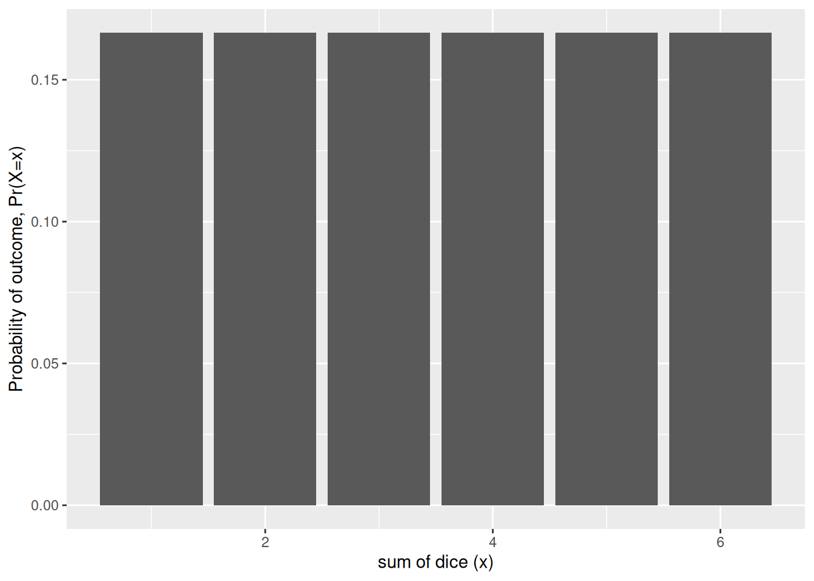
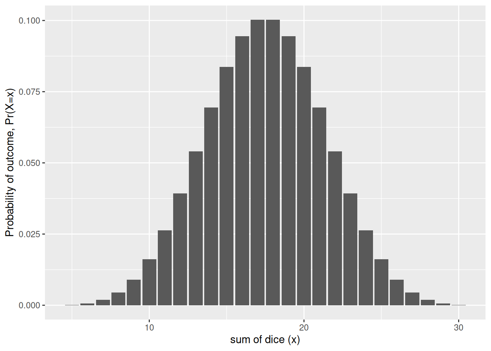

# Limit theorems

Code

- [Show All Code](javascript:void(0))

- [Hide All Code](javascript:void(0))

- 

  ------------------------------------------------------------------------

- [View Source](javascript:void(0))

Published

Last modified: 2026-10-22 01:14:35 (PDT)

## 1 The Central Limit Theorem

> **NOTE:**
>
> *Remark*. The sample mean of many independent random variables, none of which dominates the others, has a distribution that is approximately bell-shaped, whatever the distributions of the individual variables. [Theorem 1](#thm-clt) makes this precise.

> **NOTE:**
>
> **Theorem 1 (Central Limit Theorem)** Let \\X_1, X_2, \ldots\\ be [IID](independence.llms.md#def-iid) random variables with population mean \\\mu\\ and finite variance \\\sigma^2\> 0\\, and let \\\bar{X}\_{n} \stackrel{\text{def}}{=}\frac{1}{n}\sum\_{i=1}^nX_i\\. Then for every real number \\z\\ [\[1\]](#ref-wikipedia_central_limit_theorem):
>
> \\ \lim\_{n \to \infty} {\Pr\mathopen{}\left(\frac{\sqrt{n}\\(\bar{X}\_{n} - \mu)}{\sigma} \le z\right)\mathclose{}} = \Phi(z) \\
>
> where \\\Phi(z) \stackrel{\text{def}}{=}\int\_{-\infty}^{z} \frac{1}{\sqrt{2\pi}} \text{e}^{-u^2/2}\\du\\ is the CDF of the [standard normal distribution](random-variables.llms.md#def-std-normal) \\{\operatorname{N}\mathopen{}\left(0, 1\right)\mathclose{}}\\.

> **NOTE:**
>
> *Remark*. This version is the Lindeberg–Lévy CLT; its proof is beyond these notes’ scope [\[2\]](#ref-billingsley1995probability), Theorem 27.1. Other versions relax the IID assumption, which is why the informal statement asks only that no summand dominate.

> **NOTE:**
>
> **Corollary 1 (Central Limit Theorem for a sum)** Let \\X_1, X_2, \ldots\\ be [IID](independence.llms.md#def-iid) random variables with population mean \\\mu\\ and finite variance \\\sigma^2\> 0\\, and let \\S_n \stackrel{\text{def}}{=}\sum\_{i=1}^nX_i\\. Then for every real number \\z\\:
>
> \\ \lim\_{n \to \infty} {\Pr\mathopen{}\left(\frac{S_n - n\mu}{\sigma\sqrt{n}} \le z\right)\mathclose{}} = \Phi(z) \\

> **NOTE:**
>
> *Proof*. Since \\S_n = n\bar{X}\_{n}\\,
>
> \\ \frac{S_n - n\mu}{\sigma\sqrt{n}} = \frac{n(\bar{X}\_{n} - \mu)}{\sigma\sqrt{n}} = \frac{\sqrt{n}\\(\bar{X}\_{n} - \mu)}{\sigma}, \\
>
> so the event in this corollary is the event in [Theorem 1](#thm-clt), and the limits agree.

> **NOTE:**
>
> **Theorem 2 (Mean and variance of a sum of IID random variables)** Let \\X_1, \ldots, X_n\\ be [IID](independence.llms.md#def-iid) random variables, each discrete or continuous, with population mean \\\mu\\ and finite variance \\\sigma^2\\, and let \\S_n \stackrel{\text{def}}{=}\sum\_{i=1}^nX_i\\. Then, by [linearity of expectation for finite sums](expectation.llms.md#lem-linearity-finite-sum) and the [variance of a linear combination](variance-covariance.llms.md#thm-var-lincom):
>
> \\ \begin{aligned} {\operatorname{E}\mathopen{}\left\[S_n\right\]\mathclose{}} &= n\mu\\ {\operatorname{Var}\mathopen{}\left(S_n\right)\mathclose{}} &= n\sigma^2 \end{aligned} \\

> **NOTE:**
>
> *Proof*. For the mean, apply [linearity of expectation for finite sums](expectation.llms.md#lem-linearity-finite-sum) with every \\a_i = 1\\:
>
> \\ \begin{aligned} {\operatorname{E}\mathopen{}\left\[S_n\right\]\mathclose{}} &= {\operatorname{E}\mathopen{}\left\[\sum\_{i=1}^n1 \cdot X_i\right\]\mathclose{}} && \text{(} 1 \cdot v = v \text{)} \\ &= \sum\_{i=1}^n1 \cdot{\operatorname{E}\mathopen{}\left\[X_i\right\]\mathclose{}} && \text{(linearity of expectation for finite sums, all } a_i = 1 \text{)} \\ &= \sum\_{i=1}^n{\operatorname{E}\mathopen{}\left\[X_i\right\]\mathclose{}} && \text{(} 1 \cdot v = v \text{)} \\ &= n\mu && \text{(each } X_i \text{ has mean } \mu\text{)} \end{aligned} \\
>
> For the variance, apply the [variance of a linear combination](variance-covariance.llms.md#thm-var-lincom) with every \\a_i = 1\\. For \\i \ne j\\, \\X_i\\ and \\X_j\\ are independent (take \\A_k = \mathbb{R}\\ for every other \\k\\ in the [definition of independence](independence.llms.md#def-indpt)), so \\{\operatorname{Cov}\mathopen{}\left(X_i, X_j\right)\mathclose{}} = 0\\ for [independent summands](variance-covariance.llms.md#thm-indpt-uncorrelated); and \\{\operatorname{Cov}\mathopen{}\left(X_i, X_i\right)\mathclose{}} = {\operatorname{Var}\mathopen{}\left(X_i\right)\mathclose{}}\\ ([covariance of a variable with itself](variance-covariance.llms.md#lem-cov-xx)):
>
> \\ \begin{aligned} {\operatorname{Var}\mathopen{}\left(S_n\right)\mathclose{}} &= \sum\_{i=1}^n\sum\_{j=1}^n {\operatorname{Cov}\mathopen{}\left(X_i, X_j\right)\mathclose{}} && \text{(variance of a linear combination, all } a_i = 1 \text{)} \\ &= \sum\_{i=1}^n{\operatorname{Cov}\mathopen{}\left(X_i, X_i\right)\mathclose{}} + \sum\_{\substack{i, j = 1 \\ i \ne j}}^n {\operatorname{Cov}\mathopen{}\left(X_i, X_j\right)\mathclose{}} && \text{(split off the terms with } i = j \text{)} \\ &= \sum\_{i=1}^n{\operatorname{Var}\mathopen{}\left(X_i\right)\mathclose{}} + 0 && \text{(covariance with itself; independent summands)} \\ &= n\sigma^2 && \text{(each } X_i \text{ has variance } \sigma^2\text{)} \end{aligned} \\

> **NOTE:**
>
> **Corollary 2 (Mean and variance of a sample mean of IID random variables)** Let \\X_1, \ldots, X_n\\ be [IID](independence.llms.md#def-iid) [random variables](random-variables.llms.md#def-random-variable), each [discrete](random-variables.llms.md#def-discrete-rv) or [continuous](random-variables.llms.md#def-continuous-rv), with [population mean](expectation.llms.md#def-expectation) \\\mu\\ and finite [variance](variance-covariance.llms.md#def-variance) \\\sigma^2\\, and let \\\bar{X}\_{n} \stackrel{\text{def}}{=}\frac{1}{n}\sum\_{i=1}^nX_i\\. Then:
>
> \\ \begin{aligned} {\operatorname{E}\mathopen{}\left\[\bar{X}\_{n}\right\]\mathclose{}} &= \mu\\ {\operatorname{Var}\mathopen{}\left(\bar{X}\_{n}\right)\mathclose{}} &= \frac{\sigma^2}{n} \end{aligned} \\

> **NOTE:**
>
> *Proof*. Let \\S_n \stackrel{\text{def}}{=}\sum\_{i=1}^nX_i\\, so \\\bar{X}\_{n} = S_n / n\\. By [Theorem 2](#thm-sum-iid-moments), \\{\operatorname{E}\mathopen{}\left\[S_n\right\]\mathclose{}} = n\mu\\ and \\{\operatorname{Var}\mathopen{}\left(S_n\right)\mathclose{}} = n\sigma^2\\:
>
> \\ \begin{aligned} {\operatorname{E}\mathopen{}\left\[\bar{X}\_{n}\right\]\mathclose{}} &= {\operatorname{E}\mathopen{}\left\[\frac{S_n}{n}\right\]\mathclose{}} && \text{(definition of sample mean)}\\ &= \frac{1}{n}{\operatorname{E}\mathopen{}\left\[S_n\right\]\mathclose{}} && \text{(linearity of expectation)}\\ &= \frac{1}{n} \cdot n\mu && \text{(mean of a sum of IID variables)}\\ &= \mu && \text{(cancel \$n\$)}\\ {\operatorname{Var}\mathopen{}\left(\bar{X}\_{n}\right)\mathclose{}} &= {\operatorname{Var}\mathopen{}\left(\frac{S_n}{n}\right)\mathclose{}} && \text{(definition of sample mean)}\\ &= \frac{1}{n^2}{\operatorname{Var}\mathopen{}\left(S_n\right)\mathclose{}} && \text{(variance of a constant multiple)}\\ &= \frac{1}{n^2} \cdot n\sigma^2 && \text{(variance of a sum of IID variables)}\\ &= \frac{\sigma^2}{n} && \text{(cancel one factor of \$n\$)} \end{aligned} \\

> **NOTE:**
>
> *Remark*. In practice, [Theorem 1](#thm-clt) justifies approximating \\\bar{X}\_{n}\\ by a [normal distribution](random-variables.llms.md#def-normal) with [mean](expectation.llms.md#def-expectation) \\\mu\\ and [variance](variance-covariance.llms.md#def-variance) \\\sigma^2/n\\, and [Corollary 1](#cor-clt-sum) justifies approximating \\S_n\\ by a normal distribution with mean \\n\mu\\ and variance \\n\sigma^2\\. By [Theorem 2](#thm-sum-iid-moments), these are exactly the means and [variances](variance-covariance.llms.md#def-variance) of \\\bar{X}\_{n} = S_n/n\\ and \\S_n\\.

> **NOTE:**
>
> **Example 1 (The sum of five dice)** A single fair die roll has the discrete uniform distribution on \\{\mathopen{}\left\\1, \ldots, 6\right\\\mathclose{}}\\, which is flat, not bell-shaped ([Figure 1](#fig-clt-1d6)). Its mean is \\\mu= 3.5\\, and its variance is
>
> \\ \begin{aligned} \sigma^2&= \sum\_{x=1}^{6} (x - 3.5)^2 / 6 \\ &= 35/12. \end{aligned} \\
>
> Show code
>
> ``` r
> dice_sum_pmf <- function(n_dice) {
>   totals <- rowSums(expand.grid(rep(list(1:6), n_dice)))
>   probs <- prop.table(table(totals))
>   tibble::tibble(total = as.numeric(names(probs)), p = as.vector(probs))
> }
>
> dice_plot <-
>   ggplot2::ggplot(mapping = ggplot2::aes(x = total, y = p)) +
>   ggplot2::xlab("sum of dice (x)") +
>   ggplot2::ylab("Probability of outcome, Pr(X=x)") +
>   ggplot2::expand_limits(y = 0)
>
> dice_plot + ggplot2::geom_col(data = dice_sum_pmf(1))
> ```
>
> > **NOTE:**
> >
> > [](limit-theorems_files/figure-html/fig-clt-1d6-1.png "Figure 1: Distribution of the outcome of one die")
> >
> > Figure 1: Distribution of the outcome of one die
>
> The sum of five independent rolls, \\S_5\\, is already close to bell-shaped ([Figure 2](#fig-clt-5d6)).
>
> Show code
>
> ``` r
> pmf_five_dice <- dice_sum_pmf(5)
> dice_plot + ggplot2::geom_col(data = pmf_five_dice)
> ```
>
> > **NOTE:**
> >
> > [](limit-theorems_files/figure-html/fig-clt-5d6-1.png "Figure 2: Distribution of the sum of five dice")
> >
> > Figure 2: Distribution of the sum of five dice
>
> For example, the exact probability that five dice total at most 15 is \\\Pr(S_5 \le 15) = 0.3052\\. The normal approximation that [Corollary 1](#cor-clt-sum) suggests, with mean \\5 \cdot 3.5 = 17.5\\ and variance \\5 \cdot 35/12 \approx 14.58\\, evaluated at \\15.5\\ to account for \\S_5\\ taking only integer values, gives \\\Phi\mathopen{}\left((15.5 - 17.5)/\sqrt{14.58}\right)\mathclose{} \approx 0.3002\\.

> **NOTE:**
>
> **Example 2 (Sample means of car horsepower)** The Auto data record the horsepower and fuel economy of 392 car models sold between 1970 and 1982. They come from the StatLib library at Carnegie Mellon University and ship with the book *An Introduction to Statistical Learning*, in the Python package [`ISLP`](https://islp.readthedocs.io/) (`ISLP.load_data("Auto")`) and the R package [`ISLR2`](https://cran.r-project.org/package=ISLR2) (`ISLR2::Auto`). This site has a copy at [`data/auto.csv`](data/auto.csv), and both code tabs below read that file.
>
> Horsepower is not bell-shaped: a few powerful cars give it a long right tail. To apply [Theorem 1](#thm-clt), treat each draw of one car at random as one IID observation \\X_i\\, so that \\\mu\\ and \\\sigma^2\\ are the population mean and variance of the 392 horsepower values. The sample mean \\\bar{X}\_{n} = S_n/n\\, where \\S_n = \sum\_{i=1}^nX_i\\, has mean \\\mu\\ and standard deviation \\\sigma/\sqrt{n}\\, because \\S_n\\ has mean \\n\mu\\ and variance \\n\sigma^2\\ by [Theorem 2](#thm-sum-iid-moments). The code below draws 10,000 random samples of each size \\n \in {\mathopen{}\left\\1, 5, 30\right\\\mathclose{}}\\, with replacement, and computes each sample’s sample mean.
>
> ## Python
>
> ``` python
> import numpy as np
> import pandas as pd
>
> hp = pd.read_csv("data/auto.csv")["horsepower"].to_numpy(dtype=float)
> mu, sigma = hp.mean(), hp.std(ddof=0)
>
> rng = np.random.default_rng(571)
> sizes = [1, 5, 30]
> sample_means = {n: rng.choice(hp, size=(10_000, n)).mean(axis=1) for n in sizes}
>
> def skewness(x):
>     return np.mean(((x - x.mean()) / x.std()) ** 3)
>
> pd.DataFrame({
>     "n": sizes,
>     "sd of sample means": [sample_means[n].std(ddof=1) for n in sizes],
>     "sigma / sqrt(n)": [sigma / np.sqrt(n) for n in sizes],
>     "skewness of sample means": [skewness(sample_means[n]) for n in sizes],
> })
> #>     n  sd of sample means  sigma / sqrt(n)  skewness of sample means
> #> 0   1           38.691521        38.442033                  1.080767
> #> 1   5           17.265666        17.191800                  0.522243
> #> 2  30            6.971269         7.018523                  0.164940
> ```
>
> ## R
>
> ``` r
> hp <- read.csv("data/auto.csv")$horsepower
> mu <- mean(hp)
> sigma <- sqrt(mean((hp - mu)^2))
>
> set.seed(571)
> sizes <- c(1, 5, 30)
> sample_means <- lapply(sizes, function(n) {
>   replicate(10000, mean(sample(hp, n, replace = TRUE)))
> })
>
> skewness <- function(x) mean(((x - mean(x)) / sqrt(mean((x - mean(x))^2)))^3)
>
> data.frame(
>   n = sizes,
>   sd_of_sample_means = sapply(sample_means, sd),
>   sigma_over_root_n = sigma / sqrt(sizes),
>   skewness_of_sample_means = sapply(sample_means, skewness)
> )
> ```
>
> [Figure 3](#fig-clt-auto) shows a histogram of the 10,000 sample means for each \\n\\, with the normal density \\{\operatorname{N}\mathopen{}\left(\mu, \sigma^2/n\right)\mathclose{}}\\ from [Theorem 1](#thm-clt) drawn over it.
>
> Show code
>
> ``` r
> n_labels <- paste("n =", sizes)
> means_long <- tibble::tibble(
>   n = factor(
>     rep(n_labels, each = length(sample_means[[1]])),
>     levels = n_labels
>   ),
>   sample_mean = unlist(sample_means)
> )
> normal_curves <- seq_along(sizes) |>
>   lapply(function(k) {
>     se <- sigma / sqrt(sizes[k])
>     grid <- seq(mu - 4 * se, mu + 4 * se, length.out = 200)
>     tibble::tibble(
>       n = factor(n_labels[k], levels = n_labels),
>       sample_mean = grid,
>       density = dnorm(grid, mu, se)
>     )
>   }) |>
>   dplyr::bind_rows()
>
> ggplot2::ggplot(means_long, ggplot2::aes(x = sample_mean)) +
>   ggplot2::geom_histogram(
>     ggplot2::aes(y = ggplot2::after_stat(density)),
>     bins = 40,
>     fill = "grey70",
>     color = "white"
>   ) +
>   ggplot2::geom_line(
>     ggplot2::aes(y = density),
>     data = normal_curves,
>     linewidth = 1
>   ) +
>   ggplot2::facet_wrap(ggplot2::vars(n), scales = "free") +
>   ggplot2::labs(x = "sample mean of horsepower", y = "density") +
>   ggplot2::theme_minimal()
> ```
>
> > **NOTE:**
> >
> > [](limit-theorems_files/figure-html/fig-clt-auto-1.png "Figure 3: Histograms of 10,000 sample means of horsepower, for samples of n = 1, 5 and 30 cars drawn with replacement from the Auto data. The curve is the normal density with mean mu and standard deviation sigma over the square root of n.")
> >
> > Figure 3: Histograms of 10,000 sample means of horsepower, for samples of n = 1, 5 and 30 cars drawn with replacement from the Auto data. The curve is the normal density with mean mu and standard deviation sigma over the square root of n.
>
> The sample means for \\n = 1\\ are just single cars, so they are skewed. By \\n = 30\\ the histogram is close to the normal curve. The standard deviation of the sample means is within 1.2% of \\\sigma/\sqrt{n}\\ at every \\n\\, as [Theorem 2](#thm-sum-iid-moments) predicts. The skewness of the sample means, which is zero for a normal distribution, falls from 1.07 at \\n = 1\\ to 0.48 at \\n = 5\\ and 0.2 at \\n = 30\\.

> **NOTE:**
>
> 5MinuteAI explains [limit theorems](https://www.youtube.com/watch?v=6sQv1o-ttCw) and gives a [proof of the CLT](https://www.youtube.com/watch?v=-EI96KIYGWw), following the University of Washington’s CSE 312 [\[3\]](#ref-fiveminuteai_probstat).

## 2 Tail bounds

> **NOTE:**
>
> **Theorem 3 (Markov’s inequality)** Let \\X\\ be a random variable with \\X \ge 0\\ and \\{\operatorname{E}\mathopen{}\left\[X\right\]\mathclose{}} \< \infty\\. Then for every \\a \> 0\\ [\[4\]](#ref-wikipedia_markovs_inequality):
>
> \\ {\Pr\mathopen{}\left(X \ge a\right)\mathclose{}} \le \frac{{\operatorname{E}\mathopen{}\left\[X\right\]\mathclose{}}}{a} \\

> **NOTE:**
>
> *Proof*. Because \\X \ge 0\\, every outcome satisfies \\X \ge a \cdot \mathbb{1}\_{{\mathopen{}\left\\X \ge a\right\\\mathclose{}}}\\: when \\X \ge a\\ the right side is \\a \le X\\, and otherwise it is \\0 \le X\\. The expectation of a nonnegative random variable is nonnegative, so by [linearity of expectation](expectation.llms.md#thm-linearity-expectation), and because the expectation of an indicator is the probability of its event,
>
> \\ {\operatorname{E}\mathopen{}\left\[X\right\]\mathclose{}} - a \cdot {\Pr\mathopen{}\left(X \ge a\right)\mathclose{}} = {\operatorname{E}\mathopen{}\left\[X - a \cdot \mathbb{1}\_{{\mathopen{}\left\\X \ge a\right\\\mathclose{}}}\right\]\mathclose{}} \ge 0 \\
>
> and dividing by \\a \> 0\\ gives the claim.

> **NOTE:**
>
> *Remark*. The inequality carries Markov’s name by convention. Chebyshev’s inequality, which follows from it, is older [\[5\]](#ref-bienayme1853), [\[6\]](#ref-tchebichef1867); see [\[7\]](#ref-seneta2013) for the history of the attribution. A modern treatment is in [\[8\]](#ref-blitzstein2019introduction).

> **NOTE:**
>
> **Theorem 4 (Chebyshev’s inequality)** Let \\X\\ be a random variable with mean \\\mu\\ and finite variance \\\sigma^2\> 0\\. Then for every \\k \> 0\\ [\[9\]](#ref-wikipedia_chebyshevs_inequality):
>
> \\ {\Pr\mathopen{}\left(\mathopen{}\left\|X - \mu\right\|\mathclose{} \ge k\sigma\right)\mathclose{}} \le \frac{1}{k^2} \\

> **NOTE:**
>
> *Proof*. The random variable \\(X - \mu)^2\\ is nonnegative, and its expectation is \\\sigma^2\\. Because \\\mathopen{}\left\|X - \mu\right\|\mathclose{} \ge k\sigma\\ exactly when \\(X - \mu)^2 \ge k^2\sigma^2\\, [Theorem 3](#thm-markov) gives
>
> \\ {\Pr\mathopen{}\left(\mathopen{}\left\|X - \mu\right\|\mathclose{} \ge k\sigma\right)\mathclose{}} = {\Pr\mathopen{}\left((X - \mu)^2 \ge k^2\sigma^2\right)\mathclose{}} \le \frac{\sigma^2}{k^2\sigma^2} = \frac{1}{k^2} \\

> **NOTE:**
>
> *Remark*. [Theorem 4](#thm-chebyshev) needs only a mean and a variance, not a distribution, so it holds for every distribution that has them. That generality makes it loose: for a normal distribution, the chance of landing more than two standard deviations from the mean is about 5%, but the bound at \\k = 2\\ is 25%.

> **NOTE:**
>
> *Remark*. Bienaymé derived this bound in 1853 [\[5\]](#ref-bienayme1853), and Chebyshev proved a more general form in 1867 [\[6\]](#ref-tchebichef1867). A modern treatment is in [\[8\]](#ref-blitzstein2019introduction).

> **NOTE:**
>
> **Example 3 (How loose is Chebyshev’s bound for car horsepower?)** Take the 392 horsepower values in the Auto data described in [Example 2](#exm-clt-auto) as the whole population, and draw one car at random. For each \\k\\, the code below counts the share of cars whose horsepower is at least \\k\\ standard deviations from the mean, and sets it beside the bound \\1/k^2\\ from [Theorem 4](#thm-chebyshev).
>
> ``` r
> hp <- read.csv("data/auto.csv")$horsepower
> mu <- mean(hp)
> sigma <- sqrt(mean((hp - mu)^2))
>
> k <- c(1.5, 2, 3)
> share_beyond <- sapply(k, function(kk) mean(abs(hp - mu) >= kk * sigma))
> data.frame(k = k, share_of_cars = share_beyond, chebyshev_bound = 1 / k^2)
> ```
>
> The bound holds at every \\k\\, as [Theorem 4](#thm-chebyshev) guarantees. At \\k = 2\\ the share of cars is 4.3%, against a bound of 25%, and at \\k = 3\\ it is 1.3% against 11.1%. The bound is loose because it must hold for every distribution with this mean and variance.

> **NOTE:**
>
> **Exercise 1 (How many cars to estimate mean fuel economy)** Let \\X_1, \ldots, X_n\\ be [IID](independence.llms.md#def-iid) draws of the fuel economy (`mpg`) of a car chosen at random from the Auto data, with population mean \\\mu\\ and variance \\\sigma^2\\, and let \\\bar{X}\_{n} \stackrel{\text{def}}{=}\frac{1}{n}\sum\_{i=1}^nX_i\\.
>
> 1.  Use [Theorem 2](#thm-sum-iid-moments) and [Theorem 4](#thm-chebyshev) to show that for every \\\epsilon \> 0\\,
>
>     \\ {\Pr\mathopen{}\left(\mathopen{}\left\|\bar{X}\_{n} - \mu\right\|\mathclose{} \ge \epsilon\right)\mathclose{}} \le \frac{\sigma^2}{n\epsilon^2} \\
>
> 2.  Compute \\\sigma^2\\ for the `mpg` column of [`data/auto.csv`](data/auto.csv), treating the 392 cars as the whole population. Find the smallest \\n\\ for which the bound in (a) guarantees \\{\Pr\mathopen{}\left(\mathopen{}\left\|\bar{X}\_{n} - \mu\right\|\mathclose{} \ge 1\right)\mathclose{}} \le 0.05\\.
>
> 3.  Simulate 10,000 samples of that size drawn with replacement, and count how many sample means miss \\\mu\\ by 1 or more. Why is the count so far below the 5% the bound allows?

> **NOTE:**
>
> *Solution 1*.
>
> 1.  By [Theorem 2](#thm-sum-iid-moments), \\{\operatorname{Var}\mathopen{}\left(S_n\right)\mathclose{}} = n\sigma^2\\ for \\S_n \stackrel{\text{def}}{=}\sum\_{i=1}^nX_i\\, so \\\bar{X}\_{n} = S_n/n\\ has mean \\\mu\\ and variance \\\sigma^2/n\\ (a constant factor \\c\\ scales a variance by \\c^2\\). Apply [Theorem 4](#thm-chebyshev) to \\\bar{X}\_{n}\\ with \\k\sigma/\sqrt{n} = \epsilon\\, that is, \\k = \epsilon\sqrt{n}/\sigma\\, so \\1/k^2 = \sigma^2/(n\epsilon^2)\\.
>
> 2.  Setting \\\sigma^2/(n \cdot 1^2) \le 0.05\\ gives \\n \ge 20\sigma^2\\.
>
> 3.  See the code below.
>
> ``` r
> mpg <- read.csv("data/auto.csv")$mpg
> mu <- mean(mpg)
> sigma2 <- mean((mpg - mu)^2)
> n_min <- ceiling(20 * sigma2)
>
> set.seed(571)
> xbar <- replicate(10000, mean(sample(mpg, n_min, replace = TRUE)))
> misses <- sum(abs(xbar - mu) >= 1)
> normal_approx <- 2 * pnorm(-1 / sqrt(sigma2 / n_min))
> c(variance = sigma2, n = n_min, misses = misses, normal_approx = normal_approx)
> #>      variance             n        misses normal_approx 
> #>  6.076274e+01  1.216000e+03  0.000000e+00  7.694705e-06
> ```
>
> The population variance of `mpg` is 60.8, so \\n = 1216\\ cars suffice. Out of 10,000 samples of that size, 0 sample means missed \\\mu\\ by 1 or more, against the 5% (500 samples) the bound allows. The bound is loose because the sample mean of this many cars is nearly normal ([Theorem 1](#thm-clt)), and the normal approximation puts the chance of a miss at about 7.7^{-6}; Chebyshev’s inequality must hold for every distribution, as in [Example 3](#exm-chebyshev-auto).

> **NOTE:**
>
> **Theorem 5 (Chebyshev’s inequality for a sample mean)** Let \\X_1, \ldots, X_n\\ be [IID](independence.llms.md#def-iid) random variables with population mean \\\mu\\ and finite variance \\\sigma^2\> 0\\, and let \\\bar{X}\_{n} \stackrel{\text{def}}{=}\frac{1}{n}\sum\_{i=1}^nX_i\\. Then for every \\\epsilon \> 0\\:
>
> \\ {\Pr\mathopen{}\left(\mathopen{}\left\|\bar{X}\_{n} - \mu\right\|\mathclose{} \ge \epsilon\right)\mathclose{}} \le \frac{\sigma^2}{n\epsilon^2} \\

> **NOTE:**
>
> *Proof*. This is the solution to [Exercise 1](#exr-chebyshev-sample-size) (a), worked in [Solution 1](#sol-chebyshev-sample-size). It applies [Theorem 4](#thm-chebyshev) to \\\bar{X}\_{n}\\, whose [variance](variance-covariance.llms.md#def-variance) is \\\sigma^2/n\\ by [Corollary 2](#cor-mean-iid-moments).

> **NOTE:**
>
> **Lemma 1 (Hoeffding’s lemma)** Let \\X\\ be a random variable with \\0 \le X \le 1\\ and mean \\\mu\\. Then for every real number \\s\\,
>
> \\ {\operatorname{E}\mathopen{}\left\[e^{s(X - \mu)}\right\]\mathclose{}} \le e^{s^2/8}. \\

> **NOTE:**
>
> *Proof*. First bound \\e^{sX}\\ by a line. The function \\x \mapsto e^{x}\\ is convex, and for \\0 \le X \le 1\\ the number \\sX\\ is the weighted average \\(1 - X) \cdot 0 + X \cdot s\\, so
>
> \\ \begin{aligned} e^{sX} &\le (1 - X) e^{0} + X e^{s} && \text{(convexity of the exponential)} \\ &= 1 - X + X e^{s} && \text{(} e^{0} = 1 \text{)} \end{aligned} \\
>
> Take the expectation of both sides, which preserves the inequality:
>
> \\ \begin{aligned} {\operatorname{E}\mathopen{}\left\[e^{sX}\right\]\mathclose{}} &\le 1 - {\operatorname{E}\mathopen{}\left\[X\right\]\mathclose{}} + {\operatorname{E}\mathopen{}\left\[X\right\]\mathclose{}} e^{s} && \text{(linearity of expectation)} \\ &= 1 - \mu+ \mu e^{s} && \text{(definition of } \mu\text{)} \end{aligned} \\
>
> The number \\1 - \mu+ \mu e^{s}\\ is a weighted average of \\1\\ and \\e^{s}\\ with weights \\1 - \mu\\ and \\\mu\\, so it is positive. Multiply by the constant \\e^{-s\mu}\\ and write the result as an exponential:
>
> \\ \begin{aligned} {\operatorname{E}\mathopen{}\left\[e^{s(X - \mu)}\right\]\mathclose{}} &= e^{-s\mu} {\operatorname{E}\mathopen{}\left\[e^{sX}\right\]\mathclose{}} && \text{(} e^{-s\mu} \text{ is a constant)} \\ &\le e^{-s\mu} \mathopen{}\left(1 - \mu+ \mu e^{s}\right)\mathclose{} && \text{(the bound above)} \\ &= e^{L(s)} && \text{(define } L(s) \stackrel{\text{def}}{=}-s\mu+ \log\mathopen{}\left(1 - \mu+ \mu e^{s}\right)\mathclose{} \text{)} \end{aligned} \\
>
> It remains to show \\L(s) \le s^2/8\\. Write
>
> \\ p(s) \stackrel{\text{def}}{=}\frac{\mu e^{s}}{1 - \mu+ \mu e^{s}}, \\
>
> which lies in \\\[0, 1\]\\. The first derivative of \\L\\ is
>
> \\ \begin{aligned} L'(s) &= -\mu+ \frac{\mu e^{s}}{1 - \mu+ \mu e^{s}} && \text{(chain rule for the logarithm)} \\ &= -\mu+ p(s) && \text{(definition of } p \text{)} \end{aligned} \\
>
> The derivative of \\p\\ is
>
> \\ \begin{aligned} p'(s) &= \frac{\mu e^{s}\mathopen{}\left(1 - \mu+ \mu e^{s}\right)\mathclose{} - \mu e^{s} \cdot \mu e^{s}}{\mathopen{}\left(1 - \mu+ \mu e^{s}\right)\mathclose{}^2} && \text{(quotient rule)} \\ &= \frac{\mu e^{s}\mathopen{}\left(1 - \mu\right)\mathclose{}}{\mathopen{}\left(1 - \mu+ \mu e^{s}\right)\mathclose{}^2} && \text{(the } \mu^2 e^{2s} \text{ terms cancel)} \\ &= p(s)\mathopen{}\left(1 - p(s)\right)\mathclose{} && \text{(} 1 - p(s) = \tfrac{1 - \mu}{1 - \mu+ \mu e^{s}} \text{)} \end{aligned} \\
>
> so \\L''(s) = p'(s) = p(s)\mathopen{}\left(1 - p(s)\right)\mathclose{}\\. Completing the square gives
>
> \\ \begin{aligned} p(s)\mathopen{}\left(1 - p(s)\right)\mathclose{} &= \frac{1}{4} - \mathopen{}\left(p(s) - \frac{1}{2}\right)\mathclose{}^2 && \text{(complete the square)} \\ &\le \frac{1}{4} && \text{(a square is not negative)} \end{aligned} \\
>
> At \\s = 0\\, \\L(0) = 0 + \log 1 = 0\\ and \\L'(0) = -\mu+ \mu= 0\\. By Taylor’s theorem with the Lagrange remainder, there is a number \\\xi\\ between \\0\\ and \\s\\ with
>
> \\ \begin{aligned} L(s) &= L(0) + L'(0)\\ s + \frac{L''(\xi)}{2} s^2 && \text{(Taylor's theorem)} \\ &= \frac{L''(\xi)}{2} s^2 && \text{(} L(0) = L'(0) = 0 \text{)} \\ &\le \frac{s^2}{8} && \text{(} L''(\xi) \le \tfrac{1}{4} \text{)} \end{aligned} \\
>
> Therefore \\{\operatorname{E}\mathopen{}\left\[e^{s(X - \mu)}\right\]\mathclose{}} \le e^{L(s)} \le e^{s^2/8}\\.

> **NOTE:**
>
> *Remark*. The bound on the moment generating function \\{\operatorname{E}\mathopen{}\left\[e^{s(X - \mu)}\right\]\mathclose{}}\\ is the step of Hoeffding’s 1963 paper [\[10\]](#ref-hoeffding1963) that the literature calls Hoeffding’s lemma. The next result uses it to bound the tails of a sample mean.

> **NOTE:**
>
> **Theorem 6 (Hoeffding’s inequality)** Let \\X_1, \ldots, X_n\\ be [IID](independence.llms.md#def-iid) random variables with \\0 \le X_i \le 1\\ and population mean \\\mu\\, and let \\\bar{X}\_{n} \stackrel{\text{def}}{=}\frac{1}{n}\sum\_{i=1}^nX_i\\. Then for every \\\varepsilon\> 0\\ [\[11\]](#ref-wikipedia_hoeffdings_inequality),
>
> \\ {\Pr\mathopen{}\left(\bar{X}\_{n} - \mu\ge \varepsilon\right)\mathclose{}} \le e^{-2n\varepsilon^2}. \tag{1}\\

> **NOTE:**
>
> *Proof*. Let the free parameter be \\s \> 0\\. The event \\{\mathopen{}\left\\\bar{X}\_{n} - \mu\ge \varepsilon\right\\\mathclose{}}\\ is the event \\{\mathopen{}\left\\e^{sn(\bar{X}\_{n} - \mu)} \ge e^{sn\varepsilon}\right\\\mathclose{}}\\, because the exponential is increasing and \\sn \> 0\\. The random variable \\e^{sn(\bar{X}\_{n} - \mu)}\\ is positive, so [Markov’s inequality](#thm-markov) applies:
>
> \\ \begin{aligned} {\Pr\mathopen{}\left(\bar{X}\_{n} - \mu\ge \varepsilon\right)\mathclose{}} &= {\Pr\mathopen{}\left(e^{sn(\bar{X}\_{n} - \mu)} \ge e^{sn\varepsilon}\right)\mathclose{}} && \text{(the exponential is increasing)} \\ &\le e^{-sn\varepsilon} {\operatorname{E}\mathopen{}\left\[e^{sn(\bar{X}\_{n} - \mu)}\right\]\mathclose{}} && \text{(Markov's inequality)} \end{aligned} \\
>
> Rewrite the exponent as a sum, so that the exponential becomes a product:
>
> \\ \begin{aligned} e^{sn(\bar{X}\_{n} - \mu)} &= e^{s\sum\_{i=1}^n(X_i - \mu)} && \text{(} n\bar{X}\_{n} = \sum\_{i=1}^nX_i \text{)} \\ &= \prod\_{i=1}^n e^{s(X_i - \mu)} && \text{(} e^{a + b} = e^{a} e^{b} \text{)} \end{aligned} \\
>
> The factors are functions of independent random variables, so they are independent, and the expectation of a product of independent random variables is the product of their expectations (the [expectation of a product of independent variables](variance-covariance.llms.md#thm-indpt-uncorrelated), applied one factor at a time). Then apply [Lemma 1](#lem-hoeffding) to each factor:
>
> \\ \begin{aligned} {\operatorname{E}\mathopen{}\left\[e^{sn(\bar{X}\_{n} - \mu)}\right\]\mathclose{}} &= \prod\_{i=1}^n {\operatorname{E}\mathopen{}\left\[e^{s(X_i - \mu)}\right\]\mathclose{}} && \text{(independence)} \\ &\le \prod\_{i=1}^n e^{s^2/8} && \text{(Hoeffding's lemma)} \\ &= e^{ns^2/8} && \text{(} n \text{ equal factors)} \end{aligned} \\
>
> Combining the two displays, for every \\s \> 0\\,
>
> \\ {\Pr\mathopen{}\left(\bar{X}\_{n} - \mu\ge \varepsilon\right)\mathclose{}} \le e^{-sn\varepsilon+ ns^2/8}. \\
>
> The right side is smallest where the exponent \\-sn\varepsilon+ ns^2/8\\ is smallest. The exponent is a quadratic in \\s\\ with a positive leading coefficient, so it has one minimum, where its derivative is zero. Its derivative in \\s\\ is \\-n\varepsilon+ ns/4\\, which is zero at \\s = 4\varepsilon\\, and \\4\varepsilon\> 0\\ is allowed. There the exponent is
>
> \\ \begin{aligned} -4\varepsilon\cdot n\varepsilon+ \frac{n(4\varepsilon)^2}{8} &= -4n\varepsilon^2 + 2n\varepsilon^2 && \text{(substitute } s = 4\varepsilon\text{)} \\ &= -2n\varepsilon^2 && \text{(combine like terms)} \end{aligned} \\
>
> which is the claim.

> **NOTE:**
>
> **Corollary 3 (Hoeffding’s inequality, two-sided)** Under the assumptions of [Theorem 6](#thm-hoeffding), for every \\\varepsilon\> 0\\,
>
> \\ {\Pr\mathopen{}\left(\mathopen{}\left\|\bar{X}\_{n} - \mu\right\|\mathclose{} \ge \varepsilon\right)\mathclose{}} \le 2e^{-2n\varepsilon^2}. \tag{2}\\

> **NOTE:**
>
> *Proof*. The variables \\1 - X_1, \ldots, 1 - X_n\\ are IID, lie in \\\[0, 1\]\\, and have mean \\1 - \mu\\. Their sample mean is \\1 - \bar{X}\_{n}\\, so [Theorem 6](#thm-hoeffding) applied to them gives
>
> \\ \begin{aligned} {\Pr\mathopen{}\left(\mu- \bar{X}\_{n} \ge \varepsilon\right)\mathclose{}} &= {\Pr\mathopen{}\left((1 - \bar{X}\_{n}) - (1 - \mu) \ge \varepsilon\right)\mathclose{}} && \text{(rearrange the event)} \\ &\le e^{-2n\varepsilon^2} && \text{(Hoeffding's inequality for } 1 - X_i \text{)} \end{aligned} \\
>
> The event \\{\mathopen{}\left\\\mathopen{}\left\|\bar{X}\_{n} - \mu\right\|\mathclose{} \ge \varepsilon\right\\\mathclose{}}\\ is the union of \\{\mathopen{}\left\\\bar{X}\_{n} - \mu\ge \varepsilon\right\\\mathclose{}}\\ and \\{\mathopen{}\left\\\mu- \bar{X}\_{n} \ge \varepsilon\right\\\mathclose{}}\\. The probability of a union is at most the sum of the probabilities, so
>
> \\ \begin{aligned} {\Pr\mathopen{}\left(\mathopen{}\left\|\bar{X}\_{n} - \mu\right\|\mathclose{} \ge \varepsilon\right)\mathclose{}} &\le {\Pr\mathopen{}\left(\bar{X}\_{n} - \mu\ge \varepsilon\right)\mathclose{}} + {\Pr\mathopen{}\left(\mu- \bar{X}\_{n} \ge \varepsilon\right)\mathclose{}} && \text{(union bound)} \\ &\le e^{-2n\varepsilon^2} + e^{-2n\varepsilon^2} && \text{(Hoeffding's inequality, twice)} \\ &= 2e^{-2n\varepsilon^2} && \text{(combine like terms)} \end{aligned} \\

> **NOTE:**
>
> *Remark*. Hoeffding stated the inequality for sums of independent bounded random variables, with different bounds for each term [\[10\]](#ref-hoeffding1963). This page states the case of the sample mean of IID variables in \\\[0, 1\]\\, which is the case that bounds the gap between a sample proportion and the probability it estimates. For an indicator variable, \\\mu\\ is the probability of the event and \\\bar{X}\_{n}\\ is the share of the \\n\\ draws in which it occurs.

> **NOTE:**
>
> **Example 4 (How loose is Hoeffding’s bound for the share of efficient cars?)** Take the 392 cars in the Auto data described in [Example 2](#exm-clt-auto) as the whole population, and call a car efficient if its fuel economy (`mpg`) is above \\25\\. Let \\X_i = 1\\ if the \\i\\th car drawn at random is efficient and \\X_i = 0\\ otherwise, so \\\mu\\ is the share of efficient cars and \\\bar{X}\_{n}\\ is the share in a sample of \\n\\ draws. Each \\X_i\\ lies in \\\[0, 1\]\\, and the draws are made with replacement, so the \\X_i\\ are IID and [Corollary 3](#cor-hoeffding-two-sided) applies. The code below draws \\10{,}000\\ samples of each size, computes the proportion of samples whose share misses \\\mu\\ by at least \\\varepsilon= 0.1\\, and sets that proportion beside the bound \\2e^{-2n\varepsilon^2}\\ of [Equation 2](#eq-hoeffding) and the bound \\\sigma^2/(n\varepsilon^2)\\ that Chebyshev’s inequality gives ([Theorem 5](#thm-chebyshev-sample-mean)).
>
> ``` r
> mpg <- read.csv("data/auto.csv")$mpg
> efficient <- as.numeric(mpg > 25)
> mu <- mean(efficient)
> sigma2 <- mean((efficient - mu)^2)
> tol <- 0.1
>
> n <- c(50, 100, 200, 400)
> set.seed(571)
> share_missed <- sapply(n, function(nn) {
>   xbar <- replicate(10000, mean(sample(efficient, nn, replace = TRUE)))
>   mean(abs(xbar - mu) >= tol)
> })
> hoeffding_bound <- pmin(1, 2 * exp(-2 * n * tol^2))
> chebyshev_bound <- pmin(1, sigma2 / (n * tol^2))
> data.frame(
>   n = n,
>   share_missed = share_missed,
>   hoeffding_bound = hoeffding_bound,
>   chebyshev_bound = chebyshev_bound
> )
> ```
>
> The simulated proportions lie below both bounds at every sample size, as they should: the bounds apply to the true probabilities these proportions estimate. The share of efficient cars is 0.398. For \\n = 50\\ and \\n = 100\\ Chebyshev’s bound is the smaller of the two, but the Hoeffding bound falls exponentially in \\n\\ while the Chebyshev bound falls only like \\1/n\\, so at \\n = 200\\ and \\n = 400\\ Hoeffding’s is the smaller. At \\n = 400\\ the Hoeffding bound is 0.00067, against 0.06 for Chebyshev, and 0 of the 10,000 samples missed. Both bounds are loose because they must hold for every distribution of this kind, not only for this one.

## 3 The law of large numbers

> **NOTE:**
>
> **Definition 1 (Convergence in probability)** A sequence of random variables \\Y_1, Y_2, \ldots\\ **converges in probability** to a constant \\c\\ [\[12\]](#ref-wikipedia_convergence_of_random_variables) if, for every distance \\\varepsilon \> 0\\, the probability that \\Y_n\\ lies at least \\\varepsilon\\ away from \\c\\ goes to zero as \\n\\ grows:
>
> \\ \lim\_{n \to \infty} {\Pr\mathopen{}\left(\mathopen{}\left\|Y_n - c\right\|\mathclose{} \ge \varepsilon\right)\mathclose{}} = 0 \\
>
> We write \\Y_n \overset{\scriptstyle p}{\longrightarrow}c\\.
>
> > **NOTE:**
> >
> > Casella and Berger [\[13\]](#ref-CaseBerg01), Def. 5.5.1.

> **NOTE:**
>
> **Theorem 7 (Weak law of large numbers)** Let \\X_1, X_2, \ldots\\ be [IID](independence.llms.md#def-iid) random variables with population mean \\\mu\\ and finite variance \\\sigma^2\> 0\\, and let \\\bar{X}\_{n} \stackrel{\text{def}}{=}\frac{1}{n}\sum\_{i=1}^nX_i\\ be the sample mean. Then the sample mean [converges in probability](#def-convergence-in-probability) to \\\mu\\ [\[14\]](#ref-wikipedia_law_of_large_numbers):
>
> \\ \bar{X}\_{n} \overset{\scriptstyle p}{\longrightarrow}\mu \\
>
> > **NOTE:**
> >
> > Casella and Berger [\[13\]](#ref-CaseBerg01), Thm. 5.5.2.

> **NOTE:**
>
> *Proof*. By [Corollary 2](#cor-mean-iid-moments), \\{\operatorname{E}\mathopen{}\left\[\bar{X}\_{n}\right\]\mathclose{}} = \mu\\ and \\{\operatorname{Var}\mathopen{}\left(\bar{X}\_{n}\right)\mathclose{}} = \sigma^2/n\\.
>
> Let the tolerance be \\\varepsilon \> 0\\ and let the multiplier be \\k \stackrel{\text{def}}{=}\varepsilon \sqrt{n} / \sigma\\, so that \\k \sigma/ \sqrt{n} = \varepsilon\\. [Chebyshev’s inequality](#thm-chebyshev) for \\\bar{X}\_{n}\\, whose standard deviation is \\\sigma/ \sqrt{n}\\, gives
>
> \\ \begin{aligned} 0 \le {\Pr\mathopen{}\left(\mathopen{}\left\|\bar{X}\_{n} - \mu\right\|\mathclose{} \ge \varepsilon\right)\mathclose{}} &= {\Pr\mathopen{}\left(\mathopen{}\left\|\bar{X}\_{n} - \mu\right\|\mathclose{} \ge k \frac{\sigma}{\sqrt{n}}\right)\mathclose{}} && \text{(definition of \$k\$)}\\ &\le \frac{1}{k^2} && \text{(Chebyshev's inequality)}\\ &= \frac{\sigma^2}{n \varepsilon^2} && \text{(substitute \$k\$)} \end{aligned} \\
>
> The bound goes to zero as \\n \to \infty\\, so the probability, squeezed between zero and the bound, goes to zero. This holds for every \\\varepsilon \> 0\\.

## References

\[1\]

Wikipedia contributors, “Central limit theorem — Wikipedia, the free encyclopedia.” 2026. Available: <https://en.wikipedia.org/wiki/Central_limit_theorem>

\[2\]

P. Billingsley, *Probability and measure*, 3rd ed. in Wiley series in probability and mathematical statistics. New York: Wiley, 1995.

\[3\]

5MinuteAI, “Probability & statistics.” Video playlist on YouTube. Accessed: Oct. 12, 2026. \[Online\]. Available: <https://www.youtube.com/playlist?list=PLeB45KifGiuHesi4PALNZSYZFhViVGQJK>

\[4\]

Wikipedia contributors, “Markov’s inequality — Wikipedia, the free encyclopedia.” 2026. Available: <https://en.wikipedia.org/wiki/Markov%27s_inequality>

\[5\]

I.-J. Bienaymé, “Considérations à l’appui de la découverte de Laplace sur la loi de probabilité dans la méthode des moindres carrés,” *Comptes Rendus de l’Académie des Sciences*, vol. 37, pp. 309–324, 1853, Available: <https://www.numdam.org/item/JMPA_1867_2_12__158_0/>

\[6\]

P. L. Tchébychef, “Des valeurs moyennes,” *Journal de mathématiques pures et appliquées*, vol. 12, pp. 177–184, 1867, Available: <https://www.numdam.org/item/JMPA_1867_2_12__177_0/>

\[7\]

E. Seneta, “A tricentenary history of the law of large numbers,” *Bernoulli*, vol. 19, no. 4, pp. 1088–1121, 2013, doi: [10.3150/12-BEJSP12](https://doi.org/10.3150/12-BEJSP12).

\[8\]

J. K. Blitzstein and J. Hwang, *Introduction to probability*, 2nd ed. Chapman; Hall/CRC, 2019. doi: [10.1201/9780429428357](https://doi.org/10.1201/9780429428357).

\[9\]

Wikipedia contributors, “Chebyshev’s inequality — Wikipedia, the free encyclopedia.” 2026. Available: <https://en.wikipedia.org/wiki/Chebyshev%27s_inequality>

\[10\]

W. Hoeffding, “Probability inequalities for sums of bounded random variables,” *Journal of the American Statistical Association*, vol. 58, no. 301, pp. 13–30, 1963, doi: [10.1080/01621459.1963.10500830](https://doi.org/10.1080/01621459.1963.10500830).

\[11\]

Wikipedia contributors, “Hoeffding’s inequality — Wikipedia, the free encyclopedia.” 2026. Available: <https://en.wikipedia.org/wiki/Hoeffding%27s_inequality>

\[12\]

Wikipedia contributors, “Convergence of random variables — Wikipedia, the free encyclopedia.” 2026. Available: <https://en.wikipedia.org/wiki/Convergence_of_random_variables>

\[13\]

G. Casella and R. Berger, *Statistical inference*, 2nd ed. Cengage Learning, 2002. Available: <https://www.cengage.com/c/statistical-inference-2e-casella-berger/9780534243128/>

\[14\]

Wikipedia contributors, “Law of large numbers — Wikipedia, the free encyclopedia.” 2026. Available: <https://en.wikipedia.org/wiki/Law_of_large_numbers>

Back to top
