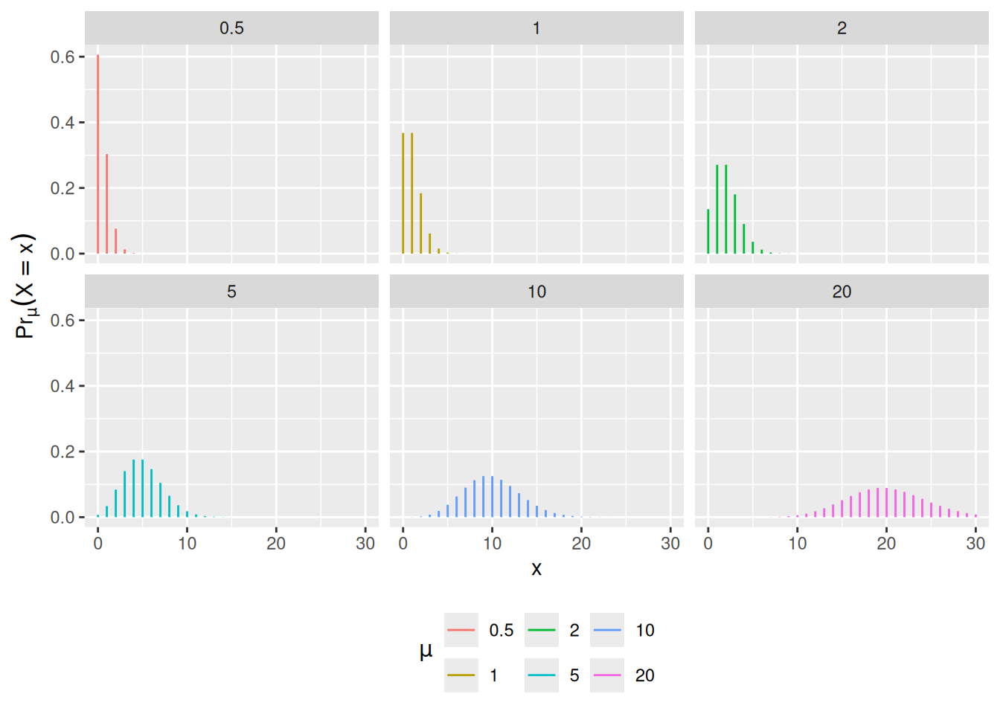
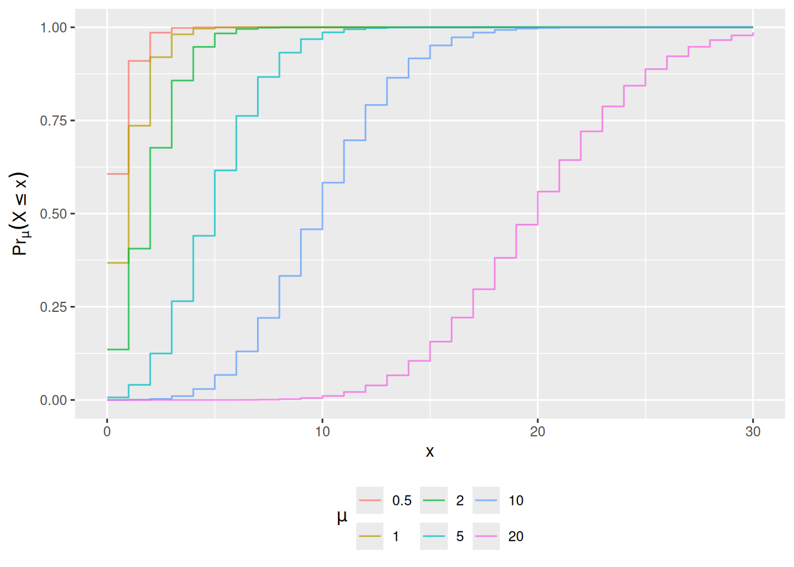
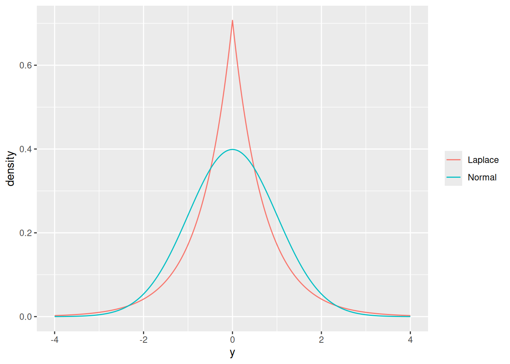

# Key distributions

Code

- [Show All Code](javascript:void(0))

- [Hide All Code](javascript:void(0))

- 

  ------------------------------------------------------------------------

- [View Source](javascript:void(0))

Published

Last modified: 2026-10-23 13:20:10 (PDT)

> **NOTE:**
>
> *Remark*. Some distributions are typically used for outcome models ([Table 1](#tbl-outcome-distns)); other distributions are typically used for test statistics ([Table 2](#tbl-test-stat-distns)).

> **NOTE:**
>
> | Distribution | Uses |
> |----|----|
> | [Bernoulli](random-variables.llms.md#def-bernoulli) | Binary outcomes |
> | [Binomial](#def-binomial) | Sums of Bernoulli outcomes |
> | Poisson | Unbounded count outcomes |
> | Geometric | Counts of non-events before an event occurs |
> | Negative binomial | Mixtures of Poisson distributions, counts of non-events until a given number of events occurs |
> | [Normal (Gaussian)](random-variables.llms.md#def-normal) | Continuous outcomes without a more specific distribution |
> | [Multivariate normal](#sec-mvn) | Vectors of continuous outcomes |
> | [Mixtures](#sec-mixture) | Outcomes from a population of unobserved subpopulations |
> | [Exponential](random-variables.llms.md#def-exponential) | Time to event outcomes |
> | Gamma | Time to event outcomes |
> | Weibull | Time to event outcomes |
> | Log-normal | Time to event outcomes |
>
> Table 1: Distributions typically used for outcome models

> **NOTE:**
>
> | Distribution | Uses |
> |----|----|
> | \\\chi^2\\ | Regression comparisons (asymptotic), contingency table independence tests, goodness-of-fit tests |
> | \\F\\ | Gaussian model comparisons (exact) |
> | \\Z\\ (standard normal) | Proportions, means, regression coefficients (asymptotic) |
> | \\t\\ (Student’s) | Means, regression coefficients in Gaussian outcome models (exact) |
>
> Table 2: Distributions typically used for test statistics

## 1 The Bernoulli distribution

> **NOTE:**
>
> **Example 1 (A coin flip)** The [Bernoulli distribution](random-variables.llms.md#def-bernoulli) describes a binary outcome. The indicator of heads on one flip of a fair coin is \\\operatorname{Ber}(1/2)\\. By the [expectation of the Bernoulli distribution](expectation.llms.md#thm-bernoulli-mean), \\X \sim \operatorname{Ber}(\pi)\\ has mean \\\pi\\, and by the [variance of a Bernoulli random variable](variance-covariance.llms.md#exm-variance-bernoulli), it has variance \\\pi(1 - \pi)\\.

## 2 The binomial distribution

> **NOTE:**
>
> **Definition 1 (Binomial distribution)** A [discrete](random-variables.llms.md#def-discrete-rv) random variable \\X\\ has the **binomial distribution** with number of trials \\n \in {\mathopen{}\left\\1, 2, \dots\right\\\mathclose{}}\\ and event probability \\\pi\in \[0, 1\]\\, written \\X \sim {\operatorname{Bin}\mathopen{}\left(n, \pi\right)\mathclose{}}\\ [\[1\]](#ref-wikipedia_binomial_distribution), if:
>
> \\ \mathbb{P}(X = x) \stackrel{\text{def}}{=}\binom{n}{x} \pi^x (1 - \pi)^{n - x}, \quad x \in {\mathopen{}\left\\0, 1, \dots, n\right\\\mathclose{}} \tag{1}\\
>
> where \\\binom{n}{x} = \frac{n!}{x!\\(n - x)!}\\ is the number of ways to choose \\x\\ of the \\n\\ trials.

> **NOTE:**
>
> *Remark*. Casella and Berger [\[2, Sec. 3.2\]](#ref-CaseBerg01) defines the binomial distribution the same way. With \\n = 1\\, [Equation 1](#eq-binom-pmf) is the [Bernoulli PMF](random-variables.llms.md#def-bernoulli): \\{\operatorname{Bin}\mathopen{}\left(1, \pi\right)\mathclose{}}\\ and \\\operatorname{Ber}(\pi)\\ are the same distribution.

> **NOTE:**
>
> **Example 2 (Two heads in three flips)** Let \\X \sim {\operatorname{Bin}\mathopen{}\left(3, 1/2\right)\mathclose{}}\\ be the number of heads in three flips of a fair coin. By [Equation 1](#eq-binom-pmf):
>
> \\ \begin{aligned} \mathbb{P}(X = 2) &= \binom{3}{2} \mathopen{}\left(\frac{1}{2}\right)\mathclose{}^2 \mathopen{}\left(1 - \frac{1}{2}\right)\mathclose{}^{3 - 2} && \text{(binomial PMF with } n = 3,\\ \pi= 1/2,\\ x = 2 \text{)} \\ &= \frac{3!}{2!\\1!} \mathopen{}\left(\frac{1}{2}\right)\mathclose{}^2 \mathopen{}\left(\frac{1}{2}\right)\mathclose{}^1 && \text{(definition of } \tbinom{3}{2} \text{; } 1 - 1/2 = 1/2 \text{)} \\ &= 3 \cdot\frac{1}{4} \cdot\frac{1}{2} && \text{(evaluate the factorials and powers)} \\ &= \frac{3}{8} && \text{(multiply)} \end{aligned} \\
>
> The three outcomes with two heads are \\HHT\\, \\HTH\\, and \\THH\\, each with probability \\1/8\\.

> **NOTE:**
>
> **Example 3 (Draws without replacement are not binomial)** An urn holds two red balls and two blue balls. Draw two balls without replacement, and let \\X\\ be the number of red balls drawn. Each draw is red with probability \\1/2\\, but \\X \not\sim {\operatorname{Bin}\mathopen{}\left(2, 1/2\right)\mathclose{}}\\, because the draws are not [independent](independence.llms.md#def-indpt):
>
> \\ \begin{aligned} \mathbb{P}(X = 2) &= \mathbb{P}(\text{first red}) \cdot\mathbb{P}(\text{second red} \mid \text{first red}) && \text{(multiplication rule)} \\ &= \frac{2}{4} \cdot\frac{1}{3} && \text{(one red ball is left among three)} \\ &= \frac{1}{6} && \text{(multiply)} \end{aligned} \\
>
> whereas, by [Equation 1](#eq-binom-pmf), a \\{\operatorname{Bin}\mathopen{}\left(2, 1/2\right)\mathclose{}}\\ random variable has
>
> \\ \begin{aligned} \mathbb{P}(X = 2) &= \binom{2}{2} \mathopen{}\left(\frac{1}{2}\right)\mathclose{}^2 \mathopen{}\left(\frac{1}{2}\right)\mathclose{}^0 && \text{(binomial PMF with } n = 2,\\ \pi= 1/2,\\ x = 2 \text{)} \\ &= \frac{1}{4} && \text{(evaluate)} \end{aligned} \\

> **NOTE:**
>
> **Theorem 1 (A sum of IID Bernoulli variables is binomial)** If \\X_1, \ldots, X_n\\ are [IID](independence.llms.md#def-iid) \\\operatorname{Ber}(\pi)\\ random variables, then their sum \\S = \sum\_{i=1}^nX_i\\ has the \\{\operatorname{Bin}\mathopen{}\left(n, \pi\right)\mathclose{}}\\ distribution.

> **NOTE:**
>
> *Proof*. Each \\X_i\\ is \\0\\ or \\1\\, so \\S\\ takes values in \\{\mathopen{}\left\\0, 1, \dots, n\right\\\mathclose{}}\\. Let \\x \in {\mathopen{}\left\\0, 1, \dots, n\right\\\mathclose{}}\\ be a value of \\S\\, and let \\A_x\\ be the set of sequences \\(s_1, \ldots, s_n) \in {\mathopen{}\left\\0, 1\right\\\mathclose{}}^n\\ with exactly \\x\\ ones. The event \\{\mathopen{}\left\\S = x\right\\\mathclose{}}\\ is the disjoint union of the events \\{\mathopen{}\left\\X_1 = s_1, \ldots, X_n = s_n\right\\\mathclose{}}\\ over \\(s_1, \ldots, s_n) \in A_x\\. For one such sequence:
>
> \\ \begin{aligned} \mathbb{P}(X_1 = s_1, \ldots, X_n = s_n) &= \prod\_{i=1}^n \mathbb{P}(X_i = s_i) && \text{(independence)} \\ &= \prod\_{i=1}^n \pi^{s_i} (1 - \pi)^{1 - s_i} && \text{(Bernoulli PMF)} \\ &= \pi^{\sum\_{i=1}^ns_i} (1 - \pi)^{\sum\_{i=1}^n(1 - s_i)} && \text{(collect exponents)} \\ &= \pi^x (1 - \pi)^{n - x} && \text{(} \textstyle\sum\_{i=1}^ns_i = x \text{ for a sequence in } A_x \text{)} \end{aligned} \\
>
> Choosing which \\x\\ of the \\n\\ positions hold the ones determines the sequence, so \\A_x\\ has \\\binom{n}{x}\\ elements. Therefore:
>
> \\ \begin{aligned} \mathbb{P}(S = x) &= \sum\_{(s_1, \ldots, s_n) \in A_x} \mathbb{P}(X_1 = s_1, \ldots, X_n = s_n) && \text{(additivity over disjoint events)} \\ &= \sum\_{(s_1, \ldots, s_n) \in A_x} \pi^x (1 - \pi)^{n - x} && \text{(probability of one sequence)} \\ &= \binom{n}{x} \pi^x (1 - \pi)^{n - x} && \text{(} A_x \text{ has } \tbinom{n}{x} \text{ elements)} \end{aligned} \\
>
> which is [Equation 1](#eq-binom-pmf).

> **NOTE:**
>
> **Example 4 (Counting treatment responders)** Suppose five patients each respond to a treatment with probability \\0.2\\, independently of one another, and let \\X_i = 1\\ if patient \\i\\ responds and \\X_i = 0\\ otherwise. By [Theorem 1](#thm-binomial-sum-bernoulli), the number of responders \\S = \sum\_{i=1}^5 X_i\\ is \\{\operatorname{Bin}\mathopen{}\left(5, 0.2\right)\mathclose{}}\\, so the probability that nobody responds is:
>
> \\ \begin{aligned} \mathbb{P}(S = 0) &= \binom{5}{0} (0.2)^0 (1 - 0.2)^{5 - 0} && \text{(binomial PMF with } n = 5,\\ \pi= 0.2,\\ x = 0 \text{)} \\ &= 1 \cdot 1 \cdot(0.8)^5 && \text{(} \tbinom{5}{0} = 1 \text{ and } (0.2)^0 = 1 \text{)} \\ &= 0.32768 && \text{(evaluate the power)} \end{aligned} \\

> **NOTE:**
>
> **Theorem 2 (Mean and variance of the binomial distribution)** If \\X \sim {\operatorname{Bin}\mathopen{}\left(n, \pi\right)\mathclose{}}\\, then:
>
> - \\{\mathbb{E}\mathopen{}\left\[X\right\]\mathclose{}} = n\pi\\
> - \\{\operatorname{Var}\mathopen{}\left(X\right)\mathclose{}} = n\pi(1 - \pi)\\

> **NOTE:**
>
> *Proof*. The mean and variance of \\X\\ depend only on its distribution, so by [Theorem 1](#thm-binomial-sum-bernoulli) we can compute them for \\S = \sum\_{i=1}^nX_i\\, where \\X_1, \ldots, X_n\\ are IID \\\operatorname{Ber}(\pi)\\. For the mean, apply [linearity of expectation](expectation.llms.md#thm-linearity-expectation) \\n - 1\\ times, then the [Bernoulli mean](expectation.llms.md#thm-bernoulli-mean):
>
> \\ \begin{aligned} {\mathbb{E}\mathopen{}\left\[S\right\]\mathclose{}} &= {\mathbb{E}\mathopen{}\left\[\sum\_{i=1}^nX_i\right\]\mathclose{}} && \text{(definition of } S \text{)} \\ &= \sum\_{i=1}^n{\mathbb{E}\mathopen{}\left\[X_i\right\]\mathclose{}} && \text{(linearity of expectation)} \\ &= \sum\_{i=1}^n\pi && \text{(Bernoulli mean)} \\ &= n\pi && \text{(sum of } n \text{ copies of } \pi\text{)} \end{aligned} \\
>
> For the variance, apply the [variance of a linear combination](variance-covariance.llms.md#thm-var-lincom) with \\a_1 = \cdots = a_n = 1\\, then [independent components give a diagonal variance matrix](variance-covariance.llms.md#cor-vcov-indpt-diagonal), then the [Bernoulli variance](variance-covariance.llms.md#exm-variance-bernoulli):
>
> \\ \begin{aligned} {\operatorname{Var}\mathopen{}\left(S\right)\mathclose{}} &= \sum\_{i=1}^n\sum\_{j=1}^n {\operatorname{Cov}\mathopen{}\left(X_i, X_j\right)\mathclose{}} && \text{(variance of a linear combination with } a_i = 1 \text{)} \\ &= \sum\_{i=1}^n{\operatorname{Cov}\mathopen{}\left(X_i, X_i\right)\mathclose{}} && \text{(} {\operatorname{Cov}\mathopen{}\left(X_i, X_j\right)\mathclose{}} = 0 \text{ for } i \neq j \text{, by independence)} \\ &= \sum\_{i=1}^n{\operatorname{Var}\mathopen{}\left(X_i\right)\mathclose{}} && \text{(} {\operatorname{Cov}\mathopen{}\left(X_i, X_i\right)\mathclose{}} = {\operatorname{Var}\mathopen{}\left(X_i\right)\mathclose{}} \text{)} \\ &= \sum\_{i=1}^n\pi(1 - \pi) && \text{(Bernoulli variance)} \\ &= n\pi(1 - \pi) && \text{(sum of } n \text{ copies of } \pi(1 - \pi) \text{)} \end{aligned} \\

> **NOTE:**
>
> **Example 5 (Expected number of responders)** In [Example 4](#exm-binomial-sum-bernoulli), \\S \sim {\operatorname{Bin}\mathopen{}\left(5, 0.2\right)\mathclose{}}\\. By [Theorem 2](#thm-binomial-moments):
>
> \\ \begin{aligned} {\mathbb{E}\mathopen{}\left\[S\right\]\mathclose{}} &= 5 \cdot 0.2 && \text{(} n\pi\text{)} \\ &= 1 && \text{(multiply)} \\ {\operatorname{Var}\mathopen{}\left(S\right)\mathclose{}} &= 5 \cdot 0.2 \cdot(1 - 0.2) && \text{(} n\pi(1 - \pi) \text{)} \\ &= 0.8 && \text{(multiply)} \end{aligned} \\
>
> On average, one of the five patients responds.

## 3 The Poisson distribution

> **NOTE:**
>
> **Definition 2 (Poisson distribution)** A random variable \\Y\\ has the **Poisson distribution** with mean parameter \\\mu\> 0\\, written \\Y \sim \operatorname{Pois}(\mu)\\ [\[3\]](#ref-wikipedia_poisson_distribution), if:
>
> \\\mathbb{P}(Y = y) \stackrel{\text{def}}{=}\frac{\mu^{y} e^{-\mu}}{y!}, \quad y \in \mathbb{N}= {\mathopen{}\left\\0, 1, 2, \dots\right\\\mathclose{}} \tag{2}\\

> **NOTE:**
>
> *Remark*. (see [Figure 1](#fig-pois-pmf))

> **NOTE:**
>
> **Exercise 1** What is the range of possible values for a Poisson distribution?

> **NOTE:**
>
> *Solution 1*. \\ \begin{aligned} \mathcal{R}(Y) &= {\mathopen{}\left\\0, 1, 2, \dots\right\\\mathclose{}} \\ &= \mathbb{N} \end{aligned} \\

> **NOTE:**
>
> **Theorem 3 (CDF of Poisson distribution)** If \\Y \sim \operatorname{Pois}(\mu)\\, then for every real number \\y\\:
>
> \\\mathbb{P}(Y \le y) = e^{-\mu} \sum\_{j=0}^{\mathopen{}\left\lfloor y\right\rfloor\mathclose{}}\frac{\mu^j}{j!} \tag{3}\\

> **NOTE:**
>
> *Proof*. For \\y \< 0\\, both sides are \\0\\ (the sum is empty). For any \\y \ge 0\\, the event \\\\Y \le y\\\\ is the disjoint union of events \\\\Y = j\\\\ for all non-negative integers \\j \le \mathopen{}\left\lfloor y\right\rfloor\mathclose{}\\. Applying the Poisson PMF ([Equation 2](#eq-pois-pmf)) and factoring out the common term \\e^{-\mu}\\:
>
> \\ \begin{aligned} \mathbb{P}(Y \le y) &= \sum\_{j=0}^{\mathopen{}\left\lfloor y\right\rfloor\mathclose{}} \mathbb{P}(Y = j) && (\text{disjoint union of events } Y = j) \\ &= \sum\_{j=0}^{\mathopen{}\left\lfloor y\right\rfloor\mathclose{}} \frac{\mu^j e^{-\mu}}{j!} && (\text{definition of Poisson PMF}) \\ &= e^{-\mu} \sum\_{j=0}^{\mathopen{}\left\lfloor y\right\rfloor\mathclose{}} \frac{\mu^j}{j!} && (\text{factoring out } e^{-\mu} \text{ constant wrt } j) \end{aligned} \\

> **NOTE:**
>
> **Example 6 (Computing Poisson cumulative probabilities)** For a Poisson random variable \\X \sim \operatorname{Pois}(\mu= 2)\\, the probability of observing at most 2 events is computed as:
>
> \\ \begin{aligned} \mathbb{P}(X \le 2) &= e^{-2} \sum\_{j=0}^{2} \frac{2^j}{j!} && (\text{apply CDF formula with } \mu= 2, y = 2) \\ &= e^{-2} \mathopen{}\left(\frac{2^0}{0!} + \frac{2^1}{1!} + \frac{2^2}{2!}\right)\mathclose{} && (\text{expand terms for } j = 0, 1, 2) \\ &= e^{-2} \mathopen{}\left(1 + 2 + 2\right)\mathclose{} && (\text{simplify factorials and powers}) \\ &= 5 e^{-2} \approx 0.677 && (\text{evaluate numerical value}) \end{aligned} \\

> **NOTE:**
>
> *Remark*. (see [Figure 2](#fig-pois-cdfs))

Show code

``` r
pois_dists <-
  dplyr::tibble(mu = c(0.5, 1, 2, 5, 10, 20)) |>
  dplyr::reframe(.by = mu, x = 0:30) |>
  dplyr::mutate(
    `P(X = x)` = dpois(x, lambda = mu),
    `P(X <= x)` = ppois(x, lambda = mu),
    mu = factor(mu)
  )

plot0 <-
  pois_dists |>
  ggplot2::ggplot(
    ggplot2::aes(
      x = x,
      y = `P(X = x)`,
      fill = mu,
      col = mu
    )
  ) +
  ggplot2::theme(legend.position = "bottom") +
  ggplot2::labs(
    fill = latex2exp::TeX("$\\mu$"),
    col = latex2exp::TeX("$\\mu$"),
    y = latex2exp::TeX("$\\Pr_{\\mu}(X = x)$")
  )

plot1 <-
  plot0 +
  ggplot2::geom_segment(yend = 0) +
  ggplot2::facet_wrap(~mu)

print(plot1)
```

> **NOTE:**
>
> [](distributions_files/figure-html/fig-pois-pmf-1.png "Figure 1: Poisson PMFs, by mean parameter \mu")
>
> Figure 1: Poisson PMFs, by mean parameter \\\mu\\

Show code

``` r
plot2 <-
  plot0 +
  ggplot2::geom_step(alpha = 0.75) +
  ggplot2::aes(y = `P(X <= x)`) +
  ggplot2::labs(y = latex2exp::TeX("$\\Pr_{\\mu}(X \\leq x)$"))

print(plot2)
```

> **NOTE:**
>
> [](distributions_files/figure-html/fig-pois-cdfs-1.png "Figure 2: Poisson CDFs")
>
> Figure 2: Poisson CDFs

> **NOTE:**
>
> **Exercise 2 (Poisson distribution functions)** Let \\X \sim \operatorname{Pois}(\mu= 3.75)\\.
>
> Compute:
>
> - \\\mathbb{P}(X = 4)\\
> - \\\mathbb{P}(X \le 7)\\
> - \\\mathbb{P}(X \> 5)\\

> **NOTE:**
>
> *Solution*.
>
> - \\\mathbb{P}(X=4) = 0.1937803\\
> - \\\mathbb{P}(X\le 7) = 0.9623787\\
> - \\\mathbb{P}(X \> 5) = 0.1771172\\

> **NOTE:**
>
> **Theorem 4 (Mean and variance of the Poisson distribution)** If \\X \sim \operatorname{Pois}(\mu)\\, then:
>
> - \\\mathbb{E}\[X\] = \mu\\
> - \\\operatorname{Var}(X) = \mu\\

> **NOTE:**
>
> *Proof*. **Mean.**
>
> \\ \begin{aligned} \mathbb{E}\[X\] &= \sum\_{x=0}^\infty x \cdot \mathbb{P}(X=x) && (\text{definition of expected value}) \\ &= 0 \cdot \mathbb{P}(X=0) + \sum\_{x=1}^{\infty} x \cdot \mathbb{P}(X=x) && (\text{separate } x=0 \text{ term}) \\ &= \sum\_{x=1}^{\infty} x \cdot \frac{\mu^x e^{-\mu}}{x!} && (\text{substitute Poisson PMF}) \\ &= \sum\_{x=1}^{\infty} x \cdot \frac{\mu^x e^{-\mu}}{x \cdot (x-1)!} && (\text{definition of factorial } x!) \\ &= \sum\_{x=1}^{\infty} \frac{\mu^x e^{-\mu}}{(x-1)!} && (\text{cancel factor of } x) \\ &= \mu\cdot \sum\_{x=1}^{\infty} \frac{\mu^{x-1} e^{-\mu}}{(x-1)!} && (\text{factor out one power of } \mu) \\ &= \mu\cdot \sum\_{y=0}^\infty \frac{\mu^y e^{-\mu}}{y!} && (\text{change index variable } y \stackrel{\text{def}}{=}x-1) \\ &= \mu\cdot 1 && (\text{PMF sums to 1 over state space}) \\ &= \mu&& (\text{simplify}) \end{aligned} \\
>
> **Variance.** The same steps, canceling two factors instead of one, give \\{\mathbb{E}\mathopen{}\left\[X(X-1)\right\]\mathclose{}}\\:
>
> \\ \begin{aligned} {\mathbb{E}\mathopen{}\left\[X(X-1)\right\]\mathclose{}} &= \sum\_{x=2}^\infty x(x-1) \cdot \frac{\mu^x e^{-\mu}}{x!} && (\text{LOTUS; the } x = 0, 1 \text{ terms are } 0) \\ &= \sum\_{x=2}^\infty \frac{\mu^x e^{-\mu}}{(x-2)!} && (\text{cancel } x(x-1) \text{ against } x!) \\ &= \mu^2 \cdot \sum\_{y=0}^\infty \frac{\mu^y e^{-\mu}}{y!} && (\text{factor out } \mu^2 \text{; } y \stackrel{\text{def}}{=}x - 2) \\ &= \mu^2 && (\text{PMF sums to 1}) \end{aligned} \\
>
> Then, by the [simplified expression for variance](variance-covariance.llms.md#thm-variance) and [linearity of expectation](expectation.llms.md#thm-linearity-expectation):
>
> \\ \begin{aligned} \operatorname{Var}(X) &= {\mathbb{E}\mathopen{}\left\[X^2\right\]\mathclose{}} - {\mathopen{}\left({\mathbb{E}\mathopen{}\left\[X\right\]\mathclose{}}\right)\mathclose{}}^{2} && (\text{simplified expression for variance}) \\ &= {\mathbb{E}\mathopen{}\left\[X(X-1)\right\]\mathclose{}} + {\mathbb{E}\mathopen{}\left\[X\right\]\mathclose{}} - {\mathopen{}\left({\mathbb{E}\mathopen{}\left\[X\right\]\mathclose{}}\right)\mathclose{}}^{2} && (X^2 = X(X-1) + X \text{; linearity}) \\ &= \mu^2 + \mu- \mu^2 && (\text{substitute}) \\ &= \mu&& (\text{simplify}) \end{aligned} \\
>
> See also <https://statproofbook.github.io/P/poiss-mean> and <https://statproofbook.github.io/P/poiss-var>.

> **NOTE:**
>
> **Theorem 5 (Ratio of consecutive Poisson probabilities, and the mode)** If \\X \sim \operatorname{Pois}(\mu)\\, then:
>
> - \\\mathbb{P}(X=x) = \frac{\mu}{x} \mathbb{P}(X = x-1)\\ for \\x \in {\mathopen{}\left\\1, 2, \dots\right\\\mathclose{}}\\
> - For \\x \in {\mathopen{}\left\\1, 2, \dots\right\\\mathclose{}}\\ with \\x \< \mu\\, \\\mathbb{P}(X=x) \> \mathbb{P}(X = x-1)\\
> - For \\x = \mu\\ (possible only when \\\mu\\ is an integer), \\\mathbb{P}(X=x) = \mathbb{P}(X = x-1)\\
> - For \\x \in {\mathopen{}\left\\1, 2, \dots\right\\\mathclose{}}\\ with \\x \> \mu\\, \\\mathbb{P}(X=x) \< \mathbb{P}(X = x-1)\\
> - If \\\mu\\ is not an integer, \\\arg \max\_{x} \mathbb{P}(X=x) = \mathopen{}\left\lfloor\mu\right\rfloor\mathclose{}\\; if \\\mu\\ is an integer, the maximum is attained at both \\x = \mu- 1\\ and \\x = \mu\\

> **NOTE:**
>
> *Proof*. **Ratio of consecutive probabilities.** For \\x \in {\mathopen{}\left\\1, 2, \dots\right\\\mathclose{}}\\:
>
> \\ \begin{aligned} \frac{\mathbb{P}(X = x)}{\mathbb{P}(X = x - 1)} &= \frac{\mu^x e^{-\mu} / x!}{\mu^{x-1} e^{-\mu} / (x-1)!} && (\text{substitute Poisson PMF}) \\ &= \frac{\mu}{x} && (\text{cancel } \mu^{x-1} e^{-\mu} \text{ and } (x-1)!) \end{aligned} \\
>
> This ratio is greater than, equal to, or less than 1 as \\x\\ is less than, equal to, or greater than \\\mu\\, which gives the three comparisons. So \\\mathbb{P}(X = x)\\ increases while \\x \< \mu\\ and decreases once \\x \> \mu\\. If \\\mu\\ is not an integer, the last increase is at \\x = \mathopen{}\left\lfloor\mu\right\rfloor\mathclose{}\\, which is therefore the unique mode. If \\\mu\\ is an integer, \\\mathbb{P}(X = \mu) = \mathbb{P}(X = \mu- 1)\\, and both are modes.

> **NOTE:**
>
> **Example 7 (Mode of a Poisson distribution)** For \\X \sim \operatorname{Pois}(2.5)\\, \\\mathbb{P}(X = 2) = \frac{2.5}{2}\mathbb{P}(X = 1) \> \mathbb{P}(X = 1)\\ and \\\mathbb{P}(X = 3) = \frac{2.5}{3}\mathbb{P}(X = 2) \< \mathbb{P}(X = 2)\\, so the mode is \\\mathopen{}\left\lfloor 2.5\right\rfloor\mathclose{} = 2\\. For \\X \sim \operatorname{Pois}(2)\\, \\\mathbb{P}(X = 2) = \frac{2}{2}\mathbb{P}(X = 1)\\, so \\1\\ and \\2\\ are both modes, each with probability \\2 e^{-2} \approx 0.271\\.

> **NOTE:**
>
> **Definition 3 (Exposure magnitude)** For many count outcomes, there is some sense of an **exposure magnitude**, such as population size or duration of observation, which multiplicatively rescales the expected (mean) count.

> **NOTE:**
>
> **Exercise 3** What are some examples of exposure magnitudes?

> **NOTE:**
>
> *Solution*.
>
> > **NOTE:**
> >
> > | outcome            | exposure units                              |
> > |--------------------|---------------------------------------------|
> > | disease incidence  | number of individuals exposed; time at risk |
> > | car accidents      | miles driven                                |
> > | worksite accidents | person-hours worked                         |
> > | population size    | size of habitat                             |
> >
> > Table 3: Examples of exposure units

> **NOTE:**
>
> *Remark*. Exposure units are similar to the number of trials in a binomial distribution, but **in non-binomial count outcomes, there can be more than one event per unit of exposure**.
>
> We can use \\t\\ to represent continuous-valued exposures/observation durations, and \\n\\ to represent discrete-valued exposures.

> **NOTE:**
>
> **Definition 4 (Event rate)** For a count \\Y\\ observed over a fixed, known [exposure magnitude](#def-exposure) \\t \> 0\\, the **event rate**, denoted \\{\lambda}\\, is the mean of \\Y\\ divided by the exposure magnitude:
>
> \\{\lambda}\stackrel{\text{def}}{=}\frac{{\mathbb{E}\mathopen{}\left\[Y\right\]\mathclose{}}}{t} \tag{4}\\

> **NOTE:**
>
> *Remark*. The event rate is a transformation of the mean: it removes the exposure magnitude from the mean, so counts observed over different exposures can be compared on one scale. Regression models for counts use the same decomposition, with the rate depending on covariates and the exposure magnitude known (see [rme’s count-regression chapter](https://morrison-lab.github.io/rme/chapters/count-regression.html)).

> **NOTE:**
>
> **Theorem 6 (Transformation function from event rate to mean)** If a count \\Y\\ is observed over exposure magnitude \\t \> 0\\ with event rate \\{\lambda}\\, then its mean \\\mu\stackrel{\text{def}}{=}{\mathbb{E}\mathopen{}\left\[Y\right\]\mathclose{}}\\ is:
>
> \\\mu= {\lambda}\cdot t \tag{5}\\

> **NOTE:**
>
> *Proof*. By [Definition 4](#def-event-rate):
>
> \\ \begin{aligned} {\lambda}&\stackrel{\text{def}}{=}\frac{{\mathbb{E}\mathopen{}\left\[Y\right\]\mathclose{}}}{t} && (\text{definition of event rate}) \\ {\mathbb{E}\mathopen{}\left\[Y\right\]\mathclose{}} &= {\lambda}\cdot t && (\text{multiply both sides by } t \> 0) \\ \mu&= {\lambda}\cdot t && (\mu\stackrel{\text{def}}{=}{\mathbb{E}\mathopen{}\left\[Y\right\]\mathclose{}}) \end{aligned} \\

> **NOTE:**
>
> **Example 8 (Calculating expected counts from event rates)** Suppose a city records a disease event rate of \\{\lambda}= 0.05\\ cases per person-year. For a subpopulation with an exposure magnitude of \\t = 100\\ person-years, the expected count of cases is, by [Theorem 6](#thm-mean-vs-event-rate):
>
> \\ \begin{aligned} \mu&= {\lambda}\cdot t && (\text{transformation from event rate to mean}) \\ &= 0.05 \times 100 && (\text{substitute } {\lambda}= 0.05 \text{ and } t = 100) \\ &= 5 \text{ cases} && (\text{evaluate expected count}) \end{aligned} \\

> **NOTE:**
>
> **Theorem 7 (No exposure means no expected events)** For each exposure magnitude \\t \ge 0\\, let \\Y_t\\ be the count observed over exposure \\t\\. If the mean count is proportional to the exposure magnitude, \\{\mathbb{E}\mathopen{}\left\[Y_t\right\]\mathclose{}} = {\lambda}\cdot t\\ for all \\t \ge 0\\ with one finite rate \\{\lambda}\\, then there are no expected events without exposure:
>
> \\{\mathbb{E}\mathopen{}\left\[Y_0\right\]\mathclose{}} = 0\\

> **NOTE:**
>
> *Proof*. \\ \begin{aligned} {\mathbb{E}\mathopen{}\left\[Y_0\right\]\mathclose{}} &= {\lambda}\cdot 0 && (\text{evaluate } {\mathbb{E}\mathopen{}\left\[Y_t\right\]\mathclose{}} = {\lambda}t \text{ at } t = 0) \\ &= 0 && (\text{multiplication by zero; } {\lambda}\text{ is finite}) \end{aligned} \\

> **NOTE:**
>
> *Remark*. The hypothesis carries the content here. [Definition 4](#def-event-rate) alone cannot give \\{\mathbb{E}\mathopen{}\left\[Y_0\right\]\mathclose{}} = 0\\, since \\{\lambda}= {\mathbb{E}\mathopen{}\left\[Y\right\]\mathclose{}}/t\\ is undefined at \\t = 0\\; the result holds for a model that assumes one rate \\{\lambda}\\ shared across exposure magnitudes, including \\t = 0\\.

> **NOTE:**
>
> **Example 9 (Zero exposure time)** If a subject is observed for \\t = 0\\ person-years, no follow-up time has elapsed, so under a constant-rate model the expected number of incident events is \\{\mathbb{E}\mathopen{}\left\[Y_0\right\]\mathclose{}} = 0\\.

> **IMPORTANT:**
>
> A mean proportional to exposure, \\{\mathbb{E}\mathopen{}\left\[Y_t\right\]\mathclose{}} = {\lambda}t\\, has no term that stays nonzero at \\t = 0\\: a model of this form says that with no exposure, no events are expected. A mean with an added constant, such as \\{\mathbb{E}\mathopen{}\left\[Y_t\right\]\mathclose{}} = c + {\lambda}t\\ with \\c \> 0\\, would expect \\c\\ events even with no exposure. Regression models for counts keep the proportional form when they add covariates (see [rme’s count-regression chapter](https://morrison-lab.github.io/rme/chapters/count-regression.html)).

> **NOTE:**
>
> **Theorem 8 (Exposure is additive on the log scale)** If \\\mu= {\lambda}\cdot t\\ with \\{\lambda}\> 0\\ and \\t \> 0\\, then:
>
> \\\log{\mu} = \log{{\lambda}} + \log{t}\\

> **NOTE:**
>
> *Proof*. \\ \begin{aligned} \log{\mu} &= \log({\lambda}\cdot t) && (\text{substitute } \mu= {\lambda}\cdot t) \\ &= \log{{\lambda}} + \log{t} && (\text{logarithm product rule}) \end{aligned} \\

> **NOTE:**
>
> **Example 10 (Log-linear representation of expected counts)** If a clinic sees an event rate of \\{\lambda}= 0.02\\ events/day and \\t = 30\\ days of observation:
>
> \\ \begin{aligned} \log{\mu} &= \log(0.02) + \log(30) && (\text{apply log-scale formula}) \\ &= -3.912 + 3.401 && (\text{evaluate natural logarithms}) \\ &= -0.511 && (\text{sum terms}) \end{aligned} \\
>
> Exponentiating yields \\\mu= {\operatorname{exp}\mathopen{}\left\\-0.511\right\\\mathclose{}} \approx 0.60\\ expected events.

> **NOTE:**
>
> **Definition 5 (Offset)** In a model whose linear component contains a term with no unknown coefficient, that term is called an **offset**: it shifts the linear component by a known amount. In a count model with exposure magnitude \\t\\, the offset is the known term \\\log{t}\\ in the log-scale decomposition of the [mean](expectation.llms.md#def-expectation) ([8](#thm-exposure-log-scale)),
>
> \\\log{\mu} = \log{{\lambda}} + \log{t}.\\

> **NOTE:**
>
> *Remark*. The offset needs no covariates: with a single exposure \\t\\ and an unknown rate \\{\lambda}\\, \\\log{t}\\ is already an offset. Regression models for counts keep the same term and add covariate terms beside it (see [rme’s count-regression chapter](https://morrison-lab.github.io/rme/chapters/count-regression.html)).

> **NOTE:**
>
> **Example 11 (The offset for a clinic’s event count)** In [Example 10](#exm-exposure-log-scale), the clinic was observed for \\t = 30\\ days, so the offset is \\\log{30} \approx 3.401\\. Only \\\log{{\lambda}}\\ is unknown before the data are seen; the offset is fixed by the length of observation. A clinic observed for \\t = 60\\ days has offset \\\log{60} \approx 4.094\\, which raises \\\log{\mu}\\ by \\\log{2} \approx 0.693\\ at the same event rate.

> **NOTE:**
>
> **Theorem 9 (Sum of independent Poisson random variables)** If \\X\\ and \\Y\\ are [independent](independence.llms.md#def-indpt) Poisson random variables with means \\\mu_X\\ and \\\mu_Y\\, their sum, \\Z=X+Y\\, is also a Poisson random variable, with mean \\\mu_Z = \mu_X + \mu_Y\\.

> **NOTE:**
>
> *Proof*. The event \\\\Z = z\\\\ is the disjoint union of the events \\\\X = k, Y = z - k\\\\ for \\k = 0, 1, \ldots, z\\ (since \\X\\ and \\Y\\ are non-negative integers), so:
>
> \\ \begin{aligned} \mathbb{P}(Z = z) &= \sum\_{k=0}^z \mathbb{P}(X = k,\\ Y = z - k) && (\text{countable additivity}) \\ &= \sum\_{k=0}^z \mathbb{P}(X = k) \mathbb{P}(Y = z - k) && (\text{independence}) \\ &= \sum\_{k=0}^z \frac{\mu_X^k e^{-\mu_X}}{k!} \frac{\mu_Y^{z-k} e^{-\mu_Y}}{(z-k)!} && (\text{substitute Poisson PMFs}) \\ &= e^{-(\mu_X + \mu_Y)} \sum\_{k=0}^z \frac{\mu_X^k \mu_Y^{z-k}}{k!(z-k)!} && (\text{factor out } e^{-\mu_X} e^{-\mu_Y}) \\ &= \frac{e^{-(\mu_X + \mu_Y)}}{z!} \sum\_{k=0}^z \frac{z!}{k!(z-k)!} \mu_X^k \mu_Y^{z-k} && (\text{multiply and divide by } z!) \\ &= \frac{e^{-(\mu_X + \mu_Y)}}{z!} (\mu_X + \mu_Y)^z && (\text{binomial theorem}) \end{aligned} \\
>
> This probability expression matches the PMF of a \\\operatorname{Pois}(\mu_X + \mu_Y)\\ random variable (see also <https://web.stanford.edu/class/archive/cs/cs109/cs109.1206/lectureNotes/LN12_independent_rvs.pdf>, Example 3).

> **NOTE:**
>
> **Example 12 (Aggregating independent region counts)** Suppose Region A records \\X \sim \operatorname{Pois}(\mu_X = 12)\\ cases and Region B records \\Y \sim \operatorname{Pois}(\mu_Y = 18)\\ cases independently. By [Theorem 9](#thm-sum-pois), the combined total count \\Z = X + Y\\ follows a Poisson distribution:
>
> \\ \begin{aligned} Z &\sim \operatorname{Pois}(\mu_X + \mu_Y) && (\text{sum of independent Poissons}) \\ &= \operatorname{Pois}(12 + 18) && (\text{substitute region means}) \\ &= \operatorname{Pois}(30) && (\text{evaluate sum}) \end{aligned} \\

## 4 The Negative-Binomial distribution

> **NOTE:**
>
> **Definition 6 (Negative binomial distribution)** A random variable \\Y\\ has the **negative binomial distribution** with mean \\\mu\> 0\\ and overdispersion parameter \\\rho\> 0\\, written \\Y \sim \operatorname{NegBin}(\mu, \rho)\\ [\[4\]](#ref-wikipedia_negative_binomial_distribution), if, for \\y \in {\mathopen{}\left\\0, 1, 2, \dots\right\\\mathclose{}}\\:
>
> \\ \mathbb{P}(Y=y) \stackrel{\text{def}}{=}\frac{\mu^y}{y!} \cdot \frac{\Gamma(\rho+ y)}{\Gamma(\rho) \cdot (\rho+ \mu)^y} \cdot \mathopen{}\left(1+\frac{\mu}{\rho}\right)\mathclose{}^{-\rho} \\
>
> where \\\Gamma\\ is the gamma function, which satisfies \\\Gamma(x) = (x-1)!\\ for positive integers \\x\\.

> **NOTE:**
>
> **Theorem 10 (The negative binomial converges to the Poisson)** Let the population [mean](expectation.llms.md#def-expectation) be \\\mu\> 0\\, and let \\Y\_\rho\sim \operatorname{NegBin}(\mu, \rho)\\. Then for each \\y \in {\mathopen{}\left\\0, 1, 2, \dots\right\\\mathclose{}}\\, as \\\rho\rightarrow \infty\\, the negative binomial PMF converges to the [Poisson](#def-poisson) PMF ([Equation 2](#eq-pois-pmf)):
>
> \\\lim\_{\rho\rightarrow \infty} \mathbb{P}(Y\_\rho= y) = \frac{\mu^{y} e^{-\mu}}{y!}\\

> **NOTE:**
>
> *Proof*. Choose a value \\y\\ of \\Y\_\rho\\. In [Definition 6](#def-nb), the first factor \\\mu^y / y!\\ does not depend on \\\rho\\. For the second factor, \\\Gamma(\rho+ y) = \Gamma(\rho) \prod\_{k=0}^{y-1} (\rho+ k)\\, by applying \\\Gamma(x + 1) = x\\\Gamma(x)\\ \\y\\ times (for \\y = 0\\, the product is empty and equals 1), so:
>
> \\ \begin{aligned} \frac{\Gamma(\rho+ y)}{\Gamma(\rho) \cdot (\rho+ \mu)^y} &= \frac{\Gamma(\rho) \prod\_{k=0}^{y-1} (\rho+ k)}{\Gamma(\rho) \cdot (\rho+ \mu)^y} && (\Gamma(x + 1) = x\\\Gamma(x) \text{, applied } y \text{ times}) \\ &= \prod\_{k=0}^{y-1} \frac{\rho+ k}{\rho+ \mu} && (\text{cancel } \Gamma(\rho) \text{; one factor of } \rho+ \mu\text{ per } k) \\ &= \prod\_{k=0}^{y-1} \frac{1 + k/\rho}{1 + \mu/\rho} && (\text{divide each numerator and denominator by } \rho) \\ &\rightarrow \prod\_{k=0}^{y-1} \frac{1 + 0}{1 + 0} && (k/\rho\rightarrow 0 \text{ and } \mu/\rho\rightarrow 0 \text{; finitely many factors}) \\ &= 1 && (\text{simplify}) \end{aligned} \\
>
> For the third factor, write \\x \stackrel{\text{def}}{=}\mu/\rho\\, so \\x \rightarrow 0\\ as \\\rho\rightarrow \infty\\, and \\\rho= \mu/x\\:
>
> \\ \begin{aligned} \log\mathopen{}\left(\mathopen{}\left(1 + \frac{\mu}{\rho}\right)\mathclose{}^{-\rho}\right)\mathclose{} &= -\rho\log\mathopen{}\left(1 + \frac{\mu}{\rho}\right)\mathclose{} && (\text{log of a power}) \\ &= -\mu\cdot \frac{\log(1 + x)}{x} && (\text{substitute } \rho= \mu/x) \\ &\rightarrow -\mu\cdot 1 && (\textstyle\lim\_{x \rightarrow 0} \log(1 + x)/x = 1 \text{, the derivative of } \log(1 + x) \text{ at } x = 0) \\ &= -\mu && (\text{simplify}) \end{aligned} \\
>
> so, since the exponential function is continuous, \\\mathopen{}\left(1 + \mu/\rho\right)\mathclose{}^{-\rho} \rightarrow {\operatorname{exp}\mathopen{}\left\\-\mu\right\\\mathclose{}}\\. Each of the three factors has a limit, so their product does too:
>
> \\ \begin{aligned} \lim\_{\rho\rightarrow \infty} \mathbb{P}(Y\_\rho= y) &= \frac{\mu^y}{y!} \cdot 1 \cdot {\operatorname{exp}\mathopen{}\left\\-\mu\right\\\mathclose{}} && (\text{limit of a product of convergent factors}) \\ &= \frac{\mu^{y} e^{-\mu}}{y!} && (\text{rearrange}) \end{aligned} \\
>
> which is the \\\operatorname{Pois}(\mu)\\ PMF.

> **NOTE:**
>
> **Theorem 11 (Mean and variance of the negative binomial distribution)** If \\Y \sim \operatorname{NegBin}(\mu, \rho)\\, then:
>
> - \\\mathbb{E}\[Y\] = \mu\\
> - \\{\operatorname{Var}\mathopen{}\left(Y\right)\mathclose{}} = \mu+ \frac{\mu^2}{\rho} \> \mu\\

> **NOTE:**
>
> *Proof*. The negative binomial distribution is a gamma mixture of Poisson distributions: if \\\Lambda\\ has the gamma density \\g({\lambda}) = \frac{(\rho/\mu)^\rho}{\Gamma(\rho)} {\lambda}^{\rho- 1} e^{-\rho{\lambda}/\mu}\\ for \\{\lambda}\> 0\\, which has mean \\\mu\\ and variance \\\mu^2/\rho\\ [\[2\]](#ref-CaseBerg01), and \\Y \mid \Lambda= {\lambda}\sim \operatorname{Pois}({\lambda})\\, then \\Y \sim \operatorname{NegBin}(\mu, \rho)\\. To check this, integrate the joint density over \\{\lambda}\\:
>
> \\ \begin{aligned} \mathbb{P}(Y = y) &= \int_0^\infty \frac{{\lambda}^y e^{-{\lambda}}}{y!} \cdot\frac{(\rho/\mu)^\rho}{\Gamma(\rho)} {\lambda}^{\rho- 1} e^{-\rho{\lambda}/\mu}\\d{\lambda} && (\text{marginalize over } \Lambda) \\ &= \frac{(\rho/\mu)^\rho}{y!\\\Gamma(\rho)} \int_0^\infty {\lambda}^{y + \rho- 1} e^{-{\lambda}(1 + \rho/\mu)}\\d{\lambda} && (\text{collect powers of } {\lambda}\text{ and exponents}) \\ &= \frac{(\rho/\mu)^\rho}{y!\\\Gamma(\rho)} \cdot\frac{\Gamma(y + \rho)}{(1 + \rho/\mu)^{y + \rho}} && (\textstyle\int_0^\infty {\lambda}^{a-1} e^{-b{\lambda}}\\d{\lambda}= \Gamma(a)/b^a) \\ &= \frac{\Gamma(y + \rho)}{y!\\\Gamma(\rho)} \mathopen{}\left(\frac{\rho}{\mu}\right)\mathclose{}^\rho\mathopen{}\left(\frac{\mu}{\mu+ \rho}\right)\mathclose{}^{y + \rho} && (1 + \rho/\mu= (\mu+ \rho)/\mu) \\ &= \frac{\Gamma(y + \rho)}{y!\\\Gamma(\rho)} \mathopen{}\left(\frac{\rho}{\mu+ \rho}\right)\mathclose{}^{\rho} \mathopen{}\left(\frac{\mu}{\mu+ \rho}\right)\mathclose{}^{y} && (\text{combine the } \mu^\rho\text{ factors}) \\ &= \frac{\mu^y}{y!} \cdot\frac{\Gamma(\rho+ y)}{\Gamma(\rho)\\(\rho+ \mu)^y} \cdot\mathopen{}\left(1 + \frac{\mu}{\rho}\right)\mathclose{}^{-\rho} && (\text{rearrange into the form of the definition}) \end{aligned} \\
>
> Then, by the [law of iterated expectations](expectation.llms.md#thm-lie) and the [law of total variance](variance-covariance.llms.md#thm-total-variance), using
>
> \\ \begin{aligned} {\mathbb{E}\mathopen{}\left\[Y \mid \Lambda\right\]\mathclose{}} &= \operatorname{Var}(Y \mid \Lambda) \\ &= \Lambda \end{aligned} \\
>
> ([Theorem 4](#thm-poisson-properties)):
>
> \\ \begin{aligned} \mathbb{E}\[Y\] &= {\mathbb{E}\mathopen{}\left\[{\mathbb{E}\mathopen{}\left\[Y \mid \Lambda\right\]\mathclose{}}\right\]\mathclose{}} && (\text{law of iterated expectations}) \\ &= {\mathbb{E}\mathopen{}\left\[\Lambda\right\]\mathclose{}} && ({\mathbb{E}\mathopen{}\left\[Y \mid \Lambda\right\]\mathclose{}} = \Lambda) \\ &= \mu && (\text{mean of the gamma distribution}) \\ {\operatorname{Var}\mathopen{}\left(Y\right)\mathclose{}} &= {\mathbb{E}\mathopen{}\left\[{\operatorname{Var}\mathopen{}\left(Y \mid \Lambda\right)\mathclose{}}\right\]\mathclose{}} + {\operatorname{Var}\mathopen{}\left({\mathbb{E}\mathopen{}\left\[Y \mid \Lambda\right\]\mathclose{}}\right)\mathclose{}} && (\text{law of total variance}) \\ &= {\mathbb{E}\mathopen{}\left\[\Lambda\right\]\mathclose{}} + {\operatorname{Var}\mathopen{}\left(\Lambda\right)\mathclose{}} && ({\operatorname{Var}\mathopen{}\left(Y \mid \Lambda\right)\mathclose{}} = \Lambda\text{ and } {\mathbb{E}\mathopen{}\left\[Y \mid \Lambda\right\]\mathclose{}} = \Lambda) \\ &= \mu+ \frac{\mu^2}{\rho} && (\text{mean and variance of the gamma distribution}) \end{aligned} \\
>
> and \\\mu^2/\rho\> 0\\ gives \\{\operatorname{Var}\mathopen{}\left(Y\right)\mathclose{}} \> \mu\\.

> **NOTE:**
>
> **Example 13 (Overdispersion relative to the Poisson)** With \\\mu= 4\\ and \\\rho= 2\\,
>
> \\ \begin{aligned} {\operatorname{Var}\mathopen{}\left(Y\right)\mathclose{}} &= 4 + 16/2 \\ &= 12, \end{aligned} \\
>
> three times the variance of a \\\operatorname{Pois}(4)\\ count with the same mean.

## 5 The Laplace distribution

> **NOTE:**
>
> **Definition 7 (Laplace distribution)** A random variable \\Y\\ has the **Laplace distribution** with location parameter \\\mu\in \mathbb{R}\\ and scale parameter \\b \> 0\\, written \\Y \sim {\operatorname{Laplace}\mathopen{}\left(\mu, b\right)\mathclose{}}\\ [\[5\]](#ref-wikipedia_laplace_distribution), if \\Y\\ is continuous with [density](random-variables.llms.md#def-pdf):
>
> \\\operatorname{p}(Y=y) \stackrel{\text{def}}{=}\frac{1}{2b} \text{e}^{-\frac{\mathopen{}\left\|y - \mu\right\|\mathclose{}}{b}}, \quad y \in \mathbb{R} \tag{6}\\

> **NOTE:**
>
> *Remark*. The [normal density](random-variables.llms.md#def-normal) has the squared distance \\(y - \mu)^2\\ in its exponent. The Laplace density has the absolute distance \\\mathopen{}\left\|y - \mu\right\|\mathclose{}\\ instead. Both densities are symmetric about \\\mu\\, but the Laplace density has a sharp peak at \\\mu\\ and decays more slowly in the tails.

> **NOTE:**
>
> **Example 14 (Laplace density values)** Let \\Y \sim {\operatorname{Laplace}\mathopen{}\left(3, 2\right)\mathclose{}}\\, so \\\mu= 3\\ and \\b = 2\\ ([Definition 7](#def-laplace)). At the location, \\\mathopen{}\left\|y - \mu\right\|\mathclose{} = 0\\, so the density is \\\frac{1}{2b}\\. At a point \\y = 5\\, the distance is
>
> \\ \begin{aligned} \mathopen{}\left\|5 - 3\right\|\mathclose{} &= 2 \\ &= b, \end{aligned} \\
>
> so the density is \\\frac{1}{2b}\text{e}^{-1}\\. Here are both values:
>
> ``` r
> b <- 2
> c(
>   at_mu = 1 / (2 * b),
>   at_mu_plus_2 = exp(-1) / (2 * b)
> ) |>
>   round(3)
> #>        at_mu at_mu_plus_2 
> #>        0.250        0.092
> ```
>
> The density at \\\mu+ b\\ is the density at \\\mu\\ times \\\text{e}^{-1}\\, and the same holds at \\\mu- b\\, because the density depends only on the distance from \\\mu\\.

> **NOTE:**
>
> **Theorem 12 (Mean and variance of the Laplace distribution)** If \\Y \sim {\operatorname{Laplace}\mathopen{}\left(\mu, b\right)\mathclose{}}\\ ([Definition 7](#def-laplace)), then
>
> \\{\mathbb{E}\mathopen{}\left\[Y\right\]\mathclose{}} = \mu\quad \text{and} \quad {\operatorname{Var}\mathopen{}\left(Y\right)\mathclose{}} = 2b^2. \tag{7}\\

> **NOTE:**
>
> *Proof*. Write \\U = Y - \mu\\. By [Equation 6](#eq-laplace-pdf), \\U\\ has density \\\frac{1}{2b}\text{e}^{-\mathopen{}\left\|u\right\|\mathclose{}/b}\\, which is symmetric about \\0\\.
>
> For the mean, the integrand \\u \cdot \frac{1}{2b}\text{e}^{-\mathopen{}\left\|u\right\|\mathclose{}/b}\\ is an odd function, so its integral over \\\mathbb{R}\\ is \\0\\. Therefore \\{\mathbb{E}\mathopen{}\left\[U\right\]\mathclose{}} = 0\\, and
>
> \\ \begin{aligned} {\mathbb{E}\mathopen{}\left\[Y\right\]\mathclose{}} &= \mu+ {\mathbb{E}\mathopen{}\left\[U\right\]\mathclose{}} \\ &= \mu. \end{aligned} \\
>
> For the variance,
>
> \\ \begin{aligned} {\operatorname{Var}\mathopen{}\left(Y\right)\mathclose{}} &= {\operatorname{Var}\mathopen{}\left(U\right)\mathclose{}} \\ &= {\mathbb{E}\mathopen{}\left\[U^2\right\]\mathclose{}} \end{aligned} \\
>
> because \\{\mathbb{E}\mathopen{}\left\[U\right\]\mathclose{}} = 0\\. The integrand \\u^2 \cdot \frac{1}{2b}\text{e}^{-\mathopen{}\left\|u\right\|\mathclose{}/b}\\ is even, so
>
> \\ \begin{aligned} {\mathbb{E}\mathopen{}\left\[U^2\right\]\mathclose{}} &= 2 \int_0^\infty u^2 \frac{1}{2b} \text{e}^{-u/b} \\ du && \text{(even integrand)} \\ &= \frac{1}{b} \int_0^\infty u^2 \text{e}^{-u/b} \\ du && \text{(multiplying the constants)} \\ &= \frac{1}{b} \mathopen{}\left(2b \int_0^\infty u \text{e}^{-u/b} \\ du\right)\mathclose{} && \text{(integration by parts; the boundary terms are \$0\$)} \\ &= \frac{1}{b} \mathopen{}\left(2b \cdot b^2\right)\mathclose{} && \text{(integration by parts again; the boundary terms are \$0\$)} \\ &= 2b^2. && \text{(multiplying the constants)} \end{aligned} \\

> **NOTE:**
>
> **Example 15 (Laplace and normal tails with the same mean and variance)** A Laplace variable \\Y \sim {\operatorname{Laplace}\mathopen{}\left(0, b\right)\mathclose{}}\\ has variance \\2b^2\\ ([Theorem 12](#thm-laplace-moments)). Choosing \\b = 1/\sqrt{2}\\ gives variance \\1\\, the same mean and variance as a standard normal. [Figure 3](#fig-laplace-vs-normal) compares the two densities. The Laplace density is higher at the center and in the far tails, and lower in between.
>
> Show code
>
> ``` r
> b <- 1 / sqrt(2)
> grid <- seq(-4, 4, length.out = 801)
> dlaplace <- function(y, mu = 0, b = 1) exp(-abs(y - mu) / b) / (2 * b)
> densities <- tibble::tibble(
>   y = rep(grid, times = 2),
>   distribution = rep(c("Laplace", "Normal"), each = length(grid)),
>   density = c(dlaplace(grid, b = b), dnorm(grid))
> )
> ggplot2::ggplot(densities) +
>   ggplot2::aes(x = y, y = density, colour = distribution) +
>   ggplot2::geom_line() +
>   ggplot2::labs(colour = NULL)
> ```
>
> > **NOTE:**
> >
> > [](distributions_files/figure-html/fig-laplace-vs-normal-1.png "Figure 3: Laplace and standard normal densities with the same mean (0) and variance (1)")
> >
> > Figure 3: Laplace and standard normal densities with the same mean (0) and variance (1)
>
> The probability of landing more than \\3\\ standard deviations from the mean shows the difference in the tails. For the Laplace distribution, \\\mathbb{P}(\mathopen{}\left\|Y\right\|\mathclose{} \> t) = \text{e}^{-t/b}\\, because each tail has probability \\\frac{1}{2}\text{e}^{-t/b}\\ by integrating [Equation 6](#eq-laplace-pdf).
>
> ``` r
> t <- 3
> c(
>   Laplace = exp(-t / b),
>   Normal = 2 * pnorm(-t)
> )
> #>     Laplace      Normal 
> #> 0.014369596 0.002699796
> ```
>
> The Laplace distribution puts about 5.3 times as much probability beyond \\3\\ standard deviations as the normal distribution does.

## 6 Weibull distribution

> **NOTE:**
>
> **Definition 8 (Weibull distribution)** A non-negative random variable \\T\\ has the **Weibull distribution** with shape \\\alpha\> 0\\ and rate \\{\lambda}\> 0\\ [\[6\]](#ref-wikipedia_weibull_distribution) if its [survival function](random-variables.llms.md#def-surv-fn) is:
>
> \\\operatorname{S}(t) \stackrel{\text{def}}{=}\text{e}^{-{\lambda}t^\alpha}, \quad t \ge 0\\

> **NOTE:**
>
> **Theorem 13 (Weibull density and hazard)** If \\T\\ has the Weibull distribution with shape \\\alpha\\ and rate \\{\lambda}\\, then for \\t \> 0\\:
>
> \\ \begin{aligned} f(t) &= \alpha{\lambda}t^{\alpha-1}\text{e}^{-{\lambda}t^\alpha}\\ \operatorname{h}(t) &= \alpha{\lambda}t^{\alpha-1} \end{aligned} \\

> **NOTE:**
>
> *Proof*. The CDF of \\T\\ is \\F(t) = 1 - \operatorname{S}(t)\\ ([survival function and CDF](random-variables.llms.md#thm-survival-expressions-1)), which is \\0\\ for \\t \< 0\\ and \\1 - \text{e}^{-{\lambda}t^\alpha}\\ for \\t \ge 0\\. This \\F\\ is continuous everywhere, with a continuous derivative everywhere except possibly \\t = 0\\, so
>
> \\ \begin{aligned} f &= F' \\ &= -\operatorname{S}' \end{aligned} \\
>
> is a density of \\T\\ ([a piecewise-smooth CDF has its derivative as a density](random-variables.llms.md#thm-cdf-derivative-density)). This density is continuous at every \\t \> 0\\, so there the hazard is \\f(t)/\operatorname{S}(t)\\ ([hazard equals density over survival](random-variables.llms.md#thm-hazard-dens-surv)):
>
> \\ \begin{aligned} f(t) &= -\frac{d}{dt}\text{e}^{-{\lambda}t^\alpha} && (f = -\operatorname{S}') \\ &= \alpha{\lambda}t^{\alpha-1}\text{e}^{-{\lambda}t^\alpha} && (\text{chain rule}) \\ \operatorname{h}(t) &= \frac{\alpha{\lambda}t^{\alpha-1}\text{e}^{-{\lambda}t^\alpha}}{\text{e}^{-{\lambda}t^\alpha}} && (\text{hazard is density over survival}) \\ &= \alpha{\lambda}t^{\alpha-1} && (\text{cancel}) \end{aligned} \\

> **NOTE:**
>
> *Remark*. The hazard is written \\\operatorname{h}(t)\\ here, rather than \\{\lambda}(t)\\, because the Weibull rate parameter is also called \\{\lambda}\\.

> **NOTE:**
>
> **Theorem 14 (Weibull mean)** If \\T\\ has the Weibull distribution with shape \\\alpha\\ and rate \\{\lambda}\\, then:
>
> \\{\mathbb{E}\mathopen{}\left\[T\right\]\mathclose{}} = \Gamma(1+1/\alpha)\cdot {\lambda}^{-1/\alpha}\\

> **NOTE:**
>
> *Proof*. For the mean, use the [survival-function formula for the mean](expectation.llms.md#thm-surv-mean) and substitute \\u = {\lambda}t^\alpha\\, so that \\t = (u/{\lambda})^{1/\alpha}\\ and \\dt = \frac{1}{\alpha}{\lambda}^{-1/\alpha} u^{1/\alpha- 1}\\du\\:
>
> \\ \begin{aligned} {\mathbb{E}\mathopen{}\left\[T\right\]\mathclose{}} &= \int_0^\infty \text{e}^{-{\lambda}t^\alpha}\\dt && (\text{expectation via the survival function}) \\ &= \frac{1}{\alpha}{\lambda}^{-1/\alpha} \int_0^\infty u^{1/\alpha- 1} \text{e}^{-u}\\du && (\text{substitute } u = {\lambda}t^\alpha) \\ &= \frac{1}{\alpha}{\lambda}^{-1/\alpha}\\\Gamma(1/\alpha) && (\text{definition of the gamma function}) \\ &= \Gamma(1 + 1/\alpha)\\{\lambda}^{-1/\alpha} && (\Gamma(1 + a) = a\\\Gamma(a)) \end{aligned} \\

> **NOTE:**
>
> **Corollary 1 (The Weibull with shape 1 is the exponential)** If \\T\\ has the [Weibull distribution](#def-weibull) with shape \\\alpha= 1\\ and rate \\{\lambda}\\, then \\T\\ has the [exponential distribution](random-variables.llms.md#def-exponential) with rate \\{\lambda}\\.

> **NOTE:**
>
> *Proof*. By [Theorem 13](#thm-weibull) with \\\alpha= 1\\, for \\t \> 0\\:
>
> \\ \begin{aligned} f(t) &= \alpha{\lambda}t^{\alpha-1}\text{e}^{-{\lambda}t^\alpha} && (\text{Weibull density}) \\ &= 1 \cdot {\lambda}t^{0}\text{e}^{-{\lambda}t^1} && (\text{substitute } \alpha= 1) \\ &= {\lambda}\text{e}^{-{\lambda}t} && (t^0 = 1 \text{ and } t^1 = t) \end{aligned} \\
>
> and \\f(t) = 0\\ for \\t \< 0\\, since \\T\\ is non-negative. This density matches the exponential density at every \\t \ne 0\\. Changing a density at the single point \\t = 0\\ does not change its integral over any set, so \\T\\ has the exponential distribution with rate \\{\lambda}\\.

> **NOTE:**
>
> **Corollary 2 (The Weibull shape sets the direction of the hazard)** If \\T\\ has the [Weibull distribution](#def-weibull) with shape \\\alpha\\ and rate \\{\lambda}\\, then on \\t \> 0\\ its hazard \\\operatorname{h}(t)\\ is:
>
> - strictly increasing if \\\alpha\> 1\\
> - constant if \\\alpha= 1\\
> - strictly decreasing if \\\alpha\< 1\\

> **NOTE:**
>
> *Proof*. By [Theorem 13](#thm-weibull), \\\operatorname{h}(t) = \alpha{\lambda}t^{\alpha-1}\\ for \\t \> 0\\, so:
>
> \\ \begin{aligned} \frac{d}{dt}\operatorname{h}(t) &= \frac{d}{dt} \alpha{\lambda}t^{\alpha-1} && (\text{Weibull hazard}) \\ &= \alpha(\alpha- 1){\lambda}t^{\alpha-2} && (\text{power rule}) \end{aligned} \\
>
> For \\t \> 0\\, the factors \\\alpha\\, \\{\lambda}\\, and \\t^{\alpha-2}\\ are all positive, so \\\frac{d}{dt}\operatorname{h}(t)\\ has the sign of \\\alpha- 1\\: positive for \\\alpha\> 1\\, zero for \\\alpha= 1\\, and negative for \\\alpha\< 1\\. A function with a positive (negative) derivative on an interval is strictly increasing (decreasing) there, and one with a zero derivative is constant.

> **NOTE:**
>
> *Remark*. The exponential distribution’s hazard is constant, so the Weibull’s choice of an increasing, constant, or decreasing hazard ([Corollary 2](#cor-weibull-hazard-monotone)) provides more flexibility than the exponential.

> **NOTE:**
>
> **Example 16 (Exponential as a special case)** With \\\alpha= 1\\, [Theorem 13](#thm-weibull) gives \\\operatorname{h}(t) = {\lambda}\\ and
>
> \\ \begin{aligned} {\mathbb{E}\mathopen{}\left\[T\right\]\mathclose{}} &= \Gamma(2){\lambda}^{-1} \\ &= 1/{\lambda}, \end{aligned} \\
>
> matching the exponential distribution’s constant hazard and mean. With \\\alpha= 2\\ and \\{\lambda}= 1\\, \\\operatorname{h}(t) = 2t\\ increases with \\t\\, and
>
> \\ \begin{aligned} {\mathbb{E}\mathopen{}\left\[T\right\]\mathclose{}} &= \Gamma(3/2) \\ &= \sqrt{\pi}/2 \\ &\approx 0.886. \end{aligned} \\

## 7 The multivariate normal distribution

> **NOTE:**
>
> **Definition 9 (Multivariate normal distribution (multivariate Gaussian distribution))** A \\p \times 1\\ random vector \\\mathord{\smash\[b\]{\underset{\raise.3ex\hbox{\$\scriptstyle\sim\$}}{X}}\vphantom{X}}= {(X_1, \ldots, X_p)}^{\top}\\ has the **multivariate normal distribution** (or **multivariate Gaussian distribution**) with mean parameter \\\mathord{\smash\[b\]{\underset{\raise.3ex\hbox{\$\scriptstyle\sim\$}}{\mu}}\vphantom{\mu}} \in \mathbb{R}^p\\ and variance parameter \\\mathbf{\Sigma}\\, a \\p \times p\\ [positive definite](https://morrison-lab.github.io/mds/linear-algebra-special-matrices.html#def-positive-definite) matrix, written \\\mathord{\smash\[b\]{\underset{\raise.3ex\hbox{\$\scriptstyle\sim\$}}{X}}\vphantom{X}}\sim \operatorname{N}\_p\mathopen{}\left(\mathord{\smash\[b\]{\underset{\raise.3ex\hbox{\$\scriptstyle\sim\$}}{\mu}}\vphantom{\mu}}, \mathbf{\Sigma}\right)\mathclose{}\\, if \\\mathord{\smash\[b\]{\underset{\raise.3ex\hbox{\$\scriptstyle\sim\$}}{X}}\vphantom{X}}\\ has joint density:
>
> \\ \operatorname{p}(\mathord{\smash\[b\]{\underset{\raise.3ex\hbox{\$\scriptstyle\sim\$}}{X}}\vphantom{X}}= \mathord{\smash\[b\]{\underset{\raise.3ex\hbox{\$\scriptstyle\sim\$}}{x}}\vphantom{x}}) \stackrel{\text{def}}{=} \frac{1}{(2\pi)^{p/2} \det(\mathbf{\Sigma})^{1/2}} \text{e}^{-\frac{1}{2} {(\mathord{\smash\[b\]{\underset{\raise.3ex\hbox{\$\scriptstyle\sim\$}}{x}}\vphantom{x}}- \mathord{\smash\[b\]{\underset{\raise.3ex\hbox{\$\scriptstyle\sim\$}}{\mu}}\vphantom{\mu}})}^{\top} \mathbf{\Sigma}^{-1} (\mathord{\smash\[b\]{\underset{\raise.3ex\hbox{\$\scriptstyle\sim\$}}{x}}\vphantom{x}}- \mathord{\smash\[b\]{\underset{\raise.3ex\hbox{\$\scriptstyle\sim\$}}{\mu}}\vphantom{\mu}})}, \quad \mathord{\smash\[b\]{\underset{\raise.3ex\hbox{\$\scriptstyle\sim\$}}{x}}\vphantom{x}}\in \mathbb{R}^p \\
>
> where \\\det(\mathbf{\Sigma})\\ is the [determinant](https://morrison-lab.github.io/mds/linear-algebra-special-matrices.html#def-determinant) of \\\mathbf{\Sigma}\\ and \\\mathbf{\Sigma}^{-1}\\ is its [inverse](https://morrison-lab.github.io/mds/linear-algebra-special-matrices.html#def-matrix-inverse).

> **NOTE:**
>
> *Remark*. A joint density of \\p\\ random variables is the \\p\\-variable analogue of a [joint density](random-variables.llms.md#def-joint-pdf) of two: a non-negative function on \\\mathbb{R}^p\\ whose integral over any region \\A \subseteq \mathbb{R}^p\\ is \\\Pr(\mathord{\smash\[b\]{\underset{\raise.3ex\hbox{\$\scriptstyle\sim\$}}{X}}\vphantom{X}}\in A)\\.
>
> The density is well defined because \\\mathbf{\Sigma}\\ is positive definite:
>
> - \\\mathbf{\Sigma}^{-1}\\ exists ([positive definite matrices have positive definite inverses](https://morrison-lab.github.io/mds/linear-algebra-special-matrices.html#thm-pd-inverse)), and
> - \\\det(\mathbf{\Sigma}) \> 0\\ ([positive definite matrices have positive determinants](https://morrison-lab.github.io/mds/linear-algebra-special-matrices.html#cor-det-pd)), so its square root is a positive number.

> **NOTE:**
>
> **Theorem 15 (The multivariate normal density integrates to 1)** If \\\mathord{\smash\[b\]{\underset{\raise.3ex\hbox{\$\scriptstyle\sim\$}}{X}}\vphantom{X}}\sim \operatorname{N}\_p\mathopen{}\left(\mathord{\smash\[b\]{\underset{\raise.3ex\hbox{\$\scriptstyle\sim\$}}{\mu}}\vphantom{\mu}}, \mathbf{\Sigma}\right)\mathclose{}\\ ([Definition 9](#def-mvn)), then the density in [Definition 9](#def-mvn) integrates to 1 over \\\mathbb{R}^p\\.

> **NOTE:**
>
> **Theorem 16 (The mean and variance of the multivariate normal distribution)** If \\\mathord{\smash\[b\]{\underset{\raise.3ex\hbox{\$\scriptstyle\sim\$}}{X}}\vphantom{X}}\sim \operatorname{N}\_p\mathopen{}\left(\mathord{\smash\[b\]{\underset{\raise.3ex\hbox{\$\scriptstyle\sim\$}}{\mu}}\vphantom{\mu}}, \mathbf{\Sigma}\right)\mathclose{}\\ ([Definition 9](#def-mvn)), then \\\mathbb{E}\mathord{\smash\[b\]{\underset{\raise.3ex\hbox{\$\scriptstyle\sim\$}}{X}}\vphantom{X}}= \mathord{\smash\[b\]{\underset{\raise.3ex\hbox{\$\scriptstyle\sim\$}}{\mu}}\vphantom{\mu}}\\ (the [expectation of a random vector](expectation.llms.md#def-expectation-matrix)), and \\{\operatorname{Var}\mathopen{}\left(\mathord{\smash\[b\]{\underset{\raise.3ex\hbox{\$\scriptstyle\sim\$}}{X}}\vphantom{X}}\right)\mathclose{}} = \mathbf{\Sigma}\\ (the [variance of a random vector](variance-covariance.llms.md#def-cov-vec-x)).

> **NOTE:**
>
> *Remark*. The proof changes variables in a \\p\\-dimensional integral, which these notes do not develop; see [\[7\]](#ref-wikipedia_multivariate_normal_distribution). As with the univariate [normal distribution](random-variables.llms.md#thm-normal-moments), these facts are where the parameters’ names come from. They also show why \\\mathbf{\Sigma}\\ must at least be [positive semidefinite](variance-covariance.llms.md#thm-vcov-psd); requiring it to be positive definite rules out cases like [a variance matrix that is not positive definite](variance-covariance.llms.md#exm-vcov-singular), which has no joint density.

> **NOTE:**
>
> **Example 17 (The univariate normal is the case \\p = 1\\)** With \\p = 1\\, \\\mathord{\smash\[b\]{\underset{\raise.3ex\hbox{\$\scriptstyle\sim\$}}{\mu}}\vphantom{\mu}} = (\mu)\\, and \\\mathbf{\Sigma} = (\sigma^2)\\ for \\\sigma^2\> 0\\, \\\det(\mathbf{\Sigma}) = \sigma^2\\ ([determinant](https://morrison-lab.github.io/mds/linear-algebra-special-matrices.html#def-determinant), \\p = 1\\) and \\\mathbf{\Sigma}^{-1} = (1/\sigma^2)\\, so:
>
> \\ \begin{aligned} \operatorname{p}(\mathord{\smash\[b\]{\underset{\raise.3ex\hbox{\$\scriptstyle\sim\$}}{X}}\vphantom{X}}= \mathord{\smash\[b\]{\underset{\raise.3ex\hbox{\$\scriptstyle\sim\$}}{x}}\vphantom{x}}) &= \frac{1}{(2\pi)^{1/2} (\sigma^2)^{1/2}} \text{e}^{-\frac{1}{2} (x - \mu) \frac{1}{\sigma^2} (x - \mu)} && \text{(substitute into the multivariate normal density)} \\ &= \frac{1}{\sigma\sqrt{2\pi}} \text{e}^{-\frac{(x - \mu)^2}{2\sigma^2}} && \text{(simplify)} \end{aligned} \\
>
> which is the [normal density](random-variables.llms.md#def-normal) \\{\operatorname{N}\mathopen{}\left(\mu, \sigma^2\right)\mathclose{}}\\.

> **NOTE:**
>
> **Lemma 1 (The quadratic form in the multivariate normal density is non-negative)** If \\\mathbf{\Sigma}\\ is a \\p \times p\\ positive definite matrix and \\\mathord{\smash\[b\]{\underset{\raise.3ex\hbox{\$\scriptstyle\sim\$}}{x}}\vphantom{x}}, \mathord{\smash\[b\]{\underset{\raise.3ex\hbox{\$\scriptstyle\sim\$}}{\mu}}\vphantom{\mu}} \in \mathbb{R}^p\\, then
>
> \\{(\mathord{\smash\[b\]{\underset{\raise.3ex\hbox{\$\scriptstyle\sim\$}}{x}}\vphantom{x}}- \mathord{\smash\[b\]{\underset{\raise.3ex\hbox{\$\scriptstyle\sim\$}}{\mu}}\vphantom{\mu}})}^{\top} \mathbf{\Sigma}^{-1} (\mathord{\smash\[b\]{\underset{\raise.3ex\hbox{\$\scriptstyle\sim\$}}{x}}\vphantom{x}}- \mathord{\smash\[b\]{\underset{\raise.3ex\hbox{\$\scriptstyle\sim\$}}{\mu}}\vphantom{\mu}}) \ge 0,\\
>
> with equality if and only if \\\mathord{\smash\[b\]{\underset{\raise.3ex\hbox{\$\scriptstyle\sim\$}}{x}}\vphantom{x}}= \mathord{\smash\[b\]{\underset{\raise.3ex\hbox{\$\scriptstyle\sim\$}}{\mu}}\vphantom{\mu}}\\.

> **NOTE:**
>
> *Proof*. \\\mathbf{\Sigma}^{-1}\\ is positive definite ([positive definite inverse](https://morrison-lab.github.io/mds/linear-algebra-special-matrices.html#thm-pd-inverse)). If \\\mathord{\smash\[b\]{\underset{\raise.3ex\hbox{\$\scriptstyle\sim\$}}{x}}\vphantom{x}}\neq \mathord{\smash\[b\]{\underset{\raise.3ex\hbox{\$\scriptstyle\sim\$}}{\mu}}\vphantom{\mu}}\\, then \\\mathord{\smash\[b\]{\underset{\raise.3ex\hbox{\$\scriptstyle\sim\$}}{x}}\vphantom{x}}- \mathord{\smash\[b\]{\underset{\raise.3ex\hbox{\$\scriptstyle\sim\$}}{\mu}}\vphantom{\mu}} \neq \mathord{\smash\[b\]{\underset{\raise.3ex\hbox{\$\scriptstyle\sim\$}}{0}}\vphantom{0}}\\, so the quadratic form is positive by the [definition of positive definite](https://morrison-lab.github.io/mds/linear-algebra-special-matrices.html#def-positive-definite). If \\\mathord{\smash\[b\]{\underset{\raise.3ex\hbox{\$\scriptstyle\sim\$}}{x}}\vphantom{x}}= \mathord{\smash\[b\]{\underset{\raise.3ex\hbox{\$\scriptstyle\sim\$}}{\mu}}\vphantom{\mu}}\\, then \\\mathord{\smash\[b\]{\underset{\raise.3ex\hbox{\$\scriptstyle\sim\$}}{x}}\vphantom{x}}- \mathord{\smash\[b\]{\underset{\raise.3ex\hbox{\$\scriptstyle\sim\$}}{\mu}}\vphantom{\mu}} = \mathord{\smash\[b\]{\underset{\raise.3ex\hbox{\$\scriptstyle\sim\$}}{0}}\vphantom{0}}\\, and the quadratic form is \\0\\.

> **NOTE:**
>
> **Definition 10 (Mahalanobis distance)** For a \\p \times p\\ positive definite matrix \\\mathbf{\Sigma}\\ and \\\mathord{\smash\[b\]{\underset{\raise.3ex\hbox{\$\scriptstyle\sim\$}}{x}}\vphantom{x}}, \mathord{\smash\[b\]{\underset{\raise.3ex\hbox{\$\scriptstyle\sim\$}}{\mu}}\vphantom{\mu}} \in \mathbb{R}^p\\, the **Mahalanobis distance** from \\\mathord{\smash\[b\]{\underset{\raise.3ex\hbox{\$\scriptstyle\sim\$}}{x}}\vphantom{x}}\\ to \\\mathord{\smash\[b\]{\underset{\raise.3ex\hbox{\$\scriptstyle\sim\$}}{\mu}}\vphantom{\mu}}\\ with respect to \\\mathbf{\Sigma}\\ is:
>
> \\ \Delta(\mathord{\smash\[b\]{\underset{\raise.3ex\hbox{\$\scriptstyle\sim\$}}{x}}\vphantom{x}}) \stackrel{\text{def}}{=}\sqrt{{(\mathord{\smash\[b\]{\underset{\raise.3ex\hbox{\$\scriptstyle\sim\$}}{x}}\vphantom{x}}- \mathord{\smash\[b\]{\underset{\raise.3ex\hbox{\$\scriptstyle\sim\$}}{\mu}}\vphantom{\mu}})}^{\top} \mathbf{\Sigma}^{-1} (\mathord{\smash\[b\]{\underset{\raise.3ex\hbox{\$\scriptstyle\sim\$}}{x}}\vphantom{x}}- \mathord{\smash\[b\]{\underset{\raise.3ex\hbox{\$\scriptstyle\sim\$}}{\mu}}\vphantom{\mu}})} \\

> **NOTE:**
>
> *Remark*. The square root is defined by [Lemma 1](#lem-mahalanobis-nonneg). See also [\[8\]](#ref-wikipedia_mahalanobis_distance).

> **NOTE:**
>
> **Corollary 3 (The multivariate normal density decreases with Mahalanobis distance)** If \\\mathord{\smash\[b\]{\underset{\raise.3ex\hbox{\$\scriptstyle\sim\$}}{X}}\vphantom{X}}\sim \operatorname{N}\_p\mathopen{}\left(\mathord{\smash\[b\]{\underset{\raise.3ex\hbox{\$\scriptstyle\sim\$}}{\mu}}\vphantom{\mu}}, \mathbf{\Sigma}\right)\mathclose{}\\, then:
>
> \\ \operatorname{p}(\mathord{\smash\[b\]{\underset{\raise.3ex\hbox{\$\scriptstyle\sim\$}}{X}}\vphantom{X}}= \mathord{\smash\[b\]{\underset{\raise.3ex\hbox{\$\scriptstyle\sim\$}}{x}}\vphantom{x}}) = \frac{1}{(2\pi)^{p/2} \det(\mathbf{\Sigma})^{1/2}} \text{e}^{-\frac{\Delta(\mathord{\smash\[b\]{\underset{\raise.3ex\hbox{\$\scriptstyle\sim\$}}{x}}\vphantom{x}})^2}{2}} \\
>
> where \\\Delta\\ is the Mahalanobis distance to \\\mathord{\smash\[b\]{\underset{\raise.3ex\hbox{\$\scriptstyle\sim\$}}{\mu}}\vphantom{\mu}}\\ with respect to \\\mathbf{\Sigma}\\ ([Definition 10](#def-mahalanobis)). So the density is highest at \\\mathord{\smash\[b\]{\underset{\raise.3ex\hbox{\$\scriptstyle\sim\$}}{x}}\vphantom{x}}= \mathord{\smash\[b\]{\underset{\raise.3ex\hbox{\$\scriptstyle\sim\$}}{\mu}}\vphantom{\mu}}\\, decreases as \\\Delta(\mathord{\smash\[b\]{\underset{\raise.3ex\hbox{\$\scriptstyle\sim\$}}{x}}\vphantom{x}})\\ increases, and is the same at every \\\mathord{\smash\[b\]{\underset{\raise.3ex\hbox{\$\scriptstyle\sim\$}}{x}}\vphantom{x}}\\ with the same \\\Delta(\mathord{\smash\[b\]{\underset{\raise.3ex\hbox{\$\scriptstyle\sim\$}}{x}}\vphantom{x}})\\.

> **NOTE:**
>
> *Proof*. Substitute [Definition 10](#def-mahalanobis) into [Definition 9](#def-mvn). The function \\\delta\mapsto \text{e}^{-\delta^2/2}\\ decreases on \\\delta\ge 0\\, and by [Lemma 1](#lem-mahalanobis-nonneg), \\\Delta(\mathord{\smash\[b\]{\underset{\raise.3ex\hbox{\$\scriptstyle\sim\$}}{x}}\vphantom{x}}) = 0\\ only at \\\mathord{\smash\[b\]{\underset{\raise.3ex\hbox{\$\scriptstyle\sim\$}}{x}}\vphantom{x}}= \mathord{\smash\[b\]{\underset{\raise.3ex\hbox{\$\scriptstyle\sim\$}}{\mu}}\vphantom{\mu}}\\.

> **NOTE:**
>
> **Example 18 (Mahalanobis distance for diagonal variance matrices)** If \\\mathbf{\Sigma}\\ is [diagonal](https://morrison-lab.github.io/mds/linear-algebra-special-matrices.html#def-diagonal-matrix) with diagonal elements \\\sigma^2_1, \ldots, \sigma^2_p\\, all positive, then \\\mathbf{\Sigma}^{-1}\\ is diagonal with diagonal elements \\1/\sigma^2_1, \ldots, 1/\sigma^2_p\\ (multiplying the two gives \\\mathbf{I}\_p\\; [matrix inverse](https://morrison-lab.github.io/mds/linear-algebra-special-matrices.html#def-matrix-inverse)), so:
>
> \\ \Delta(\mathord{\smash\[b\]{\underset{\raise.3ex\hbox{\$\scriptstyle\sim\$}}{x}}\vphantom{x}})^2 = \sum\_{i=1}^p\frac{(x_i - \mu_i)^2}{\sigma^2_i} \\
>
> Two special cases:
>
> - If \\\mathbf{\Sigma} = \mathbf{I}\_p\\, then \\\Delta(\mathord{\smash\[b\]{\underset{\raise.3ex\hbox{\$\scriptstyle\sim\$}}{x}}\vphantom{x}})^2 = \sum\_{i=1}^p(x_i - \mu_i)^2\\, so the Mahalanobis distance is the ordinary (Euclidean) distance.
> - If \\\mathbf{\Sigma} = \sigma^2\mathbf{I}\_p\\, then \\\Delta(\mathord{\smash\[b\]{\underset{\raise.3ex\hbox{\$\scriptstyle\sim\$}}{x}}\vphantom{x}})\\ is the Euclidean distance divided by \\\sigma\\.
>
> In general, each coordinate’s difference is measured in units of that coordinate’s standard deviation.

> **NOTE:**
>
> **Theorem 17 (A multivariate normal vector with diagonal variance has independent normal components)** If \\\mathord{\smash\[b\]{\underset{\raise.3ex\hbox{\$\scriptstyle\sim\$}}{X}}\vphantom{X}}\sim \operatorname{N}\_p\mathopen{}\left(\mathord{\smash\[b\]{\underset{\raise.3ex\hbox{\$\scriptstyle\sim\$}}{\mu}}\vphantom{\mu}}, \mathbf{\Sigma}\right)\mathclose{}\\ and \\\mathbf{\Sigma}\\ is diagonal with diagonal elements \\\sigma^2_1, \ldots, \sigma^2_p\\, then:
>
> - the joint density of \\\mathord{\smash\[b\]{\underset{\raise.3ex\hbox{\$\scriptstyle\sim\$}}{X}}\vphantom{X}}\\ is the product of the [normal densities](random-variables.llms.md#def-normal) \\{\operatorname{N}\mathopen{}\left(\mu_i, \sigma^2_i\right)\mathclose{}}\\, \\i = 1, \ldots, p\\,
> - each \\X_i \sim {\operatorname{N}\mathopen{}\left(\mu_i, \sigma^2_i\right)\mathclose{}}\\, and
> - \\X_1, \ldots, X_p\\ are [independent](independence.llms.md#def-indpt).

> **NOTE:**
>
> *Proof*. By the [determinant of a diagonal matrix](https://morrison-lab.github.io/mds/linear-algebra-special-matrices.html#thm-det-diagonal), \\\det(\mathbf{\Sigma}) = \prod\_{i=1}^p \sigma^2_i\\, so \\\det(\mathbf{\Sigma})^{1/2} = \prod\_{i=1}^p \sigma_i\\. Using [Example 18](#exm-mahalanobis-special) for the quadratic form:
>
> \\ \begin{aligned} \operatorname{p}(\mathord{\smash\[b\]{\underset{\raise.3ex\hbox{\$\scriptstyle\sim\$}}{X}}\vphantom{X}}= \mathord{\smash\[b\]{\underset{\raise.3ex\hbox{\$\scriptstyle\sim\$}}{x}}\vphantom{x}}) &= \frac{1}{(2\pi)^{p/2} \prod\_{i=1}^p \sigma_i} \text{e}^{-\frac{1}{2} \sum\_{i=1}^p\frac{(x_i - \mu_i)^2}{\sigma^2_i}} && \text{(substitute)} \\ &= \prod\_{i=1}^p \frac{1}{\sigma_i \sqrt{2\pi}} \text{e}^{-\frac{(x_i - \mu_i)^2}{2\sigma^2_i}} && \text{(} \text{e}^{a + b} = \text{e}^{a}\text{e}^{b} \text{)} \end{aligned} \\
>
> which is the product of the \\{\operatorname{N}\mathopen{}\left(\mu_i, \sigma^2_i\right)\mathclose{}}\\ densities. Integrating out every coordinate except \\x_i\\, each other factor integrates to 1 ([the normal density integrates to 1](random-variables.llms.md#thm-normal-density)), leaving the \\{\operatorname{N}\mathopen{}\left(\mu_i, \sigma^2_i\right)\mathclose{}}\\ density as the density of \\X_i\\ ([marginal density from a joint density](random-variables.llms.md#thm-marginal-density), with \\p\\ variables). So the joint density is the product of the marginal densities, and the components are independent by [the factorization theorem for densities](independence.llms.md#thm-indpt-density), extended to \\p\\ variables as its remark describes.

> **NOTE:**
>
> **Corollary 4 (For a multivariate normal vector, uncorrelated components are independent)** If \\\mathord{\smash\[b\]{\underset{\raise.3ex\hbox{\$\scriptstyle\sim\$}}{X}}\vphantom{X}}\sim \operatorname{N}\_p\mathopen{}\left(\mathord{\smash\[b\]{\underset{\raise.3ex\hbox{\$\scriptstyle\sim\$}}{\mu}}\vphantom{\mu}}, \mathbf{\Sigma}\right)\mathclose{}\\, then \\X_1, \ldots, X_p\\ are independent if and only if \\\mathbf{\Sigma}\\ is diagonal, that is, if and only if \\{\operatorname{Cov}\mathopen{}\left(X_i, X_j\right)\mathclose{}} = 0\\ for every \\i \neq j\\.

> **NOTE:**
>
> *Proof*. By [Theorem 16](#thm-mvn-moments), \\{\operatorname{Var}\mathopen{}\left(\mathord{\smash\[b\]{\underset{\raise.3ex\hbox{\$\scriptstyle\sim\$}}{X}}\vphantom{X}}\right)\mathclose{}} = \mathbf{\Sigma}\\, whose \\(i,j)\\-th element is \\{\operatorname{Cov}\mathopen{}\left(X_i, X_j\right)\mathclose{}}\\ ([elements of the variance matrix](variance-covariance.llms.md#thm-vcov-elements)). If \\\mathbf{\Sigma}\\ is diagonal, the components are independent by [Theorem 17](#thm-mvn-diagonal-indpt). If the components are independent, then:
>
> - each pair \\X_i, X_j\\ with \\i \neq j\\ is independent,
> - each \\X_i\\ is continuous, with the density left after integrating out the other coordinates of the joint density ([marginal density from a joint density](random-variables.llms.md#thm-marginal-density), with \\p\\ variables), and
> - \\{\mathbb{E}\mathopen{}\left\[X_i^2\right\]\mathclose{}} \< \infty\\, because \\{\operatorname{Var}\mathopen{}\left(X_i\right)\mathclose{}}\\, the \\(i,i)\\-th element of \\\mathbf{\Sigma}\\, is defined, and a [variance](variance-covariance.llms.md#def-variance) is defined only when \\{\mathbb{E}\mathopen{}\left\[X_i^2\right\]\mathclose{}} \< \infty\\.
>
> So \\\mathbf{\Sigma}\\ is diagonal by [independent components give a diagonal variance matrix](variance-covariance.llms.md#cor-vcov-indpt-diagonal).

> **NOTE:**
>
> *Remark*. In general, uncorrelated random variables need not be independent ([an example](variance-covariance.llms.md#exm-uncorrelated-not-indpt)). [Corollary 4](#cor-mvn-uncorrelated-indpt) needs the whole vector to be multivariate normal: two random variables that are each normal and uncorrelated can still be dependent (<https://en.wikipedia.org/wiki/Normally_distributed_and_uncorrelated_does_not_imply_independent>).

> **NOTE:**
>
> **Theorem 18 (Mahalanobis distance in eigenvector coordinates)** Let \\\mathbf{\Sigma}\\ be positive definite, with [eigendecomposition](https://morrison-lab.github.io/mds/linear-algebra-special-matrices.html#def-eigendecomposition) \\\mathbf{\Sigma} = \mathbf{Q}\mathbf{\Lambda}{\mathbf{Q}}^{\top}\\, where \\\mathbf{Q}\\ has columns \\\mathord{\smash\[b\]{\underset{\raise.3ex\hbox{\$\scriptstyle\sim\$}}{q}}\vphantom{q}}\_1, \ldots, \mathord{\smash\[b\]{\underset{\raise.3ex\hbox{\$\scriptstyle\sim\$}}{q}}\vphantom{q}}\_p\\ and \\\mathbf{\Lambda}\\ has diagonal elements \\\lambda_1, \ldots, \lambda_p\\. Then:
>
> \\ \Delta(\mathord{\smash\[b\]{\underset{\raise.3ex\hbox{\$\scriptstyle\sim\$}}{x}}\vphantom{x}})^2 = \sum\_{i=1}^p\frac{\mathopen{}\left({\mathord{\smash\[b\]{\underset{\raise.3ex\hbox{\$\scriptstyle\sim\$}}{q}}\vphantom{q}}\_i}^{\top}(\mathord{\smash\[b\]{\underset{\raise.3ex\hbox{\$\scriptstyle\sim\$}}{x}}\vphantom{x}}- \mathord{\smash\[b\]{\underset{\raise.3ex\hbox{\$\scriptstyle\sim\$}}{\mu}}\vphantom{\mu}})\right)\mathclose{}^2}{\lambda_i} \\

> **NOTE:**
>
> *Proof*. Let \\\mathord{\smash\[b\]{\underset{\raise.3ex\hbox{\$\scriptstyle\sim\$}}{y}}\vphantom{y}} = {\mathbf{Q}}^{\top}(\mathord{\smash\[b\]{\underset{\raise.3ex\hbox{\$\scriptstyle\sim\$}}{x}}\vphantom{x}}- \mathord{\smash\[b\]{\underset{\raise.3ex\hbox{\$\scriptstyle\sim\$}}{\mu}}\vphantom{\mu}})\\, whose \\i\\-th element is \\y_i = {\mathord{\smash\[b\]{\underset{\raise.3ex\hbox{\$\scriptstyle\sim\$}}{q}}\vphantom{q}}\_i}^{\top}(\mathord{\smash\[b\]{\underset{\raise.3ex\hbox{\$\scriptstyle\sim\$}}{x}}\vphantom{x}}- \mathord{\smash\[b\]{\underset{\raise.3ex\hbox{\$\scriptstyle\sim\$}}{\mu}}\vphantom{\mu}})\\. By the [inverse of a positive definite matrix](https://morrison-lab.github.io/mds/linear-algebra-special-matrices.html#thm-pd-inverse), \\\mathbf{\Sigma}^{-1} = \mathbf{Q}\mathbf{\Lambda}^{-1}{\mathbf{Q}}^{\top}\\, with every \\\lambda_i \> 0\\. So:
>
> \\ \begin{aligned} \Delta(\mathord{\smash\[b\]{\underset{\raise.3ex\hbox{\$\scriptstyle\sim\$}}{x}}\vphantom{x}})^2 &= {(\mathord{\smash\[b\]{\underset{\raise.3ex\hbox{\$\scriptstyle\sim\$}}{x}}\vphantom{x}}- \mathord{\smash\[b\]{\underset{\raise.3ex\hbox{\$\scriptstyle\sim\$}}{\mu}}\vphantom{\mu}})}^{\top} \mathbf{Q}\mathbf{\Lambda}^{-1}{\mathbf{Q}}^{\top} (\mathord{\smash\[b\]{\underset{\raise.3ex\hbox{\$\scriptstyle\sim\$}}{x}}\vphantom{x}}- \mathord{\smash\[b\]{\underset{\raise.3ex\hbox{\$\scriptstyle\sim\$}}{\mu}}\vphantom{\mu}}) && \text{(definition; substitute } \mathbf{\Sigma}^{-1} \text{)} \\ &= {\mathord{\smash\[b\]{\underset{\raise.3ex\hbox{\$\scriptstyle\sim\$}}{y}}\vphantom{y}}}^{\top} \mathbf{\Lambda}^{-1} \mathord{\smash\[b\]{\underset{\raise.3ex\hbox{\$\scriptstyle\sim\$}}{y}}\vphantom{y}} && \text{(} {(\mathord{\smash\[b\]{\underset{\raise.3ex\hbox{\$\scriptstyle\sim\$}}{x}}\vphantom{x}}- \mathord{\smash\[b\]{\underset{\raise.3ex\hbox{\$\scriptstyle\sim\$}}{\mu}}\vphantom{\mu}})}^{\top}\mathbf{Q} = {\mathord{\smash\[b\]{\underset{\raise.3ex\hbox{\$\scriptstyle\sim\$}}{y}}\vphantom{y}}}^{\top} \text{)} \\ &= \sum\_{i=1}^p\frac{y_i^2}{\lambda_i} && \text{(} \mathbf{\Lambda}^{-1} \text{ is diagonal)} \end{aligned} \\

> **NOTE:**
>
> *Remark*. \\y_i\\ is the coordinate of \\\mathord{\smash\[b\]{\underset{\raise.3ex\hbox{\$\scriptstyle\sim\$}}{x}}\vphantom{x}}- \mathord{\smash\[b\]{\underset{\raise.3ex\hbox{\$\scriptstyle\sim\$}}{\mu}}\vphantom{\mu}}\\ along the eigenvector \\\mathord{\smash\[b\]{\underset{\raise.3ex\hbox{\$\scriptstyle\sim\$}}{q}}\vphantom{q}}\_i\\. So the set of points at Mahalanobis distance \\\delta\\ from \\\mathord{\smash\[b\]{\underset{\raise.3ex\hbox{\$\scriptstyle\sim\$}}{\mu}}\vphantom{\mu}}\\, where the multivariate normal density is constant ([Corollary 3](#cor-mvn-mahalanobis)), is an ellipse (\\p = 2\\) or ellipsoid centered at \\\mathord{\smash\[b\]{\underset{\raise.3ex\hbox{\$\scriptstyle\sim\$}}{\mu}}\vphantom{\mu}}\\, with axes along the eigenvectors of \\\mathbf{\Sigma}\\ and half-length \\\delta\sqrt{\lambda_i}\\ along \\\mathord{\smash\[b\]{\underset{\raise.3ex\hbox{\$\scriptstyle\sim\$}}{q}}\vphantom{q}}\_i\\.

> **NOTE:**
>
> **Example 19 (Elliptical contours of a bivariate normal density)** Let \\\mathord{\smash\[b\]{\underset{\raise.3ex\hbox{\$\scriptstyle\sim\$}}{\mu}}\vphantom{\mu}} = \mathord{\smash\[b\]{\underset{\raise.3ex\hbox{\$\scriptstyle\sim\$}}{0}}\vphantom{0}}\\ and \\\mathbf{\Sigma} = \begin{pmatrix}2 & 1 \\ 1 & 2\end{pmatrix}\\, which has eigenvalues \\3\\ and \\1\\, with eigenvectors \\\mathord{\smash\[b\]{\underset{\raise.3ex\hbox{\$\scriptstyle\sim\$}}{q}}\vphantom{q}}\_1 = \frac{1}{\sqrt{2}}{(1, 1)}^{\top}\\ and \\\mathord{\smash\[b\]{\underset{\raise.3ex\hbox{\$\scriptstyle\sim\$}}{q}}\vphantom{q}}\_2 = \frac{1}{\sqrt{2}}{(1, -1)}^{\top}\\ ([an eigendecomposition example](https://morrison-lab.github.io/mds/linear-algebra-special-matrices.html#exm-spectral)). By [Theorem 18](#thm-mahalanobis-eigen):
>
> \\ \Delta(\mathord{\smash\[b\]{\underset{\raise.3ex\hbox{\$\scriptstyle\sim\$}}{x}}\vphantom{x}})^2 = \frac{(x_1 + x_2)^2}{2 \cdot 3} + \frac{(x_1 - x_2)^2}{2 \cdot 1} \\
>
> The point
>
> \\ \begin{aligned} \mathord{\smash\[b\]{\underset{\raise.3ex\hbox{\$\scriptstyle\sim\$}}{x}}\vphantom{x}}&= \sqrt{3}\\\mathord{\smash\[b\]{\underset{\raise.3ex\hbox{\$\scriptstyle\sim\$}}{q}}\vphantom{q}}\_1 \\ &= \sqrt{3/2}\\{(1, 1)}^{\top} \end{aligned} \\
>
> has \\x_1 + x_2 = \sqrt{6}\\ and \\x_1 - x_2 = 0\\, so
>
> \\ \begin{aligned} \Delta(\mathord{\smash\[b\]{\underset{\raise.3ex\hbox{\$\scriptstyle\sim\$}}{x}}\vphantom{x}})^2 &= 6/6 \\ &= 1; \end{aligned} \\
>
> the point \\\mathord{\smash\[b\]{\underset{\raise.3ex\hbox{\$\scriptstyle\sim\$}}{x}}\vphantom{x}}= \mathord{\smash\[b\]{\underset{\raise.3ex\hbox{\$\scriptstyle\sim\$}}{q}}\vphantom{q}}\_2\\ has \\x_1 + x_2 = 0\\ and \\x_1 - x_2 = \sqrt{2}\\, so
>
> \\ \begin{aligned} \Delta(\mathord{\smash\[b\]{\underset{\raise.3ex\hbox{\$\scriptstyle\sim\$}}{x}}\vphantom{x}})^2 &= 2/2 \\ &= 1. \end{aligned} \\
>
> So the contour \\\Delta(\mathord{\smash\[b\]{\underset{\raise.3ex\hbox{\$\scriptstyle\sim\$}}{x}}\vphantom{x}}) = 1\\ of the \\\operatorname{N}\_2\mathopen{}\left(\mathord{\smash\[b\]{\underset{\raise.3ex\hbox{\$\scriptstyle\sim\$}}{0}}\vphantom{0}}, \mathbf{\Sigma}\right)\mathclose{}\\ density is an ellipse stretched along \\{(1, 1)}^{\top}\\, with half-length \\\sqrt{3}\\, and squeezed along \\{(1, -1)}^{\top}\\, with half-length \\1\\: \\X_1\\ and \\X_2\\ are positively correlated.

## 8 Mixture distributions

> **NOTE:**
>
> **Definition 11 (Mixture density)** Let \\{\operatorname{p}\_1}, \ldots, {\operatorname{p}\_K}\\ be densities on \\\mathbb{R}\\, and let \\w_1, \ldots, w_K\\ be numbers with:
>
> - \\w_c \ge 0\\ for every \\c\\, and
> - \\\sum\_{c=1}^{K} w_c = 1\\.
>
> The **mixture** of \\{\operatorname{p}\_1}, \ldots, {\operatorname{p}\_K}\\ with **mixing weights** \\w_1, \ldots, w_K\\ is the function [\[9\]](#ref-wikipedia_mixture_distribution):
>
> \\ {\operatorname{p}\_{\text{mix}}}(x) \stackrel{\text{def}}{=}\sum\_{c=1}^{K} w_c \\ {\operatorname{p}\_c}(x), \quad x \in \mathbb{R} \\

> **NOTE:**
>
> **Definition 12 (Mixture component)** The densities \\{\operatorname{p}\_1}, \ldots, {\operatorname{p}\_K}\\ in a mixture ([Definition 11](#def-mixture)) are its **components**.

> **NOTE:**
>
> **Theorem 19 (A mixture is the density of a two-stage random variable)** Let \\C\\ be a discrete random variable and \\X\\ a continuous random variable with [joint density-mass function](random-variables.llms.md#def-joint-density-mass)
>
> \\\operatorname{p}(C = c,\\ X = x) = w_c \\ {\operatorname{p}\_c}(x), \quad c \in {\mathopen{}\left\\1, \ldots, K\right\\\mathclose{}},\\
>
> with \\{\operatorname{p}\_c}\\ and \\w_c\\ as in [Definition 11](#def-mixture). Then:
>
> - \\\mathbb{P}(C = c) = w_c\\,
> - for each \\c\\ with \\w_c \> 0\\, the [conditional density](expectation.llms.md#def-cond-mixed) of \\X\\ given \\C = c\\ is \\{\operatorname{p}\_c}\\, and
> - the mixture \\{\operatorname{p}\_{\text{mix}}}\\ is a density of \\X\\.

> **NOTE:**
>
> *Proof*. By the [marginal PMF from a joint density-mass function](random-variables.llms.md#cor-joint-density-mass-marginal),
>
> \\ \begin{aligned} \mathbb{P}(C = c) &= \int\_{-\infty}^{\infty} w_c \\ {\operatorname{p}\_c}(x)\\dx \\ &= w_c, \end{aligned} \\
>
> because \\{\operatorname{p}\_c}\\ is a density and so integrates to 1. Then, by the [definition of the conditional density](expectation.llms.md#def-cond-mixed),
>
> \\ \begin{aligned} \operatorname{p}(X = x \mid C = c) &= w_c \\ {\operatorname{p}\_c}(x) / w_c \\ &= {\operatorname{p}\_c}(x). \end{aligned} \\
>
> For the last claim, the events \\{\mathopen{}\left\\C = 1\right\\\mathclose{}}, \ldots, {\mathopen{}\left\\C = K\right\\\mathclose{}}\\ are mutually exclusive, and their union is the whole sample space. So for any interval \\B\\:
>
> \\ \begin{aligned} \Pr(X \in B) &= \sum\_{c=1}^{K} \Pr(C = c,\\ X \in B) && \text{(additivity over the events } {\mathopen{}\left\\C = c\right\\\mathclose{}} \text{)} \\ &= \sum\_{c=1}^{K} \int_B w_c \\ {\operatorname{p}\_c}(x)\\dx && \text{(definition of a joint density-mass function)} \\ &= \int_B \sum\_{c=1}^{K} w_c \\ {\operatorname{p}\_c}(x)\\dx && \text{(a finite sum of integrals is the integral of the sum)} \\ &= \int_B {\operatorname{p}\_{\text{mix}}}(x)\\dx && \text{(definition of a mixture)} \end{aligned} \\
>
> And \\{\operatorname{p}\_{\text{mix}}} \ge 0\\, as a sum of non-negative terms, so \\{\operatorname{p}\_{\text{mix}}}\\ is a [density](random-variables.llms.md#def-pdf) of \\X\\.

> **NOTE:**
>
> *Remark*. [Theorem 19](#thm-mixture-two-stage) describes how to generate a draw from a mixture: first draw a component label \\C\\ with \\\mathbb{P}(C = c) = w_c\\, then draw \\X\\ from the component density \\{\operatorname{p}\_C}\\. In applications, \\C\\ is often an unobserved subpopulation, such as a disease subtype. Mixtures of multivariate densities, such as mixtures of [multivariate normal densities](#def-mvn) (Gaussian mixture models), work the same way, with \\p\\-variable densities in place of densities on \\\mathbb{R}\\.

> **NOTE:**
>
> **Theorem 20 (The mean of a mixture is the weighted mean of the component means)** If \\X\\ has density \\{\operatorname{p}\_{\text{mix}}}\\ ([Definition 11](#def-mixture)), and each component \\{\operatorname{p}\_c}\\ has a defined mean \\\mu_c = \int\_{-\infty}^{\infty} x \\ {\operatorname{p}\_c}(x)\\dx\\, then:
>
> \\{\mathbb{E}\mathopen{}\left\[X\right\]\mathclose{}} = \sum\_{c=1}^{K} w_c \\ \mu_c\\

> **NOTE:**
>
> *Proof*. The integral defining \\{\mathbb{E}\mathopen{}\left\[X\right\]\mathclose{}}\\ converges absolutely, because \\\int\_{-\infty}^\infty \mathopen{}\left\|x\right\|\mathclose{} \\ {\operatorname{p}\_{\text{mix}}}(x)\\dx = \sum\_{c=1}^{K} w_c \int\_{-\infty}^\infty \mathopen{}\left\|x\right\|\mathclose{} \\ {\operatorname{p}\_c}(x)\\dx\\, a finite sum of finite numbers. Then:
>
> \\ \begin{aligned} {\mathbb{E}\mathopen{}\left\[X\right\]\mathclose{}} &= \int\_{-\infty}^{\infty} x \\ {\operatorname{p}\_{\text{mix}}}(x)\\dx && \text{(definition of expectation)} \\ &= \int\_{-\infty}^{\infty} x \sum\_{c=1}^{K} w_c \\ {\operatorname{p}\_c}(x)\\dx && \text{(definition of a mixture)} \\ &= \sum\_{c=1}^{K} w_c \int\_{-\infty}^{\infty} x \\ {\operatorname{p}\_c}(x)\\dx && \text{(a finite sum of integrals is the integral of the sum)} \\ &= \sum\_{c=1}^{K} w_c \\ \mu_c && \text{(definition of } \mu_c \text{)} \end{aligned} \\
>
> The first step is the [definition of expectation](expectation.llms.md#def-expectation).

> **NOTE:**
>
> **Theorem 21 (Which component did an observation come from?)** Under the conditions of [Theorem 19](#thm-mixture-two-stage), for each \\x\\ with \\{\operatorname{p}\_{\text{mix}}}(x) \> 0\\:
>
> \\ \mathbb{P}(C = c \mid X = x) = \frac{w_c \\ {\operatorname{p}\_c}(x)}{\sum\_{k=1}^{K} w_k \\ {\operatorname{p}\_k}(x)} \\

> **NOTE:**
>
> *Proof*. By [Theorem 19](#thm-mixture-two-stage), \\{\operatorname{p}\_{\text{mix}}}\\ is a density of \\X\\. By the [definition of the conditional PMF](expectation.llms.md#def-cond-mixed) (the case \\X\\ continuous, \\C\\ discrete):
>
> \\ \begin{aligned} \mathbb{P}(C = c \mid X = x) &= \frac{\operatorname{p}(C = c,\\ X = x)}{\operatorname{p}(X = x)} && \text{(definition of the conditional PMF)} \\ &= \frac{w_c \\ {\operatorname{p}\_c}(x)}{\sum\_{k=1}^{K} w_k \\ {\operatorname{p}\_k}(x)} && \text{(substitute the joint density-mass function and } {\operatorname{p}\_{\text{mix}}} \text{)} \end{aligned} \\

> **NOTE:**
>
> *Remark*. [Theorem 21](#thm-mixture-posterior) has the form of [Bayes’ theorem](probability-basics.llms.md#thm-bayes), with densities in place of some probabilities: the prior probability \\w_c\\ of component \\c\\ is multiplied by the component density \\{\operatorname{p}\_c}(x)\\ at the observation and divided by the overall density \\{\operatorname{p}\_{\text{mix}}}(x)\\, which plays the role of the [law of total probability](probability-basics.llms.md#thm-total-prob).

> **NOTE:**
>
> **Definition 13 (Responsibility of a mixture component)** In the setting of [Theorem 21](#thm-mixture-posterior), the conditional probability \\\mathbb{P}(C = c \mid X = x)\\ is called, in machine learning, the **responsibility** of component \\c\\ for \\x\\.

> **NOTE:**
>
> **Example 20 (A two-component normal mixture)** Let \\{\operatorname{p}\_1}\\ be the \\{\operatorname{N}\mathopen{}\left(0, 1\right)\mathclose{}}\\ density and \\{\operatorname{p}\_2}\\ the \\{\operatorname{N}\mathopen{}\left(6, 1\right)\mathclose{}}\\ density, with mixing weights \\w_1 = 0.3\\ and \\w_2 = 0.7\\, and let \\X\\ have density \\{\operatorname{p}\_{\text{mix}}} = 0.3\\{\operatorname{p}\_1} + 0.7\\{\operatorname{p}\_2}\\.
>
> - **Mean.** By [Theorem 20](#thm-mixture-mean) and the [normal means](random-variables.llms.md#thm-normal-moments),
>
>   \\ \begin{aligned} {\mathbb{E}\mathopen{}\left\[X\right\]\mathclose{}} &= 0.3 \cdot 0 + 0.7 \cdot 6 \\ &= 4.2. \end{aligned} \\
>
> - **Density.** \\{\operatorname{p}\_{\text{mix}}}\\ has peaks near the two component means, \\{\operatorname{p}\_{\text{mix}}}(0) \approx 0.120\\ and \\{\operatorname{p}\_{\text{mix}}}(6) \approx 0.279\\, with a trough between them, \\{\operatorname{p}\_{\text{mix}}}(3) \approx 0.004\\. The density at the mean, \\{\operatorname{p}\_{\text{mix}}}(4.2) \approx 0.055\\, is less than half its value at either peak.
>
> - **Responsibilities.** By [Theorem 21](#thm-mixture-posterior), at \\x = 3\\, halfway between the component means, \\{\operatorname{p}\_1}(3) = {\operatorname{p}\_2}(3)\\ by the symmetry of the normal density, so:
>
>   \\ \begin{aligned} \mathbb{P}(C = 2 \mid X = 3) &= \frac{0.7\\{\operatorname{p}\_2}(3)}{0.3\\{\operatorname{p}\_1}(3) + 0.7\\{\operatorname{p}\_2}(3)} \\ &= \frac{0.7}{0.3 + 0.7} \\ &= 0.7, \end{aligned} \\
>
>   the prior weight: an observation equally far from both components carries no information about which component it came from. At \\x = 4.2\\, the same formula gives \\\mathbb{P}(C = 2 \mid X = 4.2) \approx 0.9997\\.

> **NOTE:**
>
> *Remark*. [Example 20](#exm-mixture-gaussian) shows that the mean of a mixture can fall where observations are rare, so a single normal distribution fitted to such data would describe them poorly.

> **NOTE:**
>
> **Example 21 (The negative binomial as a continuous mixture)** The [negative binomial distribution](#def-nb) is a mixture of Poisson distributions with a continuum of components, one for each mean \\{\lambda}\> 0\\: its PMF is \\\mathbb{P}(Y = y) = \int_0^\infty g({\lambda})\\\frac{{\lambda}^y e^{-{\lambda}}}{y!}\\d{\lambda}\\, where the gamma density \\g\\ plays the role of the mixing weights and the integral replaces the sum in [Definition 11](#def-mixture) (see the proof of [Theorem 11](#thm-nb)).

## References

\[1\]

Wikipedia contributors, “Binomial distribution — Wikipedia, the free encyclopedia.” 2026. Available: <https://en.wikipedia.org/wiki/Binomial_distribution>

\[2\]

G. Casella and R. Berger, *Statistical inference*, 2nd ed. Cengage Learning, 2002. Available: <https://www.cengage.com/c/statistical-inference-2e-casella-berger/9780534243128/>

\[3\]

Wikipedia contributors, “Poisson distribution — Wikipedia, the free encyclopedia.” 2026. Available: <https://en.wikipedia.org/wiki/Poisson_distribution>

\[4\]

Wikipedia contributors, “Negative binomial distribution — Wikipedia, the free encyclopedia.” 2026. Available: <https://en.wikipedia.org/wiki/Negative_binomial_distribution>

\[5\]

Wikipedia contributors, “Laplace distribution — Wikipedia, the free encyclopedia.” 2026. Available: <https://en.wikipedia.org/wiki/Laplace_distribution>

\[6\]

Wikipedia contributors, “Weibull distribution — Wikipedia, the free encyclopedia.” 2026. Available: <https://en.wikipedia.org/wiki/Weibull_distribution>

\[7\]

Wikipedia contributors, “Multivariate normal distribution — Wikipedia, the free encyclopedia.” 2026. Available: <https://en.wikipedia.org/wiki/Multivariate_normal_distribution>

\[8\]

Wikipedia contributors, “Mahalanobis distance — Wikipedia, the free encyclopedia.” 2026. Available: <https://en.wikipedia.org/wiki/Mahalanobis_distance>

\[9\]

Wikipedia contributors, “Mixture distribution — Wikipedia, the free encyclopedia.” 2026. Available: <https://en.wikipedia.org/wiki/Mixture_distribution>

Back to top
