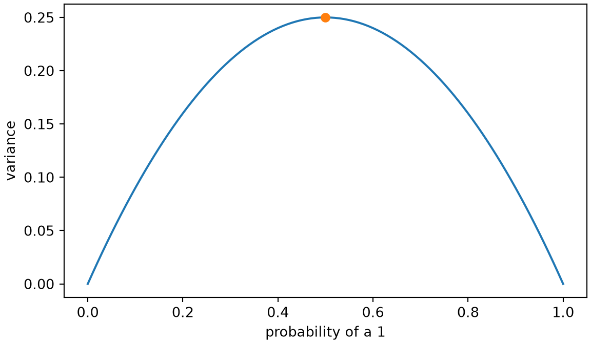
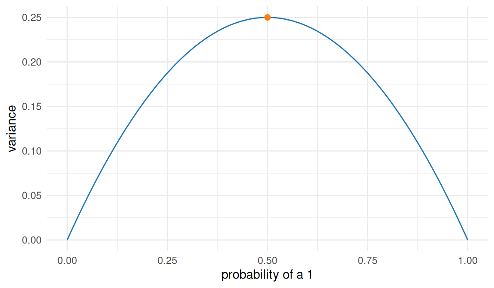
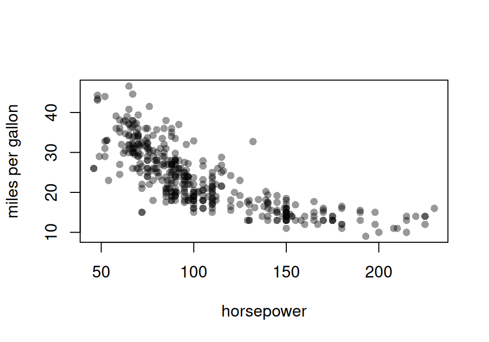

# Variance and covariance

Code

- [Show All Code](javascript:void(0))

- [Hide All Code](javascript:void(0))

- 

  ------------------------------------------------------------------------

- [View Source](javascript:void(0))

Published

Last modified: 2026-11-09 22:49:40 (PST)

# 1 Deviation, error, and noise

> **NOTE:**
>
> **Definition 1 (Deviation)** A **deviation** is the difference between a value and a reference value. For any quantity $z$ and reference value $r$, the deviation of $z$ from $r$ is:
>
> $$z - r$$

> **NOTE:**
>
> *Remark*. In [probability](probability-basics.llms.md#def-probability) and statistics, “deviation” usually means deviation from a [population mean](expectation.llms.md#def-expectation).
>
> See: [Wikipedia: Deviation (statistics)](https://en.wikipedia.org/wiki/Deviation_(statistics))

> **NOTE:**
>
> **Example 1 (Deviation from a reference weight)** A newborn weighing 3,200 g deviates from a reference weight of 3,500 g by $3200 - 3500 = -300$ g.

> **NOTE:**
>
> **Definition 2 (Deviation from a population or subpopulation mean (error, noise term))** The **deviation from the mean** of a [random variable](random-variables.llms.md#def-random-variable) $Y$ is its [deviation](#def-deviation) from its [expectation](expectation.llms.md#def-expectation), also called its **error** or **noise term**:
>
> $$\mathbb{d}(Y) \stackrel{\text{def}}{=}Y - {\mathbb{E}\mathopen{}\left[Y\right]\mathclose{}}$$
>
> For a realized [observation](https://morrison-lab.github.io/sds/exploratory-descriptive.html#def-observation) $y$:
>
> $$\mathbb{d}(y) \stackrel{\text{def}}{=}y - {\mathbb{E}\mathopen{}\left[Y\right]\mathclose{}}$$

> **NOTE:**
>
> *Remark*. Other sources often call this quantity an **error** or **noise term** [\[1\]](#ref-wikipedia_errors_and_residuals). In regression settings, the reference mean is often conditional on covariates: $\mathbb{d}(y_i) \stackrel{\text{def}}{=}y_i - {\mathbb{E}\mathopen{}\left[Y_i \mid X_i = x_i\right]\mathclose{}}$.
>
> These notes prefer “[deviation](#def-deviation)” for the quantity just defined. The Morrison Lab’s regression notes use “residual” (defined in their [Linear regression chapter](https://morrison-lab.github.io/rme/chapters/Linear-models-overview.html#def-resid-fitted)) for deviations from fitted values, write $\mathbb{d}(\cdot)$ for these model/data deviations, and reserve ${\varepsilon\mathopen{}\left(\cdot\right)\mathclose{}}$ for estimator-to-estimand deviations (see [Estimation](https://morrison-lab.github.io/sds/estimation.html#def-estimation-error)).
>
> See:
>
> - [Wikipedia: Errors and residuals](https://en.wikipedia.org/wiki/Errors_and_residuals)
> - [Wikipedia: Deviation (statistics)](https://en.wikipedia.org/wiki/Deviation_(statistics))
> - [Wikipedia: Linear regression — Notation and terminology](https://en.wikipedia.org/wiki/Linear_regression#Notation_and_terminology)

> **NOTE:**
>
> **Example 2 (Deviation of a die roll from its mean)** A fair die roll $Y$ has ${\mathbb{E}\mathopen{}\left[Y\right]\mathclose{}} = 3.5$ (computed on the [expectation page](expectation.llms.md#exm-linearity-expectation)), so a roll of $y = 5$ has deviation
>
> $$\begin{aligned}
> \mathbb{d}(5) &= 5 - 3.5 \\
> &= 1.5,
> \end{aligned}$$
>
> and a roll of $y = 2$ has deviation
>
> $$\begin{aligned}
> \mathbb{d}(2) &= 2 - 3.5 \\
> &= -1.5.
> \end{aligned}$$

# 2 Variance and related characteristics

> **NOTE:**
>
> **Definition 3 (Variance)** The **variance** of a [random variable](random-variables.llms.md#def-random-variable) $X$ with ${\mathbb{E}\mathopen{}\left[X^2\right]\mathclose{}} < \infty$ is the [expectation](expectation.llms.md#def-expectation) of the squared [deviation from the mean](#def-deviation-pop-mean) [\[2\]](#ref-wikipedia_variance); that is:
>
> $${\operatorname{Var}\mathopen{}\left(X\right)\mathclose{}} \stackrel{\text{def}}{=}{\mathbb{E}\mathopen{}\left[[\mathbb{d}(X)]^2\right]\mathclose{}}$$

> **NOTE:**
>
> **Theorem 1 (Variance as expected squared deviation from the mean)** $${\operatorname{Var}\mathopen{}\left(X\right)\mathclose{}} = {\mathbb{E}\mathopen{}\left[(X - {\mathbb{E}\mathopen{}\left[X\right]\mathclose{}})^2\right]\mathclose{}}$$

> **NOTE:**
>
> *Proof*. Substituting the definition of $\mathbb{d}(X)$ from [Definition 2](#def-deviation-pop-mean) into [Definition 3](#def-variance):
>
> $${\operatorname{Var}\mathopen{}\left(X\right)\mathclose{}} \stackrel{\text{def}}{=}{\mathbb{E}\mathopen{}\left[[\mathbb{d}(X)]^2\right]\mathclose{}} = {\mathbb{E}\mathopen{}\left[(X - {\mathbb{E}\mathopen{}\left[X\right]\mathclose{}})^2\right]\mathclose{}}.$$

> **NOTE:**
>
> *Remark*. The expanded form is the more commonly seen definition of the [variance](#def-variance), and the canonical starting point in most treatments; it’s given here as a theorem rather than the primary definition to keep $\mathbb{d}(X)$ as the definition’s single building block, matching the notation of [Definition 2](#def-deviation-pop-mean).

> **NOTE:**
>
> **Theorem 2 (Simplified expression for variance)** $${\operatorname{Var}\mathopen{}\left(X\right)\mathclose{}}={\mathbb{E}\mathopen{}\left[X^2\right]\mathclose{}} - {\mathopen{}\left({\mathbb{E}\mathopen{}\left[X\right]\mathclose{}}\right)\mathclose{}}^{2}$$

> **NOTE:**
>
> *Proof*. Let $\mu= {\mathbb{E}\mathopen{}\left[X\right]\mathclose{}}$ be the [population mean](expectation.llms.md#def-expectation) of $X$. It is a constant, so [linearity of expectation](expectation.llms.md#thm-linearity-expectation) applies with $\mu$ as a coefficient:
>
> $$\begin{aligned}
> {\operatorname{Var}\mathopen{}\left(X\right)\mathclose{}}
> &\stackrel{\text{def}}{=}{\mathbb{E}\mathopen{}\left[[\mathbb{d}(X)]^2\right]\mathclose{}} && \text{(definition of variance)} \\
> &= {\mathbb{E}\mathopen{}\left[(X-\mu)^2\right]\mathclose{}} && \text{(definition of deviation from the population mean } \mu\text{)} \\
> &={\mathbb{E}\mathopen{}\left[X^2 - 2X\mu+ {\mathopen{}\left(\mu\right)\mathclose{}}^{2}\right]\mathclose{}} && \text{(expand binomial square)} \\
> &={\mathbb{E}\mathopen{}\left[X^2\right]\mathclose{}} - 2\mu{\mathbb{E}\mathopen{}\left[X\right]\mathclose{}} + {\mathopen{}\left(\mu\right)\mathclose{}}^{2} && \text{(linearity of expectation; } \mu\text{ is a constant)} \\
> &={\mathbb{E}\mathopen{}\left[X^2\right]\mathclose{}} - 2{\mathopen{}\left(\mu\right)\mathclose{}}^{2} + {\mathopen{}\left(\mu\right)\mathclose{}}^{2} && \text{(} {\mathbb{E}\mathopen{}\left[X\right]\mathclose{}} = \mu\text{)} \\
> &={\mathbb{E}\mathopen{}\left[X^2\right]\mathclose{}} - {\mathopen{}\left(\mu\right)\mathclose{}}^{2} && \text{(combine like terms)} \\
> &={\mathbb{E}\mathopen{}\left[X^2\right]\mathclose{}} - {\mathopen{}\left({\mathbb{E}\mathopen{}\left[X\right]\mathclose{}}\right)\mathclose{}}^{2} && \text{(} \mu= {\mathbb{E}\mathopen{}\left[X\right]\mathclose{}} \text{)}
> \end{aligned}$$

> **NOTE:**
>
> **Example 3 (Variance of a Bernoulli random variable)** Let $X \sim \operatorname{Ber}(\pi)$. Then ${\mathbb{E}\mathopen{}\left[X\right]\mathclose{}} = \pi$ and ${\mathbb{E}\mathopen{}\left[X^2\right]\mathclose{}} = \pi$ (both computed on the [expectation page](expectation.llms.md#exm-lotus)), so:
>
> $$\begin{aligned}
> {\operatorname{Var}\mathopen{}\left(X\right)\mathclose{}}
> &= {\mathbb{E}\mathopen{}\left[X^2\right]\mathclose{}} - {\mathopen{}\left({\mathbb{E}\mathopen{}\left[X\right]\mathclose{}}\right)\mathclose{}}^{2}
> && \text{(simplified expression for variance)} \\
> &= \pi- \pi^2
> && \text{(substitute)} \\
> &= \pi(1 - \pi)
> && \text{(factor)}
> \end{aligned}$$
>
> For a fair coin ($\pi= 1/2$), ${\operatorname{Var}\mathopen{}\left(X\right)\mathclose{}} = 1/4$. [Figure 1](#fig-bernoulli-variance) graphs ${\operatorname{Var}\mathopen{}\left(X\right)\mathclose{}}$ against $\pi$.

> **NOTE:**
>
> ## Python
>
> ``` python
> import numpy as np
> import matplotlib.pyplot as plt
>
> prob = np.linspace(0, 1, 201)
> variance = prob * (1 - prob)
>
> fig, ax = plt.subplots(figsize=(6, 3.5), layout="constrained")
> ax.plot(prob, variance, color="#1f77b4")
> ax.plot(0.5, 0.5 * (1 - 0.5), "o", color="#ff7f0e")
> ax.set_xlabel("probability of a 1")
> ax.set_ylabel("variance")
> plt.show()
> ```
>
> [](variance-covariance_files/figure-html/bernoulli-variance-py-1.png "Figure 1: The variance \pi(1 - \pi) of a Bernoulli random variable, against its probability \pi. It is 0 at \pi= 0 and \pi= 1, where the outcome is certain. It is largest, 1/4, at \pi= 1/2 (dot), where the outcome is least predictable.")
>
> ## R
>
> ``` r
> library(ggplot2)
>
> prob <- seq(0, 1, length.out = 201)
> bernoulli <- data.frame(prob = prob, variance = prob * (1 - prob))
> mid <- data.frame(prob = 0.5, variance = 0.5 * (1 - 0.5))
>
> ggplot(bernoulli, aes(x = prob, y = variance)) +
>   geom_line(colour = "#1f77b4") +
>   geom_point(data = mid, colour = "#ff7f0e", size = 2) +
>   labs(x = "probability of a 1", y = "variance") +
>   theme_minimal()
> ```
>
> [](variance-covariance_files/figure-html/bernoulli-variance-r-1.png "Figure 1: The variance \pi(1 - \pi) of a Bernoulli random variable, against its probability \pi. It is 0 at \pi= 0 and \pi= 1, where the outcome is certain. It is largest, 1/4, at \pi= 1/2 (dot), where the outcome is least predictable.")
>
> Figure 1: The [variance](#def-variance) $\pi(1 - \pi)$ of a [Bernoulli](random-variables.llms.md#def-bernoulli) [random variable](random-variables.llms.md#def-random-variable), against its [probability](probability-basics.llms.md#def-probability) $\pi$. It is 0 at $\pi= 0$ and $\pi= 1$, where the [outcome](expectation.llms.md#def-outcome) is certain. It is largest, $1/4$, at $\pi= 1/2$ (dot), where the outcome is least predictable.

> **NOTE:**
>
> **Definition 4 (Conditional variance)** The **conditional variance** of $Y$ given $X = x$ is the [variance](#def-variance) of $Y$ under its conditional distribution given $X = x$:
>
> $${\operatorname{Var}\mathopen{}\left(Y \mid X = x\right)\mathclose{}} \stackrel{\text{def}}{=}{\mathbb{E}\mathopen{}\left[\mathopen{}\left(Y - {\mathbb{E}\mathopen{}\left[Y \mid X = x\right]\mathclose{}}\right)\mathclose{}^2 \mid X = x\right]\mathclose{}}$$
>
> Evaluating this [function](https://morrison-lab.github.io/mcs/functions.html#def-function) of $x$ at $X$ gives the [random variable](random-variables.llms.md#def-random-variable) ${\operatorname{Var}\mathopen{}\left(Y \mid X\right)\mathclose{}}$, just as the [conditional expectation function](expectation.llms.md#def-cond-expectation-function) ${\mathbb{E}\mathopen{}\left[Y \mid X\right]\mathclose{}}$ comes from ${\mathbb{E}\mathopen{}\left[Y \mid X = x\right]\mathclose{}}$.

> **NOTE:**
>
> **Example 4 (Conditional variance of a binary outcome)** Let $(X, Y)$ have the [joint PMF](random-variables.llms.md#def-joint-pmf) $\mathbb{P}(X=0, Y=0) = 0.2$, $\mathbb{P}(X=0, Y=1) = 0.3$, $\mathbb{P}(X=1, Y=0) = 0.1$, $\mathbb{P}(X=1, Y=1) = 0.4$ (the table in the [expectation page’s exercise](expectation.llms.md#exr-fubini-joint-disc)). Given $X = 0$, $Y$ is binary with
>
> $$\begin{aligned}
> \mathbb{P}(Y = 1 \mid X = 0) &= 0.3/0.5 \\
> &= 0.6,
> \end{aligned}$$
>
> so ${\mathbb{E}\mathopen{}\left[Y \mid X = 0\right]\mathclose{}} = 0.6$, and by [Definition 4](#def-cond-variance):
>
> $$\begin{aligned}
> {\operatorname{Var}\mathopen{}\left(Y \mid X = 0\right)\mathclose{}}
> &= (0 - 0.6)^2 \cdot 0.4 + (1 - 0.6)^2 \cdot 0.6
> && \text{(definition of conditional variance)} \\
> &= 0.144 + 0.096
> && \text{(multiply)} \\
> &= 0.24
> && \text{(add)}
> \end{aligned}$$
>
> The same steps with
>
> $$\begin{aligned}
> \mathbb{P}(Y = 1 \mid X = 1) &= 0.4/0.5 \\
> &= 0.8
> \end{aligned}$$
>
> give
>
> $$\begin{aligned}
> {\operatorname{Var}\mathopen{}\left(Y \mid X = 1\right)\mathclose{}} &= (0.2)^2 \cdot 0.8 + (0.8)^2 \cdot 0.2 \\
> &= 0.16.
> \end{aligned}$$

> **NOTE:**
>
> **Definition 5 (Homoskedasticity)** A [random variable](random-variables.llms.md#def-random-variable) $Y$ is **homoskedastic** with respect to a random variable (or vector) $X$ if the [conditional variance](#def-cond-variance) of $Y$ given $X = x$ is the same for every $x$:
>
> $${\operatorname{Var}\mathopen{}\left(Y \mid X = x\right)\mathclose{}} = \sigma^2\quad \text{for all } x$$
>
> for some constant $\sigma^2$.

> **NOTE:**
>
> **Example 5 (A homoskedastic total)** Flip two fair coins, let $X_1$ indicate heads on the first, and let $Y$ be the total number of heads. Given $X_1 = 0$, $Y$ is $0$ or $1$ with [probability](probability-basics.llms.md#def-probability) $1/2$ each; given $X_1 = 1$, $Y$ is $1$ or $2$ with probability $1/2$ each. Either way, $Y$ is $1/2$ away from its conditional mean with probability 1, so
>
> $$\begin{aligned}
> {\operatorname{Var}\mathopen{}\left(Y \mid X_1 = 0\right)\mathclose{}} &= {\operatorname{Var}\mathopen{}\left(Y \mid X_1 = 1\right)\mathclose{}} \\
> &= 1/4,
> \end{aligned}$$
>
> and $Y$ is homoskedastic with respect to $X_1$, with $\sigma^2= 1/4$.

> **NOTE:**
>
> **Definition 6 (Heteroskedasticity)** A [random variable](random-variables.llms.md#def-random-variable) $Y$ is **heteroskedastic** with respect to $X$ if it is not [homoskedastic](#def-homosked) with respect to $X$: that is, if ${\operatorname{Var}\mathopen{}\left(Y \mid X = x\right)\mathclose{}}$ differs between some values of $x$.

> **NOTE:**
>
> **Example 6 (A heteroskedastic binary outcome)** In [Example 4](#exm-cond-variance),
>
> $$\begin{aligned}
> {\operatorname{Var}\mathopen{}\left(Y \mid X = 0\right)\mathclose{}} &= 0.24 \\
> &\ne 0.16 \\
> &= {\operatorname{Var}\mathopen{}\left(Y \mid X = 1\right)\mathclose{}},
> \end{aligned}$$
>
> so $Y$ is heteroskedastic with respect to $X$. More generally, a binary outcome with $\mathbb{P}(Y = 1 \mid X = x) = \pi(x)$ has [conditional variance](#def-cond-variance) $\pi(x)(1 - \pi(x))$, so it is homoskedastic only if $\pi(x)$ takes at most two values, $\pi$ and $1 - \pi$, for some $\pi$.

> **NOTE:**
>
> **Theorem 3 (Law of total variance (conditional variance formula, Eve’s law, variance decomposition formula))** For [random variables](random-variables.llms.md#def-random-variable) $X$ and $Y$ with ${\mathbb{E}\mathopen{}\left[Y^2\right]\mathclose{}} < \infty$:
>
> $${\operatorname{Var}\mathopen{}\left(Y\right)\mathclose{}} = {\mathbb{E}\mathopen{}\left[{\operatorname{Var}\mathopen{}\left(Y \mid X\right)\mathclose{}}\right]\mathclose{}} + {\operatorname{Var}\mathopen{}\left({\mathbb{E}\mathopen{}\left[Y \mid X\right]\mathclose{}}\right)\mathclose{}}$$

> **NOTE:**
>
> *Proof*. Write $\mu\stackrel{\text{def}}{=}{\mathbb{E}\mathopen{}\left[Y\right]\mathclose{}}$ and $m(X) \stackrel{\text{def}}{=}{\mathbb{E}\mathopen{}\left[Y \mid X\right]\mathclose{}}$. Adding and subtracting $m(X)$ inside the deviation and expanding the square:
>
> $$\begin{aligned}
> {\operatorname{Var}\mathopen{}\left(Y\right)\mathclose{}}
> &= {\mathbb{E}\mathopen{}\left[\mathopen{}\left(Y - \mu\right)\mathclose{}^2\right]\mathclose{}}
> && \text{(definition of variance)} \\
> &= {\mathbb{E}\mathopen{}\left[\mathopen{}\left(\mathopen{}\left[Y - m(X)\right]\mathclose{} + \mathopen{}\left[m(X) - \mu\right]\mathclose{}\right)\mathclose{}^2\right]\mathclose{}}
> && \text{(add and subtract } m(X) \text{)} \\
> &= {\mathbb{E}\mathopen{}\left[{\mathopen{}\left(Y - m(X)\right)\mathclose{}}^{2}\right]\mathclose{}} + {\mathbb{E}\mathopen{}\left[{\mathopen{}\left(m(X) - \mu\right)\mathclose{}}^{2}\right]\mathclose{}}
>   + 2{\mathbb{E}\mathopen{}\left[\mathopen{}\left[Y - m(X)\right]\mathclose{}\mathopen{}\left[m(X) - \mu\right]\mathclose{}\right]\mathclose{}}
> && \text{(expand the square; linearity of expectation)}
> \end{aligned}$$
>
> The three terms are handled separately, each using the [law of iterated expectations](expectation.llms.md#thm-lie), applied to a function of $X$ and $Y$ ([conditional expectation of a function](expectation.llms.md#def-cond-expectation-general)). The third [term](https://morrison-lab.github.io/mds/algebra-sums.html#def-term) also uses two facts about [conditional expectations](expectation.llms.md#def-cond-expectation): a [function of](expectation.llms.md#thm-cond-pull-out) $X$ factors out of a conditional expectation given $X$, and [conditional expectation is linear](expectation.llms.md#thm-cond-linearity).
>
> First term:
>
> $$\begin{aligned}
> {\mathbb{E}\mathopen{}\left[{\mathopen{}\left(Y - m(X)\right)\mathclose{}}^{2}\right]\mathclose{}}
> &= {\mathbb{E}\mathopen{}\left[{\mathbb{E}\mathopen{}\left[{\mathopen{}\left(Y - m(X)\right)\mathclose{}}^{2} \mid X\right]\mathclose{}}\right]\mathclose{}}
> && \text{(law of iterated expectations)} \\
> &= {\mathbb{E}\mathopen{}\left[{\operatorname{Var}\mathopen{}\left(Y \mid X\right)\mathclose{}}\right]\mathclose{}}
> && \text{(definition of conditional variance)}
> \end{aligned}$$
>
> Second term: by the [law of iterated expectations](expectation.llms.md#thm-lie),
>
> $$\begin{aligned}
> {\mathbb{E}\mathopen{}\left[m(X)\right]\mathclose{}} &= {\mathbb{E}\mathopen{}\left[{\mathbb{E}\mathopen{}\left[Y \mid X\right]\mathclose{}}\right]\mathclose{}} \\
> &= \mu,
> \end{aligned}$$
>
> so:
>
> $$\begin{aligned}
> {\mathbb{E}\mathopen{}\left[{\mathopen{}\left(m(X) - \mu\right)\mathclose{}}^{2}\right]\mathclose{}}
> &= {\mathbb{E}\mathopen{}\left[{\mathopen{}\left(m(X) - {\mathbb{E}\mathopen{}\left[m(X)\right]\mathclose{}}\right)\mathclose{}}^{2}\right]\mathclose{}}
> && \text{(} \mu= {\mathbb{E}\mathopen{}\left[m(X)\right]\mathclose{}} \text{)} \\
> &= {\operatorname{Var}\mathopen{}\left(m(X)\right)\mathclose{}}
> && \text{(definition of variance)} \\
> &= {\operatorname{Var}\mathopen{}\left({\mathbb{E}\mathopen{}\left[Y \mid X\right]\mathclose{}}\right)\mathclose{}}
> && \text{(definition of } m(X) \text{)}
> \end{aligned}$$
>
> Third term:
>
> $$\begin{aligned}
> {\mathbb{E}\mathopen{}\left[\mathopen{}\left[Y - m(X)\right]\mathclose{}\mathopen{}\left[m(X) - \mu\right]\mathclose{}\right]\mathclose{}}
> &= {\mathbb{E}\mathopen{}\left[{\mathbb{E}\mathopen{}\left[\mathopen{}\left[Y - m(X)\right]\mathclose{}\mathopen{}\left[m(X) - \mu\right]\mathclose{} \mid X\right]\mathclose{}}\right]\mathclose{}}
> && \text{(law of iterated expectations)} \\
> &= {\mathbb{E}\mathopen{}\left[\mathopen{}\left[m(X) - \mu\right]\mathclose{} \cdot{\mathbb{E}\mathopen{}\left[Y - m(X) \mid X\right]\mathclose{}}\right]\mathclose{}}
> && \text{(a function of } X \text{ factors out, with } g(X) = m(X) - \mu\text{)} \\
> &= {\mathbb{E}\mathopen{}\left[\mathopen{}\left[m(X) - \mu\right]\mathclose{} \cdot\mathopen{}\left[{\mathbb{E}\mathopen{}\left[Y \mid X\right]\mathclose{}} - {\mathbb{E}\mathopen{}\left[m(X) \mid X\right]\mathclose{}}\right]\mathclose{}\right]\mathclose{}}
> && \text{(linearity of conditional expectation)} \\
> &= {\mathbb{E}\mathopen{}\left[\mathopen{}\left[m(X) - \mu\right]\mathclose{} \cdot\mathopen{}\left[{\mathbb{E}\mathopen{}\left[Y \mid X\right]\mathclose{}} - m(X)\right]\mathclose{}\right]\mathclose{}}
> && \text{(} {\mathbb{E}\mathopen{}\left[g(X) \mid X\right]\mathclose{}} = g(X) \text{, with } g = m \text{)} \\
> &= {\mathbb{E}\mathopen{}\left[\mathopen{}\left[m(X) - \mu\right]\mathclose{} \cdot 0\right]\mathclose{}}
> && \text{(} {\mathbb{E}\mathopen{}\left[Y \mid X\right]\mathclose{}} = m(X) \text{)} \\
> &= 0
> && \text{(expectation of a constant)}
> \end{aligned}$$
>
> Substituting the three terms:
>
> $$\begin{aligned}
> {\operatorname{Var}\mathopen{}\left(Y\right)\mathclose{}}
> &= {\mathbb{E}\mathopen{}\left[{\operatorname{Var}\mathopen{}\left(Y \mid X\right)\mathclose{}}\right]\mathclose{}} + {\operatorname{Var}\mathopen{}\left({\mathbb{E}\mathopen{}\left[Y \mid X\right]\mathclose{}}\right)\mathclose{}} + 2 \cdot 0
> && \text{(substitute the three terms)} \\
> &= {\mathbb{E}\mathopen{}\left[{\operatorname{Var}\mathopen{}\left(Y \mid X\right)\mathclose{}}\right]\mathclose{}} + {\operatorname{Var}\mathopen{}\left({\mathbb{E}\mathopen{}\left[Y \mid X\right]\mathclose{}}\right)\mathclose{}}
> && \text{(simplify)}
> \end{aligned}$$

> **NOTE:**
>
> **Example 7 (Decomposing the variance of a binary outcome)** Continuing [Example 4](#exm-cond-variance),
>
> $$\begin{aligned}
> \mathbb{P}(X = 0) &= \mathbb{P}(X = 1) \\
> &= 0.5,
> \end{aligned}$$
>
> ${\mathbb{E}\mathopen{}\left[Y \mid X = 0\right]\mathclose{}} = 0.6$, and ${\mathbb{E}\mathopen{}\left[Y \mid X = 1\right]\mathclose{}} = 0.8$, so ${\mathbb{E}\mathopen{}\left[{\mathbb{E}\mathopen{}\left[Y \mid X\right]\mathclose{}}\right]\mathclose{}} = 0.7$, and by [Theorem 3](#thm-total-variance):
>
> $$\begin{aligned}
> {\mathbb{E}\mathopen{}\left[{\operatorname{Var}\mathopen{}\left(Y \mid X\right)\mathclose{}}\right]\mathclose{}}
> &= 0.5 \cdot 0.24 + 0.5 \cdot 0.16
> && \text{(average the conditional variances)} \\
> &= 0.20 \\
> {\operatorname{Var}\mathopen{}\left({\mathbb{E}\mathopen{}\left[Y \mid X\right]\mathclose{}}\right)\mathclose{}}
> &= 0.5 \cdot(0.6 - 0.7)^2 + 0.5 \cdot(0.8 - 0.7)^2
> && \text{(variance of the conditional means)} \\
> &= 0.01 \\
> {\operatorname{Var}\mathopen{}\left(Y\right)\mathclose{}}
> &= 0.20 + 0.01
> && \text{(law of total variance)} \\
> &= 0.21
> \end{aligned}$$
>
> As a check, $Y$ is [Bernoulli](random-variables.llms.md#def-bernoulli) with
>
> $$\begin{aligned}
> \mathbb{P}(Y = 1) &= 0.3 + 0.4 \\
> &= 0.7,
> \end{aligned}$$
>
> so by [Example 3](#exm-variance-bernoulli),
>
> $$\begin{aligned}
> {\operatorname{Var}\mathopen{}\left(Y\right)\mathclose{}} &= 0.7 \cdot 0.3 \\
> &= 0.21.
> \end{aligned}$$

> **NOTE:**
>
> **Definition 7 (Precision)** The **precision** of a [random variable](random-variables.llms.md#def-random-variable) $X$, often denoted $\tau(X)$, $\tau_X$, or shorthanded as $\tau$, is the inverse of that random variable’s [variance](#def-variance) (for ${\operatorname{Var}\mathopen{}\left(X\right)\mathclose{}} > 0$); that is:
>
> $$\tau(X) \stackrel{\text{def}}{=}{\mathopen{}\left({\operatorname{Var}\mathopen{}\left(X\right)\mathclose{}}\right)\mathclose{}}^{-1}$$

> **NOTE:**
>
> **Definition 8 (Standard deviation)** The **standard deviation** of a [random variable](random-variables.llms.md#def-random-variable) $X$ is the [square root](https://morrison-lab.github.io/mds/algebra-basics.html#def-square-root) of the [variance](#def-variance) of $X$:
>
> $${\operatorname{SD}\mathopen{}\left(X\right)\mathclose{}} \stackrel{\text{def}}{=}\sqrt{{\operatorname{Var}\mathopen{}\left(X\right)\mathclose{}}}$$

> **NOTE:**
>
> *Remark*. The [standard deviation](#def-sd) is on the same scale as $X$ itself (unlike the [variance](#def-variance), which is on the scale of $X$’s square), which is why it is often the preferred measure of spread when reporting results.

> **NOTE:**
>
> **Example 8 (Precision and standard deviation of a fair coin flip)** In [Example 3](#exm-variance-bernoulli), a fair coin flip has ${\operatorname{Var}\mathopen{}\left(X\right)\mathclose{}} = 1/4$, so its precision is
>
> $$\begin{aligned}
> \tau(X) &= 1 / (1/4) \\
> &= 4
> \end{aligned}$$
>
> and its [standard deviation](#def-sd) is
>
> $$\begin{aligned}
> {\operatorname{SD}\mathopen{}\left(X\right)\mathclose{}} &= \sqrt{1/4} \\
> &= 1/2.
> \end{aligned}$$

> **NOTE:**
>
> **Lemma 1 (The second moment is the variance plus the squared mean)** For any [random variable](random-variables.llms.md#def-random-variable) $Z$ with ${\mathbb{E}\mathopen{}\left[Z^2\right]\mathclose{}} < \infty$:
>
> $${\mathbb{E}\mathopen{}\left[Z^2\right]\mathclose{}} = {\operatorname{Var}\mathopen{}\left(Z\right)\mathclose{}} + {\mathopen{}\left({\mathbb{E}\mathopen{}\left[Z\right]\mathclose{}}\right)\mathclose{}}^{2}$$

> **NOTE:**
>
> *Proof*. Add ${\mathopen{}\left({\mathbb{E}\mathopen{}\left[Z\right]\mathclose{}}\right)\mathclose{}}^{2}$ to both sides of the [simplified expression for variance](#thm-variance), ${\operatorname{Var}\mathopen{}\left(Z\right)\mathclose{}} = {\mathbb{E}\mathopen{}\left[Z^2\right]\mathclose{}} - {\mathopen{}\left({\mathbb{E}\mathopen{}\left[Z\right]\mathclose{}}\right)\mathclose{}}^{2}$.

> **NOTE:**
>
> **Example 9 (The second moment of a Bernoulli random variable)** Let $Z$ be a [Bernoulli](random-variables.llms.md#def-bernoulli) [random variable](random-variables.llms.md#def-random-variable) with success [probability](probability-basics.llms.md#def-probability) $\pi$, so $Z \sim \operatorname{Ber}(\pi)$. Then ${\mathbb{E}\mathopen{}\left[Z^2\right]\mathclose{}} = \pi$ directly, because $Z^2 = Z$ when $Z$ is $0$ or $1$. The [lemma](#lem-second-moment-variance) gives the same value from the [mean](expectation.llms.md#def-expectation) and the [variance](#def-variance):
>
> $$\begin{aligned}
> {\operatorname{Var}\mathopen{}\left(Z\right)\mathclose{}} + {\mathopen{}\left({\mathbb{E}\mathopen{}\left[Z\right]\mathclose{}}\right)\mathclose{}}^{2}
> &= \pi(1 - \pi) + {\mathopen{}\left(\pi\right)\mathclose{}}^{2}
> && \text{(Bernoulli variance and mean)} \\
> &= \pi
> && \text{(expand and combine like terms)}
> \end{aligned}$$

# 3 The best constant prediction

> **NOTE:**
>
> **Theorem 4 (Expected squared error of a constant prediction)** Let $Y$ be a [random variable](random-variables.llms.md#def-random-variable) with [mean](expectation.llms.md#def-expectation) $\mu$ and finite [variance](#def-variance). Then for every number $c$,
>
> $${\mathbb{E}\mathopen{}\left[{\mathopen{}\left(Y - c\right)\mathclose{}}^{2}\right]\mathclose{}} = {\operatorname{Var}\mathopen{}\left(Y\right)\mathclose{}} + {\mathopen{}\left(\mu- c\right)\mathclose{}}^{2}.
> \tag{1}$$

> **NOTE:**
>
> *Proof*. Add and subtract $\mu$ inside the square, expand it, and take the [expectation](expectation.llms.md#def-expectation) [term](https://morrison-lab.github.io/mds/algebra-sums.html#def-term) by term:
>
> $$\begin{aligned}
> {\mathbb{E}\mathopen{}\left[{\mathopen{}\left(Y - c\right)\mathclose{}}^{2}\right]\mathclose{}}
> &= {\mathbb{E}\mathopen{}\left[{\mathopen{}\left((Y - \mu) + (\mu- c)\right)\mathclose{}}^{2}\right]\mathclose{}}
> && \text{(add and subtract } \mu\text{)} \\
> &= {\mathbb{E}\mathopen{}\left[{\mathopen{}\left(Y - \mu\right)\mathclose{}}^{2} + 2(\mu- c)(Y - \mu) + {\mathopen{}\left(\mu- c\right)\mathclose{}}^{2}\right]\mathclose{}}
> && \text{(expand the square of a sum)} \\
> &= {\mathbb{E}\mathopen{}\left[{\mathopen{}\left(Y - \mu\right)\mathclose{}}^{2}\right]\mathclose{}} + 2(\mu- c){\mathbb{E}\mathopen{}\left[Y - \mu\right]\mathclose{}} + {\mathopen{}\left(\mu- c\right)\mathclose{}}^{2}
> && \text{(linearity of expectation; } \mu\text{ and } c \text{ are constants)} \\
> &= {\operatorname{Var}\mathopen{}\left(Y\right)\mathclose{}} + 2(\mu- c){\mathbb{E}\mathopen{}\left[Y - \mu\right]\mathclose{}} + {\mathopen{}\left(\mu- c\right)\mathclose{}}^{2}
> && \text{(variance as expected squared deviation)} \\
> &= {\operatorname{Var}\mathopen{}\left(Y\right)\mathclose{}} + 2(\mu- c) \cdot 0 + {\mathopen{}\left(\mu- c\right)\mathclose{}}^{2}
> && \text{(} {\mathbb{E}\mathopen{}\left[Y - \mu\right]\mathclose{}} = {\mathbb{E}\mathopen{}\left[Y\right]\mathclose{}} - \mu= 0 \text{)} \\
> &= {\operatorname{Var}\mathopen{}\left(Y\right)\mathclose{}} + {\mathopen{}\left(\mu- c\right)\mathclose{}}^{2}
> && \text{(zero times a number)}
> \end{aligned}$$

> **NOTE:**
>
> **Corollary 1 (The mean is the best constant prediction under squared error)** Under the assumptions of [Theorem 4](#thm-constant-prediction-decompose),
>
> $$\arg \min_{c \in \mathbb{R}} {\mathbb{E}\mathopen{}\left[{\mathopen{}\left(Y - c\right)\mathclose{}}^{2}\right]\mathclose{}} = {\mathopen{}\left\{\mu\right\}\mathclose{}}
> \quad \text{and} \quad
> \min_{c \in \mathbb{R}} {\mathbb{E}\mathopen{}\left[{\mathopen{}\left(Y - c\right)\mathclose{}}^{2}\right]\mathclose{}} = {\operatorname{Var}\mathopen{}\left(Y\right)\mathclose{}},$$
>
> where $\arg \min$ is the [set of minimizers](https://morrison-lab.github.io/mds/algebra-basics.html#def-argmin).

> **NOTE:**
>
> *Proof*. In [Equation 1](#eq-constant-prediction-decompose) the first term, ${\operatorname{Var}\mathopen{}\left(Y\right)\mathclose{}}$, does not depend on $c$. The second term, ${\mathopen{}\left(\mu- c\right)\mathclose{}}^{2}$, is a square, so it is never negative, and it is zero exactly when $c = \mu$. So $c = \mu$ minimizes the expected squared error and no other number does, and at $c = \mu$ the expected squared error is ${\operatorname{Var}\mathopen{}\left(Y\right)\mathclose{}}$.

> **NOTE:**
>
> **Example 10 (The best constant prediction of fuel economy)** Take the 392 cars in the Auto data [described on the limit theorems page](limit-theorems.llms.md#exm-clt-auto) as the whole population, and predict the fuel economy (`mpg`) of a car drawn at random with one number $c$. The code below computes the expected squared error of three constants, and sets each beside the right side of [Equation 1](#eq-constant-prediction-decompose).
>
> ``` r
> auto <- readr::read_csv("data/auto.csv", show_col_types = FALSE)
> mpg <- auto$mpg
> mu <- mean(mpg)
> squared_deviations <- (mpg - mu)^2
> sigma2 <- mean(squared_deviations)
>
> median_mpg <- median(mpg)
> c_values <- c(mean = mu, median = median_mpg, twenty = 20)
> constants <- names(c_values)
>
> errors_by_car <- outer(mpg, c_values, "-")
> squared_errors <- errors_by_car^2
> errors <- colMeans(squared_errors)
> shift_squared <- (mu - c_values)^2
>
> tibble::tibble(
>   constant = constants,
>   c = c_values,
>   expected_squared_error = errors,
>   decomposition = sigma2 + shift_squared
> )
> ```
>
> [Figure 2](#fig-best-constant-auto) plots the expected squared error of every constant from 10 to 40 against $c$, and marks the three constants in the table.
>
> Show code
>
> ``` r
> c_grid <- seq(10, 40, length.out = 301)
> grid_deviations <- outer(mpg, c_grid, "-")
> grid_squared <- grid_deviations^2
> grid_errors <- colMeans(grid_squared)
> curve <- tibble::tibble(c = c_grid, expected_squared_error = grid_errors)
> point_labels <- c("mean", "median", "c = 20")
> label_hjust <- c(0.5, 0.5, 1)
> label_vjust <- c(2.5, -2.5, -2)
> marked <- tibble::tibble(
>   point_label = point_labels,
>   c = c_values,
>   expected_squared_error = errors,
>   label_hjust = label_hjust,
>   label_vjust = label_vjust
> )
> curve_aes <- ggplot2::aes(x = c, y = expected_squared_error)
> label_aes <- ggplot2::aes(
>   label = point_label,
>   hjust = label_hjust,
>   vjust = label_vjust
> )
>
> curve |>
>   ggplot2::ggplot() +
>   curve_aes +
>   ggplot2::geom_line() +
>   ggplot2::geom_point(data = marked, size = 3) +
>   ggplot2::geom_text(label_aes, data = marked) +
>   ggplot2::labs(
>     x = "constant prediction c (miles per gallon)",
>     y = "expected squared error"
>   ) +
>   ggplot2::expand_limits(y = 0) +
>   ggplot2::theme_minimal()
> ```
>
> > **NOTE:**
> >
> > [](variance-covariance_files/figure-html/fig-best-constant-auto-1.png "Figure 2: Expected squared error of a constant prediction c of fuel economy for the 392 cars in the Auto data, for c from 10 to 40 miles per gallon. The points mark the mean, the median and c = 20.")
> >
> > Figure 2: Expected squared error of a constant prediction c of fuel economy for the 392 cars in the Auto data, for c from 10 to 40 miles per gallon. The points mark the mean, the median and c = 20.
>
> The two columns agree, as [Theorem 4](#thm-constant-prediction-decompose) says. The mean, 23.45, has the smallest expected squared error, 60.76, which is the [variance](#def-variance) of `mpg` over these cars (divisor the number of cars, not one fewer), as [Corollary 1](#cor-best-constant) says; the median and $c = 20$ are each worse by ${\mathopen{}\left(\mu- c\right)\mathclose{}}^{2}$.

# 4 Independent noise plus a random variable

## 4.1 Mean-zero noise model

Measurement [noise](https://morrison-lab.github.io/sds/model-validation.html#def-noise) is almost always modeled as a [random variable](random-variables.llms.md#def-random-variable) $\varepsilon$ with **[mean](expectation.llms.md#def-expectation) zero** and [variance](#def-variance) $\sigma^2$.

> **NOTE:**
>
> *Remark 1* (Mean zero is a parametrization choice). Mean zero is a parametrization choice, not a substantive assumption. In $Y = f(x) + \varepsilon$, moving a constant from $\varepsilon$ into $f(x)$ changes the split but not the distribution of $Y$, so the data identify only the sum $f(x) + {\mathbb{E}\mathopen{}\left[\varepsilon\right]\mathclose{}}$, the mean of $Y$ at $x$. Requiring ${\mathbb{E}\mathopen{}\left[\varepsilon\right]\mathclose{}} = 0$ picks the one split in which $f(x)$ is that mean. This loses no generality when the model for $f$ can absorb a constant, as any model with an [intercept](https://morrison-lab.github.io/mds/algebra-exponentials.html#def-intercept) can. It restricts the model only when $f$ cannot absorb one, as in a regression through the origin.

Mean zero gives one identity, used repeatedly across statistical modeling and machine learning.

> **NOTE:**
>
> **Exercise 1 (The average squared error of pure noise)** Let $\varepsilon$ be a [random variable](random-variables.llms.md#def-random-variable) with $\mathbb{E}[\varepsilon] = 0$ and ${\operatorname{Var}\mathopen{}\left(\varepsilon\right)\mathclose{}} = \sigma^2$.
>
> Find $\mathbb{E}[\varepsilon^2]$ in terms of $\sigma^2$, and say which earlier result you used.

> **NOTE:**
>
> *Solution 1*. [Theorem 2](#thm-variance) says ${\operatorname{Var}\mathopen{}\left(X\right)\mathclose{}} = \mathbb{E}[X^2] - (\mathbb{E}[X])^2$ for any $X$. Taking $X = \varepsilon$ and substituting $\mathbb{E}[\varepsilon] = 0$,
>
> $$\begin{aligned}
> \mathbb{E}[\varepsilon^2]
> &= {\operatorname{Var}\mathopen{}\left(\varepsilon\right)\mathclose{}} + 0^2 \\
> &= \sigma^2
> \end{aligned}
> \tag{2}$$
>
> so for mean-zero [noise](https://morrison-lab.github.io/sds/model-validation.html#def-noise) the average squared value *is* the [variance](#def-variance).
>
> The identity looks slight and does a lot of work. [Equation 2](#eq-noise-second-moment) is the step that produces the [residual variance](https://morrison-lab.github.io/sds/model-validation.html#def-irreducible-error) term in regression and statistical modeling: it converts a statement about the *spread* of the noise, which is what a model of the world gives you, into a statement about *squared error*, which is what the fitting objective measures.

> **NOTE:**
>
> **Theorem 5 (The second moment of mean-zero noise)** Let $\varepsilon$ be a [random variable](random-variables.llms.md#def-random-variable) with $\mathbb{E}[\varepsilon] = 0$ and ${\operatorname{Var}\mathopen{}\left(\varepsilon\right)\mathclose{}} = \sigma^2$. Then
>
> $$\mathbb{E}[\varepsilon^2] = \sigma^2$$

> **NOTE:**
>
> *Proof*. This is the solution to [Exercise 1](#exr-noise-second-moment), worked in [Solution 1](#sol-noise-second-moment). It rearranges [Theorem 2](#thm-variance), using $\mathbb{E}[\varepsilon] = 0$.

> **NOTE:**
>
> **Theorem 6 (The second moment of independent noise plus a random variable)** Let $\varepsilon$ be a [random variable](random-variables.llms.md#def-random-variable) with ${\mathbb{E}\mathopen{}\left[\varepsilon\right]\mathclose{}} = 0$ and ${\operatorname{Var}\mathopen{}\left(\varepsilon\right)\mathclose{}} = \sigma^2$. Let $X$ be a random variable with ${\mathbb{E}\mathopen{}\left[X^2\right]\mathclose{}} < \infty$ that is [independent](independence.llms.md#def-indpt) of $\varepsilon$. Then
>
> $${\mathbb{E}\mathopen{}\left[\mathopen{}\left(\varepsilon+ X\right)\mathclose{}^2\right]\mathclose{}} = \sigma^2+ {\operatorname{Var}\mathopen{}\left(X\right)\mathclose{}} + {\mathopen{}\left({\mathbb{E}\mathopen{}\left[X\right]\mathclose{}}\right)\mathclose{}}^{2}$$

> **NOTE:**
>
> *Proof*. Expanding the square and using [linearity of expectation](expectation.llms.md#thm-linearity-expectation), first for the [expectation](expectation.llms.md#def-expectation) of a [sum](https://morrison-lab.github.io/mds/algebra-sums.html#def-summation) and then for a constant factor,
>
> $$\begin{aligned}
> {\mathbb{E}\mathopen{}\left[\mathopen{}\left(\varepsilon+ X\right)\mathclose{}^2\right]\mathclose{}}
> &= {\mathbb{E}\mathopen{}\left[\varepsilon^2 + 2 \varepsilon X+ X^2\right]\mathclose{}}
> && \text{(expand: } \mathopen{}\left(a + b\right)\mathclose{}^2 = a^2 + 2ab + b^2 \text{)} \\
> &= {\mathbb{E}\mathopen{}\left[\varepsilon^2\right]\mathclose{}} + {\mathbb{E}\mathopen{}\left[2 \varepsilon X\right]\mathclose{}} + {\mathbb{E}\mathopen{}\left[X^2\right]\mathclose{}}
> && \text{(expectation of a sum)} \\
> &= {\mathbb{E}\mathopen{}\left[\varepsilon^2\right]\mathclose{}} + 2{\mathbb{E}\mathopen{}\left[\varepsilon X\right]\mathclose{}} + {\mathbb{E}\mathopen{}\left[X^2\right]\mathclose{}}
> && \text{(constant factor 2)}
> \end{aligned}$$
>
> Each of the three terms is evaluated in turn.
>
> - ${\mathbb{E}\mathopen{}\left[\varepsilon^2\right]\mathclose{}} = \sigma^2$, by [Theorem 5](#thm-noise-second-moment).
>
> - Because $\varepsilon$ and $X$ are [independent](independence.llms.md#def-indpt), the expectation of the product is the product of the expectations:
>
>   $$\begin{aligned}
>   {\mathbb{E}\mathopen{}\left[\varepsilon X\right]\mathclose{}}
>   &= {\mathbb{E}\mathopen{}\left[\varepsilon\right]\mathclose{}}{\mathbb{E}\mathopen{}\left[X\right]\mathclose{}}
>   && \text{(independence)} \\
>   &= 0 \cdot {\mathbb{E}\mathopen{}\left[X\right]\mathclose{}}
>   && \text{(} {\mathbb{E}\mathopen{}\left[\varepsilon\right]\mathclose{}} = 0 \text{)} \\
>   &= 0
>   && \text{(zero times a number)}
>   \end{aligned}$$
>
> - ${\mathbb{E}\mathopen{}\left[X^2\right]\mathclose{}} = {\operatorname{Var}\mathopen{}\left(X\right)\mathclose{}} + {\mathopen{}\left({\mathbb{E}\mathopen{}\left[X\right]\mathclose{}}\right)\mathclose{}}^{2}$, by [Theorem 2](#thm-variance).
>
> Substituting the three terms gives
>
> $$\begin{aligned}
> {\mathbb{E}\mathopen{}\left[\mathopen{}\left(\varepsilon+ X\right)\mathclose{}^2\right]\mathclose{}}
> &= \sigma^2+ 2 \cdot 0 + \mathopen{}\left({\operatorname{Var}\mathopen{}\left(X\right)\mathclose{}} + {\mathopen{}\left({\mathbb{E}\mathopen{}\left[X\right]\mathclose{}}\right)\mathclose{}}^{2}\right)\mathclose{}
> && \text{(the three terms above)} \\
> &= \sigma^2+ {\operatorname{Var}\mathopen{}\left(X\right)\mathclose{}} + {\mathopen{}\left({\mathbb{E}\mathopen{}\left[X\right]\mathclose{}}\right)\mathclose{}}^{2}
> && \text{(drop } 2 \cdot 0 \text{)}
> \end{aligned}$$

> **NOTE:**
>
> *Remark* (Use in statistics and machine learning). Let $\varepsilon$ be the [noise](https://morrison-lab.github.io/sds/model-validation.html#def-noise) in a new outcome $Y$, and let $X$ be the difference between the true mean $\mu= {\mathbb{E}\mathopen{}\left[Y\right]\mathclose{}}$ and a prediction $\hat{y}$:
>
> $$X\stackrel{\text{def}}{=}\mu- \hat{y}$$
>
> The mean of $X$ is minus the bias of the prediction:
>
> $$\begin{aligned}
> {\mathbb{E}\mathopen{}\left[X\right]\mathclose{}}
> &= {\mathbb{E}\mathopen{}\left[\mu- \hat{y}\right]\mathclose{}}
> && \text{(definition of } X\text{)} \\
> &= \mu- {\mathbb{E}\mathopen{}\left[\hat{y}\right]\mathclose{}}
> && \text{(expectation of a difference; } \mu\text{ is a constant)} \\
> &= -\mathopen{}\left({\mathbb{E}\mathopen{}\left[\hat{y}\right]\mathclose{}} - \mu\right)\mathclose{}
> && \text{(factor out } -1 \text{)} \\
> &= -{\operatorname{Bias}\mathopen{}\left(\hat{y}\right)\mathclose{}}
> && \text{(definition of bias)}
> \end{aligned}$$
>
> The [variance](#def-variance) of $X$ is the variance of the prediction:
>
> $$\begin{aligned}
> {\operatorname{Var}\mathopen{}\left(X\right)\mathclose{}}
> &= {\operatorname{Var}\mathopen{}\left(\mu- \hat{y}\right)\mathclose{}}
> && \text{(definition of } X\text{)} \\
> &= {\operatorname{Var}\mathopen{}\left(\hat{y}\right)\mathclose{}}
> && \text{(a constant shifts a variable without changing its variance, and a sign flip does not change it either)}
> \end{aligned}$$
>
> Substituting these two results into the theorem, with ${\mathopen{}\left(-{\operatorname{Bias}\mathopen{}\left(\hat{y}\right)\mathclose{}}\right)\mathclose{}}^{2} = {\mathopen{}\left({\operatorname{Bias}\mathopen{}\left(\hat{y}\right)\mathclose{}}\right)\mathclose{}}^{2}$, gives the squared [prediction error](expectation.llms.md#def-prediction-error) of the new outcome as
>
> $${\mathbb{E}\mathopen{}\left[{\mathopen{}\left(\varepsilon+ X\right)\mathclose{}}^{2}\right]\mathclose{}} = \sigma^2+ {\operatorname{Var}\mathopen{}\left(\hat{y}\right)\mathclose{}} + {\mathopen{}\left({\operatorname{Bias}\mathopen{}\left(\hat{y}\right)\mathclose{}}\right)\mathclose{}}^{2},$$
>
> where $\sigma^2$ is the [residual variance](https://morrison-lab.github.io/sds/model-validation.html#def-irreducible-error). The statistics notes define the bias of a prediction and the training data it depends on, and state this result for predictions as the [bias, variance and noise decomposition](https://morrison-lab.github.io/sds/model-validation.html#thm-epe-decomposition), with its exercise, worked example and definition of the residual variance.

# 5 Covariance

> **NOTE:**
>
> **Definition 9 (Covariance)** The **covariance** of two [random variables](random-variables.llms.md#def-random-variable) $X$ and $Y$ with ${\mathbb{E}\mathopen{}\left[X^2\right]\mathclose{}} < \infty$ and ${\mathbb{E}\mathopen{}\left[Y^2\right]\mathclose{}} < \infty$ [\[3\]](#ref-wikipedia_covariance) is:
>
> $${\operatorname{Cov}\mathopen{}\left(X,Y\right)\mathclose{}} \stackrel{\text{def}}{=}{\mathbb{E}\mathopen{}\left[(X - {\mathbb{E}\mathopen{}\left[X\right]\mathclose{}})(Y - {\mathbb{E}\mathopen{}\left[Y\right]\mathclose{}})\right]\mathclose{}}$$

> **NOTE:**
>
> **Theorem 7 (Alternative formula for covariance)** $${\operatorname{Cov}\mathopen{}\left(X,Y\right)\mathclose{}}= {\mathbb{E}\mathopen{}\left[XY\right]\mathclose{}} - {\mathbb{E}\mathopen{}\left[X\right]\mathclose{}} {\mathbb{E}\mathopen{}\left[Y\right]\mathclose{}}$$

> **NOTE:**
>
> *Proof*. Let $\mu_X = {\mathbb{E}\mathopen{}\left[X\right]\mathclose{}}$ and $\mu_Y = {\mathbb{E}\mathopen{}\left[Y\right]\mathclose{}}$ be the [population means](expectation.llms.md#def-expectation) of $X$ and $Y$. They are constants, so [linearity of expectation](expectation.llms.md#thm-linearity-expectation) applies with them as coefficients, analogous to the proof of the [simplified expression for variance](#thm-variance):
>
> $$\begin{aligned}
> {\operatorname{Cov}\mathopen{}\left(X,Y\right)\mathclose{}}
> &\stackrel{\text{def}}{=}{\mathbb{E}\mathopen{}\left[(X-\mu_X)(Y-\mu_Y)\right]\mathclose{}} && \text{(definition of covariance, with population means } \mu_X, \mu_Y \text{)} \\
> &= {\mathbb{E}\mathopen{}\left[XY - X\mu_Y - Y\mu_X + \mu_X\mu_Y\right]\mathclose{}} && \text{(expand the product)} \\
> &= {\mathbb{E}\mathopen{}\left[XY\right]\mathclose{}} - \mu_Y{\mathbb{E}\mathopen{}\left[X\right]\mathclose{}} - \mu_X{\mathbb{E}\mathopen{}\left[Y\right]\mathclose{}} + \mu_X\mu_Y && \text{(linearity of expectation; } \mu_X, \mu_Y \text{ are constants)} \\
> &= {\mathbb{E}\mathopen{}\left[XY\right]\mathclose{}} - \mu_Y\mu_X - \mu_X\mu_Y + \mu_X\mu_Y && \text{(} {\mathbb{E}\mathopen{}\left[X\right]\mathclose{}} = \mu_X \text{ and } {\mathbb{E}\mathopen{}\left[Y\right]\mathclose{}} = \mu_Y \text{)} \\
> &= {\mathbb{E}\mathopen{}\left[XY\right]\mathclose{}} - \mu_X\mu_Y && \text{(combine like terms)} \\
> &= {\mathbb{E}\mathopen{}\left[XY\right]\mathclose{}} - {\mathbb{E}\mathopen{}\left[X\right]\mathclose{}}{\mathbb{E}\mathopen{}\left[Y\right]\mathclose{}} && \text{(} \mu_X = {\mathbb{E}\mathopen{}\left[X\right]\mathclose{}} \text{ and } \mu_Y = {\mathbb{E}\mathopen{}\left[Y\right]\mathclose{}} \text{)}
> \end{aligned}$$

> **NOTE:**
>
> **Example 11 (Covariance of a binary exposure and outcome)** For the [joint PMF](random-variables.llms.md#def-joint-pmf) in [Example 4](#exm-cond-variance),
>
> $$\begin{aligned}
> {\mathbb{E}\mathopen{}\left[XY\right]\mathclose{}} &= \mathbb{P}(X = 1, Y = 1) \\
> &= 0.4,
> \end{aligned}$$
>
> ${\mathbb{E}\mathopen{}\left[X\right]\mathclose{}} = 0.5$, and ${\mathbb{E}\mathopen{}\left[Y\right]\mathclose{}} = 0.7$, so:
>
> $$\begin{aligned}
> {\operatorname{Cov}\mathopen{}\left(X,Y\right)\mathclose{}}
> &= {\mathbb{E}\mathopen{}\left[XY\right]\mathclose{}} - {\mathbb{E}\mathopen{}\left[X\right]\mathclose{}}{\mathbb{E}\mathopen{}\left[Y\right]\mathclose{}}
> && \text{(alternative formula for covariance)} \\
> &= 0.4 - 0.5 \cdot 0.7
> && \text{(substitute)} \\
> &= 0.05
> && \text{(evaluate)}
> \end{aligned}$$

> **NOTE:**
>
> **Theorem 8 (Independent random variables have zero covariance)** If $X$ and $Y$ are [independent](independence.llms.md#def-indpt), each [discrete](random-variables.llms.md#def-discrete-rv) or [continuous](random-variables.llms.md#def-continuous-rv), with defined [expectations](expectation.llms.md#def-expectation), then:
>
> $${\mathbb{E}\mathopen{}\left[XY\right]\mathclose{}} = {\mathbb{E}\mathopen{}\left[X\right]\mathclose{}}{\mathbb{E}\mathopen{}\left[Y\right]\mathclose{}}$$
>
> If also ${\mathbb{E}\mathopen{}\left[X^2\right]\mathclose{}} < \infty$ and ${\mathbb{E}\mathopen{}\left[Y^2\right]\mathclose{}} < \infty$, then ${\operatorname{Cov}\mathopen{}\left(X,Y\right)\mathclose{}} = 0$.

> **NOTE:**
>
> *Proof*. Write $f_X$ and $f_Y$ for the PMFs or densities of $X$ and $Y$, with reference measures $\mu_X$ and $\mu_Y$ as in the [joint-distribution form of Fubini–Tonelli](expectation.llms.md#cor-fubini-joint) ([counting measure](https://morrison-lab.github.io/mds/measures.html#def-counting-measure) for a [discrete variable](random-variables.llms.md#def-discrete-rv), [Lebesgue measure](https://morrison-lab.github.io/mds/measures.html#def-lebesgue-measure) for a [continuous](random-variables.llms.md#def-continuous-rv) one). Because $X$ and $Y$ are [independent](independence.llms.md#def-indpt), $f_{X,Y}(x, y) = f_X(x)\,f_Y(y)$ is their [joint PMF](random-variables.llms.md#def-joint-pmf), [density](random-variables.llms.md#def-pdf), or density-mass [function](https://morrison-lab.github.io/mcs/functions.html#def-function) (the factorization in the notes to the [definition of independence](independence.llms.md#def-indpt)). First, with $h(x, y) = \mathopen{}\left|x\right|\mathclose{}\mathopen{}\left|y\right|\mathclose{} \ge 0$ (condition (a)):
>
> $$\begin{aligned}
> {\mathbb{E}\mathopen{}\left[\mathopen{}\left|XY\right|\mathclose{}\right]\mathclose{}}
> &= \int_{\mathcal{R}(X)}\mathopen{}\left(\int_{\mathcal{R}(Y)} \mathopen{}\left|x\right|\mathclose{}\mathopen{}\left|y\right|\mathclose{}\,f_X(x)\,f_Y(y)\,d\mu_Y(y)\right)\mathclose{}\,d\mu_X(x)
> && \text{(joint-distribution form of Fubini--Tonelli, condition (a))} \\
> &= \int_{\mathcal{R}(X)} \mathopen{}\left|x\right|\mathclose{}\,f_X(x)\mathopen{}\left(\int_{\mathcal{R}(Y)} \mathopen{}\left|y\right|\mathclose{}\,f_Y(y)\,d\mu_Y(y)\right)\mathclose{}\,d\mu_X(x)
> && \text{(} \mathopen{}\left|x\right|\mathclose{}\,f_X(x) \text{ does not depend on } y \text{)} \\
> &= \int_{\mathcal{R}(X)} \mathopen{}\left|x\right|\mathclose{}\,f_X(x) \cdot{\mathbb{E}\mathopen{}\left[\mathopen{}\left|Y\right|\mathclose{}\right]\mathclose{}}\,d\mu_X(x)
> && \text{(LOTUS for } \mathopen{}\left|Y\right|\mathclose{} \text{)} \\
> &= {\mathbb{E}\mathopen{}\left[\mathopen{}\left|X\right|\mathclose{}\right]\mathclose{}} \cdot{\mathbb{E}\mathopen{}\left[\mathopen{}\left|Y\right|\mathclose{}\right]\mathclose{}}
> && \text{(LOTUS for } \mathopen{}\left|X\right|\mathclose{} \text{)}
> \end{aligned}$$
>
> which is finite, because $X$ and $Y$ have defined [expectations](expectation.llms.md#def-expectation). So condition (b) holds for $h(x, y) = xy$, and the same steps without the [absolute values](https://morrison-lab.github.io/mds/algebra-basics.html#def-absolute-value) give:
>
> $$\begin{aligned}
> {\mathbb{E}\mathopen{}\left[XY\right]\mathclose{}}
> &= \int_{\mathcal{R}(X)}\mathopen{}\left(\int_{\mathcal{R}(Y)} xy\,f_X(x)\,f_Y(y)\,d\mu_Y(y)\right)\mathclose{}\,d\mu_X(x)
> && \text{(joint-distribution form of Fubini--Tonelli, condition (b))} \\
> &= \int_{\mathcal{R}(X)} x\,f_X(x)\mathopen{}\left(\int_{\mathcal{R}(Y)} y\,f_Y(y)\,d\mu_Y(y)\right)\mathclose{}\,d\mu_X(x)
> && \text{(} x\,f_X(x) \text{ does not depend on } y \text{)} \\
> &= \int_{\mathcal{R}(X)} x\,f_X(x) \cdot{\mathbb{E}\mathopen{}\left[Y\right]\mathclose{}}\,d\mu_X(x)
> && \text{(definition of expectation)} \\
> &= {\mathbb{E}\mathopen{}\left[X\right]\mathclose{}} \cdot{\mathbb{E}\mathopen{}\left[Y\right]\mathclose{}}
> && \text{(definition of expectation)}
> \end{aligned}$$
>
> Finally, by the [alternative formula for covariance](#thm-alt-cov):
>
> $$\begin{aligned}
> {\operatorname{Cov}\mathopen{}\left(X,Y\right)\mathclose{}}
> &= {\mathbb{E}\mathopen{}\left[XY\right]\mathclose{}} - {\mathbb{E}\mathopen{}\left[X\right]\mathclose{}}{\mathbb{E}\mathopen{}\left[Y\right]\mathclose{}}
> && \text{(alternative formula for covariance)} \\
> &= {\mathbb{E}\mathopen{}\left[X\right]\mathclose{}}{\mathbb{E}\mathopen{}\left[Y\right]\mathclose{}} - {\mathbb{E}\mathopen{}\left[X\right]\mathclose{}}{\mathbb{E}\mathopen{}\left[Y\right]\mathclose{}}
> && \text{(} {\mathbb{E}\mathopen{}\left[XY\right]\mathclose{}} = {\mathbb{E}\mathopen{}\left[X\right]\mathclose{}}{\mathbb{E}\mathopen{}\left[Y\right]\mathclose{}} \text{)} \\
> &= 0
> && \text{(subtract)}
> \end{aligned}$$

> **NOTE:**
>
> **Example 12 (Two independent coin flips)** For the [independent](independence.llms.md#def-indpt) coin flips $X_1$ and $X_2$ of [the independence page’s example](independence.llms.md#exm-indpt), $X_1 X_2 = 1$ only when both flips are heads, so:
>
> $$\begin{aligned}
> {\mathbb{E}\mathopen{}\left[X_1 X_2\right]\mathclose{}}
> &= \mathbb{P}(X_1 = 1, X_2 = 1)
> && \text{(} X_1 X_2 \text{ is the indicator of two heads)} \\
> &= \tfrac{1}{4}
> && \text{(each outcome has probability } \tfrac{1}{4} \text{)} \\
> &= \tfrac{1}{2} \cdot\tfrac{1}{2}
> && \text{(factor)} \\
> &= {\mathbb{E}\mathopen{}\left[X_1\right]\mathclose{}}{\mathbb{E}\mathopen{}\left[X_2\right]\mathclose{}}
> && \text{(each flip is } \operatorname{Ber}(1/2) \text{)}
> \end{aligned}$$
>
> so ${\operatorname{Cov}\mathopen{}\left(X_1, X_2\right)\mathclose{}} = 0$, as [Theorem 8](#thm-indpt-uncorrelated) requires.

> **NOTE:**
>
> **Example 13 (Zero covariance without independence)** The [converse](https://morrison-lab.github.io/mcs/proof-writing.html#def-converse) of [Theorem 8](#thm-indpt-uncorrelated) is false. Let $X$ take the values $-1$, $0$, and $1$ with [probability](probability-basics.llms.md#def-probability) $1/3$ each, and let $Y = X^2$. Then
>
> $$\begin{aligned}
> {\mathbb{E}\mathopen{}\left[X\right]\mathclose{}} &= (-1 + 0 + 1)/3 \\
> &= 0,
> \end{aligned}$$
>
> and
>
> $$\begin{aligned}
> XY &= X^3 \\
> &= X,
> \end{aligned}$$
>
> so:
>
> $$\begin{aligned}
> {\operatorname{Cov}\mathopen{}\left(X,Y\right)\mathclose{}}
> &= {\mathbb{E}\mathopen{}\left[XY\right]\mathclose{}} - {\mathbb{E}\mathopen{}\left[X\right]\mathclose{}}{\mathbb{E}\mathopen{}\left[Y\right]\mathclose{}}
> && \text{(alternative formula for covariance)} \\
> &= {\mathbb{E}\mathopen{}\left[X\right]\mathclose{}} - {\mathbb{E}\mathopen{}\left[X\right]\mathclose{}}{\mathbb{E}\mathopen{}\left[Y\right]\mathclose{}}
> && \text{(} XY = X^3 \text{ and } X^3 = X \text{ on } {\mathopen{}\left\{-1, 0, 1\right\}\mathclose{}} \text{)} \\
> &= 0 - 0 \cdot{\mathbb{E}\mathopen{}\left[Y\right]\mathclose{}}
> && \text{(} {\mathbb{E}\mathopen{}\left[X\right]\mathclose{}} = 0 \text{)} \\
> &= 0
> && \text{(multiply)}
> \end{aligned}$$
>
> But $X$ and $Y$ are not [independent](independence.llms.md#def-indpt): $Y$ is a [function](https://morrison-lab.github.io/mcs/functions.html#def-function) of $X$, and
>
> $$\begin{aligned}
> \mathbb{P}(X = 0, Y = 0) &= \mathbb{P}(X = 0) \\
> &= \tfrac{1}{3},
> \end{aligned}$$
>
> while
>
> $$\begin{aligned}
> \mathbb{P}(X = 0)\,\mathbb{P}(Y = 0) &= \tfrac{1}{3} \cdot\tfrac{1}{3} \\
> &= \tfrac{1}{9}.
> \end{aligned}$$

> **NOTE:**
>
> **Definition 10 (Correlation)** The **correlation** of two [random variables](random-variables.llms.md#def-random-variable) $X$ and $Y$ with finite, positive [variances](#def-variance) is their [covariance](#def-cov) divided by the product of their [standard deviations](#def-sd):
>
> $${\operatorname{Cor}\mathopen{}\left(X,Y\right)\mathclose{}} \stackrel{\text{def}}{=}\frac{{\operatorname{Cov}\mathopen{}\left(X,Y\right)\mathclose{}}}{{\operatorname{SD}\mathopen{}\left(X\right)\mathclose{}}\,{\operatorname{SD}\mathopen{}\left(Y\right)\mathclose{}}}$$

> **NOTE:**
>
> *Remark*. Dividing by the [standard deviations](#def-sd) removes the units of $X$ and $Y$. This [population correlation](#def-correlation) is a property of a [joint distribution](random-variables.llms.md#def-joint-distribution); the sample (Pearson) correlation coefficient computed from data estimates it.

> **NOTE:**
>
> **Example 14 (Correlation of a binary exposure and outcome)** In [Example 11](#exm-alt-cov), ${\operatorname{Cov}\mathopen{}\left(X,Y\right)\mathclose{}} = 0.05$, where $X \sim \operatorname{Ber}(0.5)$ has ${\operatorname{Var}\mathopen{}\left(X\right)\mathclose{}} = 0.25$ ([Example 3](#exm-variance-bernoulli)) and $Y$ has ${\operatorname{Var}\mathopen{}\left(Y\right)\mathclose{}} = 0.21$ ([Example 7](#exm-total-variance)), so:
>
> $$\begin{aligned}
> {\operatorname{Cor}\mathopen{}\left(X,Y\right)\mathclose{}}
> &= \frac{{\operatorname{Cov}\mathopen{}\left(X,Y\right)\mathclose{}}}{{\operatorname{SD}\mathopen{}\left(X\right)\mathclose{}}\,{\operatorname{SD}\mathopen{}\left(Y\right)\mathclose{}}}
> && \text{(definition of correlation)} \\
> &= \frac{0.05}{\sqrt{0.25} \cdot\sqrt{0.21}}
> && \text{(substitute; } {\operatorname{SD}\mathopen{}\left(\cdot\right)\mathclose{}} = \sqrt{{\operatorname{Var}\mathopen{}\left(\cdot\right)\mathclose{}}} \text{)} \\
> &\approx \frac{0.05}{0.5 \cdot 0.458}
> && \text{(evaluate the square roots)} \\
> &\approx 0.218
> && \text{(divide)}
> \end{aligned}$$

> **NOTE:**
>
> **Definition 11 (Uncorrelated random variables)** [Random variables](random-variables.llms.md#def-random-variable) $X$ and $Y$ with ${\mathbb{E}\mathopen{}\left[X^2\right]\mathclose{}} < \infty$ and ${\mathbb{E}\mathopen{}\left[Y^2\right]\mathclose{}} < \infty$ are **uncorrelated** when their [covariance](#def-cov) is 0:
>
> $${\operatorname{Cov}\mathopen{}\left(X,Y\right)\mathclose{}} = 0$$

> **NOTE:**
>
> *Remark*. [Theorem 8](#thm-indpt-uncorrelated) says [independent](independence.llms.md#def-indpt) [random variables](random-variables.llms.md#def-random-variable) are [uncorrelated](#def-uncorrelated), and [Example 13](#exm-uncorrelated-not-indpt) shows the [converse](https://morrison-lab.github.io/mcs/proof-writing.html#def-converse) fails.

> **NOTE:**
>
> **Example 15 (Correlated and uncorrelated pairs)** In [Example 13](#exm-uncorrelated-not-indpt), ${\operatorname{Cov}\mathopen{}\left(X,Y\right)\mathclose{}} = 0$, so $X$ and $Y = X^2$ are [uncorrelated](#def-uncorrelated). In [Example 11](#exm-alt-cov), ${\operatorname{Cov}\mathopen{}\left(X,Y\right)\mathclose{}} = 0.05 \neq 0$, so the binary exposure and outcome are not uncorrelated.

> **NOTE:**
>
> **Corollary 2 (Uncorrelated means zero correlation)** If $X$ and $Y$ have finite, positive [variances](#def-variance), then $X$ and $Y$ are [uncorrelated](#def-uncorrelated) [if and only if](https://morrison-lab.github.io/mcs/proof-writing.html#def-iff) ${\operatorname{Cor}\mathopen{}\left(X,Y\right)\mathclose{}} = 0$.

> **NOTE:**
>
> *Proof*. By [Definition 10](#def-correlation), ${\operatorname{Cor}\mathopen{}\left(X,Y\right)\mathclose{}} = {\operatorname{Cov}\mathopen{}\left(X,Y\right)\mathclose{}} / \mathopen{}\left({\operatorname{SD}\mathopen{}\left(X\right)\mathclose{}}\,{\operatorname{SD}\mathopen{}\left(Y\right)\mathclose{}}\right)\mathclose{}$, and ${\operatorname{SD}\mathopen{}\left(X\right)\mathclose{}}\,{\operatorname{SD}\mathopen{}\left(Y\right)\mathclose{}} > 0$ because both [variances](#def-variance) are positive, so ${\operatorname{Cor}\mathopen{}\left(X,Y\right)\mathclose{}} = 0$ [if and only if](https://morrison-lab.github.io/mcs/proof-writing.html#def-iff) ${\operatorname{Cov}\mathopen{}\left(X,Y\right)\mathclose{}} = 0$, which is [Definition 11](#def-uncorrelated).

> **NOTE:**
>
> **Definition 12 (Conditional covariance)** The **conditional covariance** of $Y$ and $Z$ given $X = x$ is their [covariance](#def-cov) under their conditional distribution given $X = x$:
>
> $${\operatorname{Cov}\mathopen{}\left(Y,Z \mid X = x\right)\mathclose{}} \stackrel{\text{def}}{=}{\mathbb{E}\mathopen{}\left[\mathopen{}\left(Y-{\mathbb{E}\mathopen{}\left[Y \mid X = x\right]\mathclose{}}\right)\mathclose{}\mathopen{}\left(Z-{\mathbb{E}\mathopen{}\left[Z \mid X = x\right]\mathclose{}}\right)\mathclose{} \mid X = x\right]\mathclose{}}$$
>
> Evaluating this [function](https://morrison-lab.github.io/mcs/functions.html#def-function) of $x$ at $X$ gives the [random variable](random-variables.llms.md#def-random-variable) ${\operatorname{Cov}\mathopen{}\left(Y,Z \mid X\right)\mathclose{}}$.

> **NOTE:**
>
> **Example 16 (Conditional covariance of a variable with itself)** Taking $Z = Y$ in [Definition 12](#def-cond-cov) gives the [conditional variance](#def-cond-variance): ${\operatorname{Cov}\mathopen{}\left(Y,Y \mid X = x\right)\mathclose{}} = {\operatorname{Var}\mathopen{}\left(Y \mid X = x\right)\mathclose{}}$. In [Example 4](#exm-cond-variance), for example, ${\operatorname{Cov}\mathopen{}\left(Y,Y \mid X = 0\right)\mathclose{}} = 0.24$.

> **NOTE:**
>
> **Theorem 9 (Law of total covariance (covariance decomposition formula, conditional covariance formula))** For [random variables](random-variables.llms.md#def-random-variable) $X$, $Y$, and $Z$ with ${\mathbb{E}\mathopen{}\left[Y^2\right]\mathclose{}} < \infty$ and ${\mathbb{E}\mathopen{}\left[Z^2\right]\mathclose{}} < \infty$:
>
> $${\operatorname{Cov}\mathopen{}\left(Y,Z\right)\mathclose{}} = {\mathbb{E}\mathopen{}\left[{\operatorname{Cov}\mathopen{}\left(Y,Z \mid X\right)\mathclose{}}\right]\mathclose{}} + {\operatorname{Cov}\mathopen{}\left({\mathbb{E}\mathopen{}\left[Y \mid X\right]\mathclose{}}, {\mathbb{E}\mathopen{}\left[Z \mid X\right]\mathclose{}}\right)\mathclose{}}$$

> **NOTE:**
>
> *Proof*. The proof follows the proof of the [law of total variance](#thm-total-variance), which is the special case $Z = Y$. Write $m_Y(X) \stackrel{\text{def}}{=}{\mathbb{E}\mathopen{}\left[Y \mid X\right]\mathclose{}}$, $m_Z(X) \stackrel{\text{def}}{=}{\mathbb{E}\mathopen{}\left[Z \mid X\right]\mathclose{}}$, $\mu_Y \stackrel{\text{def}}{=}{\mathbb{E}\mathopen{}\left[Y\right]\mathclose{}}$, and $\mu_Z \stackrel{\text{def}}{=}{\mathbb{E}\mathopen{}\left[Z\right]\mathclose{}}$. Adding and subtracting $m_Y(X)$ and $m_Z(X)$ inside the deviations:
>
> $$\begin{aligned}
> {\operatorname{Cov}\mathopen{}\left(Y,Z\right)\mathclose{}}
> &= {\mathbb{E}\mathopen{}\left[\mathopen{}\left(Y - \mu_Y\right)\mathclose{}\mathopen{}\left(Z - \mu_Z\right)\mathclose{}\right]\mathclose{}}
> && \text{(definition of covariance)} \\
> &= {\mathbb{E}\mathopen{}\left[\mathopen{}\left(\mathopen{}\left[Y - m_Y(X)\right]\mathclose{} + \mathopen{}\left[m_Y(X) - \mu_Y\right]\mathclose{}\right)\mathclose{}\mathopen{}\left(\mathopen{}\left[Z - m_Z(X)\right]\mathclose{} + \mathopen{}\left[m_Z(X) - \mu_Z\right]\mathclose{}\right)\mathclose{}\right]\mathclose{}}
> && \text{(add and subtract)} \\
> &= {\mathbb{E}\mathopen{}\left[\mathopen{}\left[Y - m_Y(X)\right]\mathclose{}\mathopen{}\left[Z - m_Z(X)\right]\mathclose{}\right]\mathclose{}}
> + {\mathbb{E}\mathopen{}\left[\mathopen{}\left[Y - m_Y(X)\right]\mathclose{}\mathopen{}\left[m_Z(X) - \mu_Z\right]\mathclose{}\right]\mathclose{}}
> \\&\quad
> + {\mathbb{E}\mathopen{}\left[\mathopen{}\left[m_Y(X) - \mu_Y\right]\mathclose{}\mathopen{}\left[Z - m_Z(X)\right]\mathclose{}\right]\mathclose{}}
> + {\mathbb{E}\mathopen{}\left[\mathopen{}\left[m_Y(X) - \mu_Y\right]\mathclose{}\mathopen{}\left[m_Z(X) - \mu_Z\right]\mathclose{}\right]\mathclose{}}
> && \text{(expand the product; linearity of expectation)}
> \end{aligned}$$
>
> The two middle terms are 0, by the same steps as the cross term in the proof of [Theorem 3](#thm-total-variance): condition on $X$ by the [law of iterated expectations](expectation.llms.md#thm-lie), factor out the function of $X$ ([pull-out property](expectation.llms.md#thm-cond-pull-out)), and use ${\mathbb{E}\mathopen{}\left[Y - m_Y(X) \mid X\right]\mathclose{}} = 0$ (or ${\mathbb{E}\mathopen{}\left[Z - m_Z(X) \mid X\right]\mathclose{}} = 0$), which follows from [linearity of conditional expectation](expectation.llms.md#thm-cond-linearity). For the first term:
>
> $$\begin{aligned}
> {\mathbb{E}\mathopen{}\left[\mathopen{}\left[Y - m_Y(X)\right]\mathclose{}\mathopen{}\left[Z - m_Z(X)\right]\mathclose{}\right]\mathclose{}}
> &= {\mathbb{E}\mathopen{}\left[{\mathbb{E}\mathopen{}\left[\mathopen{}\left[Y - m_Y(X)\right]\mathclose{}\mathopen{}\left[Z - m_Z(X)\right]\mathclose{} \mid X\right]\mathclose{}}\right]\mathclose{}}
> && \text{(law of iterated expectations)} \\
> &= {\mathbb{E}\mathopen{}\left[{\operatorname{Cov}\mathopen{}\left(Y,Z \mid X\right)\mathclose{}}\right]\mathclose{}}
> && \text{(definition of conditional covariance)}
> \end{aligned}$$
>
> For the last term, the [law of iterated expectations](expectation.llms.md#thm-lie) gives ${\mathbb{E}\mathopen{}\left[m_Y(X)\right]\mathclose{}} = \mu_Y$ and ${\mathbb{E}\mathopen{}\left[m_Z(X)\right]\mathclose{}} = \mu_Z$, so:
>
> $$\begin{aligned}
> {\mathbb{E}\mathopen{}\left[\mathopen{}\left[m_Y(X) - \mu_Y\right]\mathclose{}\mathopen{}\left[m_Z(X) - \mu_Z\right]\mathclose{}\right]\mathclose{}}
> &= {\mathbb{E}\mathopen{}\left[\mathopen{}\left[m_Y(X) - {\mathbb{E}\mathopen{}\left[m_Y(X)\right]\mathclose{}}\right]\mathclose{}\mathopen{}\left[m_Z(X) - {\mathbb{E}\mathopen{}\left[m_Z(X)\right]\mathclose{}}\right]\mathclose{}\right]\mathclose{}}
> && \text{(substitute the means)} \\
> &= {\operatorname{Cov}\mathopen{}\left(m_Y(X), m_Z(X)\right)\mathclose{}}
> && \text{(definition of covariance)} \\
> &= {\operatorname{Cov}\mathopen{}\left({\mathbb{E}\mathopen{}\left[Y \mid X\right]\mathclose{}}, {\mathbb{E}\mathopen{}\left[Z \mid X\right]\mathclose{}}\right)\mathclose{}}
> && \text{(definitions of } m_Y, m_Z \text{)}
> \end{aligned}$$
>
> Adding the four terms gives the result.

> **NOTE:**
>
> **Lemma 2 (The covariance of a variable with itself is its variance)** For any [random variable](random-variables.llms.md#def-random-variable) $X$ with ${\mathbb{E}\mathopen{}\left[X^2\right]\mathclose{}} < \infty$:
>
> $${\operatorname{Cov}\mathopen{}\left(X,X\right)\mathclose{}} = {\operatorname{Var}\mathopen{}\left(X\right)\mathclose{}}$$

> **NOTE:**
>
> *Proof*. By the [alternative formula for covariance](#thm-alt-cov):
>
> $$\begin{aligned}
> {\operatorname{Cov}\mathopen{}\left(X,X\right)\mathclose{}}
> &= {\mathbb{E}\mathopen{}\left[XX\right]\mathclose{}} - {\mathbb{E}\mathopen{}\left[X\right]\mathclose{}}{\mathbb{E}\mathopen{}\left[X\right]\mathclose{}}
> && \text{(alternative formula for covariance, with } Y = X \text{)}
> \\&= {\mathbb{E}\mathopen{}\left[X^2\right]\mathclose{}} - {\mathopen{}\left({\mathbb{E}\mathopen{}\left[X\right]\mathclose{}}\right)\mathclose{}}^{2}
> && \text{(} XX = X^2 \text{)}
> \\&= {\operatorname{Var}\mathopen{}\left(X\right)\mathclose{}}
> && \text{(simplified expression for variance)}
> \end{aligned}$$

> **NOTE:**
>
> **Definition 13 (Variance/covariance of a** $p \times 1$ random vector) For a $p \times 1$ dimensional random vector $\mathord{\smash[b]{\underset{\raise.3ex\hbox{$\scriptstyle\sim$}}{X}}\vphantom{X}}$,
>
> $$\begin{aligned}
> {\operatorname{Var}\mathopen{}\left(\mathord{\smash[b]{\underset{\raise.3ex\hbox{$\scriptstyle\sim$}}{X}}\vphantom{X}}\right)\mathclose{}}
> &\stackrel{\text{def}}{=}{\operatorname{Cov}\mathopen{}\left(\mathord{\smash[b]{\underset{\raise.3ex\hbox{$\scriptstyle\sim$}}{X}}\vphantom{X}}\right)\mathclose{}}
> \\
> &\stackrel{\text{def}}{=}{\mathbb{E}\mathopen{}\left[\mathopen{}\left(\mathord{\smash[b]{\underset{\raise.3ex\hbox{$\scriptstyle\sim$}}{X}}\vphantom{X}}- \mathbb{E}\mathord{\smash[b]{\underset{\raise.3ex\hbox{$\scriptstyle\sim$}}{X}}\vphantom{X}}\right)\mathclose{} {\mathopen{}\left(\mathord{\smash[b]{\underset{\raise.3ex\hbox{$\scriptstyle\sim$}}{X}}\vphantom{X}}- \mathbb{E}\mathord{\smash[b]{\underset{\raise.3ex\hbox{$\scriptstyle\sim$}}{X}}\vphantom{X}}\right)\mathclose{}}^{\top}\right]\mathclose{}}
> \end{aligned}$$

> **NOTE:**
>
> **Theorem 10 (Elements of the variance-covariance matrix are pairwise covariances)** For a $p \times 1$ random vector $\mathord{\smash[b]{\underset{\raise.3ex\hbox{$\scriptstyle\sim$}}{X}}\vphantom{X}}= {(X_1, \ldots, X_p)}^{\top}$, the $(i,j)$-th element of ${\operatorname{Var}\mathopen{}\left(\mathord{\smash[b]{\underset{\raise.3ex\hbox{$\scriptstyle\sim$}}{X}}\vphantom{X}}\right)\mathclose{}}$ is ${\operatorname{Cov}\mathopen{}\left(X_i, X_j\right)\mathclose{}}$:
>
> $${\operatorname{Var}\mathopen{}\left(\mathord{\smash[b]{\underset{\raise.3ex\hbox{$\scriptstyle\sim$}}{X}}\vphantom{X}}\right)\mathclose{}}=
> \begin{pmatrix}
> {\operatorname{Var}\mathopen{}\left(X_1\right)\mathclose{}}      & {\operatorname{Cov}\mathopen{}\left(X_1, X_2\right)\mathclose{}} & \cdots & {\operatorname{Cov}\mathopen{}\left(X_1, X_p\right)\mathclose{}} \\
> {\operatorname{Cov}\mathopen{}\left(X_2, X_1\right)\mathclose{}} & {\operatorname{Var}\mathopen{}\left(X_2\right)\mathclose{}}      & \cdots & {\operatorname{Cov}\mathopen{}\left(X_2, X_p\right)\mathclose{}} \\
> \vdots          & \vdots          & \ddots & \vdots           \\
> {\operatorname{Cov}\mathopen{}\left(X_p, X_1\right)\mathclose{}} & {\operatorname{Cov}\mathopen{}\left(X_p, X_2\right)\mathclose{}} & \cdots & {\operatorname{Var}\mathopen{}\left(X_p\right)\mathclose{}}
> \end{pmatrix}$$

> **NOTE:**
>
> *Proof*. Let $\mu_i = {\mathbb{E}\mathopen{}\left[X_i\right]\mathclose{}}$ for $i = 1, \ldots, p$, so $\mathbb{E}\mathord{\smash[b]{\underset{\raise.3ex\hbox{$\scriptstyle\sim$}}{X}}\vphantom{X}}= {(\mu_1, \ldots, \mu_p)}^{\top}$. By [Definition 13](#def-cov-vec-x):
>
> $$\begin{aligned}
> {\operatorname{Var}\mathopen{}\left(\mathord{\smash[b]{\underset{\raise.3ex\hbox{$\scriptstyle\sim$}}{X}}\vphantom{X}}\right)\mathclose{}}
> &= {\mathbb{E}\mathopen{}\left[
>   \mathopen{}\left(\mathord{\smash[b]{\underset{\raise.3ex\hbox{$\scriptstyle\sim$}}{X}}\vphantom{X}}- \mathbb{E}\mathord{\smash[b]{\underset{\raise.3ex\hbox{$\scriptstyle\sim$}}{X}}\vphantom{X}}\right)\mathclose{}
>   {\mathopen{}\left(\mathord{\smash[b]{\underset{\raise.3ex\hbox{$\scriptstyle\sim$}}{X}}\vphantom{X}}- \mathbb{E}\mathord{\smash[b]{\underset{\raise.3ex\hbox{$\scriptstyle\sim$}}{X}}\vphantom{X}}\right)\mathclose{}}^{\top}
> \right]\mathclose{}}
> \\
> &= {\mathbb{E}\mathopen{}\left[
>   \begin{pmatrix}X_1 - \mu_1 \\ \vdots \\ X_p - \mu_p\end{pmatrix}
>   \begin{pmatrix}X_1 - \mu_1 & \cdots & X_p - \mu_p\end{pmatrix}
> \right]\mathclose{}}
> \\
> &= {\mathbb{E}\mathopen{}\left[
>   \begin{pmatrix}
>     (X_1 - \mu_1)(X_1 - \mu_1) & \cdots & (X_1 - \mu_1)(X_p - \mu_p) \\
>     \vdots                      & \ddots & \vdots                      \\
>     (X_p - \mu_p)(X_1 - \mu_1) & \cdots & (X_p - \mu_p)(X_p - \mu_p)
>   \end{pmatrix}
> \right]\mathclose{}}
> \\
> &=
>   \begin{pmatrix}
>     {\mathbb{E}\mathopen{}\left[(X_1 - \mu_1)(X_1 - \mu_1)\right]\mathclose{}} & \cdots & {\mathbb{E}\mathopen{}\left[(X_1 - \mu_1)(X_p - \mu_p)\right]\mathclose{}} \\
>     \vdots                             & \ddots & \vdots                             \\
>     {\mathbb{E}\mathopen{}\left[(X_p - \mu_p)(X_1 - \mu_1)\right]\mathclose{}} & \cdots & {\mathbb{E}\mathopen{}\left[(X_p - \mu_p)(X_p - \mu_p)\right]\mathclose{}}
>   \end{pmatrix}
> \\
> &=
>   \begin{pmatrix}
>     {\operatorname{Cov}\mathopen{}\left(X_1, X_1\right)\mathclose{}} & \cdots & {\operatorname{Cov}\mathopen{}\left(X_1, X_p\right)\mathclose{}} \\
>     \vdots          & \ddots & \vdots           \\
>     {\operatorname{Cov}\mathopen{}\left(X_p, X_1\right)\mathclose{}} & \cdots & {\operatorname{Cov}\mathopen{}\left(X_p, X_p\right)\mathclose{}}
>   \end{pmatrix}
> \\
> &=
>   \begin{pmatrix}
>     {\operatorname{Var}\mathopen{}\left(X_1\right)\mathclose{}}      & \cdots & {\operatorname{Cov}\mathopen{}\left(X_1, X_p\right)\mathclose{}} \\
>     \vdots          & \ddots & \vdots           \\
>     {\operatorname{Cov}\mathopen{}\left(X_p, X_1\right)\mathclose{}} & \cdots & {\operatorname{Var}\mathopen{}\left(X_p\right)\mathclose{}}
>   \end{pmatrix}
> \end{aligned}$$
>
> where:
>
> - the step from the third to fourth line uses the [expectation of a random matrix](expectation.llms.md#def-expectation-matrix),
> - the step from the fourth to fifth line uses [Definition 9](#def-cov), and
> - the last step uses [Lemma 2](#lem-cov-xx).

> **NOTE:**
>
> **Theorem 11 (Alternate expression for variance of a random vector)** $$\begin{aligned}
> {\operatorname{Var}\mathopen{}\left(\mathord{\smash[b]{\underset{\raise.3ex\hbox{$\scriptstyle\sim$}}{X}}\vphantom{X}}\right)\mathclose{}}
> &= {\mathbb{E}\mathopen{}\left[\mathord{\smash[b]{\underset{\raise.3ex\hbox{$\scriptstyle\sim$}}{X}}\vphantom{X}}{\mathord{\smash[b]{\underset{\raise.3ex\hbox{$\scriptstyle\sim$}}{X}}\vphantom{X}}}^{\top}\right]\mathclose{}} - \mathopen{}\left(\mathbb{E}\mathord{\smash[b]{\underset{\raise.3ex\hbox{$\scriptstyle\sim$}}{X}}\vphantom{X}}\right)\mathclose{} {\mathopen{}\left(\mathbb{E}\mathord{\smash[b]{\underset{\raise.3ex\hbox{$\scriptstyle\sim$}}{X}}\vphantom{X}}\right)\mathclose{}}^{\top}
> \end{aligned}$$

> **NOTE:**
>
> *Proof*. $$\begin{aligned}
> {\operatorname{Var}\mathopen{}\left(\mathord{\smash[b]{\underset{\raise.3ex\hbox{$\scriptstyle\sim$}}{X}}\vphantom{X}}\right)\mathclose{}}
> &= {\mathbb{E}\mathopen{}\left[
>     \mathopen{}\left(\mathord{\smash[b]{\underset{\raise.3ex\hbox{$\scriptstyle\sim$}}{X}}\vphantom{X}}- \mathbb{E}\mathord{\smash[b]{\underset{\raise.3ex\hbox{$\scriptstyle\sim$}}{X}}\vphantom{X}}\right)\mathclose{}
>     {\mathopen{}\left(\mathord{\smash[b]{\underset{\raise.3ex\hbox{$\scriptstyle\sim$}}{X}}\vphantom{X}}- \mathbb{E}\mathord{\smash[b]{\underset{\raise.3ex\hbox{$\scriptstyle\sim$}}{X}}\vphantom{X}}\right)\mathclose{}}^{\top}
>   \right]\mathclose{}}
> && \text{(definition)}
> \\
> &= {\mathbb{E}\mathopen{}\left[
>     \mathord{\smash[b]{\underset{\raise.3ex\hbox{$\scriptstyle\sim$}}{X}}\vphantom{X}}{\mathord{\smash[b]{\underset{\raise.3ex\hbox{$\scriptstyle\sim$}}{X}}\vphantom{X}}}^{\top}
>     - \mathord{\smash[b]{\underset{\raise.3ex\hbox{$\scriptstyle\sim$}}{X}}\vphantom{X}}{\mathopen{}\left(\mathbb{E}\mathord{\smash[b]{\underset{\raise.3ex\hbox{$\scriptstyle\sim$}}{X}}\vphantom{X}}\right)\mathclose{}}^{\top}
>     - \mathopen{}\left(\mathbb{E}\mathord{\smash[b]{\underset{\raise.3ex\hbox{$\scriptstyle\sim$}}{X}}\vphantom{X}}\right)\mathclose{} {\mathord{\smash[b]{\underset{\raise.3ex\hbox{$\scriptstyle\sim$}}{X}}\vphantom{X}}}^{\top}
>     + \mathopen{}\left(\mathbb{E}\mathord{\smash[b]{\underset{\raise.3ex\hbox{$\scriptstyle\sim$}}{X}}\vphantom{X}}\right)\mathclose{} {\mathopen{}\left(\mathbb{E}\mathord{\smash[b]{\underset{\raise.3ex\hbox{$\scriptstyle\sim$}}{X}}\vphantom{X}}\right)\mathclose{}}^{\top}
>   \right]\mathclose{}}
> && \text{(expand the product)}
> \\
> &= {\mathbb{E}\mathopen{}\left[\mathord{\smash[b]{\underset{\raise.3ex\hbox{$\scriptstyle\sim$}}{X}}\vphantom{X}}{\mathord{\smash[b]{\underset{\raise.3ex\hbox{$\scriptstyle\sim$}}{X}}\vphantom{X}}}^{\top}\right]\mathclose{}}
>   - \mathopen{}\left(\mathbb{E}\mathord{\smash[b]{\underset{\raise.3ex\hbox{$\scriptstyle\sim$}}{X}}\vphantom{X}}\right)\mathclose{} {\mathopen{}\left(\mathbb{E}\mathord{\smash[b]{\underset{\raise.3ex\hbox{$\scriptstyle\sim$}}{X}}\vphantom{X}}\right)\mathclose{}}^{\top}
>   - \mathopen{}\left(\mathbb{E}\mathord{\smash[b]{\underset{\raise.3ex\hbox{$\scriptstyle\sim$}}{X}}\vphantom{X}}\right)\mathclose{} {\mathopen{}\left(\mathbb{E}\mathord{\smash[b]{\underset{\raise.3ex\hbox{$\scriptstyle\sim$}}{X}}\vphantom{X}}\right)\mathclose{}}^{\top}
>   + \mathopen{}\left(\mathbb{E}\mathord{\smash[b]{\underset{\raise.3ex\hbox{$\scriptstyle\sim$}}{X}}\vphantom{X}}\right)\mathclose{} {\mathopen{}\left(\mathbb{E}\mathord{\smash[b]{\underset{\raise.3ex\hbox{$\scriptstyle\sim$}}{X}}\vphantom{X}}\right)\mathclose{}}^{\top}
> && \text{(linearity, element-wise; } \mathbb{E}\mathord{\smash[b]{\underset{\raise.3ex\hbox{$\scriptstyle\sim$}}{X}}\vphantom{X}}\text{ is constant)}
> \\
> &= {\mathbb{E}\mathopen{}\left[\mathord{\smash[b]{\underset{\raise.3ex\hbox{$\scriptstyle\sim$}}{X}}\vphantom{X}}{\mathord{\smash[b]{\underset{\raise.3ex\hbox{$\scriptstyle\sim$}}{X}}\vphantom{X}}}^{\top}\right]\mathclose{}}
>   - \mathopen{}\left(\mathbb{E}\mathord{\smash[b]{\underset{\raise.3ex\hbox{$\scriptstyle\sim$}}{X}}\vphantom{X}}\right)\mathclose{} {\mathopen{}\left(\mathbb{E}\mathord{\smash[b]{\underset{\raise.3ex\hbox{$\scriptstyle\sim$}}{X}}\vphantom{X}}\right)\mathclose{}}^{\top}
> && \text{(combine like terms)}
> \end{aligned}$$

> **NOTE:**
>
> **Theorem 12 (Variance of a linear combination)** For any vector of [random variables](random-variables.llms.md#def-random-variable) $\mathord{\smash[b]{\underset{\raise.3ex\hbox{$\scriptstyle\sim$}}{X}}\vphantom{X}}= (X_1, \ldots, X_n)$ and corresponding vector of constants $\mathord{\smash[b]{\underset{\raise.3ex\hbox{$\scriptstyle\sim$}}{a}}\vphantom{a}}= (a_1, \ldots, a_n)$, the [variance](#def-variance) of their [linear combination](https://morrison-lab.github.io/mds/linear-algebra-vectors.html#def-linear-combination) is:
>
> $$\begin{aligned}
> {\operatorname{Var}\mathopen{}\left(\mathord{\smash[b]{\underset{\raise.3ex\hbox{$\scriptstyle\sim$}}{a}}\vphantom{a}}\cdot \mathord{\smash[b]{\underset{\raise.3ex\hbox{$\scriptstyle\sim$}}{X}}\vphantom{X}}\right)\mathclose{}}
> &= {\operatorname{Var}\mathopen{}\left(\sum_{i=1}^na_i X_i\right)\mathclose{}}
> \\ &= {\mathord{\smash[b]{\underset{\raise.3ex\hbox{$\scriptstyle\sim$}}{a}}\vphantom{a}}}^{\top} {\operatorname{Var}\mathopen{}\left(\mathord{\smash[b]{\underset{\raise.3ex\hbox{$\scriptstyle\sim$}}{X}}\vphantom{X}}\right)\mathclose{}} \mathord{\smash[b]{\underset{\raise.3ex\hbox{$\scriptstyle\sim$}}{a}}\vphantom{a}}
> \\ &= \sum_{i=1}^n\sum_{j=1}^n a_i a_j {\operatorname{Cov}\mathopen{}\left(X_i,X_j\right)\mathclose{}}
> \end{aligned}$$

> **NOTE:**
>
> *Proof*. Treat $\mathord{\smash[b]{\underset{\raise.3ex\hbox{$\scriptstyle\sim$}}{a}}\vphantom{a}}$ and $\mathord{\smash[b]{\underset{\raise.3ex\hbox{$\scriptstyle\sim$}}{X}}\vphantom{X}}$ as $n \times 1$ [column vectors](https://morrison-lab.github.io/mds/linear-algebra-vectors.html#def-column-vector), so
>
> $$\begin{aligned}
> \mathord{\smash[b]{\underset{\raise.3ex\hbox{$\scriptstyle\sim$}}{a}}\vphantom{a}}\cdot \mathord{\smash[b]{\underset{\raise.3ex\hbox{$\scriptstyle\sim$}}{X}}\vphantom{X}}&= {\mathord{\smash[b]{\underset{\raise.3ex\hbox{$\scriptstyle\sim$}}{a}}\vphantom{a}}}^{\top}\mathord{\smash[b]{\underset{\raise.3ex\hbox{$\scriptstyle\sim$}}{X}}\vphantom{X}}\\
> &= \sum_{i=1}^na_i X_i,
> \end{aligned}$$
>
> a [scalar](https://morrison-lab.github.io/mds/linear-algebra-vectors.html#def-scalar). By [linearity of expectation](expectation.llms.md#thm-linearity-expectation), ${\mathbb{E}\mathopen{}\left[{\mathord{\smash[b]{\underset{\raise.3ex\hbox{$\scriptstyle\sim$}}{a}}\vphantom{a}}}^{\top}\mathord{\smash[b]{\underset{\raise.3ex\hbox{$\scriptstyle\sim$}}{X}}\vphantom{X}}\right]\mathclose{}} = {\mathord{\smash[b]{\underset{\raise.3ex\hbox{$\scriptstyle\sim$}}{a}}\vphantom{a}}}^{\top}\,\mathbb{E}\mathord{\smash[b]{\underset{\raise.3ex\hbox{$\scriptstyle\sim$}}{X}}\vphantom{X}}$, so:
>
> $$\begin{aligned}
> {\operatorname{Var}\mathopen{}\left({\mathord{\smash[b]{\underset{\raise.3ex\hbox{$\scriptstyle\sim$}}{a}}\vphantom{a}}}^{\top}\mathord{\smash[b]{\underset{\raise.3ex\hbox{$\scriptstyle\sim$}}{X}}\vphantom{X}}\right)\mathclose{}}
> &= {\mathbb{E}\mathopen{}\left[\mathopen{}\left({\mathord{\smash[b]{\underset{\raise.3ex\hbox{$\scriptstyle\sim$}}{a}}\vphantom{a}}}^{\top}\mathord{\smash[b]{\underset{\raise.3ex\hbox{$\scriptstyle\sim$}}{X}}\vphantom{X}}- {\mathord{\smash[b]{\underset{\raise.3ex\hbox{$\scriptstyle\sim$}}{a}}\vphantom{a}}}^{\top}\mathbb{E}\mathord{\smash[b]{\underset{\raise.3ex\hbox{$\scriptstyle\sim$}}{X}}\vphantom{X}}\right)\mathclose{}^2\right]\mathclose{}}
> && \text{(definition of variance)} \\
> &= {\mathbb{E}\mathopen{}\left[\mathopen{}\left({\mathord{\smash[b]{\underset{\raise.3ex\hbox{$\scriptstyle\sim$}}{a}}\vphantom{a}}}^{\top}\mathopen{}\left(\mathord{\smash[b]{\underset{\raise.3ex\hbox{$\scriptstyle\sim$}}{X}}\vphantom{X}}- \mathbb{E}\mathord{\smash[b]{\underset{\raise.3ex\hbox{$\scriptstyle\sim$}}{X}}\vphantom{X}}\right)\mathclose{}\right)\mathclose{}^2\right]\mathclose{}}
> && \text{(factor out } {\mathord{\smash[b]{\underset{\raise.3ex\hbox{$\scriptstyle\sim$}}{a}}\vphantom{a}}}^{\top} \text{)} \\
> &= {\mathbb{E}\mathopen{}\left[{\mathord{\smash[b]{\underset{\raise.3ex\hbox{$\scriptstyle\sim$}}{a}}\vphantom{a}}}^{\top}\mathopen{}\left(\mathord{\smash[b]{\underset{\raise.3ex\hbox{$\scriptstyle\sim$}}{X}}\vphantom{X}}- \mathbb{E}\mathord{\smash[b]{\underset{\raise.3ex\hbox{$\scriptstyle\sim$}}{X}}\vphantom{X}}\right)\mathclose{}{\mathopen{}\left(\mathord{\smash[b]{\underset{\raise.3ex\hbox{$\scriptstyle\sim$}}{X}}\vphantom{X}}- \mathbb{E}\mathord{\smash[b]{\underset{\raise.3ex\hbox{$\scriptstyle\sim$}}{X}}\vphantom{X}}\right)\mathclose{}}^{\top}\mathord{\smash[b]{\underset{\raise.3ex\hbox{$\scriptstyle\sim$}}{a}}\vphantom{a}}\right]\mathclose{}}
> && \text{(a scalar equals its transpose, so } s^2 = s\,{s}^{\top} \text{)} \\
> &= {\mathord{\smash[b]{\underset{\raise.3ex\hbox{$\scriptstyle\sim$}}{a}}\vphantom{a}}}^{\top}\,{\mathbb{E}\mathopen{}\left[\mathopen{}\left(\mathord{\smash[b]{\underset{\raise.3ex\hbox{$\scriptstyle\sim$}}{X}}\vphantom{X}}- \mathbb{E}\mathord{\smash[b]{\underset{\raise.3ex\hbox{$\scriptstyle\sim$}}{X}}\vphantom{X}}\right)\mathclose{}{\mathopen{}\left(\mathord{\smash[b]{\underset{\raise.3ex\hbox{$\scriptstyle\sim$}}{X}}\vphantom{X}}- \mathbb{E}\mathord{\smash[b]{\underset{\raise.3ex\hbox{$\scriptstyle\sim$}}{X}}\vphantom{X}}\right)\mathclose{}}^{\top}\right]\mathclose{}}\,\mathord{\smash[b]{\underset{\raise.3ex\hbox{$\scriptstyle\sim$}}{a}}\vphantom{a}}
> && \text{(linearity of expectation, element-wise)} \\
> &= {\mathord{\smash[b]{\underset{\raise.3ex\hbox{$\scriptstyle\sim$}}{a}}\vphantom{a}}}^{\top} {\operatorname{Var}\mathopen{}\left(\mathord{\smash[b]{\underset{\raise.3ex\hbox{$\scriptstyle\sim$}}{X}}\vphantom{X}}\right)\mathclose{}} \mathord{\smash[b]{\underset{\raise.3ex\hbox{$\scriptstyle\sim$}}{a}}\vphantom{a}}
> && \text{(variance of a random vector)} \\
> &= \sum_{i=1}^n\sum_{j=1}^n a_i a_j {\operatorname{Cov}\mathopen{}\left(X_i,X_j\right)\mathclose{}}
> && \text{(expand the quadratic form, using the elements of } {\operatorname{Var}\mathopen{}\left(\mathord{\smash[b]{\underset{\raise.3ex\hbox{$\scriptstyle\sim$}}{X}}\vphantom{X}}\right)\mathclose{}} \text{)}
> \end{aligned}$$

> **NOTE:**
>
> **Corollary 3 (Variance of a sum of two random variables)** For any two [random variables](random-variables.llms.md#def-random-variable) $X$ and $Y$ and [scalars](https://morrison-lab.github.io/mds/linear-algebra-vectors.html#def-scalar) $a$ and $b$:
>
> $${\operatorname{Var}\mathopen{}\left(aX + bY\right)\mathclose{}} = a^2 {\operatorname{Var}\mathopen{}\left(X\right)\mathclose{}} + b^2 {\operatorname{Var}\mathopen{}\left(Y\right)\mathclose{}} + 2(a \cdot b) {\operatorname{Cov}\mathopen{}\left(X,Y\right)\mathclose{}}$$

> **NOTE:**
>
> *Proof*. Apply [Theorem 12](#thm-var-lincom) with $n=2$, $X_1 = X$, and $X_2 = Y$:
>
> $$\begin{aligned}
> {\operatorname{Var}\mathopen{}\left(aX+bY\right)\mathclose{}}
> &= a^2 {\operatorname{Var}\mathopen{}\left(X\right)\mathclose{}} + b^2 {\operatorname{Var}\mathopen{}\left(Y\right)\mathclose{}} + 2ab {\operatorname{Cov}\mathopen{}\left(X,Y\right)\mathclose{}}
> \end{aligned}$$
>
> Alternatively, by [linearity of expectation](expectation.llms.md#thm-linearity-expectation):
>
> $$\begin{aligned}
> {\operatorname{Var}\mathopen{}\left(aX+bY\right)\mathclose{}}
> &\stackrel{\text{def}}{=}{\mathbb{E}\mathopen{}\left[\mathopen{}\left(aX+bY - {\mathbb{E}\mathopen{}\left[aX+bY\right]\mathclose{}}\right)\mathclose{}^2\right]\mathclose{}}
> && \text{(definition of variance)} \\
> &= {\mathbb{E}\mathopen{}\left[\mathopen{}\left(a(X-\mu_X) + b(Y-\mu_Y)\right)\mathclose{}^2\right]\mathclose{}}
> && \text{(linearity of expectation, with population means } \mu_X = {\mathbb{E}\mathopen{}\left[X\right]\mathclose{}}, \mu_Y = {\mathbb{E}\mathopen{}\left[Y\right]\mathclose{}} \text{)} \\
> &= {\mathbb{E}\mathopen{}\left[a^2(X-\mu_X)^2 + 2(a \cdot b)(X-\mu_X)(Y-\mu_Y) + b^2(Y-\mu_Y)^2\right]\mathclose{}}
> && \text{(expand the square)} \\
> &= a^2{\mathbb{E}\mathopen{}\left[(X-\mu_X)^2\right]\mathclose{}} + 2(a \cdot b){\mathbb{E}\mathopen{}\left[(X-\mu_X)(Y-\mu_Y)\right]\mathclose{}} + b^2{\mathbb{E}\mathopen{}\left[(Y-\mu_Y)^2\right]\mathclose{}}
> && \text{(linearity of expectation)} \\
> &= a^2 {\operatorname{Var}\mathopen{}\left(X\right)\mathclose{}} + 2(a \cdot b) {\operatorname{Cov}\mathopen{}\left(X,Y\right)\mathclose{}} + b^2 {\operatorname{Var}\mathopen{}\left(Y\right)\mathclose{}}
> && \text{(definitions of variance and covariance)}
> \end{aligned}$$

> **NOTE:**
>
> **Corollary 4 (Variance of a sum of independent random variables)** If $X$ and $Y$ are [independent](independence.llms.md#def-indpt), each [discrete](random-variables.llms.md#def-discrete-rv) or [continuous](random-variables.llms.md#def-continuous-rv), with ${\mathbb{E}\mathopen{}\left[X^2\right]\mathclose{}} < \infty$ and ${\mathbb{E}\mathopen{}\left[Y^2\right]\mathclose{}} < \infty$, then:
>
> $${\operatorname{Var}\mathopen{}\left(X + Y\right)\mathclose{}} = {\operatorname{Var}\mathopen{}\left(X\right)\mathclose{}} + {\operatorname{Var}\mathopen{}\left(Y\right)\mathclose{}}$$

> **NOTE:**
>
> *Proof*. By [Theorem 8](#thm-indpt-uncorrelated), ${\operatorname{Cov}\mathopen{}\left(X,Y\right)\mathclose{}} = 0$. Applying [Corollary 3](#cor-var-lincom2) with
>
> $$\begin{aligned}
> a &= b \\
> &= 1:
> \end{aligned}$$
>
> $$\begin{aligned}
> {\operatorname{Var}\mathopen{}\left(X + Y\right)\mathclose{}}
> &= 1^2 {\operatorname{Var}\mathopen{}\left(X\right)\mathclose{}} + 1^2 {\operatorname{Var}\mathopen{}\left(Y\right)\mathclose{}} + 2(1 \cdot 1) {\operatorname{Cov}\mathopen{}\left(X,Y\right)\mathclose{}}
> && \text{(variance of a sum of two random variables)} \\
> &= {\operatorname{Var}\mathopen{}\left(X\right)\mathclose{}} + {\operatorname{Var}\mathopen{}\left(Y\right)\mathclose{}} + 2 {\operatorname{Cov}\mathopen{}\left(X,Y\right)\mathclose{}}
> && \text{(simplify)} \\
> &= {\operatorname{Var}\mathopen{}\left(X\right)\mathclose{}} + {\operatorname{Var}\mathopen{}\left(Y\right)\mathclose{}}
> && \text{(} {\operatorname{Cov}\mathopen{}\left(X,Y\right)\mathclose{}} = 0 \text{)}
> \end{aligned}$$

> **NOTE:**
>
> *Remark*. [Corollary 3](#cor-var-lincom2) is why two variables’ [covariance](#def-cov) matters for combining them: the covariance [term](https://morrison-lab.github.io/mds/algebra-sums.html#def-term) is what separates the [variance](#def-variance) of their [sum](https://morrison-lab.github.io/mds/algebra-sums.html#def-summation) from the sum of their variances, and [Corollary 4](#cor-var-sum-indpt) is the case where that term is 0.

> **NOTE:**
>
> **Theorem 13 (A variance matrix is symmetric and positive semidefinite)** For a $p \times 1$ random vector $\mathord{\smash[b]{\underset{\raise.3ex\hbox{$\scriptstyle\sim$}}{X}}\vphantom{X}}= {(X_1, \ldots, X_p)}^{\top}$ with ${\mathbb{E}\mathopen{}\left[X_i^2\right]\mathclose{}} < \infty$ for every $i$, ${\operatorname{Var}\mathopen{}\left(\mathord{\smash[b]{\underset{\raise.3ex\hbox{$\scriptstyle\sim$}}{X}}\vphantom{X}}\right)\mathclose{}}$ is [symmetric](https://morrison-lab.github.io/mds/linear-algebra-special-matrices.html#def-symmetric-matrix) and [positive semidefinite](https://morrison-lab.github.io/mds/linear-algebra-special-matrices.html#def-positive-semidefinite): for every $p \times 1$ vector of constants $\mathord{\smash[b]{\underset{\raise.3ex\hbox{$\scriptstyle\sim$}}{a}}\vphantom{a}}$,
>
> $${\mathord{\smash[b]{\underset{\raise.3ex\hbox{$\scriptstyle\sim$}}{a}}\vphantom{a}}}^{\top} {\operatorname{Var}\mathopen{}\left(\mathord{\smash[b]{\underset{\raise.3ex\hbox{$\scriptstyle\sim$}}{X}}\vphantom{X}}\right)\mathclose{}} \mathord{\smash[b]{\underset{\raise.3ex\hbox{$\scriptstyle\sim$}}{a}}\vphantom{a}}\ge 0$$

> **NOTE:**
>
> *Proof*. By [Theorem 10](#thm-vcov-elements), the $(i,j)$-th element of ${\operatorname{Var}\mathopen{}\left(\mathord{\smash[b]{\underset{\raise.3ex\hbox{$\scriptstyle\sim$}}{X}}\vphantom{X}}\right)\mathclose{}}$ is ${\operatorname{Cov}\mathopen{}\left(X_i, X_j\right)\mathclose{}}$, and by [Definition 9](#def-cov), with $\mu_i = {\mathbb{E}\mathopen{}\left[X_i\right]\mathclose{}}$:
>
> $$\begin{aligned}
> {\operatorname{Cov}\mathopen{}\left(X_i, X_j\right)\mathclose{}}
> &= {\mathbb{E}\mathopen{}\left[(X_i - \mu_i)(X_j - \mu_j)\right]\mathclose{}}
> && \text{(definition of covariance)} \\
> &= {\mathbb{E}\mathopen{}\left[(X_j - \mu_j)(X_i - \mu_i)\right]\mathclose{}}
> && \text{(multiplication of numbers is commutative)} \\
> &= {\operatorname{Cov}\mathopen{}\left(X_j, X_i\right)\mathclose{}}
> && \text{(definition of covariance)}
> \end{aligned}$$
>
> so the $(i,j)$-th and $(j,i)$-th elements are equal, and ${\operatorname{Var}\mathopen{}\left(\mathord{\smash[b]{\underset{\raise.3ex\hbox{$\scriptstyle\sim$}}{X}}\vphantom{X}}\right)\mathclose{}}$ is symmetric.
>
> For positive semidefiniteness, let $Y = {\mathord{\smash[b]{\underset{\raise.3ex\hbox{$\scriptstyle\sim$}}{a}}\vphantom{a}}}^{\top}\mathord{\smash[b]{\underset{\raise.3ex\hbox{$\scriptstyle\sim$}}{X}}\vphantom{X}}$. Then:
>
> $$\begin{aligned}
> {\mathord{\smash[b]{\underset{\raise.3ex\hbox{$\scriptstyle\sim$}}{a}}\vphantom{a}}}^{\top} {\operatorname{Var}\mathopen{}\left(\mathord{\smash[b]{\underset{\raise.3ex\hbox{$\scriptstyle\sim$}}{X}}\vphantom{X}}\right)\mathclose{}} \mathord{\smash[b]{\underset{\raise.3ex\hbox{$\scriptstyle\sim$}}{a}}\vphantom{a}}
> &= {\operatorname{Var}\mathopen{}\left(Y\right)\mathclose{}}
> && \text{(variance of a linear combination)} \\
> &= {\mathbb{E}\mathopen{}\left[(Y - {\mathbb{E}\mathopen{}\left[Y\right]\mathclose{}})^2\right]\mathclose{}}
> && \text{(definition of variance)} \\
> &\ge 0
> && \text{(} (Y - {\mathbb{E}\mathopen{}\left[Y\right]\mathclose{}})^2 \ge 0 \text{)}
> \end{aligned}$$
>
> The first step is [Theorem 12](#thm-var-lincom). The last step holds because a [random variable](random-variables.llms.md#def-random-variable) that is never negative has a non-negative [expectation](expectation.llms.md#def-expectation): in the [discrete](random-variables.llms.md#def-discrete-rv) and [continuous](random-variables.llms.md#def-continuous-rv) cases of the [definition of expectation](expectation.llms.md#def-expectation), every term of the sum, or the integrand, is non-negative (for the general case, see Billingsley [\[4\]](#ref-billingsley1995probability)).

> **NOTE:**
>
> **Example 17 (Two variance matrices that differ only in sign)** Let $\mathord{\smash[b]{\underset{\raise.3ex\hbox{$\scriptstyle\sim$}}{X}}\vphantom{X}}= {(X_1, X_2)}^{\top}$ be equally likely to be each of the four points
>
> $$D_1 = {\mathopen{}\left\{(-5, 1),\ (0, -1),\ (0, 1),\ (5, -1)\right\}\mathclose{}},$$
>
> and let $\mathord{\smash[b]{\underset{\raise.3ex\hbox{$\scriptstyle\sim$}}{X}}\vphantom{X}}'$ be equally likely to be each of the four points
>
> $$D_2 = {\mathopen{}\left\{(5, 1),\ (0, -1),\ (0, 1),\ (-5, -1)\right\}\mathclose{}}.$$
>
> Both sets have first coordinates ${\mathopen{}\left\{-5, 0, 0, 5\right\}\mathclose{}}$ and second coordinates ${\mathopen{}\left\{1, -1, 1, -1\right\}\mathclose{}}$, so
>
> $$\begin{aligned}
> {\mathbb{E}\mathopen{}\left[X_1\right]\mathclose{}} &= {\mathbb{E}\mathopen{}\left[X_2\right]\mathclose{}} \\
> &= 0,
> \end{aligned}$$
>
> $$\begin{aligned}
> {\mathbb{E}\mathopen{}\left[X_1^2\right]\mathclose{}} &= (25 + 0 + 0 + 25)/4 \\
> &= 12.5,
> \end{aligned}$$
>
> and
>
> $$\begin{aligned}
> {\mathbb{E}\mathopen{}\left[X_2^2\right]\mathclose{}} &= (1 + 1 + 1 + 1)/4 \\
> &= 1,
> \end{aligned}$$
>
> and likewise for $\mathord{\smash[b]{\underset{\raise.3ex\hbox{$\scriptstyle\sim$}}{X}}\vphantom{X}}'$. They differ in the products of the coordinates:
>
> $$\begin{aligned}
> {\mathbb{E}\mathopen{}\left[X_1 X_2\right]\mathclose{}} &= \frac{(-5)(1) + (0)(-1) + (0)(1) + (5)(-1)}{4} \\
> &= -2.5, \\
> {\mathbb{E}\mathopen{}\left[X_1' X_2'\right]\mathclose{}} &= \frac{(5)(1) + (0)(-1) + (0)(1) + (-5)(-1)}{4} \\
> &= 2.5.
> \end{aligned}$$
>
> Since the means are 0, [Theorem 10](#thm-vcov-elements) and [Theorem 7](#thm-alt-cov) give:
>
> $${\operatorname{Var}\mathopen{}\left(\mathord{\smash[b]{\underset{\raise.3ex\hbox{$\scriptstyle\sim$}}{X}}\vphantom{X}}\right)\mathclose{}} = \begin{pmatrix}12.5 & -2.5 \\ -2.5 & 1\end{pmatrix},
> \qquad
> {\operatorname{Var}\mathopen{}\left(\mathord{\smash[b]{\underset{\raise.3ex\hbox{$\scriptstyle\sim$}}{X}}\vphantom{X}}'\right)\mathclose{}} = \begin{pmatrix}12.5 & 2.5 \\ 2.5 & 1\end{pmatrix}.$$
>
> Both are symmetric. [Theorem 12](#thm-var-lincom) with $\mathord{\smash[b]{\underset{\raise.3ex\hbox{$\scriptstyle\sim$}}{a}}\vphantom{a}}= {(1, 1)}^{\top}$ and $\mathord{\smash[b]{\underset{\raise.3ex\hbox{$\scriptstyle\sim$}}{a}}\vphantom{a}}= {(1, -1)}^{\top}$ gives:
>
> $$\begin{aligned}
> {\operatorname{Var}\mathopen{}\left(X_1 + X_2\right)\mathclose{}} &= 12.5 + 1 + 2(-2.5) &
> {\operatorname{Var}\mathopen{}\left(X_1 - X_2\right)\mathclose{}} &= 12.5 + 1 - 2(-2.5) \\
> &= 8.5, &
> &= 18.5, \\
> {\operatorname{Var}\mathopen{}\left(X_1' + X_2'\right)\mathclose{}} &= 12.5 + 1 + 2(2.5) &
> {\operatorname{Var}\mathopen{}\left(X_1' - X_2'\right)\mathclose{}} &= 12.5 + 1 - 2(2.5) \\
> &= 18.5, &
> &= 8.5.
> \end{aligned}$$
>
> As a check, $X_1 + X_2$ takes the values $-4, -1, 1, 4$, each with [probability](probability-basics.llms.md#def-probability) $1/4$, so its [mean](expectation.llms.md#def-expectation) is 0 and its [variance](#def-variance) is $(16 + 1 + 1 + 16)/4 = 8.5$.

> **NOTE:**
>
> *Remark*. The two sets of points have the same spread along each coordinate axis, so the diagonals of their [variance matrices](#def-cov-vec-x) agree. The sign of the [covariance](#def-cov) says which diagonal direction, ${(1, 1)}^{\top}$ or ${(1, -1)}^{\top}$, has the larger spread.

> **NOTE:**
>
> **Example 18 (A variance matrix that is not positive definite)** Let $X_1$ have [variance](#def-variance) $\sigma^2> 0$, and let $X_2 = X_1$. Every [covariance](#def-cov) in $\mathord{\smash[b]{\underset{\raise.3ex\hbox{$\scriptstyle\sim$}}{X}}\vphantom{X}}= {(X_1, X_2)}^{\top}$ is ${\operatorname{Cov}\mathopen{}\left(X_1, X_1\right)\mathclose{}} = \sigma^2$ by [Lemma 2](#lem-cov-xx), so:
>
> $${\operatorname{Var}\mathopen{}\left(\mathord{\smash[b]{\underset{\raise.3ex\hbox{$\scriptstyle\sim$}}{X}}\vphantom{X}}\right)\mathclose{}} = \sigma^2\begin{pmatrix}1 & 1 \\ 1 & 1\end{pmatrix}.$$
>
> With $\mathord{\smash[b]{\underset{\raise.3ex\hbox{$\scriptstyle\sim$}}{a}}\vphantom{a}}= {(1, -1)}^{\top}$,
>
> $$\begin{aligned}
> {\mathord{\smash[b]{\underset{\raise.3ex\hbox{$\scriptstyle\sim$}}{a}}\vphantom{a}}}^{\top}{\operatorname{Var}\mathopen{}\left(\mathord{\smash[b]{\underset{\raise.3ex\hbox{$\scriptstyle\sim$}}{X}}\vphantom{X}}\right)\mathclose{}}\mathord{\smash[b]{\underset{\raise.3ex\hbox{$\scriptstyle\sim$}}{a}}\vphantom{a}}&= {\operatorname{Var}\mathopen{}\left(X_1 - X_2\right)\mathclose{}} \\
> &= {\operatorname{Var}\mathopen{}\left(0\right)\mathclose{}} \\
> &= 0,
> \end{aligned}$$
>
> so ${\operatorname{Var}\mathopen{}\left(\mathord{\smash[b]{\underset{\raise.3ex\hbox{$\scriptstyle\sim$}}{X}}\vphantom{X}}\right)\mathclose{}}$ is positive semidefinite but not [positive definite](https://morrison-lab.github.io/mds/linear-algebra-special-matrices.html#def-positive-definite) (compare [this example](https://morrison-lab.github.io/mds/linear-algebra-special-matrices.html#exm-positive-semidefinite)). If $X_1$ is [continuous](random-variables.llms.md#def-continuous-rv), $\mathord{\smash[b]{\underset{\raise.3ex\hbox{$\scriptstyle\sim$}}{X}}\vphantom{X}}$ has no [joint density](random-variables.llms.md#thm-no-joint-density-diagonal).

> **NOTE:**
>
> **Corollary 5 (Independent components give a diagonal variance matrix)** Let $\mathord{\smash[b]{\underset{\raise.3ex\hbox{$\scriptstyle\sim$}}{X}}\vphantom{X}}= {(X_1, \ldots, X_p)}^{\top}$ be a random vector whose components are each [discrete](random-variables.llms.md#def-discrete-rv) or [continuous](random-variables.llms.md#def-continuous-rv), with:
>
> - ${\mathbb{E}\mathopen{}\left[X_i^2\right]\mathclose{}} < \infty$ for every $i$, and
> - $X_i$ and $X_j$ [independent](independence.llms.md#def-indpt) for every $i \neq j$.
>
> Then ${\operatorname{Var}\mathopen{}\left(\mathord{\smash[b]{\underset{\raise.3ex\hbox{$\scriptstyle\sim$}}{X}}\vphantom{X}}\right)\mathclose{}}$ is [diagonal](https://morrison-lab.github.io/mds/linear-algebra-special-matrices.html#def-diagonal-matrix), with diagonal elements ${\operatorname{Var}\mathopen{}\left(X_1\right)\mathclose{}}, \ldots, {\operatorname{Var}\mathopen{}\left(X_p\right)\mathclose{}}$.

> **NOTE:**
>
> *Proof*. By [Theorem 10](#thm-vcov-elements), the $(i,j)$-th element of ${\operatorname{Var}\mathopen{}\left(\mathord{\smash[b]{\underset{\raise.3ex\hbox{$\scriptstyle\sim$}}{X}}\vphantom{X}}\right)\mathclose{}}$ is ${\operatorname{Cov}\mathopen{}\left(X_i, X_j\right)\mathclose{}}$. For $i \neq j$, $X_i$ and $X_j$ are [independent](independence.llms.md#def-indpt), so ${\operatorname{Cov}\mathopen{}\left(X_i, X_j\right)\mathclose{}} = 0$ by [Theorem 8](#thm-indpt-uncorrelated). The $(i,i)$-th element is ${\operatorname{Cov}\mathopen{}\left(X_i, X_i\right)\mathclose{}} = {\operatorname{Var}\mathopen{}\left(X_i\right)\mathclose{}}$ by [Lemma 2](#lem-cov-xx).

> **NOTE:**
>
> **Theorem 14 (Correlation lies between** $-1$ and $1$) If $X$ and $Y$ have finite, positive [variances](#def-variance), then their [correlation](#def-correlation) lies in $[-1, 1]$ [\[5\]](#ref-CaseBerg01):
>
> $$-1 \le {\operatorname{Cor}\mathopen{}\left(X,Y\right)\mathclose{}} \le 1$$

> **NOTE:**
>
> *Proof*. Write $\sigma_X$ and $\sigma_Y$ for the [standard deviations](#def-sd),
>
> $$\sigma_X \stackrel{\text{def}}{=}{\operatorname{SD}\mathopen{}\left(X\right)\mathclose{}} > 0, \qquad \sigma_Y \stackrel{\text{def}}{=}{\operatorname{SD}\mathopen{}\left(Y\right)\mathclose{}} > 0,$$
>
> and take either sign $\pm$ throughout. A [variance](#def-variance) is the [expectation](expectation.llms.md#def-expectation) of a squared [deviation](#def-deviation), a non-negative [random variable](random-variables.llms.md#def-random-variable), so it is non-negative. Applying [Corollary 3](#cor-var-lincom2) with $a = 1/\sigma_X$ and $b = \pm 1/\sigma_Y$:
>
> $$\begin{aligned}
> 0
> &\le {\operatorname{Var}\mathopen{}\left(\frac{X}{\sigma_X} \pm \frac{Y}{\sigma_Y}\right)\mathclose{}}
> && \text{(a variance is non-negative)} \\
> &= \frac{{\operatorname{Var}\mathopen{}\left(X\right)\mathclose{}}}{\sigma_X^2} + \frac{{\operatorname{Var}\mathopen{}\left(Y\right)\mathclose{}}}{\sigma_Y^2} \pm \frac{2 {\operatorname{Cov}\mathopen{}\left(X,Y\right)\mathclose{}}}{\sigma_X \sigma_Y}
> && \text{(variance of a sum of two random variables)} \\
> &= 1 + 1 \pm \frac{2 {\operatorname{Cov}\mathopen{}\left(X,Y\right)\mathclose{}}}{\sigma_X \sigma_Y}
> && \text{(definition of standard deviation: } \sigma^2_X = {\operatorname{Var}\mathopen{}\left(X\right)\mathclose{}} \text{, } \sigma^2_Y = {\operatorname{Var}\mathopen{}\left(Y\right)\mathclose{}} \text{)} \\
> &= 2 \pm 2 {\operatorname{Cor}\mathopen{}\left(X,Y\right)\mathclose{}}
> && \text{(definition of correlation)}
> \end{aligned}$$
>
> With the $+$ sign, $0 \le 2 + 2 {\operatorname{Cor}\mathopen{}\left(X,Y\right)\mathclose{}}$ gives ${\operatorname{Cor}\mathopen{}\left(X,Y\right)\mathclose{}} \ge -1$. With the $-$ sign, $0 \le 2 - 2 {\operatorname{Cor}\mathopen{}\left(X,Y\right)\mathclose{}}$ gives ${\operatorname{Cor}\mathopen{}\left(X,Y\right)\mathclose{}} \le 1$.

> **NOTE:**
>
> **Example 19 (Correlation of horsepower and fuel economy)** The Auto data record the horsepower and fuel economy (miles per gallon) of 392 car models sold between 1970 and 1982. They come from the StatLib library at Carnegie Mellon University and ship with the book *An Introduction to Statistical Learning*, in the Python package [`ISLP`](https://islp.readthedocs.io/) (`ISLP.load_data("Auto")`) and the R package [`ISLR2`](https://cran.r-project.org/package=ISLR2) (`ISLR2::Auto`). This site has a copy at [`data/auto.csv`](data/auto.csv), and both code tabs below read that file.
>
> Choose one car at random, each with the same [probability](probability-basics.llms.md#def-probability), and let $X$ be its horsepower and $Y$ its miles per gallon. Then each [expectation](expectation.llms.md#def-expectation) in the definitions of the [variance](#def-variance) and the [covariance](#def-cov) is an average over the cars in the data, and [Definition 10](#def-correlation) gives their [correlation](#def-correlation). The code below computes each part of the definition directly.
>
> ## Python
>
> ``` python
> import numpy as np
> import pandas as pd
>
> auto = pd.read_csv("data/auto.csv")
> x = auto["horsepower"].to_numpy(dtype=float)
> y = auto["mpg"].to_numpy(dtype=float)
>
> cov_xy = np.mean((x - x.mean()) * (y - y.mean()))
> sd_x = np.sqrt(np.mean((x - x.mean()) ** 2))
> sd_y = np.sqrt(np.mean((y - y.mean()) ** 2))
>
> pd.Series({
>     "Cov(X, Y)": cov_xy,
>     "SD(X)": sd_x,
>     "SD(Y)": sd_y,
>     "Cor(X, Y)": cov_xy / (sd_x * sd_y),
> })
> #> Cov(X, Y)   -233.261349
> #> SD(X)         38.442033
> #> SD(Y)          7.795046
> #> Cor(X, Y)     -0.778427
> #> dtype: float64
> ```
>
> ## R
>
> ``` r
> auto <- read.csv("data/auto.csv")
> x <- auto$horsepower
> y <- auto$mpg
>
> cov_xy <- mean((x - mean(x)) * (y - mean(y)))
> sd_x <- sqrt(mean((x - mean(x))^2))
> sd_y <- sqrt(mean((y - mean(y))^2))
>
> c(
>   "Cov(X, Y)" = cov_xy,
>   "SD(X)" = sd_x,
>   "SD(Y)" = sd_y,
>   "Cor(X, Y)" = cov_xy / (sd_x * sd_y)
> )
> #>    Cov(X, Y)        SD(X)        SD(Y)    Cor(X, Y) 
> #> -233.2613494   38.4420327    7.7950458   -0.7784268
> ```
>
> [Figure 3](#fig-cor-auto) plots each car’s miles per gallon against its horsepower.
>
> Show code
>
> ``` r
> tibble::tibble(x, y) |>
>   ggplot2::ggplot(ggplot2::aes(x = x, y = y)) +
>   ggplot2::geom_point(alpha = 0.4, size = 2) +
>   ggplot2::labs(x = "horsepower", y = "miles per gallon") +
>   ggplot2::theme_minimal()
> ```
>
> > **NOTE:**
> >
> > [](variance-covariance_files/figure-html/fig-cor-auto-1.png "Figure 3: Miles per gallon against horsepower for the cars in the Auto data. Cars with more horsepower tend to have lower fuel economy.")
> >
> > Figure 3: Miles per gallon against horsepower for the cars in the Auto data. Cars with more horsepower tend to have lower fuel economy.
>
> The [covariance](#def-cov) is -233.3, in units of horsepower times miles per gallon. It is negative, so cars with more horsepower than average tend to have lower fuel economy than average. Dividing by the two [standard deviations](#def-sd), 38.4 horsepower and 7.8 miles per gallon, removes the units and gives a [correlation](#def-correlation) of -0.78, which lies between $-1$ and $1$ as [Theorem 14](#thm-cor-bounds) requires. The same value comes from R’s built-in `cor(x, y)`, because the correlation computed from the data divides the covariance and both standard deviations by the same count, which cancels.

> **NOTE:**
>
> 5MinuteAI explains [variance](https://www.youtube.com/watch?v=5CT1DXPp2HY) and [covariance and correlation](https://www.youtube.com/watch?v=hiim8HlI81Y) in five minutes each, following the University of Washington’s CSE 312 [\[6\]](#ref-fiveminuteai_probstat).

# 6 Moments and moment generating functions

> **NOTE:**
>
> **Definition 14 (Raw moment)** The $k$-th raw moment of a [random variable](random-variables.llms.md#def-random-variable) $X$, for a [positive integer](https://morrison-lab.github.io/mcs/number-systems.html#def-positive-integer) $k$ with ${\mathbb{E}\mathopen{}\left[\mathopen{}\left|X\right|\mathclose{}^k\right]\mathclose{}} < \infty$, is the [expectation](expectation.llms.md#def-expectation) of $X^k$:
>
> $${\mathbb{E}\mathopen{}\left[X^k\right]\mathclose{}}$$

> **NOTE:**
>
> **Example 20 (Raw moments of a die roll)** Let $X$ be the number shown by one roll of a fair six-sided die, so that $\mathbb{P}(X = x) = 1/6$ for each $x \in {\mathopen{}\left\{1, 2, 3, 4, 5, 6\right\}\mathclose{}}$. The first [raw moment](#def-moment) is the [expectation](expectation.llms.md#def-expectation) ${\mathbb{E}\mathopen{}\left[X\right]\mathclose{}}$, and the second is ${\mathbb{E}\mathopen{}\left[X^2\right]\mathclose{}}$:
>
> $$\begin{aligned}
> {\mathbb{E}\mathopen{}\left[X\right]\mathclose{}}
> &= \sum_{x=1}^{6} x \cdot\frac{1}{6}
> && \text{(definition of expectation)} \\
> &= \frac{21}{6}
> && \text{(} 1 + 2 + 3 + 4 + 5 + 6 = 21 \text{)} \\
> &= \frac{7}{2}
> && \text{(simplify)} \\
> {\mathbb{E}\mathopen{}\left[X^2\right]\mathclose{}}
> &= \sum_{x=1}^{6} x^2 \cdot\frac{1}{6}
> && \text{(expectation of a function of a discrete random variable)} \\
> &= \frac{91}{6}
> && \text{(} 1 + 4 + 9 + 16 + 25 + 36 = 91 \text{)}
> \end{aligned}$$

> **NOTE:**
>
> **Definition 15 (Central moment)** The $k$-th central moment of a [random variable](random-variables.llms.md#def-random-variable) $X$, for a [positive integer](https://morrison-lab.github.io/mcs/number-systems.html#def-positive-integer) $k$ with ${\mathbb{E}\mathopen{}\left[\mathopen{}\left|X\right|\mathclose{}^k\right]\mathclose{}} < \infty$, is the [expectation](expectation.llms.md#def-expectation) of the [deviation from the mean](#def-deviation-pop-mean) raised to the [power](https://morrison-lab.github.io/mds/algebra-basics.html#def-power-integer) $k$:
>
> $${\mathbb{E}\mathopen{}\left[[\mathbb{d}(X)]^k\right]\mathclose{}}$$

> **NOTE:**
>
> **Example 21 (The third central moment of a Bernoulli random variable)** Let $X \sim \operatorname{Ber}(\pi)$, so ${\mathbb{E}\mathopen{}\left[X\right]\mathclose{}} = \pi$ and $\mathbb{d}(X) = X - \pi$. The third [central moment](#def-central-moment) is:
>
> $$\begin{aligned}
> {\mathbb{E}\mathopen{}\left[[\mathbb{d}(X)]^3\right]\mathclose{}}
> &= \sum_{x \in {\mathopen{}\left\{0,1\right\}\mathclose{}}} (x - \pi)^3 \cdot\mathbb{P}(X = x)
> && \text{(expectation of a function of a discrete random variable)} \\
> &= (0 - \pi)^3 (1 - \pi) + (1 - \pi)^3 \pi
> && \text{(substitute the Bernoulli probabilities)} \\
> &= \pi(1 - \pi)\mathopen{}\left((1 - \pi)^2 - \pi^2\right)\mathclose{}
> && \text{(factor out } \pi(1 - \pi) \text{)} \\
> &= \pi(1 - \pi)(1 - 2\pi)
> && \text{(difference of squares: } (1-\pi)^2 - \pi^2 = 1 - 2\pi\text{)}
> \end{aligned}$$
>
> For a fair coin ($\pi= 1/2$), the third central moment is $0$.

> **NOTE:**
>
> **Theorem 15 (The second central moment is the variance)** If ${\mathbb{E}\mathopen{}\left[X^2\right]\mathclose{}} < \infty$, then the second [central moment](#def-central-moment) of $X$ is ${\operatorname{Var}\mathopen{}\left(X\right)\mathclose{}}$.

> **NOTE:**
>
> *Proof*. The second [central moment](#def-central-moment) is ${\mathbb{E}\mathopen{}\left[[\mathbb{d}(X)]^2\right]\mathclose{}}$ by [Definition 15](#def-central-moment), which is ${\operatorname{Var}\mathopen{}\left(X\right)\mathclose{}}$ by [Definition 3](#def-variance).

> **NOTE:**
>
> **Example 22 (The variance of a die roll as a central moment)** For the die roll $X$ of [Example 20](#exm-moment-die), ${\mathbb{E}\mathopen{}\left[X\right]\mathclose{}} = 7/2$ and ${\mathbb{E}\mathopen{}\left[X^2\right]\mathclose{}} = 91/6$. By [Theorem 15](#thm-moments-low-order), the second [central moment](#def-central-moment) of $X$ is the [variance](#def-variance) ${\operatorname{Var}\mathopen{}\left(X\right)\mathclose{}}$, which [Theorem 2](#thm-variance) gives as:
>
> $$\begin{aligned}
> {\operatorname{Var}\mathopen{}\left(X\right)\mathclose{}}
> &= {\mathbb{E}\mathopen{}\left[X^2\right]\mathclose{}} - {\mathopen{}\left({\mathbb{E}\mathopen{}\left[X\right]\mathclose{}}\right)\mathclose{}}^{2}
> && \text{(simplified expression for variance)} \\
> &= \frac{91}{6} - \mathopen{}\left(\frac{7}{2}\right)\mathclose{}^2
> && \text{(substitute the raw moments)} \\
> &= \frac{182}{12} - \frac{147}{12}
> && \text{(common denominator)} \\
> &= \frac{35}{12}
> && \text{(subtract)}
> \end{aligned}$$

> **NOTE:**
>
> **Definition 16 (Moment generating function)** The **moment generating function** of a [random variable](random-variables.llms.md#def-random-variable) $X$ is the [function](https://morrison-lab.github.io/mcs/functions.html#def-function) $M_X$ of a [real number](https://morrison-lab.github.io/mcs/number-systems.html#def-real-numbers) $t$ that gives the [expectation](expectation.llms.md#def-expectation) of $\text{e}^{tX}$, defined at every $t$ with ${\mathbb{E}\mathopen{}\left[\text{e}^{tX}\right]\mathclose{}} < \infty$:
>
> $$M_X(t) \stackrel{\text{def}}{=}{\mathbb{E}\mathopen{}\left[\text{e}^{tX}\right]\mathclose{}}$$

> **NOTE:**
>
> **Example 23 (Moment generating function of a Bernoulli random variable)** Let $X \sim \operatorname{Ber}(\pi)$, so $\mathbb{P}(X = 1) = \pi$ and $\mathbb{P}(X = 0) = 1 - \pi$. For every $t$:
>
> $$\begin{aligned}
> M_X(t)
> &= {\mathbb{E}\mathopen{}\left[\text{e}^{tX}\right]\mathclose{}}
> && \text{(definition of the moment generating function)} \\
> &= \sum_{x \in {\mathopen{}\left\{0,1\right\}\mathclose{}}} \text{e}^{tx} \cdot\mathbb{P}(X = x)
> && \text{(expectation of a function of a discrete random variable)} \\
> &= \text{e}^{0} \cdot(1 - \pi) + \text{e}^{t} \cdot\pi
> && \text{(substitute the Bernoulli probabilities)} \\
> &= 1 - \pi+ \pi\,\text{e}^{t}
> && \text{(} \text{e}^{0} = 1 \text{)}
> \end{aligned}$$

> **NOTE:**
>
> **Theorem 16 (Moments from the moment generating function)** If $M_X(t)$ is defined at every $t$ in some [open interval](https://morrison-lab.github.io/mcs/sets.html#def-open-interval) around $0$, then for every [positive integer](https://morrison-lab.github.io/mcs/number-systems.html#def-positive-integer) $k$, the $k$-th [raw moment](#def-moment) of $X$ is the $k$-th [derivative](https://morrison-lab.github.io/mds/calculus-derivatives.html#def-derivative) of $M_X$ at $0$:
>
> $${\mathbb{E}\mathopen{}\left[X^k\right]\mathclose{}} = M_X^{(k)}(0)$$

> **NOTE:**
>
> *Proof*. Let $h > 0$ be such that $M_X(t)$ is defined for every $\mathopen{}\left|t\right|\mathclose{} < h$. For any such $t$, the [series](https://morrison-lab.github.io/mds/algebra-exponentials.html#def-infinite-sum) of the [exponential](random-variables.llms.md#def-exponential) gives:
>
> $$\text{e}^{tX} = \sum_{k=0}^{\infty} \frac{t^k X^k}{k!}$$
>
> The [absolute value](https://morrison-lab.github.io/mds/algebra-basics.html#def-absolute-value) of each summand is at most the matching summand of $\text{e}^{\mathopen{}\left|tX\right|\mathclose{}}$. Also, $\text{e}^{\mathopen{}\left|tX\right|\mathclose{}} \le \text{e}^{tX} + \text{e}^{-tX}$, and $M_X(t)$ and $M_X(-t)$ are both defined, so ${\mathbb{E}\mathopen{}\left[\text{e}^{\mathopen{}\left|tX\right|\mathclose{}}\right]\mathclose{}} < \infty$. This domination lets the [expectation](expectation.llms.md#def-expectation) pass through the series, by the [Fubini–Tonelli](https://morrison-lab.github.io/mds/calculus-double-integrals.html#thm-fubini-tonelli) exchange:
>
> $$\begin{aligned}
> M_X(t)
> &= {\mathbb{E}\mathopen{}\left[\sum_{k=0}^{\infty} \frac{t^k X^k}{k!}\right]\mathclose{}}
> && \text{(power series of the exponential)} \\
> &= \sum_{k=0}^{\infty} \frac{t^k}{k!}{\mathbb{E}\mathopen{}\left[X^k\right]\mathclose{}}
> && \text{(pass the expectation through the sum; linearity of expectation)}
> \end{aligned}$$
>
> A [Taylor series](https://morrison-lab.github.io/mds/calculus-taylor-series.html#def-taylor-series) can be differentiated one summand at a time inside the [open interval](https://morrison-lab.github.io/mcs/sets.html#def-open-interval) where it [converges](https://morrison-lab.github.io/mds/calculus-taylor-series.html#def-taylor-series). The $k$-th [derivative](https://morrison-lab.github.io/mds/calculus-derivatives.html#def-derivative) at $0$ keeps only the summand with $t^k$, and that summand’s coefficient is multiplied by $k!$. So $M_X^{(k)}(0) = k! \cdot\frac{{\mathbb{E}\mathopen{}\left[X^k\right]\mathclose{}}}{k!} = {\mathbb{E}\mathopen{}\left[X^k\right]\mathclose{}}$.

> **NOTE:**
>
> **Example 24 (Moments of a Bernoulli random variable from its moment generating function)** For $X \sim \operatorname{Ber}(\pi)$, [Example 23](#exm-mgf-bernoulli) gives $M_X(t) = 1 - \pi+ \pi\,\text{e}^{t}$ for every $t$, so $M_X^{(k)}(t) = \pi\,\text{e}^{t}$ for every $k \ge 1$. By [Theorem 16](#thm-mgf-moments), for every $k \ge 1$:
>
> $$\begin{aligned}
> {\mathbb{E}\mathopen{}\left[X^k\right]\mathclose{}}
> &= M_X^{(k)}(0)
> && \text{(moments from the moment generating function)} \\
> &= \pi\,\text{e}^{0}
> && \text{(} M_X^{(k)}(t) = \pi\,\text{e}^{t} \text{)} \\
> &= \pi
> && \text{(} \text{e}^{0} = 1 \text{)}
> \end{aligned}$$
>
> This agrees with the direct computation of ${\mathbb{E}\mathopen{}\left[X^2\right]\mathclose{}}$ for a [Bernoulli](random-variables.llms.md#def-bernoulli) variable on the [expectation page](expectation.llms.md#exm-lotus).

> **NOTE:**
>
> **Theorem 17 (Moment generating function of a sum of independent random variables)** If $X$ and $Y$ are [independent](independence.llms.md#def-indpt), and $M_X(t)$ and $M_Y(t)$ are defined at a number $t$, then:
>
> $$M_{X+Y}(t) = M_X(t)\,M_Y(t)$$

> **NOTE:**
>
> *Proof*. [Functions](https://morrison-lab.github.io/mcs/functions.html#def-function) of [independent](independence.llms.md#def-indpt) variables are independent, so $\text{e}^{tX}$ and $\text{e}^{tY}$ are independent. [Independent variables](variance-covariance.llms.md#thm-indpt-uncorrelated) $A$ and $B$ satisfy ${\mathbb{E}\mathopen{}\left[AB\right]\mathclose{}} = {\mathbb{E}\mathopen{}\left[A\right]\mathclose{}}\,{\mathbb{E}\mathopen{}\left[B\right]\mathclose{}}$, so:
>
> $$\begin{aligned}
> M_{X+Y}(t)
> &= {\mathbb{E}\mathopen{}\left[\text{e}^{t(X+Y)}\right]\mathclose{}}
> && \text{(definition of the moment generating function)} \\
> &= {\mathbb{E}\mathopen{}\left[\text{e}^{tX}\,\text{e}^{tY}\right]\mathclose{}}
> && \text{(} \text{e}^{a+b} = \text{e}^{a}\,\text{e}^{b} \text{)} \\
> &= {\mathbb{E}\mathopen{}\left[\text{e}^{tX}\right]\mathclose{}}\,{\mathbb{E}\mathopen{}\left[\text{e}^{tY}\right]\mathclose{}}
> && \text{(expectation of a product of independent variables)} \\
> &= M_X(t)\,M_Y(t)
> && \text{(definition of the moment generating function)}
> \end{aligned}$$

> **NOTE:**
>
> **Example 25 (Moment generating function of a binomial random variable)** By the [sum of Bernoulli variables](distributions.llms.md#thm-binomial-sum-bernoulli), a [binomial](random-variables.llms.md#def-binomial) [random variable](random-variables.llms.md#def-random-variable) $S \sim {\operatorname{Bin}\mathopen{}\left(n, \pi\right)\mathclose{}}$ is a [sum](https://morrison-lab.github.io/mds/algebra-sums.html#def-summation) $S = \sum_{i=1}^n X_i$ of $n$ [independent](independence.llms.md#def-indpt) $\operatorname{Ber}(\pi)$ variables. Each has [moment generating function](#def-mgf) $1 - \pi+ \pi\,\text{e}^{t}$ ([Example 23](#exm-mgf-bernoulli)). Applying [Theorem 17](#thm-mgf-sum) one summand at a time:
>
> $$\begin{aligned}
> M_S(t)
> &= \prod_{i=1}^{n} M_{X_i}(t)
> && \text{(moment generating function of a sum of independent random variables)} \\
> &= \mathopen{}\left(1 - \pi+ \pi\,\text{e}^{t}\right)\mathclose{}^n
> && \text{(each factor is the Bernoulli moment generating function)}
> \end{aligned}$$

# Definitions on this page

- [Definition 1 (Deviation)](#def-deviation)
- [Definition 2 (Deviation from a population or subpopulation mean (error, noise term))](#def-deviation-pop-mean)
- [Definition 3 (Variance)](#def-variance)
- [Definition 4 (Conditional variance)](#def-cond-variance)
- [Definition 5 (Homoskedasticity)](#def-homosked)
- [Definition 6 (Heteroskedasticity)](#def-heterosked)
- [Definition 7 (Precision)](#def-precision)
- [Definition 8 (Standard deviation)](#def-sd)
- [Definition 9 (Covariance)](#def-cov)
- [Definition 10 (Correlation)](#def-correlation)
- [Definition 11 (Uncorrelated random variables)](#def-uncorrelated)
- [Definition 12 (Conditional covariance)](#def-cond-cov)
- [Definition 13 (Variance/covariance of a](#def-cov-vec-x) $p \times 1$ random vector)
- [Definition 14 (Raw moment)](#def-moment)
- [Definition 15 (Central moment)](#def-central-moment)
- [Definition 16 (Moment generating function)](#def-mgf)

# References

\[1\]

Wikipedia contributors, “Errors and residuals — Wikipedia, the free encyclopedia.” 2026. Available: <https://en.wikipedia.org/wiki/Errors_and_residuals>

\[2\]

Wikipedia contributors, “Variance — Wikipedia, the free encyclopedia.” 2026. Available: <https://en.wikipedia.org/wiki/Variance>

\[3\]

Wikipedia contributors, “Covariance — Wikipedia, the free encyclopedia.” 2026. Available: <https://en.wikipedia.org/wiki/Covariance>

\[4\]

P. Billingsley, *Probability and measure*, 3rd ed. in Wiley series in probability and mathematical statistics. New York: Wiley, 1995.

\[5\]

G. Casella and R. Berger, *Statistical inference*, 2nd ed. Cengage Learning, 2002. Available: <https://www.cengage.com/c/statistical-inference-2e-casella-berger/9780534243128/>

\[6\]

5MinuteAI, “Probability & statistics.” Video playlist on YouTube. Accessed: Oct. 12, 2026. \[Online\]. Available: <https://www.youtube.com/playlist?list=PLeB45KifGiuHesi4PALNZSYZFhViVGQJK>

Back to top
